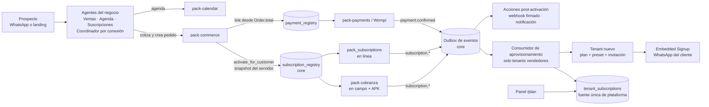

# Arquitectura objetivo: «Planes y suscripciones» como habilidades de los agentes

## Idea central

Cualquier agente del negocio puede **vender planes y cobrarlos cada período** combinando habilidades
(packs) que ya existen y que se le dan al agente, sin código por cliente ([D-35](decisiones.md#d-35--solvershub-vende-agentes): el agente es
lo que se vende; la habilidad es una capacidad que se le da):

| Capacidad | Habilidad que se le da al agente | Qué aporta |
|---|---|---|
| Agendar una demo | `pack-calendar` | Tipo de cita, horario, confirmación y recordatorios con plantilla, aviso al equipo |
| Vender un plan | `pack-commerce` | El plan es una variante con período, prueba, beneficios y código de plan; sin domicilio ni stock |
| Cobrar el período | `pack_subscriptions` **o** `pack-cobranza` | Mismo contrato (D-15): cargo por período, link, avisos, mora |
| Pagar en línea | `pack-payments` | Link de Wompi vía `payment_registry` |
| Dar de alta un negocio | Core (solo para negocios vendedores en la allowlist) | Consumidor de aprovisionamiento |

SolversHub es el primer negocio que usa estos agentes (Ventas, Agenda y Suscripciones, [HU-AOS-22](../04-fase-1-competir/SPEC-26-agent-os/hu/HU-AOS-22-dogfooding-solvershub.md)); un
gimnasio o un colegio usan los mismos agentes, instalados por su preset ([HU-AOS-46](../04-fase-1-competir/SPEC-26-agent-os/hu/HU-AOS-46-presets-v2.md)), sin el último renglón.

## Componentes



## El contrato único de suscripción (D-15, HU-SUB-01)

| Operación | Descripción |
|---|---|
| `activate(customer_id, variant_id, plan_snapshot, reference)` | Crea la suscripción. `plan_snapshot` lo arma el servidor desde la variante (precio, moneda, período, prueba, beneficios, código de plan). Idempotente por `reference` |
| `get(subscription_id)` / `list_for_customer(customer_id)` | Estado, período actual, próximo cargo |
| `pause`, `resume`, `cancel` | Con motivo y quién lo pidió |
| `change_plan(subscription_id, variant_id)` | Upgrade o downgrade con prorrateo simple |
| `charge_link(subscription_id, period)` | Link del período **vencido o en curso**, nunca de uno futuro |

**Estados**: `trialing` → `activa` → `vencida` → (`activa` al pagar) · `pausada` · `cancelada`.

**Eventos** (`tenant_id` en el payload, por el outbox): `subscription.activated`,
`subscription.charge_created`, `subscription.charge_paid`, `subscription.past_due`,
`subscription.paused`, `subscription.cancelled`, `subscription.plan_changed`.

**Tools para el LLM**: un solo juego definido en el core sobre el registro (`sub_consultar`,
`sub_link_pago`, `sub_pausar`, `sub_cancelar`, `sub_cambiar_plan`) que despacha al proveedor del
negocio. Así no conviven `sub_*` y `cob_*_suscripcion` en el mismo prompt.

**Proveedor**: `subscriptions.provider` en la config del negocio (o el preset). Si hay dos packs
proveedores habilitados y no hay elección, el sistema da un error claro y no adivina.

## El recorrido de SolversHub

```mermaid
sequenceDiagram
  autonumber
  actor Pro as Prospecto
  participant Asis as Asistente solvershub
  participant Com as pack-commerce
  participant Pay as pack-payments
  participant Sub as pack_subscriptions
  participant Bus as Outbox
  participant Prov as Aprovisionamiento
  participant Nuevo as Tenant nuevo
  Pro->>Asis: Quiero una demo
  Asis->>Asis: check_availability → create_calendar_event (tipo Demo)
  Asis-->>Pro: Confirmación con plantilla y recordatorio
  Pro->>Asis: Quiero el plan Premium
  Asis->>Com: cotización → confirmar → crear_pedido (sin domicilio)
  Com->>Pay: create_link(Order.total, referencia del pedido)
  Pay-->>Pro: Link de pago
  Pay->>Bus: payment.confirmed (tenant_id, referencia, monto)
  Bus->>Com: pedido pagado (monto validado)
  Com->>Sub: activate(snapshot del servidor)
  Sub->>Bus: subscription.activated (plan_code = premium)
  Bus->>Prov: tenant vendedor en allowlist → crear negocio
  Prov->>Nuevo: tenant + plan premium + preset del vertical + invitación
  Nuevo-->>Pro: Invitación por correo y WhatsApp
  Pro->>Nuevo: Acepta, primeros pasos, Embedded Signup
  Note over Sub,Nuevo: Cada período: cargo + link + plantilla; el pago por asistente o por /plan<br/>actualiza la misma tenant_subscriptions (D-13)
```

**Free (D-16)**: el pedido de Free se confirma sin link; la suscripción nace en `trialing` con
vencimiento a 30 días; el aprovisionamiento corre igual.

## Dos canales de cobro con una sola verdad (D-13, HU-SH-04)

| Elemento | Diseño |
|---|---|
| Fuente única | `tenant_subscriptions` del negocio nuevo (core), la que lee el enforcement |
| Referencia del período | `plat-<slug>-<AAAAMM>`, compartida por los dos canales: un mismo período nunca se cobra dos veces |
| Canal asistente | La suscripción del cliente dentro del tenant `solvershub` genera el cargo y el link; al pagarse, un evento aplica el pago a `tenant_subscriptions` |
| Canal panel | `/plan` usa `core/billing`; al pagarse, la **sincronización inversa** marca pagado el cargo del canal asistente para que nadie lo persiga |
| Conciliación | Job diario que compara ambos lados y alerta diferencias |

## ADR que hay que escribir

| ADR | Spec |
|---|---|
| Suscripciones v1: contrato único, proveedores, estados y eventos (enmienda ADR-0082 y ADR-0083) | SPEC-06 |
| Eventos de dominio durables (outbox) | SPEC-06 |
| Errores de negocio frente a fallas de pack (enmienda ADR-0024) | [SPEC-02](../03-fase-0-go-live/SPEC-02-agente-confiable/spec.md) |
| Identidad de servicio y aprovisionamiento automático | [SPEC-07](../03-fase-0-go-live/SPEC-07-asistente-solvershub/spec.md) |
| Dos canales de cobro de plataforma | [SPEC-07](../03-fase-0-go-live/SPEC-07-asistente-solvershub/spec.md) |
| Presets de agente | [SPEC-05](../03-fase-0-go-live/SPEC-05-presets-y-flujos/spec.md) |
| Billing v2 por créditos (enmienda ADR-0008 y ADR-0045) | SPEC-03 |
| Procesamiento de media en el core | [SPEC-04](../03-fase-0-go-live/SPEC-04-notas-de-voz-y-comprobantes/spec.md) |
| Transición de nombres `solvershub-*` | [SPEC-00](../03-fase-0-go-live/SPEC-00-reestructuracion/spec.md) |
| Editor de flujo (supersede ADR-0054 §5) — parqueada por D-35: lo útil vive en los procedimientos y superpoderes de [SPEC-26](../04-fase-1-competir/SPEC-26-agent-os/spec.md) | [SPEC-15](../04-fase-1-competir/SPEC-15-editor-visual-de-flujo/spec.md) |

**Enmienda a ADR-0082 (cobranza)**: la suscripción de cobranza necesita que `Cuota` y `Pago`
funcionen sin préstamo. Dos opciones, decididas en HU-SUB-15:

| Opción | Pros | Contras |
|---|---|---|
| A. Modalidad en `Cartera` (lo que dice ADR-0082) con `prestamo_id` opcional | Modelo explícito | Rompe la APK, que asume préstamo en todas las vistas (`api_gestor.py:923-1047,1468-1500`) |
| **B. "Préstamo rodante"**: una suscripción es un préstamo abierto, 0 % de interés, una cuota por período | La APK, la mora, la caja y los KPIs funcionan sin cambios | Semántica menos obvia; hay que ocultar intereses y saldo total |
