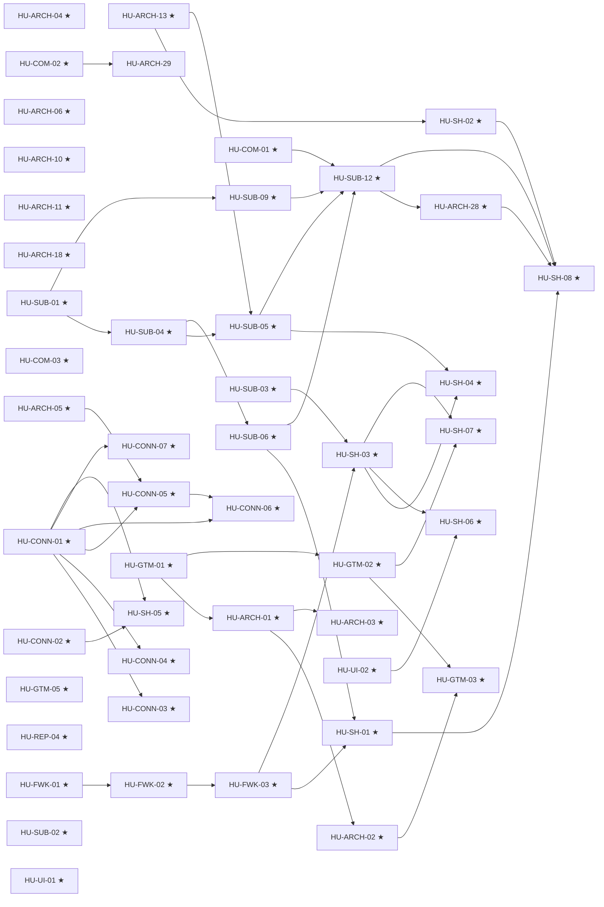

# Fase 0 · Go-live: SolversHub vende, cobra y da de alta solo (P0)

**Objetivo**: llevar SolversHub a producción con confianza y demostrarlo con su propio negocio:
el asistente de SolversHub vende, cobra y da de alta clientes sin intervención humana, y los dos
verticales (comercio y cobranza) tienen su primer cliente de pago.

La fase se parte en dos hitos (D-18):

| Hito | Nombre | HU | Días-persona sin IA | Rango de fin |
|---|---|---:|---:|---|
| **0A** | "SolversHub vende y cobra solo" | 46 | 174,5 | 2027-01-03 – 2027-02-18 |
| **0B** | "Go-live amplio" | 48 | 196 | 2027-03-29 – 2027-07-05 |

Fechas y supuestos en [calendario-estimado.md](../02-vision-y-decisiones/calendario-estimado.md).

## Criterio de salida del Hito 0A

Un prospecto real recorre todo el flujo **sin intervención humana** y deja evidencia auditada:

1. agenda una demo con el asistente de SolversHub;
2. compra un plan;
3. paga el primer período (Free se confirma sin cobro, D-16);
4. su negocio se crea solo, con su plan, el preset de su vertical y una invitación;
5. conecta su WhatsApp por Embedded Signup;
6. al final del período su suscripción genera el cobro siguiente con el proveedor elegido (D-15) y el
   aviso le llega por plantilla.

Además: golden E2E del asistente ≥95 % durante 3 noches; producción fuera de la máquina de
desarrollo con restauración probada; ningún defecto 🔴 abierto en suscripciones, comercio o
Conexiones.

**Por qué el 0A tiene 46 HU y no 41**: la lista base del plan (41 HU) arrastra cinco dependencias que
también tienen que estar listas: la composición de flujos y los presets ([HU-FWK-01](SPEC-05-presets-y-flujos/hu/HU-FWK-01-composicion-de-flujos.md) a 03, sin ellos no
hay alta con preset ni tenant reproducible), el borde TLS de producción ([HU-ARCH-02](SPEC-01-produccion-segura/hu/HU-ARCH-02-borde-tls-y-webhook-prod.md), sin él no hay
WhatsApp en producción) y el WhatsApp verificado de Roshi (HU-GTM-03, el canal por el que llega el
prospecto).

## Criterio de salida del Hito 0B

- 1 cliente de pago de comercio (restaurante o retail) y 1 de cobranza, en producción.
- Alta en menos de 1 día.
- Billing por créditos descontando y bloqueando de forma auditable.
- Notas de voz y comprobantes procesados.
- Golden sets por vertical ≥95 % durante 3 noches.

## Orden sugerido dentro del Hito 0A

| Ola | Para qué | HU |
|---|---|---|
| **1 · Urgente y barato** (primeras 2 semanas) | Quitar riesgos que hoy pueden romper la operación o el cobro | [HU-ARCH-10](SPEC-02-agente-confiable/hu/HU-ARCH-10-modelos-deepseek-vigentes.md), [HU-ARCH-11](SPEC-02-agente-confiable/hu/HU-ARCH-11-un-mensaje-por-defecto.md), [HU-ARCH-18](SPEC-02-agente-confiable/hu/HU-ARCH-18-errores-de-negocio-no-apagan-packs.md), [HU-ARCH-05](SPEC-01-produccion-segura/hu/HU-ARCH-05-webhook-fail-closed.md), [HU-REP-04](SPEC-00-reestructuracion/hu/HU-REP-04-sin-fugas-de-marca-tecnica.md), [HU-UI-01](SPEC-10-panel-confiable/hu/HU-UI-01-bugs-visibles.md), [HU-CONN-02](SPEC-08-conexion-whatsapp-meta/hu/HU-CONN-02-errores-500-y-bloqueos.md), [HU-COM-01](SPEC-09-comercio-confiable/hu/HU-COM-01-dinero-en-el-servidor.md), [HU-COM-02](SPEC-09-comercio-confiable/hu/HU-COM-02-guardrails-correctos.md), HU-SUB-02, HU-GTM-05, HU-GTM-01 |
| **2 · Fundamentos** | Lo que el resto necesita | [HU-ARCH-04](SPEC-01-produccion-segura/hu/HU-ARCH-04-endurecer-acceso.md), [HU-ARCH-06](SPEC-01-produccion-segura/hu/HU-ARCH-06-consumer-y-dlq.md), [HU-ARCH-13](SPEC-02-agente-confiable/hu/HU-ARCH-13-plantillas-fuera-de-24h.md), HU-SUB-01, HU-SUB-03, [HU-FWK-01](SPEC-05-presets-y-flujos/hu/HU-FWK-01-composicion-de-flujos.md), [HU-FWK-02](SPEC-05-presets-y-flujos/hu/HU-FWK-02-adr-presets.md), [HU-CONN-01](SPEC-08-conexion-whatsapp-meta/hu/HU-CONN-01-credenciales-por-conexion.md), [HU-COM-03](SPEC-09-comercio-confiable/hu/HU-COM-03-numeracion-y-datos-por-producto.md), [HU-UI-02](SPEC-10-panel-confiable/hu/HU-UI-02-kit-de-feedback.md), HU-GTM-02, [HU-ARCH-01](SPEC-01-produccion-segura/hu/HU-ARCH-01-produccion-fuera-de-dev.md) |
| **3 · Capacidades** | Cobrar, conectar y demostrar | HU-SUB-04, HU-SUB-09, HU-SUB-06, HU-SUB-05, [HU-FWK-03](SPEC-05-presets-y-flujos/hu/HU-FWK-03-registro-de-presets-y-seeds.md), [HU-CONN-03](SPEC-08-conexion-whatsapp-meta/hu/HU-CONN-03-ciclo-de-vida-seguro.md) a [HU-CONN-07](SPEC-08-conexion-whatsapp-meta/hu/HU-CONN-07-checklist-produccion-real.md), [HU-ARCH-02](SPEC-01-produccion-segura/hu/HU-ARCH-02-borde-tls-y-webhook-prod.md), [HU-ARCH-03](SPEC-01-produccion-segura/hu/HU-ARCH-03-backups-pitr-y-restauracion.md), [HU-SH-01](SPEC-07-asistente-solvershub/hu/HU-SH-01-tenant-reproducible.md), [HU-SH-02](SPEC-07-asistente-solvershub/hu/HU-SH-02-demo-de-punta-a-punta.md), [HU-SH-05](SPEC-07-asistente-solvershub/hu/HU-SH-05-embedded-signup-real.md), HU-GTM-03 |
| **4 · Alta automática y cierre** | Vender y dar de alta solo, medido | [HU-SH-03](SPEC-07-asistente-solvershub/hu/HU-SH-03-aprovisionamiento-automatico.md), [HU-SH-04](SPEC-07-asistente-solvershub/hu/HU-SH-04-cobro-de-plataforma-dos-canales.md), [HU-SH-06](SPEC-07-asistente-solvershub/hu/HU-SH-06-onboarding-autoservicio.md), [HU-SH-07](SPEC-07-asistente-solvershub/hu/HU-SH-07-antiabuso-y-cumplimiento.md), HU-SUB-12, [HU-SH-08](SPEC-07-asistente-solvershub/hu/HU-SH-08-golden-set-asistente.md) |

El checklist de cada ola, con las skills recomendadas por HU, está en la [guía de ejecución](../07-guia-de-ejecucion.md#61-hito-0a--solvershub-vende-y-cobra-solo).

**Trámites externos desde el día 1**: verificación de Roshi en Meta, App Review de Tech Provider,
revisión del abogado (ver plazos en el calendario).

## Specs de la fase

| Spec | Tema | HU | 0A | 0B |
|---|---|---:|---:|---:|
| [SPEC-00](SPEC-00-reestructuracion/spec.md) | Reestructuración `solvershub-<section>` | 6 | 1 | 5 |
| [SPEC-01](SPEC-01-produccion-segura/spec.md) | Producción segura y confiable | 9 | 6 | 3 |
| [SPEC-02](SPEC-02-agente-confiable/spec.md) | Agente confiable, calidad ≥95 % | 9 | 4 | 5 |
| SPEC-03 | Billing v2 por créditos | 8 | 0 | 8 |
| [SPEC-04](SPEC-04-notas-de-voz-y-comprobantes/spec.md) | Notas de voz y comprobantes | 6 | 0 | 6 |
| [SPEC-05](SPEC-05-presets-y-flujos/spec.md) | Presets y flujos multi-pack | 3 | 3 | 0 |
| SPEC-06 | Planes y suscripciones (superpoder) | 15 | 8 | 7 |
| [SPEC-07](SPEC-07-asistente-solvershub/spec.md) | Asistente SolversHub | 9 | 8 | 1 |
| [SPEC-08](SPEC-08-conexion-whatsapp-meta/spec.md) | Conexión WhatsApp-Meta efectiva | 10 | 7 | 3 |
| [SPEC-09](SPEC-09-comercio-confiable/spec.md) | Comercio confiable | 9 | 3 | 6 |
| [SPEC-10](SPEC-10-panel-confiable/spec.md) | Panel confiable | 4 | 2 | 2 |
| SPEC-11 | Lanzamiento comercial y legal | 6 | 4 | 2 |

<!-- GENERADO:inicio -->
## HU del Hito 0A (48)

| HU | Título | Est. | Depende de | Impacto |
|---|---|---|---|---|
| [HU-REP-04](SPEC-00-reestructuracion/hu/HU-REP-04-sin-fugas-de-marca-tecnica.md) ★ | Sin marca técnica ante el cliente | S | — | 🛡️ 🏆 |
| [HU-ARCH-01](SPEC-01-produccion-segura/hu/HU-ARCH-01-produccion-fuera-de-dev.md) ★ | Producción fuera de la máquina de desarrollo, con panel y landing | L | HU-GTM-01 | 🛡️ ⚙️ |
| [HU-ARCH-02](SPEC-01-produccion-segura/hu/HU-ARCH-02-borde-tls-y-webhook-prod.md) ★ | Borde TLS y webhook de Meta de producción verificados | S | [HU-ARCH-01](SPEC-01-produccion-segura/hu/HU-ARCH-01-produccion-fuera-de-dev.md) | 🛡️ |
| [HU-ARCH-03](SPEC-01-produccion-segura/hu/HU-ARCH-03-backups-pitr-y-restauracion.md) ★ | Backups WAL/PITR fuera del sitio y restauración probada | M | [HU-ARCH-01](SPEC-01-produccion-segura/hu/HU-ARCH-01-produccion-fuera-de-dev.md) | 🛡️ ⚖️ |
| [HU-ARCH-04](SPEC-01-produccion-segura/hu/HU-ARCH-04-endurecer-acceso.md) ★ | Endurecer el acceso al panel, la API y la API de campo | M | — | 🛡️ ⚖️ |
| [HU-ARCH-05](SPEC-01-produccion-segura/hu/HU-ARCH-05-webhook-fail-closed.md) ★ | Webhook fail-closed sin firma no se procesa | S | — | 🛡️ |
| [HU-ARCH-06](SPEC-01-produccion-segura/hu/HU-ARCH-06-consumer-y-dlq.md) ★ | Consumer con reclamo de pendientes y DLQ alcanzable | M | — | 🛡️ 🤖 |
| [HU-ARCH-10](SPEC-02-agente-confiable/hu/HU-ARCH-10-modelos-deepseek-vigentes.md) ★ | Modelos de DeepSeek vigentes y verificados | S | — | 🤖 🛡️ |
| [HU-ARCH-11](SPEC-02-agente-confiable/hu/HU-ARCH-11-un-mensaje-por-defecto.md) ★ | Una burbuja por respuesta por defecto y estilo editable | S | — | 💰 🛡️ |
| [HU-ARCH-13](SPEC-02-agente-confiable/hu/HU-ARCH-13-plantillas-fuera-de-24h.md) ★ | Plantillas de WhatsApp fuera de la ventana de 24 horas | M | — | 💰 ⚙️ |
| [HU-ARCH-18](SPEC-02-agente-confiable/hu/HU-ARCH-18-errores-de-negocio-no-apagan-packs.md) ★ | Un error de negocio nunca apaga una habilidad | M | — | 🛡️ 🤖 |
| [HU-ARCH-28](SPEC-02-agente-confiable/hu/HU-ARCH-28-evals-de-consistencia-pass-k.md) ★ | Evals de consistencia: usuario simulado, aserciones de estado y pass^k | L | HU-SUB-12 | 🤖 🛡️ |
| [HU-ARCH-29](SPEC-02-agente-confiable/hu/HU-ARCH-29-verificador-de-afirmaciones.md) | Verificador de afirmaciones con modelo de evidencia | M | [HU-COM-02](SPEC-09-comercio-confiable/hu/HU-COM-02-guardrails-correctos.md) | 🤖 🛡️ 💰 |
| [HU-FWK-01](SPEC-05-presets-y-flujos/hu/HU-FWK-01-composicion-de-flujos.md) ★ | Composición correcta de flujos multi-pack | M | — | 🤖 ⚙️ |
| [HU-FWK-02](SPEC-05-presets-y-flujos/hu/HU-FWK-02-adr-presets.md) ★ | ADR de presets de agente | S | [HU-FWK-01](SPEC-05-presets-y-flujos/hu/HU-FWK-01-composicion-de-flujos.md) | 🏆 ⚙️ |
| [HU-FWK-03](SPEC-05-presets-y-flujos/hu/HU-FWK-03-registro-de-presets-y-seeds.md) ★ | Registro de presets, seeds por pack y alta sin fallas | M | [HU-FWK-02](SPEC-05-presets-y-flujos/hu/HU-FWK-02-adr-presets.md) | 🏆 ⚙️ |
| HU-SUB-01 ★ | ADR Suscripciones v1 con contrato único y tools del core | M | — | 💰 🏆 |
| HU-SUB-02 ★ | Corregir el pago en línea de cuotas de suscripción en cobranza | S | — | 💰 🛡️ |
| HU-SUB-03 ★ | Eventos de dominio durables con outbox | L | — | 💰 🛡️ |
| HU-SUB-04 ★ | Ciclo de vida correcto de la suscripción | M | HU-SUB-01 | 💰 🛡️ |
| HU-SUB-05 ★ | Cobro y mora con avisos por plantilla | M | HU-SUB-04, [HU-ARCH-13](SPEC-02-agente-confiable/hu/HU-ARCH-13-plantillas-fuera-de-24h.md) | 💰 |
| HU-SUB-06 ★ | Free con prueba y planes pagos desde el primer día | M | HU-SUB-04 | 💰 🛡️ |
| HU-SUB-09 ★ | Comercio agnóstico al proveedor de suscripciones | S | HU-SUB-01 | 🏆 |
| HU-SUB-12 ★ | Golden set y journeys E2E multi-turno de suscripciones | M | HU-SUB-05, HU-SUB-06, HU-SUB-09, [HU-COM-01](SPEC-09-comercio-confiable/hu/HU-COM-01-dinero-en-el-servidor.md) | 🤖 💰 |
| [HU-SH-01](SPEC-07-asistente-solvershub/hu/HU-SH-01-tenant-reproducible.md) ★ | Tenant solvershub reproducible y coherente | M | [HU-FWK-03](SPEC-05-presets-y-flujos/hu/HU-FWK-03-registro-de-presets-y-seeds.md), HU-SUB-06 | 💰 🛡️ |
| [HU-SH-02](SPEC-07-asistente-solvershub/hu/HU-SH-02-demo-de-punta-a-punta.md) ★ | Demo agendada de punta a punta | L | [HU-ARCH-13](SPEC-02-agente-confiable/hu/HU-ARCH-13-plantillas-fuera-de-24h.md) | 💰 🛡️ |
| [HU-SH-03](SPEC-07-asistente-solvershub/hu/HU-SH-03-aprovisionamiento-automatico.md) ★ | Identidad de servicio y aprovisionamiento automático de negocios | L | HU-SUB-03, [HU-FWK-03](SPEC-05-presets-y-flujos/hu/HU-FWK-03-registro-de-presets-y-seeds.md) | 💰 ⚙️ |
| [HU-SH-04](SPEC-07-asistente-solvershub/hu/HU-SH-04-cobro-de-plataforma-dos-canales.md) ★ | Cobro de plataforma por dos canales con fuente única | L | [HU-SH-03](SPEC-07-asistente-solvershub/hu/HU-SH-03-aprovisionamiento-automatico.md), HU-SUB-05 | 💰 🛡️ |
| [HU-SH-05](SPEC-07-asistente-solvershub/hu/HU-SH-05-embedded-signup-real.md) ★ | Embedded Signup real en el panel nuevo | L | [HU-CONN-01](SPEC-08-conexion-whatsapp-meta/hu/HU-CONN-01-credenciales-por-conexion.md), [HU-CONN-02](SPEC-08-conexion-whatsapp-meta/hu/HU-CONN-02-errores-500-y-bloqueos.md) | 💰 🏆 |
| [HU-SH-06](SPEC-07-asistente-solvershub/hu/HU-SH-06-onboarding-autoservicio.md) ★ | Onboarding autoservicio desde la invitación hasta el primer mensaje | L | [HU-SH-03](SPEC-07-asistente-solvershub/hu/HU-SH-03-aprovisionamiento-automatico.md), [HU-UI-02](SPEC-10-panel-confiable/hu/HU-UI-02-kit-de-feedback.md) | 💰 🏆 |
| [HU-SH-07](SPEC-07-asistente-solvershub/hu/HU-SH-07-antiabuso-y-cumplimiento.md) ★ | Antiabuso y cumplimiento del alta automática | M | [HU-SH-03](SPEC-07-asistente-solvershub/hu/HU-SH-03-aprovisionamiento-automatico.md), HU-GTM-02 | 🛡️ ⚖️ |
| [HU-SH-08](SPEC-07-asistente-solvershub/hu/HU-SH-08-golden-set-asistente.md) ★ | Golden set E2E del asistente SolversHub y canary | M | [HU-SH-01](SPEC-07-asistente-solvershub/hu/HU-SH-01-tenant-reproducible.md), [HU-SH-02](SPEC-07-asistente-solvershub/hu/HU-SH-02-demo-de-punta-a-punta.md), HU-SUB-12, [HU-ARCH-28](SPEC-02-agente-confiable/hu/HU-ARCH-28-evals-de-consistencia-pass-k.md) | 🤖 💰 |
| [HU-CONN-01](SPEC-08-conexion-whatsapp-meta/hu/HU-CONN-01-credenciales-por-conexion.md) ★ | Resolver de credenciales por conexión con origen guardado | M | — | 🛡️ ⚙️ |
| [HU-CONN-02](SPEC-08-conexion-whatsapp-meta/hu/HU-CONN-02-errores-500-y-bloqueos.md) ★ | Errores 500 y bloqueos de Conexiones | S | — | 🛡️ |
| [HU-CONN-03](SPEC-08-conexion-whatsapp-meta/hu/HU-CONN-03-ciclo-de-vida-seguro.md) ★ | Ciclo de vida seguro de las conexiones | M | [HU-CONN-01](SPEC-08-conexion-whatsapp-meta/hu/HU-CONN-01-credenciales-por-conexion.md) | 🛡️ ⚖️ |
| [HU-CONN-04](SPEC-08-conexion-whatsapp-meta/hu/HU-CONN-04-diagnostico-confiable.md) ★ | Diagnóstico confiable de la conexión | S | [HU-CONN-01](SPEC-08-conexion-whatsapp-meta/hu/HU-CONN-01-credenciales-por-conexion.md) | 🛡️ ⚙️ |
| [HU-CONN-05](SPEC-08-conexion-whatsapp-meta/hu/HU-CONN-05-webhook-por-conexion.md) ★ | Webhook y secreto por conexión | M | [HU-CONN-01](SPEC-08-conexion-whatsapp-meta/hu/HU-CONN-01-credenciales-por-conexion.md), [HU-ARCH-05](SPEC-01-produccion-segura/hu/HU-ARCH-05-webhook-fail-closed.md) | 🛡️ |
| [HU-CONN-06](SPEC-08-conexion-whatsapp-meta/hu/HU-CONN-06-byok-produccion.md) ★ | BYOK de producción con registro de número y promoción | M | [HU-CONN-01](SPEC-08-conexion-whatsapp-meta/hu/HU-CONN-01-credenciales-por-conexion.md), [HU-CONN-05](SPEC-08-conexion-whatsapp-meta/hu/HU-CONN-05-webhook-por-conexion.md) | 💰 🛡️ |
| [HU-CONN-07](SPEC-08-conexion-whatsapp-meta/hu/HU-CONN-07-checklist-produccion-real.md) ★ | Checklist de producción real | M | [HU-CONN-01](SPEC-08-conexion-whatsapp-meta/hu/HU-CONN-01-credenciales-por-conexion.md) | 🛡️ ⚙️ |
| [HU-COM-01](SPEC-09-comercio-confiable/hu/HU-COM-01-dinero-en-el-servidor.md) ★ | El dinero del pedido se calcula en el servidor | S | — | 💰 🛡️ |
| [HU-COM-02](SPEC-09-comercio-confiable/hu/HU-COM-02-guardrails-correctos.md) ★ | Guardrails de montos y de cierre correctos | S | — | 🤖 💰 |
| [HU-COM-03](SPEC-09-comercio-confiable/hu/HU-COM-03-numeracion-y-datos-por-producto.md) ★ | Numeración única y datos del cliente según el tipo de producto | M | — | 🛡️ ⚖️ |
| [HU-UI-01](SPEC-10-panel-confiable/hu/HU-UI-01-bugs-visibles.md) ★ | Lote de bugs visibles del panel | S | — | 🛡️ |
| [HU-UI-02](SPEC-10-panel-confiable/hu/HU-UI-02-kit-de-feedback.md) ★ | Kit de feedback, confirmaciones y etiquetas legibles | M | — | 🛡️ ⚙️ |
| HU-GTM-01 ★ | Datos de negocio, dominio y fee de implementación | S | — | ⚖️ 💰 |
| HU-GTM-02 ★ | Legal v2 revisado por abogado y publicado | M | HU-GTM-01 | ⚖️ 🛡️ |
| HU-GTM-03 ★ | WhatsApp de Roshi verificado y asistente SolversHub en producción | M | [HU-ARCH-02](SPEC-01-produccion-segura/hu/HU-ARCH-02-borde-tls-y-webhook-prod.md), HU-GTM-02 | 💰 🛡️ |
| HU-GTM-05 ★ | Claims honestos en landing, playbooks y material comercial | S | — | ⚖️ 🛡️ |

### Dependencias dentro del Hito 0A

## HU del Hito 0B (49)

| HU | Título | Est. | Depende de | Impacto |
|---|---|---|---|---|
| [HU-REP-01](SPEC-00-reestructuracion/hu/HU-REP-01-limpiar-residuos.md) | Limpiar residuos de la reestructura | S | — | ⚙️ |
| [HU-REP-02](SPEC-00-reestructuracion/hu/HU-REP-02-renombre-cosmetico.md) | Renombre cosmético a solvershub-core y documentación correcta | M | [HU-REP-01](SPEC-00-reestructuracion/hu/HU-REP-01-limpiar-residuos.md) | ⚙️ |
| [HU-REP-03](SPEC-00-reestructuracion/hu/HU-REP-03-transicion-de-identificadores.md) | Transición de identificadores rompedores con alias y ADR | M | [HU-REP-02](SPEC-00-reestructuracion/hu/HU-REP-02-renombre-cosmetico.md) | ⚙️ |
| [HU-REP-05](SPEC-00-reestructuracion/hu/HU-REP-05-repo-solvershub-docs.md) | Repo solvershub-docs con CI y regla un tema, un dueño | S | — | ⚙️ |
| [HU-REP-06](SPEC-00-reestructuracion/hu/HU-REP-06-solvershub-infra.md) ★ | solvershub-infra versionado como base de recuperación ante desastres | M | — | 🛡️ ⚙️ |
| [HU-ARCH-07](SPEC-01-produccion-segura/hu/HU-ARCH-07-observabilidad-prod.md) ★ | Observabilidad de producción con alertas | M | [HU-ARCH-01](SPEC-01-produccion-segura/hu/HU-ARCH-01-produccion-fuera-de-dev.md) | 🛡️ ⚙️ |
| [HU-ARCH-08](SPEC-01-produccion-segura/hu/HU-ARCH-08-apk-a-produccion.md) ★ | APK de cobranza lista para producción | M | [HU-ARCH-02](SPEC-01-produccion-segura/hu/HU-ARCH-02-borde-tls-y-webhook-prod.md) | 🛡️ 🏆 |
| [HU-ARCH-09](SPEC-01-produccion-segura/hu/HU-ARCH-09-release-y-e2e-entre-repos.md) | Release y pruebas E2E entre repos antes de promover a producción | M | [HU-ARCH-01](SPEC-01-produccion-segura/hu/HU-ARCH-01-produccion-fuera-de-dev.md) | 🛡️ ⚙️ |
| [HU-ARCH-12](SPEC-02-agente-confiable/hu/HU-ARCH-12-precondiciones-y-escalate.md) ★ | Precondiciones terminales, señal escalate y scopes en tools de pago | M | — | 🤖 🛡️ |
| [HU-ARCH-14](SPEC-02-agente-confiable/hu/HU-ARCH-14-playground-sandbox.md) | Probar asistente sin efectos reales | M | — | 🛡️ 🤖 |
| [HU-ARCH-15](SPEC-02-agente-confiable/hu/HU-ARCH-15-cache-anthropic.md) | Caché de Anthropic con como máximo 4 breakpoints | S | — | 🤖 |
| [HU-ARCH-16](SPEC-02-agente-confiable/hu/HU-ARCH-16-golden-set-comercio.md) ★ | Golden set y journeys multi-turno de comercio | L | [HU-COM-01](SPEC-09-comercio-confiable/hu/HU-COM-01-dinero-en-el-servidor.md), [HU-COM-02](SPEC-09-comercio-confiable/hu/HU-COM-02-guardrails-correctos.md), [HU-FWK-01](SPEC-05-presets-y-flujos/hu/HU-FWK-01-composicion-de-flujos.md), HU-SUB-12 | 🤖 💰 |
| [HU-ARCH-17](SPEC-02-agente-confiable/hu/HU-ARCH-17-golden-set-cobranza.md) ★ | Golden set de cobranza | L | [HU-ARCH-13](SPEC-02-agente-confiable/hu/HU-ARCH-13-plantillas-fuera-de-24h.md), [HU-FWK-01](SPEC-05-presets-y-flujos/hu/HU-FWK-01-composicion-de-flujos.md), HU-SUB-12 | 🤖 💰 |
| HU-BILL-01 ★ | Calibración del consumo real y precios vigentes de proveedores | S | [HU-ARCH-10](SPEC-02-agente-confiable/hu/HU-ARCH-10-modelos-deepseek-vigentes.md) | 💰 |
| HU-BILL-02 ★ | ADR Billing v2 por créditos | M | HU-BILL-01 | 💰 🛡️ |
| HU-BILL-03 ★ | Tarifario versionado con ciclo de vida de modelos y costeo exacto | M | HU-BILL-02 | 💰 🛡️ |
| HU-BILL-04 ★ | Ledger multi-concepto con créditos inmutables e idempotencia | M | HU-BILL-03 | 💰 🛡️ |
| HU-BILL-05 ★ | Planes v2 con créditos y límites estructurales | M | HU-BILL-02, HU-BILL-04 | 💰 |
| HU-BILL-06 ★ | Enforcement de créditos y límites con colchón de gracia | L | HU-BILL-05 | 💰 🛡️ |
| HU-BILL-07 ★ | Panel Plan y créditos con saldo, proyección y desglose | M | HU-BILL-06 | 💰 🏆 |
| HU-BILL-08 ★ | Página de precios v2 alimentada por el core | M | HU-BILL-05 | 💰 🛡️ |
| [HU-MEDIA-01](SPEC-04-notas-de-voz-y-comprobantes/hu/HU-MEDIA-01-adr-media.md) ★ | ADR de procesamiento de media en el core | S | — | 🤖 ⚖️ |
| [HU-MEDIA-02](SPEC-04-notas-de-voz-y-comprobantes/hu/HU-MEDIA-02-almacenamiento-media.md) ★ | Descarga y almacenamiento de media entrante | M | [HU-MEDIA-01](SPEC-04-notas-de-voz-y-comprobantes/hu/HU-MEDIA-01-adr-media.md) | 🤖 ⚙️ |
| [HU-MEDIA-03](SPEC-04-notas-de-voz-y-comprobantes/hu/HU-MEDIA-03-stt-notas-de-voz.md) ★ | Notas de voz a texto con llave híbrida | M | [HU-MEDIA-02](SPEC-04-notas-de-voz-y-comprobantes/hu/HU-MEDIA-02-almacenamiento-media.md), HU-BILL-04 | 🤖 🏆 |
| [HU-MEDIA-04](SPEC-04-notas-de-voz-y-comprobantes/hu/HU-MEDIA-04-dispatcher-de-vision.md) ★ | Dispatcher de visión con prueba de conexión y benchmark | M | [HU-MEDIA-02](SPEC-04-notas-de-voz-y-comprobantes/hu/HU-MEDIA-02-almacenamiento-media.md), HU-BILL-04 | 🤖 |
| [HU-MEDIA-05](SPEC-04-notas-de-voz-y-comprobantes/hu/HU-MEDIA-05-ocr-comprobantes.md) ★ | OCR de comprobantes en la ruta financiera | L | [HU-MEDIA-04](SPEC-04-notas-de-voz-y-comprobantes/hu/HU-MEDIA-04-dispatcher-de-vision.md), [HU-COM-06](SPEC-09-comercio-confiable/hu/HU-COM-06-operacion-de-pagos.md) | 💰 ⚙️ |
| [HU-MEDIA-06](SPEC-04-notas-de-voz-y-comprobantes/hu/HU-MEDIA-06-clasificacion-de-imagenes.md) | Clasificación de imágenes y descripción de producto | M | [HU-MEDIA-04](SPEC-04-notas-de-voz-y-comprobantes/hu/HU-MEDIA-04-dispatcher-de-vision.md) | 🤖 💰 |
| HU-SUB-07 ★ | Cambio de plan e idempotencia por pedido | M | HU-SUB-04 | 💰 |
| HU-SUB-08 ★ | Administración de suscripciones en API y panel | M | HU-SUB-01 | ⚙️ 💰 |
| HU-SUB-10 | Recurrencia de planes editable en API, panel y CSV | M | HU-SUB-01 | ⚙️ |
| HU-SUB-11 | Seeds por pack y preset Planes y suscripciones | M | [HU-FWK-03](SPEC-05-presets-y-flujos/hu/HU-FWK-03-registro-de-presets-y-seeds.md), HU-SUB-06 | 🏆 💰 |
| HU-SUB-13 | Cobros por debajo del mínimo de Wompi | M | HU-SUB-04, [HU-MEDIA-05](SPEC-04-notas-de-voz-y-comprobantes/hu/HU-MEDIA-05-ocr-comprobantes.md) | 💰 |
| HU-SUB-14 | Acciones post-activación configurables | M | HU-SUB-03 | 🏆 ⚙️ |
| HU-SUB-15 | Cobranza como segundo proveedor del contrato de suscripción | L | HU-SUB-01, HU-SUB-02, HU-SUB-04 | 🏆 💰 |
| HU-SUB-18 | Avisos de cobro en horario legal | S | HU-SUB-05 | ⚖️ 🛡️ |
| [HU-SH-09](SPEC-07-asistente-solvershub/hu/HU-SH-09-landing-con-atribucion.md) | De la landing al asistente con atribución | S | [HU-SH-01](SPEC-07-asistente-solvershub/hu/HU-SH-01-tenant-reproducible.md) | 💰 |
| [HU-CONN-08](SPEC-08-conexion-whatsapp-meta/hu/HU-CONN-08-lista-y-hub-meta.md) | Lista de conexiones v2 y hub de WhatsApp-Meta | L | [HU-CONN-03](SPEC-08-conexion-whatsapp-meta/hu/HU-CONN-03-ciclo-de-vida-seguro.md), [HU-CONN-04](SPEC-08-conexion-whatsapp-meta/hu/HU-CONN-04-diagnostico-confiable.md), [HU-SH-05](SPEC-07-asistente-solvershub/hu/HU-SH-05-embedded-signup-real.md), [HU-UI-02](SPEC-10-panel-confiable/hu/HU-UI-02-kit-de-feedback.md) | 🏆 ⚙️ |
| [HU-CONN-09](SPEC-08-conexion-whatsapp-meta/hu/HU-CONN-09-costos-meta-verificables.md) | Costos de Meta verificables y opcionales por conexión | M | [HU-CONN-01](SPEC-08-conexion-whatsapp-meta/hu/HU-CONN-01-credenciales-por-conexion.md), [HU-CONN-08](SPEC-08-conexion-whatsapp-meta/hu/HU-CONN-08-lista-y-hub-meta.md) | 🏆 🛡️ |
| [HU-CONN-10](SPEC-08-conexion-whatsapp-meta/hu/HU-CONN-10-conexiones-no-meta.md) | Arreglos de conexiones que no son de Meta | S | — | 🛡️ |
| [HU-COM-04](SPEC-09-comercio-confiable/hu/HU-COM-04-barrido-de-defectos.md) | Barrido de defectos de comercio D5 a D16 y D18 | M | [HU-COM-01](SPEC-09-comercio-confiable/hu/HU-COM-01-dinero-en-el-servidor.md) | 🛡️ ⚙️ |
| [HU-COM-05](SPEC-09-comercio-confiable/hu/HU-COM-05-estados-del-pedido.md) | Máquina de estados del pedido con avisos y eventos | M | [HU-ARCH-13](SPEC-02-agente-confiable/hu/HU-ARCH-13-plantillas-fuera-de-24h.md), HU-SUB-03, [HU-COM-04](SPEC-09-comercio-confiable/hu/HU-COM-04-barrido-de-defectos.md) | ⚙️ 🛡️ |
| [HU-COM-06](SPEC-09-comercio-confiable/hu/HU-COM-06-operacion-de-pagos.md) | Operación de pagos manuales y comprobantes | M | [HU-COM-05](SPEC-09-comercio-confiable/hu/HU-COM-05-estados-del-pedido.md) | 💰 ⚙️ |
| [HU-COM-07](SPEC-09-comercio-confiable/hu/HU-COM-07-catalogo-menus-y-retail.md) | Catálogo para menús y retail | M | [HU-COM-04](SPEC-09-comercio-confiable/hu/HU-COM-04-barrido-de-defectos.md) | 💰 🏆 |
| [HU-COM-08](SPEC-09-comercio-confiable/hu/HU-COM-08-domicilios.md) | Domicilios con tarifa, zonas, mínimo y horario de pedidos | M | [HU-COM-03](SPEC-09-comercio-confiable/hu/HU-COM-03-numeracion-y-datos-por-producto.md), [HU-COM-07](SPEC-09-comercio-confiable/hu/HU-COM-07-catalogo-menus-y-retail.md) | 💰 ⚙️ |
| [HU-COM-09](SPEC-09-comercio-confiable/hu/HU-COM-09-modificar-pedido.md) | Tools para cancelar y modificar un pedido | M | [HU-COM-05](SPEC-09-comercio-confiable/hu/HU-COM-05-estados-del-pedido.md) | ⚙️ 🤖 |
| [HU-UI-03](SPEC-10-panel-confiable/hu/HU-UI-03-shell.md) | Shell del panel responsive y accesible | M | [HU-UI-02](SPEC-10-panel-confiable/hu/HU-UI-02-kit-de-feedback.md) | 🛡️ ⚙️ |
| [HU-UI-04](SPEC-10-panel-confiable/hu/HU-UI-04-calidad-del-panel.md) | Calidad del panel con tests en CI y control de deriva de la API | M | — | 🛡️ ⚙️ |
| HU-GTM-04 | Kit comercial v2 coherente con créditos y D-16 | S | HU-BILL-05, HU-GTM-05 | 💰 |
| HU-GTM-06 ★ | Primer cliente de pago por vertical en producción | M | [HU-ARCH-07](SPEC-01-produccion-segura/hu/HU-ARCH-07-observabilidad-prod.md), [HU-ARCH-08](SPEC-01-produccion-segura/hu/HU-ARCH-08-apk-a-produccion.md), [HU-ARCH-16](SPEC-02-agente-confiable/hu/HU-ARCH-16-golden-set-comercio.md), [HU-ARCH-17](SPEC-02-agente-confiable/hu/HU-ARCH-17-golden-set-cobranza.md), HU-BILL-06, [HU-MEDIA-05](SPEC-04-notas-de-voz-y-comprobantes/hu/HU-MEDIA-05-ocr-comprobantes.md), [HU-COM-06](SPEC-09-comercio-confiable/hu/HU-COM-06-operacion-de-pagos.md), HU-SUB-15 | 💰 🏆 |
<!-- GENERADO:fin -->
