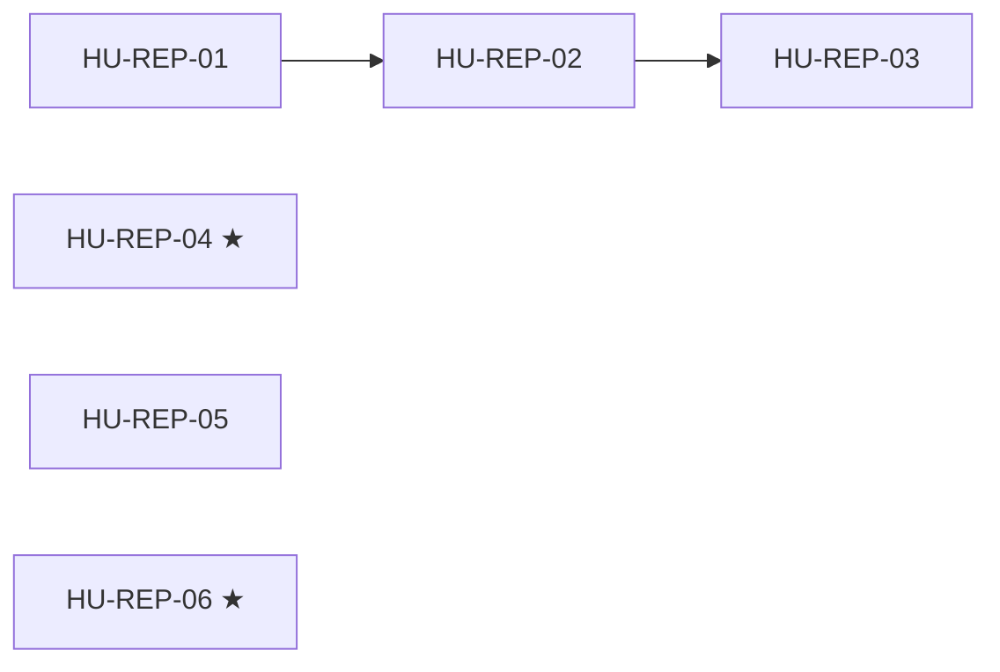

# SPEC-00 · Tareas

| Orden | HU | Título | Tamaño | Depende de | Hito |
|---|---|---|---|---|---|
| 1 | [HU-REP-04](hu/HU-REP-04-sin-fugas-de-marca-tecnica.md) ★ | Sin marca técnica ante el cliente | S | — | 0A |
| 2 | [HU-REP-01](hu/HU-REP-01-limpiar-residuos.md) | Limpiar residuos | S | — | 0B |
| 3 | [HU-REP-05](hu/HU-REP-05-repo-solvershub-docs.md) | Repo `solvershub-docs` | S | — | 0B |
| 4 | [HU-REP-06](hu/HU-REP-06-solvershub-infra.md) ★ | `solvershub-infra` versionado | M | — | 0B |
| 5 | [HU-REP-02](hu/HU-REP-02-renombre-cosmetico.md) | Renombre cosmético y documentación | M | [HU-REP-01](hu/HU-REP-01-limpiar-residuos.md) | 0B |
| 6 | [HU-REP-03](hu/HU-REP-03-transicion-de-identificadores.md) | Transición de identificadores con alias | M | [HU-REP-02](hu/HU-REP-02-renombre-cosmetico.md) | 0B |

**Esfuerzo**: 3 S + 3 M ≈ 16,5 días-persona sin IA.

