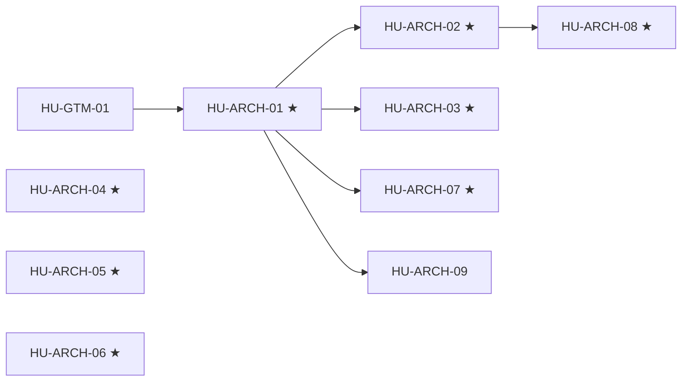

# SPEC-01 · Tareas

| Orden | HU | Título | Tamaño | Depende de | Hito |
|---|---|---|---|---|---|
| 1 | [HU-ARCH-04](hu/HU-ARCH-04-endurecer-acceso.md) ★ | Endurecer el acceso | M | — | 0A |
| 2 | [HU-ARCH-05](hu/HU-ARCH-05-webhook-fail-closed.md) ★ | Webhook fail-closed | S | — | 0A |
| 3 | [HU-ARCH-06](hu/HU-ARCH-06-consumer-y-dlq.md) ★ | Consumer y DLQ | M | — | 0A |
| 4 | [HU-ARCH-01](hu/HU-ARCH-01-produccion-fuera-de-dev.md) ★ | Producción fuera de dev | L | HU-GTM-01 | 0A |
| 5 | [HU-ARCH-02](hu/HU-ARCH-02-borde-tls-y-webhook-prod.md) ★ | Borde TLS y webhook de producción | S | [HU-ARCH-01](hu/HU-ARCH-01-produccion-fuera-de-dev.md) | 0A |
| 6 | [HU-ARCH-03](hu/HU-ARCH-03-backups-pitr-y-restauracion.md) ★ | Backups PITR y restauración | M | [HU-ARCH-01](hu/HU-ARCH-01-produccion-fuera-de-dev.md) | 0A |
| 7 | [HU-ARCH-07](hu/HU-ARCH-07-observabilidad-prod.md) ★ | Observabilidad | M | [HU-ARCH-01](hu/HU-ARCH-01-produccion-fuera-de-dev.md) | 0B |
| 8 | [HU-ARCH-09](hu/HU-ARCH-09-release-y-e2e-entre-repos.md) | Release y E2E entre repos | M | [HU-ARCH-01](hu/HU-ARCH-01-produccion-fuera-de-dev.md) | 0B |
| 9 | [HU-ARCH-08](hu/HU-ARCH-08-apk-a-produccion.md) ★ | APK a producción | M | [HU-ARCH-02](hu/HU-ARCH-02-borde-tls-y-webhook-prod.md) | 0B |

**Esfuerzo**: 2 S + 6 M + 1 L ≈ 35 días-persona sin IA.

