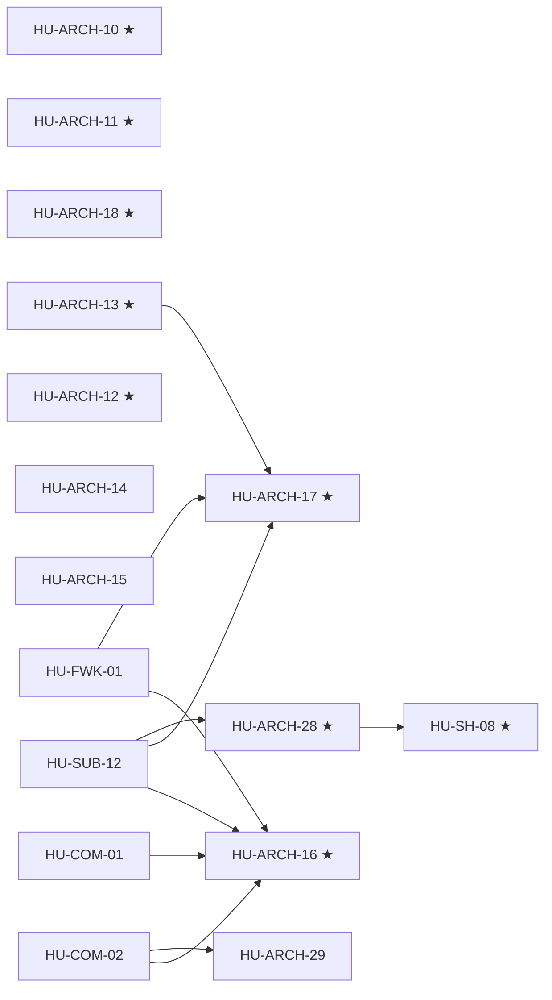

# SPEC-02 · Tareas

| Orden | HU | Título | Tamaño | Depende de | Hito |
|---|---|---|---|---|---|
| 1 | [HU-ARCH-10](hu/HU-ARCH-10-modelos-deepseek-vigentes.md) ★ | Modelos DeepSeek vigentes | S | — | 0A |
| 2 | [HU-ARCH-11](hu/HU-ARCH-11-un-mensaje-por-defecto.md) ★ | `un_mensaje` por defecto | S | — | 0A |
| 3 | [HU-ARCH-18](hu/HU-ARCH-18-errores-de-negocio-no-apagan-packs.md) ★ | Errores de negocio ≠ fallas del pack | M | — | 0A |
| 4 | [HU-ARCH-13](hu/HU-ARCH-13-plantillas-fuera-de-24h.md) ★ | Plantillas fuera de 24 h | M | — | 0A |
| 5 | [HU-ARCH-12](hu/HU-ARCH-12-precondiciones-y-escalate.md) ★ | Precondiciones, `escalate` y scopes | M | — | 0B |
| 6 | [HU-ARCH-14](hu/HU-ARCH-14-playground-sandbox.md) | Playground con sandbox | M | — | 0B |
| 7 | [HU-ARCH-15](hu/HU-ARCH-15-cache-anthropic.md) | Caché de Anthropic | S | — | 0B |
| 8 | [HU-ARCH-16](hu/HU-ARCH-16-golden-set-comercio.md) ★ | Golden set de comercio | L | [HU-COM-01](../SPEC-09-comercio-confiable/hu/HU-COM-01-dinero-en-el-servidor.md), [HU-COM-02](../SPEC-09-comercio-confiable/hu/HU-COM-02-guardrails-correctos.md), [HU-FWK-01](../SPEC-05-presets-y-flujos/hu/HU-FWK-01-composicion-de-flujos.md), HU-SUB-12 | 0B |
| 9 | [HU-ARCH-17](hu/HU-ARCH-17-golden-set-cobranza.md) ★ | Golden set de cobranza | L | [HU-ARCH-13](hu/HU-ARCH-13-plantillas-fuera-de-24h.md), [HU-FWK-01](../SPEC-05-presets-y-flujos/hu/HU-FWK-01-composicion-de-flujos.md), HU-SUB-12 | 0B |
| 10 | [HU-ARCH-28](hu/HU-ARCH-28-evals-de-consistencia-pass-k.md) ★ | Evals de consistencia: usuario simulado, aserciones de estado y pass^k | L | HU-SUB-12 | 0A |
| 11 | [HU-ARCH-29](hu/HU-ARCH-29-verificador-de-afirmaciones.md) | Verificador de afirmaciones con modelo de evidencia | M | [HU-COM-02](../SPEC-09-comercio-confiable/hu/HU-COM-02-guardrails-correctos.md) | 0A |

**Esfuerzo**: 3 S + 5 M + 3 L ≈ 48,5 días-persona sin IA.

