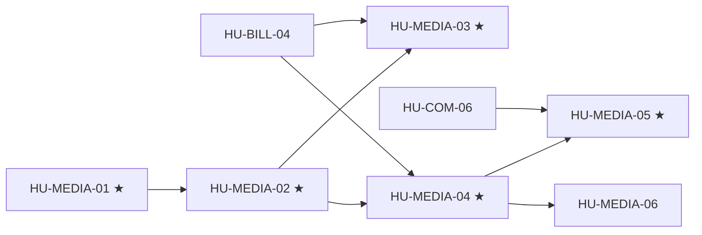

# SPEC-04 · Tareas

| Orden | HU | Título | Tamaño | Depende de | Hito |
|---|---|---|---|---|---|
| 1 | [HU-MEDIA-01](hu/HU-MEDIA-01-adr-media.md) ★ | ADR de media | S | — | 0B |
| 2 | [HU-MEDIA-02](hu/HU-MEDIA-02-almacenamiento-media.md) ★ | Descarga y almacenamiento | M | [HU-MEDIA-01](hu/HU-MEDIA-01-adr-media.md) | 0B |
| 3 | [HU-MEDIA-03](hu/HU-MEDIA-03-stt-notas-de-voz.md) ★ | Notas de voz a texto | M | [HU-MEDIA-02](hu/HU-MEDIA-02-almacenamiento-media.md), HU-BILL-04 | 0B |
| 4 | [HU-MEDIA-04](hu/HU-MEDIA-04-dispatcher-de-vision.md) ★ | Dispatcher de visión | M | [HU-MEDIA-02](hu/HU-MEDIA-02-almacenamiento-media.md), HU-BILL-04 | 0B |
| 5 | [HU-MEDIA-06](hu/HU-MEDIA-06-clasificacion-de-imagenes.md) | Clasificación y descripción | M | [HU-MEDIA-04](hu/HU-MEDIA-04-dispatcher-de-vision.md) | 0B |
| 6 | [HU-MEDIA-05](hu/HU-MEDIA-05-ocr-comprobantes.md) ★ | OCR de comprobantes | L | [HU-MEDIA-04](hu/HU-MEDIA-04-dispatcher-de-vision.md), [HU-COM-06](../SPEC-09-comercio-confiable/hu/HU-COM-06-operacion-de-pagos.md) | 0B |

**Esfuerzo**: 1 S + 4 M + 1 L ≈ 25,5 días-persona sin IA.

