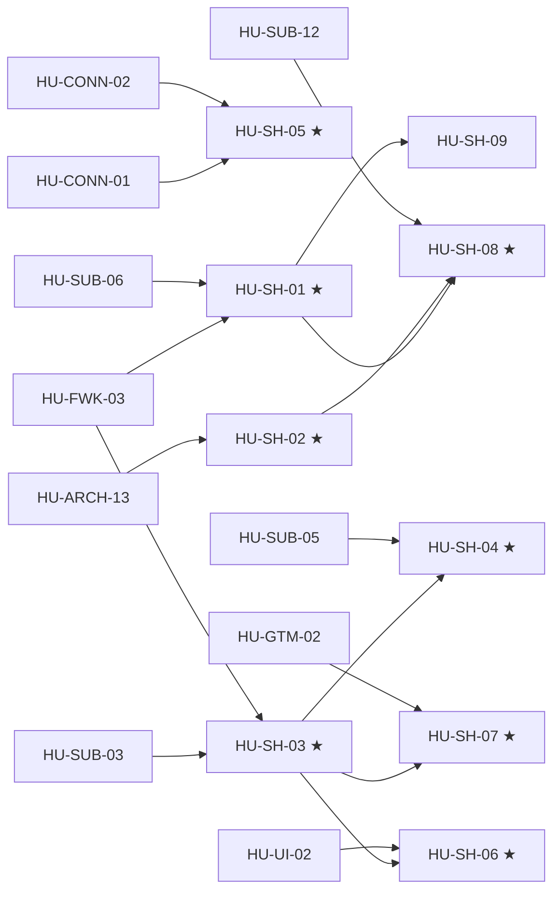

# SPEC-07 · Tareas

| Orden | HU | Título | Tamaño | Depende de | Hito |
|---|---|---|---|---|---|
| 1 | [HU-SH-02](hu/HU-SH-02-demo-de-punta-a-punta.md) ★ | Demo de punta a punta | L | [HU-ARCH-13](../SPEC-02-agente-confiable/hu/HU-ARCH-13-plantillas-fuera-de-24h.md) | 0A |
| 2 | [HU-SH-05](hu/HU-SH-05-embedded-signup-real.md) ★ | Embedded Signup real | L | [HU-CONN-01](../SPEC-08-conexion-whatsapp-meta/hu/HU-CONN-01-credenciales-por-conexion.md), [HU-CONN-02](../SPEC-08-conexion-whatsapp-meta/hu/HU-CONN-02-errores-500-y-bloqueos.md) | 0A |
| 3 | [HU-SH-01](hu/HU-SH-01-tenant-reproducible.md) ★ | Tenant reproducible | M | [HU-FWK-03](../SPEC-05-presets-y-flujos/hu/HU-FWK-03-registro-de-presets-y-seeds.md), HU-SUB-06 | 0A |
| 4 | [HU-SH-03](hu/HU-SH-03-aprovisionamiento-automatico.md) ★ | Aprovisionamiento automático | L | HU-SUB-03, [HU-FWK-03](../SPEC-05-presets-y-flujos/hu/HU-FWK-03-registro-de-presets-y-seeds.md) | 0A |
| 5 | [HU-SH-04](hu/HU-SH-04-cobro-de-plataforma-dos-canales.md) ★ | Dos canales de cobro | L | [HU-SH-03](hu/HU-SH-03-aprovisionamiento-automatico.md), HU-SUB-05 | 0A |
| 6 | [HU-SH-07](hu/HU-SH-07-antiabuso-y-cumplimiento.md) ★ | Antiabuso y cumplimiento | M | [HU-SH-03](hu/HU-SH-03-aprovisionamiento-automatico.md), HU-GTM-02 | 0A |
| 7 | [HU-SH-06](hu/HU-SH-06-onboarding-autoservicio.md) ★ | Onboarding autoservicio | L | [HU-SH-03](hu/HU-SH-03-aprovisionamiento-automatico.md), [HU-UI-02](../SPEC-10-panel-confiable/hu/HU-UI-02-kit-de-feedback.md) | 0A |
| 8 | [HU-SH-08](hu/HU-SH-08-golden-set-asistente.md) ★ | Golden set E2E y canary | M | [HU-SH-01](hu/HU-SH-01-tenant-reproducible.md), [HU-SH-02](hu/HU-SH-02-demo-de-punta-a-punta.md), HU-SUB-12, [HU-ARCH-28](../SPEC-02-agente-confiable/hu/HU-ARCH-28-evals-de-consistencia-pass-k.md) | 0A |
| 9 | [HU-SH-09](hu/HU-SH-09-landing-con-atribucion.md) | Landing con atribución | S | [HU-SH-01](hu/HU-SH-01-tenant-reproducible.md) | 0B |

**Esfuerzo**: 1 S + 3 M + 5 L ≈ 53,5 días-persona sin IA.

