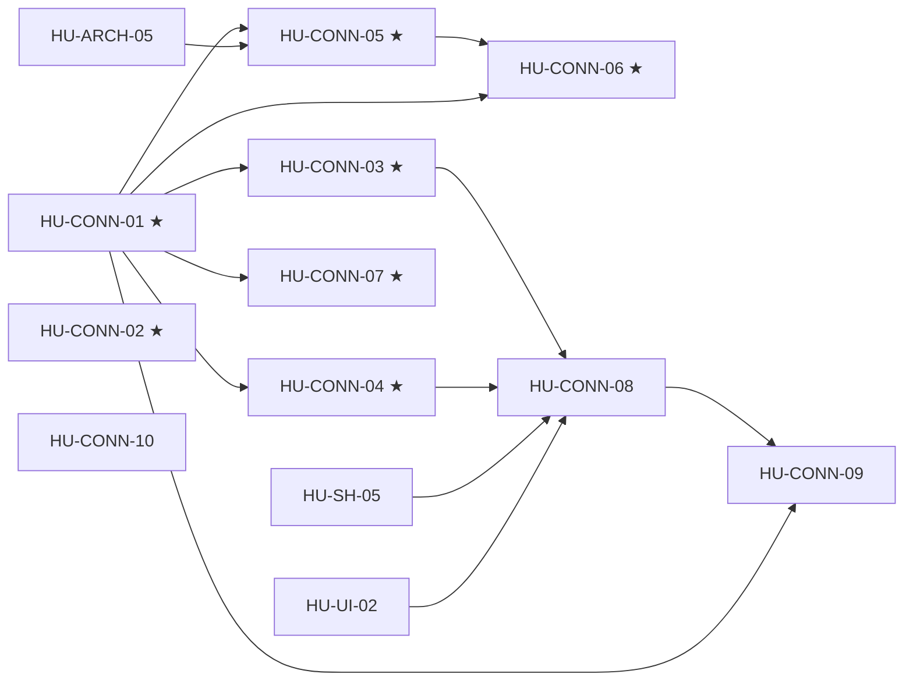

# SPEC-08 · Tareas

| Orden | HU | Título | Tamaño | Depende de | Hito |
|---|---|---|---|---|---|
| 1 | [HU-CONN-02](hu/HU-CONN-02-errores-500-y-bloqueos.md) ★ | Errores 500 y bloqueos | S | — | 0A |
| 2 | [HU-CONN-01](hu/HU-CONN-01-credenciales-por-conexion.md) ★ | Resolver de credenciales | M | — | 0A |
| 3 | [HU-CONN-03](hu/HU-CONN-03-ciclo-de-vida-seguro.md) ★ | Ciclo de vida seguro | M | [HU-CONN-01](hu/HU-CONN-01-credenciales-por-conexion.md) | 0A |
| 4 | [HU-CONN-04](hu/HU-CONN-04-diagnostico-confiable.md) ★ | Diagnóstico confiable | S | [HU-CONN-01](hu/HU-CONN-01-credenciales-por-conexion.md) | 0A |
| 5 | [HU-CONN-05](hu/HU-CONN-05-webhook-por-conexion.md) ★ | Webhook por conexión | M | [HU-CONN-01](hu/HU-CONN-01-credenciales-por-conexion.md), [HU-ARCH-05](../SPEC-01-produccion-segura/hu/HU-ARCH-05-webhook-fail-closed.md) | 0A |
| 6 | [HU-CONN-06](hu/HU-CONN-06-byok-produccion.md) ★ | BYOK de producción | M | [HU-CONN-01](hu/HU-CONN-01-credenciales-por-conexion.md), [HU-CONN-05](hu/HU-CONN-05-webhook-por-conexion.md) | 0A |
| 7 | [HU-CONN-07](hu/HU-CONN-07-checklist-produccion-real.md) ★ | Checklist de producción real | M | [HU-CONN-01](hu/HU-CONN-01-credenciales-por-conexion.md) | 0A |
| 8 | [HU-CONN-10](hu/HU-CONN-10-conexiones-no-meta.md) | Conexiones que no son Meta | S | — | 0B |
| 9 | [HU-CONN-08](hu/HU-CONN-08-lista-y-hub-meta.md) | Lista v2 y hub de Meta | L | [HU-CONN-03](hu/HU-CONN-03-ciclo-de-vida-seguro.md), [HU-CONN-04](hu/HU-CONN-04-diagnostico-confiable.md), [HU-SH-05](../SPEC-07-asistente-solvershub/hu/HU-SH-05-embedded-signup-real.md), [HU-UI-02](../SPEC-10-panel-confiable/hu/HU-UI-02-kit-de-feedback.md) | 0B |
| 10 | [HU-CONN-09](hu/HU-CONN-09-costos-meta-verificables.md) | Costos de Meta verificables | M | [HU-CONN-01](hu/HU-CONN-01-credenciales-por-conexion.md), [HU-CONN-08](hu/HU-CONN-08-lista-y-hub-meta.md) | 0B |

**Esfuerzo**: 3 S + 6 M + 1 L ≈ 36,5 días-persona sin IA (Hito 0A: 2 S + 5 M ≈ 23).

