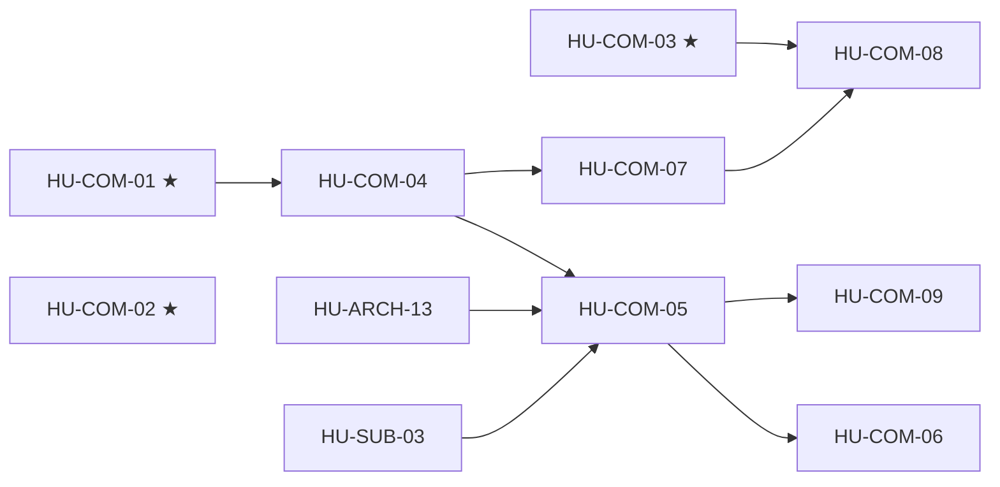

# SPEC-09 · Tareas

| Orden | HU | Título | Tamaño | Depende de | Hito |
|---|---|---|---|---|---|
| 1 | [HU-COM-01](hu/HU-COM-01-dinero-en-el-servidor.md) ★ | El dinero en el servidor | S | — | 0A |
| 2 | [HU-COM-02](hu/HU-COM-02-guardrails-correctos.md) ★ | Guardrails correctos | S | — | 0A |
| 3 | [HU-COM-03](hu/HU-COM-03-numeracion-y-datos-por-producto.md) ★ | Numeración y datos por producto | M | — | 0A |
| 4 | [HU-COM-04](hu/HU-COM-04-barrido-de-defectos.md) | Barrido D5–D16, D18 | M | [HU-COM-01](hu/HU-COM-01-dinero-en-el-servidor.md) | 0B |
| 5 | [HU-COM-05](hu/HU-COM-05-estados-del-pedido.md) | Estados, avisos y eventos | M | [HU-ARCH-13](../SPEC-02-agente-confiable/hu/HU-ARCH-13-plantillas-fuera-de-24h.md), HU-SUB-03, [HU-COM-04](hu/HU-COM-04-barrido-de-defectos.md) | 0B |
| 6 | [HU-COM-06](hu/HU-COM-06-operacion-de-pagos.md) | Operación de pagos | M | [HU-COM-05](hu/HU-COM-05-estados-del-pedido.md) | 0B |
| 7 | [HU-COM-07](hu/HU-COM-07-catalogo-menus-y-retail.md) | Catálogo para menús y retail | M | [HU-COM-04](hu/HU-COM-04-barrido-de-defectos.md) | 0B |
| 8 | [HU-COM-08](hu/HU-COM-08-domicilios.md) | Domicilios | M | [HU-COM-03](hu/HU-COM-03-numeracion-y-datos-por-producto.md), [HU-COM-07](hu/HU-COM-07-catalogo-menus-y-retail.md) | 0B |
| 9 | [HU-COM-09](hu/HU-COM-09-modificar-pedido.md) | Modificar el pedido | M | [HU-COM-05](hu/HU-COM-05-estados-del-pedido.md) | 0B |

**Esfuerzo**: 2 S + 7 M ≈ 31 días-persona sin IA (Hito 0A: 2 S + 1 M ≈ 7).

