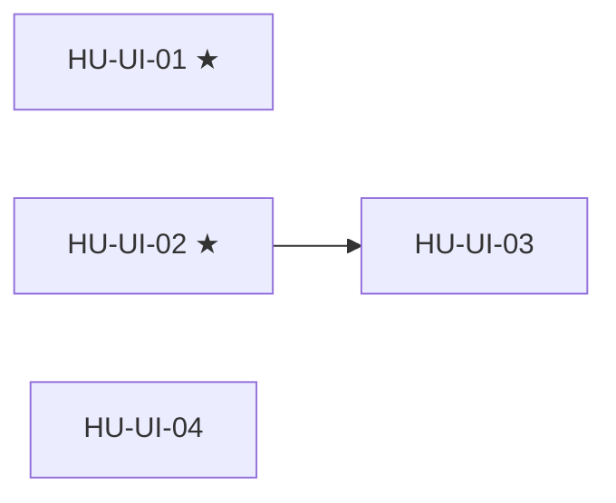

# SPEC-10 · Tareas

| Orden | HU | Título | Tamaño | Depende de | Hito |
|---|---|---|---|---|---|
| 1 | [HU-UI-01](hu/HU-UI-01-bugs-visibles.md) ★ | Bugs visibles | S | — | 0A |
| 2 | [HU-UI-02](hu/HU-UI-02-kit-de-feedback.md) ★ | Kit de feedback | M | — | 0A |
| 3 | [HU-UI-04](hu/HU-UI-04-calidad-del-panel.md) | Calidad del panel | M | — | 0B |
| 4 | [HU-UI-03](hu/HU-UI-03-shell.md) | Shell | M | [HU-UI-02](hu/HU-UI-02-kit-de-feedback.md) | 0B |

**Esfuerzo**: 1 S + 3 M ≈ 13,5 días-persona sin IA.

