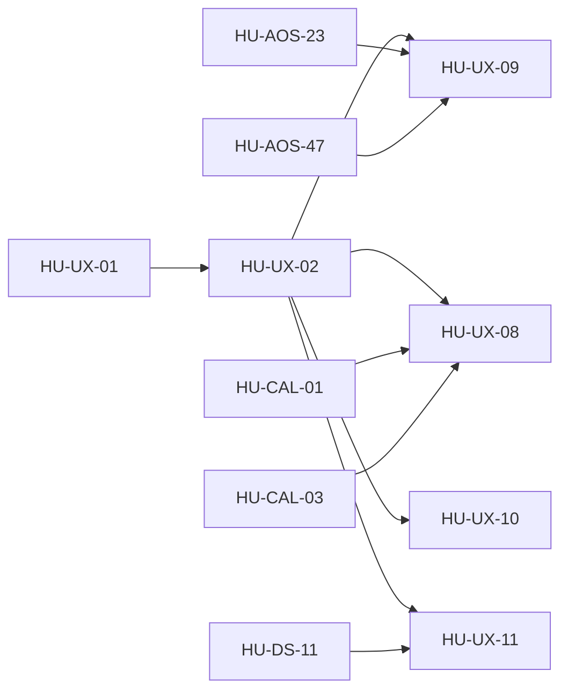

# SPEC-12 · Tareas

| Orden | HU | Título | Tamaño | Depende de |
|---|---|---|---|---|
| 1 | [HU-UX-01](hu/HU-UX-01-adr-arquitectura-de-informacion.md) | ADR de arquitectura de información | S | — |
| 2 | [HU-UX-02](hu/HU-UX-02-menu-v2.md) | Menú v2 | M | [HU-UX-01](hu/HU-UX-01-adr-arquitectura-de-informacion.md) |
| 3 | [HU-UX-09](hu/HU-UX-09-ficha-de-conexion-por-tipo.md) | Ficha de conexión por tipo | L | [HU-UX-02](hu/HU-UX-02-menu-v2.md), [HU-AOS-23](../SPEC-26-agent-os/hu/HU-AOS-23-consola-de-conexiones.md), [HU-AOS-47](../SPEC-26-agent-os/hu/HU-AOS-47-mi-agente-y-su-data.md) |
| 4 | [HU-UX-08](hu/HU-UX-08-agenda-unificada.md) | Agenda unificada | M | [HU-UX-02](hu/HU-UX-02-menu-v2.md), [HU-CAL-01](../SPEC-24-agenda-y-citas/hu/HU-CAL-01-bloqueos-de-agenda.md), [HU-CAL-03](../SPEC-24-agenda-y-citas/hu/HU-CAL-03-calendario-visual.md) |
| 5 | [HU-UX-10](hu/HU-UX-10-cobranza-y-ventas-en-pestanas.md) | Cobranza y Ventas en pestañas | M | [HU-UX-02](hu/HU-UX-02-menu-v2.md) |
| 6 | [HU-UX-11](hu/HU-UX-11-cajon-de-la-app-con-menu-v2.md) | Cajón de la app con el menú v2 | S | [HU-UX-02](hu/HU-UX-02-menu-v2.md), [HU-DS-11](../SPEC-29-sistema-de-diseno-unificado/hu/HU-DS-11-shell-del-panel-en-la-app.md) |
| 7 | [HU-UX-03](hu/HU-UX-03-ayuda-contextual.md) | Ayuda contextual | M | [HU-UX-01](hu/HU-UX-01-adr-arquitectura-de-informacion.md) |
| 8 | [HU-UX-04](hu/HU-UX-04-estados-vacios-y-permisos.md) | Estados vacíos y permisos | M | [HU-UX-02](hu/HU-UX-02-menu-v2.md) |
| 9 | [HU-UX-05](hu/HU-UX-05-guias-por-habilidad.md) | Guías por habilidad | M | [HU-SH-06](../../03-fase-0-go-live/SPEC-07-asistente-solvershub/hu/HU-SH-06-onboarding-autoservicio.md), [HU-FWK-04](../SPEC-16-habilidades-como-plataforma/hu/HU-FWK-04-catalogo-de-habilidades.md) |
| 10 | [HU-UX-06](hu/HU-UX-06-registro-desde-landing.md) | Registro desde la landing | M | [HU-SH-03](../../03-fase-0-go-live/SPEC-07-asistente-solvershub/hu/HU-SH-03-aprovisionamiento-automatico.md), [HU-SH-07](../../03-fase-0-go-live/SPEC-07-asistente-solvershub/hu/HU-SH-07-antiabuso-y-cumplimiento.md) |

Las HU 2 a 6 son el rediseño del menú (D-37): primero el menú v2 en `nav.ts` con las redirecciones; luego las
fichas y pestañas de cada sección, que pueden ir en paralelo porque tocan carpetas distintas del panel; al final el
cajón de la app.

**Esfuerzo**: 2 S + 7 M + 1 L ≈ 39 días-persona sin IA.
