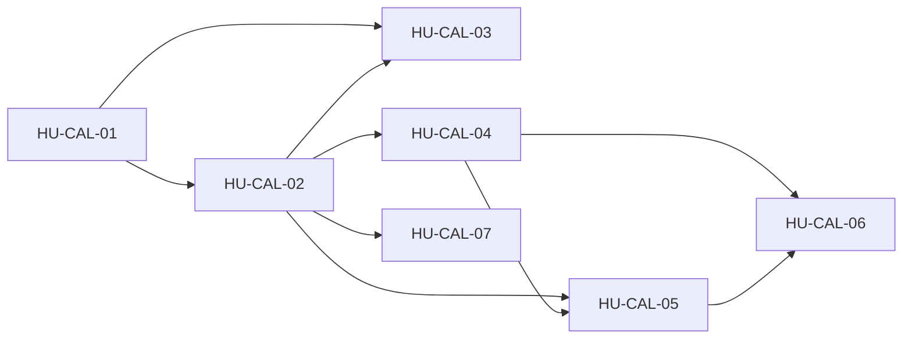

# SPEC-24 · Tareas

| Orden | HU | Título | Tamaño | Depende de |
|---|---|---|---|---|
| 1 | [HU-CAL-01](hu/HU-CAL-01-bloqueos-de-agenda.md) | Bloqueos de agenda y vista semanal | M | — |
| 2 | [HU-CAL-02](hu/HU-CAL-02-agendar-reagendar-cancelar.md) | Agendar, reagendar y cancelar demos con correo | L | [HU-CAL-01](hu/HU-CAL-01-bloqueos-de-agenda.md) |
| 3 | [HU-CAL-03](hu/HU-CAL-03-calendario-visual.md) | Calendario visual tipo Google Calendar | L | [HU-CAL-01](hu/HU-CAL-01-bloqueos-de-agenda.md), [HU-CAL-02](hu/HU-CAL-02-agendar-reagendar-cancelar.md) |
| 4 | [HU-CAL-04](hu/HU-CAL-04-fecha-actual-y-anti-escalamiento.md) | Fecha actual en el prompt y política anti-escalamiento | M | [HU-CAL-02](hu/HU-CAL-02-agendar-reagendar-cancelar.md) |
| 5 | [HU-CAL-05](hu/HU-CAL-05-pack-de-agendamiento-definitivo.md) | Pack de agendamiento definitivo | L | [HU-CAL-02](hu/HU-CAL-02-agendar-reagendar-cancelar.md), [HU-CAL-04](hu/HU-CAL-04-fecha-actual-y-anti-escalamiento.md) |
| 6 | [HU-CAL-06](hu/HU-CAL-06-afinado-del-tenant-y-e2e.md) | Afinado del asistente de la agencia y E2E del agendamiento | M | [HU-CAL-04](hu/HU-CAL-04-fecha-actual-y-anti-escalamiento.md), [HU-CAL-05](hu/HU-CAL-05-pack-de-agendamiento-definitivo.md) |
| 7 | [HU-CAL-07](hu/HU-CAL-07-google-desde-el-panel.md) | Conectar Google Calendar desde el panel nuevo | M | [HU-CAL-02](hu/HU-CAL-02-agendar-reagendar-cancelar.md) |

**Esfuerzo**: 4 M + 3 L ≈ 40,0 días-persona sin IA.

Cada HU de la ampliación es un issue y un PR por repo (backend; panel en [HU-CAL-04](hu/HU-CAL-04-fecha-actual-y-anti-escalamiento.md), [HU-CAL-05](hu/HU-CAL-05-pack-de-agendamiento-definitivo.md) y [HU-CAL-07](hu/HU-CAL-07-google-desde-el-panel.md)).
El orden de despliegue y la reversa están en [design.md](design.md#migración-despliegue-y-reversa).
