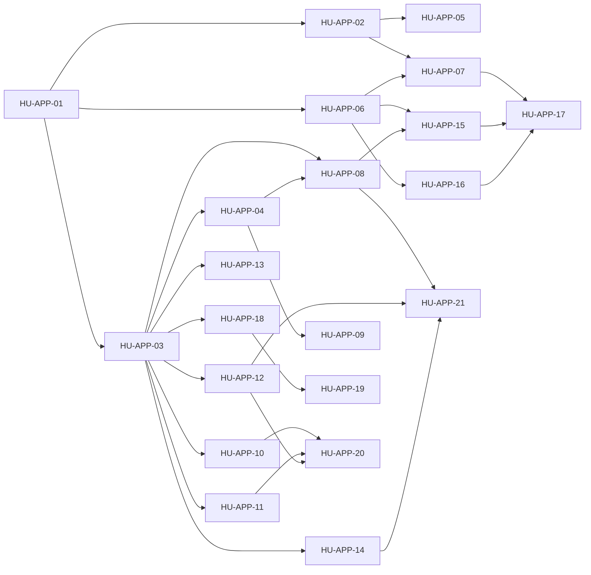

# SPEC-25 · Tareas

| Orden | HU | Título | Tamaño | Depende de |
|---|---|---|---|---|
| 1 | [HU-APP-01](hu/HU-APP-01-nucleo-modular-de-la-app.md) | Núcleo modular de la app | M | — |
| 2 | [HU-APP-02](hu/HU-APP-02-sesion-unica-y-recuperacion.md) | Sesión única, recuperación y biometría | L | [HU-APP-01](hu/HU-APP-01-nucleo-modular-de-la-app.md) |
| 3 | [HU-APP-03](hu/HU-APP-03-navegacion-por-permisos.md) | Navegación por permisos y roles | M | [HU-APP-01](hu/HU-APP-01-nucleo-modular-de-la-app.md) |
| 4 | [HU-APP-04](hu/HU-APP-04-dashboard-con-kpis.md) | Dashboard con KPIs | M | [HU-APP-03](hu/HU-APP-03-navegacion-por-permisos.md) |
| 5 | [HU-APP-05](hu/HU-APP-05-notificaciones-push.md) | Notificaciones push | M | [HU-APP-02](hu/HU-APP-02-sesion-unica-y-recuperacion.md) |
| 6 | [HU-APP-06](hu/HU-APP-06-almacenamiento-local-cifrado.md) | Almacenamiento local cifrado | M | [HU-APP-01](hu/HU-APP-01-nucleo-modular-de-la-app.md) |
| 7 | [HU-APP-07](hu/HU-APP-07-cobranza-al-nucleo-sin-regresion.md) | Cobranza al núcleo sin regresión | L | [HU-APP-01](hu/HU-APP-01-nucleo-modular-de-la-app.md), [HU-APP-02](hu/HU-APP-02-sesion-unica-y-recuperacion.md), [HU-APP-06](hu/HU-APP-06-almacenamiento-local-cifrado.md) |
| 8 | [HU-APP-08](hu/HU-APP-08-operacion-movil.md) | Operación móvil | L | [HU-APP-03](hu/HU-APP-03-navegacion-por-permisos.md), [HU-APP-04](hu/HU-APP-04-dashboard-con-kpis.md) |
| 9 | [HU-APP-09](hu/HU-APP-09-negocio-movil.md) | Negocio móvil | M | [HU-APP-03](hu/HU-APP-03-navegacion-por-permisos.md), [HU-APP-04](hu/HU-APP-04-dashboard-con-kpis.md) |
| 10 | [HU-APP-10](hu/HU-APP-10-comercio-movil.md) | Comercio móvil | L | [HU-APP-03](hu/HU-APP-03-navegacion-por-permisos.md) |
| 11 | [HU-APP-11](hu/HU-APP-11-calendario-movil.md) | Calendario móvil | L | [HU-APP-03](hu/HU-APP-03-navegacion-por-permisos.md) |
| 12 | [HU-APP-12](hu/HU-APP-12-configuracion-movil.md) | Configuración móvil | L | [HU-APP-03](hu/HU-APP-03-navegacion-por-permisos.md) |
| 13 | [HU-APP-13](hu/HU-APP-13-herramientas-y-plataforma-movil.md) | Herramientas y plataforma móvil | M | [HU-APP-03](hu/HU-APP-03-navegacion-por-permisos.md) |
| 14 | [HU-APP-14](hu/HU-APP-14-busqueda-global.md) | Búsqueda global | M | [HU-APP-03](hu/HU-APP-03-navegacion-por-permisos.md) |
| 15 | [HU-APP-15](hu/HU-APP-15-sync-offline-por-modulos.md) | Sync offline-first por módulos | L | [HU-APP-06](hu/HU-APP-06-almacenamiento-local-cifrado.md), [HU-APP-08](hu/HU-APP-08-operacion-movil.md) |
| 16 | [HU-APP-16](hu/HU-APP-16-seguridad-de-la-app.md) | Seguridad de la app | M | [HU-APP-06](hu/HU-APP-06-almacenamiento-local-cifrado.md) |
| 17 | [HU-APP-17](hu/HU-APP-17-release-firmado-y-guias.md) | Release firmado y guías | M | [HU-APP-07](hu/HU-APP-07-cobranza-al-nucleo-sin-regresion.md), [HU-APP-15](hu/HU-APP-15-sync-offline-por-modulos.md), [HU-APP-16](hu/HU-APP-16-seguridad-de-la-app.md) |
| 18 | [HU-APP-18](hu/HU-APP-18-cobranza-admin-movil.md) | Cobranza admin móvil | L | [HU-APP-03](hu/HU-APP-03-navegacion-por-permisos.md) |
| 19 | [HU-APP-19](hu/HU-APP-19-cobranza-admin-profunda.md) | Cobranza admin profunda móvil | L | [HU-APP-18](hu/HU-APP-18-cobranza-admin-movil.md) |
| 20 | [HU-APP-20](hu/HU-APP-20-escrituras-moviles.md) | Escrituras móviles | M | [HU-APP-10](hu/HU-APP-10-comercio-movil.md), [HU-APP-11](hu/HU-APP-11-calendario-movil.md), [HU-APP-12](hu/HU-APP-12-configuracion-movil.md) |
| 21 | [HU-APP-21](hu/HU-APP-21-herramientas-profunda.md) | Herramientas profundas móvil | M | [HU-APP-08](hu/HU-APP-08-operacion-movil.md), [HU-APP-12](hu/HU-APP-12-configuracion-movil.md), [HU-APP-14](hu/HU-APP-14-busqueda-global.md) |

**Esfuerzo**: 12 M + 9 L ≈ 120,0 días-persona sin IA.

Cada HU es un issue y un PR por repo afectado (agent-core y/o solvershub-apk; [SPEC-25](spec.md) como
documentación en solvershub-docs). El orden de despliegue y la reversa están en
[design.md](design.md#migración-despliegue-y-reversa).
