# SPEC-26 · Diseño

> Diseño aprobado el 2026-10-08 (D-27 y D-28). Las referencias §N apuntan a las secciones de este documento.
> El plan de ejecución está en [tasks.md](tasks.md); las decisiones, en [spec.md](spec.md#decisiones).
> Alineado el 2026-10-09 con los ADR-0112 a 0118 corregidos tras la revisión del arquitecto
> ([agent-core #402](https://github.com/devrochy/agent-core/pull/402)). Ante cualquier diferencia, mandan los ADR.

## 1. Resumen ejecutivo

1. agent-core es un SO sólido de **un agente por negocio** (Python 3.12, FastAPI, Postgres 16 con RLS forzada, Redis, Celery, habilidades instalables, AgentSpec versionado, outbox, ledgers). No hay A2A ni agentes por conexión.
2. El cuello de botella no es la cantidad de agentes, es la **consistencia**:
   - la línea base de evals (34/35 y 7/8) no cumple el ≥95 % tres noches del 0A;
   - hay reglas de seguridad que escalan a mitad de una compra;
   - el runner mira solo el primer paso del modelo;
   - un precio puede salir del LLM.
3. **Plan B (elegido): Agent OS de procedimientos.** El Coordinador ejecuta procedimientos tipados (datos validados, etapas que restringen acciones, precondiciones, confirmación, cierre por evento) sobre un **estado único**. El LLM entiende y redacta, el código decide y actúa, y un **verificador** contrasta cada afirmación con el estado.
4. Los especialistas son **agentes del mismo hilo** (una voz). Los 5 modos A2A se cumplen con mecanismos deterministas:
   - handoff = cambio de agente;
   - delegación = agente como acción;
   - consulta = lectura tipada;
   - broadcast = puntuación de disparadores;
   - colaboración = pila de tareas.

   Los agentes con contexto propio quedan solo para *back-office* asíncrono.
5. Se conserva de la versión anterior: conexión canónica, releases por conexión con canary y rollback, scope + RLS + FKs compuestas, ledgers, memoria por scope y caché por versión.
6. Fiabilidad primero: **evals de consistencia (pass^k, usuario simulado, aserciones de estado) y verificador entran ya al 0A**; el motor de procedimientos abre la Fase 1.
7. Esfuerzo: 2 HU en el 0A (12 días) + 39 HU en [SPEC-26](spec.md) (217,5 días) + 7 HU en [SPEC-27](../../05-fase-2-plus/SPEC-27-agent-os-plus/spec.md) (48 días) ≈ **277,5 días-persona sin IA**. Se compensa en parte al absorber [SPEC-15](../SPEC-15-editor-visual-de-flujo/spec.md), [HU-ARCH-26](../../05-fase-2-plus/SPEC-22-extensibilidad-avanzada/hu/HU-ARCH-26-tool-siguiente-forzada.md) y [HU-FLOW-07](../../05-fase-2-plus/SPEC-22-extensibilidad-avanzada/hu/HU-FLOW-07-purpose-y-reglas-por-etapa.md) (≈ 35 días, P-21).
8. Agent OS v1 vendible: **fin de ene-2027 a fin de jun-2027** con 1 persona (10× / 4×), o **dic-2026 a abr-2027** con 3 personas. Mandan las ventanas de observación.

---

## 2. Diagnóstico de la arquitectura actual

### 2.1 Stack real (sustituye los `[[...]]` del encargo)

| Capa | Hoy | Evidencia |
|---|---|---|
| Lenguaje y runtime | Python 3.12, FastAPI, SQLAlchemy async, Alembic (core + uno por pack), uv | `pyproject.toml`, `alembic/versions/0001..0057` |
| Base de datos | Postgres 16 + pgvector + PostGIS; RLS **forzada**; rol `app_runtime` no dueño; resolvers `SECURITY DEFINER` | `docker-compose.yml:15`, `0029_force_row_level_security.py`, `0003_multitenant_core.py:227-242` |
| Colas | Redis Streams (inbound + DLQ + reclamo), debounce en sorted set, Celery worker/beat (salida, crons, outbox) | `core/orchestrator/consumer.py:1-12`, `core/tasks/` |
| LLM | DeepSeek flash por defecto, Anthropic, OpenAI-compatible; BYOK por negocio; router de dificultad; fallback | `core/llm/`, `core/orchestrator/loop.py:290-437` |
| Habilidades | commerce, payments, calendar, cobranza, subscriptions; registros del core (`payment_registry`, `subscription_registry`) | `packages/pack-*`, ADR-0023/0067 |
| Canales | WhatsApp Meta (BYOK y Embedded Signup), WhatsApp Web (QR, neonize), chat web, correo saliente | `core/gateway/connection_types.py:121-221`, `core/api/routers/web_chat.py` |
| Panel y app | Next.js 16 + Tailwind v4 + shadcn/ui con BFF; App Expo | `solvershub-panel/README.md`, `solvershub-apk` |
| Infra | Docker/Coolify; test en la máquina de desarrollo; producción en VPS pendiente (D-19, [HU-ARCH-01](../../03-fase-0-go-live/SPEC-01-produccion-segura/hu/HU-ARCH-01-produccion-fuera-de-dev.md)) | memoria del proyecto, `decisiones.md` D-19 |
| Observabilidad | OTel apagado por defecto (exportador de consola), Sentry, `usage_ledger`, `audit_log` | `core/observability/tracing.py:41-46` |
| Evals | golden del framework (28+ escenarios), golden por negocio, journeys, `eval_runs` atados a versión; gate en CI | `evals/`, ADR-0051 |
| Equipo | 1 persona + agentes de IA (D-17) | `calendario-estimado.md` |

### 2.2 Diagnóstico por plano

| Plano | Qué existe hoy (evidencia) | Se mantiene | Se refactoriza | Se descarta |
|---|---|---|---|---|
| **Control** | AgentSpec v2 por negocio, **uno activo** (`core/agents/spec.py:224-249`, `core/db/models.py:359-387`); rollback por flip de `is_active` (`spec.py:252`); habilitación por `spec.packs` (ADR-0019) + `plugin_configs`; flujo compuesto core/pack/negocio (`core/agents/flow.py:1-20`); presets (ADR-0110); `AppSettings` operativo; API `/api/v1` con OpenAPI | Validación contra contrato, presets, catálogos de sistema (`plans`, `connection_types`), API-first, principio "versionable → spec, operativo → AppSettings" (ADR-0051) | AgentSpec → **agentes + versiones inmutables con hash**; habilitación → **instalaciones de habilidad con scope**; secciones del flujo → **procedimientos tipados** de las habilidades (afecta D-SPEC-15-1, P-21); rollback → **release por conexión** | "Un activo por negocio" como identidad del asistente; `extensions` como cajón para semántica nueva (ADR-0050) |
| **Datos** | RLS + `tenant_scope` → `set_config` transaccional (`core/shared/tenant.py`); **dos modelos de conexión**: `channel_connections` (genérico, ADR-0069) y `meta_connections` con puente doble en `conversations` (`models.py:279-285`); **una conversación abierta por cliente**, no por conexión, y su conexión se **sobrescribe** con la última entrada (`consumer.py:562-602`); memoria L1 Redis 24 h (`memory/working.py:24`), L2 `customers.attributes`, L3 `memory_vectors` con redacción de PII (`memory/vector.py:90-145`); outbox `domain_events` (ADR-0107); `usage_ledger`/`audit_log` append-only; chat web como JSON en `app_settings` (`models.py:128-132`), no como conexión | RLS forzada, roles, outbox, ledgers append-only, borrado lógico, `purge_tenant` dinámico (`0011_purge_tenant.py`) | Conexión canónica; conversación por (conexión, cliente); chat web como conexión; memoria con scope y procedencia; ledgers con `turn_id`, agente y conexión | Puente doble `connection_id`/`meta_connection_id` (tras el *contract*); `llm_usage` (legacy, ya sin escritura) |
| **Ejecución** | Gateway con firma → resuelve **el negocio** (no la conexión) por número/WABA (`gateway/webhook_route_tenant.py:81-123`) → Stream → consumer (pausa, palabras de escalamiento, horario, debounce, cuotas) → **un solo loop** `process_conversation` (memoria, flujo, acciones, dificultad, presupuesto, reglas de seguridad, escalamiento) (`orchestrator/loop.py:160-585`) → cola de salida. Semáforos global/negocio y timeout del turno (`turn_gate.py`, 8/2/180 s en `config.py:177-195`) | Gateway, stream, DLQ y reclamo, debounce, `turn_gate`, loop de acciones como **runtime de especialista**, reglas de seguridad, `requiresConfirmation`, `ScopedHttp`, auto-disable por negocio | Políticas del consumer y del preámbulo/cierre del loop → **kernel del Coordinador**; loop → hilo del agente con **motor de procedimientos**; enrutamiento por playbook → tarea en foco, reglas y disparadores | `SkillRouter` por keywords como ruta principal (queda de respaldo); `enrutamiento.md` como mecanismo (pasa a datos del Coordinador) |
| **Observabilidad** | Spans `turn`/`llm_call`/`tool_execute` (`loop.py:372,391,448`); OTel no-op salvo `OTEL_ENABLED` (`tracing.py:46`); `usage_ledger` por turno con `agent_spec_version` pero **sin conexión, agente ni trace** (`models.py:714-735`); `audit_log` de acciones; panel de costos | Spans, ledgers, Sentry, D-SPEC-01-2 (OTLP gestionado) | `turn_id` + `trace_id` persistidos y propagados a Celery; ledger por unidad de consumo; decisión del Coordinador persistida | — |
| **Seguridad** | RLS forzada con test de CI; `SECURITY DEFINER` acotadas; AES-GCM con rotación (ADR-0027); tokens de Meta en `meta_private`; `ScopedHttp` anti-SSRF (`mcp/types.py:56-131`); consentimiento de acciones **fail-open** sin binding (`loop.py:782`); bloqueo progresivo de login; RBAC por sección | Todo lo anterior | Acciones de especialista **fail-closed por construcción** (solo sus superpoderes y sus bindings); secretos por instalación con scope; A2A del mismo negocio garantizado con FKs compuestas | Fail-open de bindings para agentes nuevos |

### 2.3 Cómo se modela hoy el negocio multi-conexión

- **Sí existe** Tenant (1) ─< Conexiones (N): `channel_connections` y `meta_connections` por negocio, y ADR-0095 garantiza que un número o una WABA tienen un solo dueño.
- **Pero la conexión es un inventario de credenciales, no una unidad de ejecución:**
  1. El agente es del negocio, no de la conexión (`load_active_spec()` sin conexión, `loop.py:181`).
  2. El webhook resuelve el negocio; la conexión se busca después por `connection_external_id` (`consumer.py:521-552`).
  3. La conversación es del cliente y se **re-asigna** a la última conexión por la que escribió (`consumer.py:591-602`). Hubo un incidente real en test el 2026-10-08: la respuesta salía por WhatsApp Web aunque el cliente escribía a Meta.
  4. El chat web es un widget por negocio guardado en `AppSettings`, no una conexión.
  5. El catálogo de tipos mezcla canales conversacionales con integraciones (`google_calendar`, `email_smtp`) (`connection_types.py:121-221`).
  6. Los planes no cuentan conexiones ni agentes (`core/billing/metrics.py:60-88`; límites de habilidades 1/3/8/∞ en `plans.py:61-109`).

### 2.4 Cómo se comunican hoy los agentes entre sí

- **No hay A2A.** Hay un solo agente por negocio. La "especialización" vive en **secciones del flujo por habilidad** (`packages/pack-commerce/flow.json`) y en playbooks. El propio playbook lo dice: "El mismo asistente atiende ventas y agendamiento" (`core/playbooks/enrutamiento.md`).
- Lo que se coordina son **módulos**, no agentes: registros del core (`payment_registry`, `subscription_registry`), EventBus en proceso (`core/shared/events.py`) y outbox durable (`core/events/outbox.py`).
- El contrato ya previó un id de agente: `ToolContext.agentId` (`packages/contracts/agentcore_contracts/contracts.py:285`). El runtime no lo implementa (`core/mcp/types.py:39-53`). `AgentTurnResult.handoff` modela relevo **a humano** (`EscalationState`), no a otro agente.

### 2.5 Riesgos y deuda técnica que condicionan el rediseño

| # | Deuda / riesgo | Evidencia | Efecto en Agent OS | Tratamiento |
|---|---|---|---|---|
| D1 | Conversación por cliente con conexión sobrescrita | `consumer.py:562-602` | Con 1 Coordinador por conexión, la conversación sería ambigua | [HU-AOS-11](hu/HU-AOS-11-conexion-canonica.md) |
| D2 | Dos modelos de conexión y puente doble | `models.py:196-226, 279-285, 903-954` | No hay "la" conexión de un mensaje | [HU-AOS-11](hu/HU-AOS-11-conexion-canonica.md) |
| D3 | Un spec por negocio; `extensions` reservado sin motor | `contracts.py:202-205` | Sin identidad de agente, procedimiento ni versión por agente | [HU-AOS-03](hu/HU-AOS-03-contrato-de-procedimientos.md) (procedimientos) y [HU-AOS-12](hu/HU-AOS-12-agentes-versionados.md) (AgentSpec v3) |
| D4 | Canary inviable (ADR-0016) | `docs/adr/0016` | Regresiones desconocidas afectan al 100 % | [HU-AOS-14](hu/HU-AOS-14-releases-por-conexion.md) y [HU-AOS-32](hu/HU-AOS-32-canary-y-auto-rollback.md) |
| D5 | Consentimiento de acciones fail-open | `loop.py:782` | Un agente podría usar acciones ajenas | Acciones permitidas por etapa del procedimiento, fail-closed ([HU-AOS-05](hu/HU-AOS-05-motor-de-procedimientos.md)/16), alineado con [HU-ARCH-20](../SPEC-19-extensibilidad-y-operacion/hu/HU-ARCH-20-guardrails-runtime.md) |
| D6 | OTel apagado y sin `trace_id` persistido | `tracing.py:46` | No hay trazabilidad mensaje → decisión → acción → costo | [HU-AOS-10](hu/HU-AOS-10-kernel-del-coordinador.md) y [HU-AOS-29](hu/HU-AOS-29-tablero-de-fiabilidad.md) (+ [HU-ARCH-07](../../03-fase-0-go-live/SPEC-01-produccion-segura/hu/HU-ARCH-07-observabilidad-prod.md)) |
| D7 | Panel, webhooks y consumer en un proceso (ADR-0021) | `docs/adr/0021` | El turno del Coordinador compite con el panel en el mismo proceso | Disparador y partición de ADR-0021 (panel por un lado, gateway+consumer por otro); [HU-AOS-44](../../05-fase-2-plus/SPEC-27-agent-os-plus/hu/HU-AOS-44-topologia-por-roles.md) |
| D8 | Gate de evals flaky y runner que mira solo el primer paso del modelo | memoria `entorno-test-verificacion`, `backlog-ola-2-estado` | No mide resultados ni consistencia | **[HU-ARCH-28](../../03-fase-0-go-live/SPEC-02-agente-confiable/hu/HU-ARCH-28-evals-de-consistencia-pass-k.md) (ya, en el 0A)**: usuario simulado, aserciones de estado, pass^k |
| D9 | Producción aún en la máquina de desarrollo (invariante 9) | `09-linea-base.md:6-8` | Agent OS no debe llegar a clientes antes de [HU-ARCH-01](../../03-fase-0-go-live/SPEC-01-produccion-segura/hu/HU-ARCH-01-produccion-fuera-de-dev.md) | Dependencia de lanzamiento ([HU-AOS-38](hu/HU-AOS-38-lanzamiento-comercial.md)) |
| D10 | Base local con migraciones desalineadas | memoria `entorno-efimero-local` | Tests de integración engañosos | Stack efímero para las HU AOS |
| D11 | Capacidad de 1 persona (D-17) | `calendario-estimado.md` | Riesgo de que el alcance crezca sin control | Fases con criterios de salida; extras en Fase 2 |

### 2.6 Fiabilidad del agente hoy (por qué el foco es la consistencia)

| Síntoma | Evidencia | Causa de fondo | Qué lo resuelve |
|---|---|---|---|
| Golden 34/35 (framework) y 7/8 (`solvershub`); el umbral del 0A (≥95 % tres noches) no se cumplía | `09-linea-base.md:22-35` | Se mide un intento por escenario: la inconsistencia no se ve | pass^k con usuario simulado ([HU-ARCH-28](../../03-fase-0-go-live/SPEC-02-agente-confiable/hu/HU-ARCH-28-evals-de-consistencia-pass-k.md)) |
| El gate de CI falla a veces en un escenario del LLM y se relanza a mano | Memoria `entorno-test-verificacion` | Variabilidad del modelo sin medir | pass^k + semillas + atribución de *flakiness* ([HU-ARCH-28](../../03-fase-0-go-live/SPEC-02-agente-confiable/hu/HU-ARCH-28-evals-de-consistencia-pass-k.md)) |
| El runner de evals mira solo el primer paso del modelo | Memoria `backlog-ola-2-estado` | No se evalúa el resultado | Aserciones sobre el estado final en la base ([HU-ARCH-28](../../03-fase-0-go-live/SPEC-02-agente-confiable/hu/HU-ARCH-28-evals-de-consistencia-pass-k.md)) |
| `crm_amount_check`, `crm_completion_check` y `calendar_completion_check` escalan a mitad de una compra | Memoria `backlog-ola-2-estado` | Verificación heurística sobre texto, sin modelo de evidencia | Verificador de afirmaciones sobre evidencia ([HU-ARCH-29](../../03-fase-0-go-live/SPEC-02-agente-confiable/hu/HU-ARCH-29-verificador-de-afirmaciones.md)) y luego sobre estado ([HU-AOS-06](hu/HU-AOS-06-comandos-y-verificador-sobre-estado.md)) |
| `sub_cambiar_plan` toma el precio del LLM (a veces deja el plan en $0) | Memoria `backlog-ola-2-estado`, HU-SUB-07 | Un dato de dinero se arma fuera del servidor | **Resuelto en el plan de avance**: HU-SUB-07 (ADR-0111, agent-core #314, mergeado el 2026-10-08) pasa a precio del servidor. El procedimiento lo vuelve estructural ([HU-AOS-08](hu/HU-AOS-08-procedimientos-de-agenda-suscripciones-y-cobranza.md)) |
| Playbooks sin validar tiraban el primer turno (core #305) | Memoria `backlog-ola-2-estado` | Artefactos sin validación estática | Validador de procedimientos ([HU-AOS-03](hu/HU-AOS-03-contrato-de-procedimientos.md)) |
| Las secciones del flujo no restringen en runtime qué acción se llama | `docs/ASSISTANT-OS.md:200-201` | El orden del proceso vive en el prompt | Motor de procedimientos con etapas que restringen acciones ([HU-AOS-05](hu/HU-AOS-05-motor-de-procedimientos.md)) |
| Journeys 22/24 en local | Memoria `backlog-ola-2-estado` | Mezcla de las causas anteriores | Todo lo anterior |

Conclusión: si se agregan agentes sobre esta base, estos errores se multiplican. Primero hay que medir y garantizar la consistencia de **un** agente; después se reparten procedimientos entre agentes del mismo hilo.

### 2.7 Lo que dice la evidencia externa

| Fuente (fecha) | Hallazgo | Implicación para SolversHub |
|---|---|---|
| Cognition, *Don't Build Multi-Agents* (jun-2025) | Al partir el contexto, cada agente decide con supuestos distintos y el resultado no encaja. Recomiendan un solo agente con contexto continuo | Un hilo y una voz en la conversación con el cliente |
| Anthropic, *How we built our multi-agent research system* (jun-2025) | El multiagente gana en investigación con muchos caminos en paralelo, pero usa ≈ 15× los tokens de un chat y encaja mal cuando las tareas comparten contexto | Agentes con contexto propio solo para trabajo paralelizable y asíncrono (back-office) |
| Anthropic, *Building effective agents* (dic-2024) | Usar la solución más simple que pase las evals; el patrón de *routing* manda cada tipo de consulta de atención al cliente a su proceso especializado | Enrutar a procedimientos, no a conversaciones entre agentes |
| Sierra, τ-bench (jun-2024) | Agentes de atención con herramientas: < 50 % de éxito y pass^8 < 25 % en retail. Propone pass^k (que salga bien las k veces) | pass^k como métrica principal de calidad |
| Rasa, CALM (documentación vigente) | El LLM interpreta y los flujos ejecutan la lógica de negocio de forma determinista | Motor de procedimientos en el kernel |
| OpenAI, *A practical guide to building agents* (2025) | Empezar con un solo agente; el patrón *manager* (agentes como herramientas) conserva una sola conversación; separar agentes ante sobrecarga de herramientas | Delegación como "agente como acción" y acciones restringidas por etapa |
| Nubank, arXiv 2606.08867 (jun-2026) | Un agente por dominio con desarrollo guiado por evaluaciones (LLM-juez con acuerdo medido) llega cerca de la satisfacción de agentes humanos; la simulación se correlaciona con producción | Evals como motor; LLM-juez calibrado contra etiquetas humanas |
| Sierra, producto *Agent OS* | Una plataforma competidora ya se vende con el nombre "Agent OS" | Validar marca y nombre con el abogado (HU-GTM-02) |

Fuentes (consultadas el 2026-10-08): [Cognition, resumen de *Don't Build Multi-Agents*](https://jxnl.co/writing/2025/09/11/why-cognition-does-not-use-multi-agent-systems/) ·
[Anthropic, *How we built our multi-agent research system*](https://www.anthropic.com/engineering/multi-agent-research-system) ·
[Anthropic, *Building effective agents*](https://www.anthropic.com/engineering/building-effective-agents) ·
[τ-bench, arXiv 2406.12045](https://arxiv.org/pdf/2406.12045) · [Rasa CALM](https://rasa.com/docs/learn/concepts/calm/) ·
[Guía de OpenAI (resumen)](https://agentic-ai.readthedocs.io/en/latest/DesignPatterns/openai-patterns/) ·
[Nubank, arXiv 2606.08867](https://arxiv.org/abs/2606.08867) · [Sierra, producto](https://sierra.ai/uk/product).


---

## 3. Arquitectura objetivo

### 3.1 La idea en una línea

**El LLM entiende y redacta; el kernel decide y actúa; un verificador comprueba lo que se dice.**

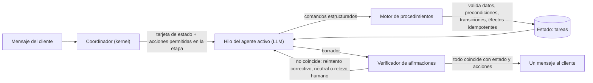

### 3.2 Decisiones de arquitectura (trade-offs con criterio)

Criterios, en orden de peso: **consistencia** (pass^k), precisión de acciones y datos, coherencia entre turnos, agentes y canales, time-to-value, latencia y costo por turno, operable por 1–3 personas, invariantes del repo.

| ID | Decisión | Opciones (✅ elegida) | Criterio decisivo |
|---|---|---|---|
| D-AOS-0 | Centro de gravedad | ✅ **A. Procedimientos tipados sobre un estado único, en un hilo por conversación** · B. Especialistas LLM independientes con A2A frente al cliente (versión anterior) · C. Seguir con prompts y playbooks (hoy) | B multiplica el error por salto y parte el contexto (§2.7). C no mejora la consistencia (§2.6). A pone la lógica de negocio en código: es el principio "kernel-first" del encargo |
| D-AOS-1 | Forma de la plataforma | ✅ **A. Evolucionar el monolito modular** · B. Microservicios · C. Reescribir sobre un framework de agentes | A reutiliza loop, RLS, outbox, panel y evals. B y C no los sostienen 1–3 personas. `docs/ADR/ADR-001-monolito-modular.md` y ADR-0021 ya fijan el monolito |
| D-AOS-2 | Conexión canónica | ✅ **A. `channel_connections` = Conexión; `meta_connections` = cuenta del proveedor (FK)** · B. Tabla nueva · C. Puente doble | A se resuelve con un backfill acotado; respeta ADR-0069/0095 |
| D-AOS-3 | Unidad de conversación | ✅ **A. Una conversación abierta por (conexión, cliente)** · B. Una por cliente (hoy) | B rompe "1 Coordinador por conexión" |
| D-AOS-4 | Contratos | ✅ **A. `procedure/1` + AgentSpec v3 (agente) + KernelSpec v1 (major con ADR; lector tolerante de v2)** · B. Todo en `extensions` · C. JSON libre | B viola "el contrato no miente" (ADR-0050); C pierde la validación |
| D-AOS-5 | Estado de la conversación | ✅ **A. Tareas *event-sourced* (`task_events`) + proyección (`conversation_tasks`)** · B. JSONB libre en `conversations.state` (hoy) · C. Solo historial | A permite reproducir un turno, auditarlo y verificarlo en las evals. Con C el modelo reconstruye el estado en cada turno |
| D-AOS-6 | Cómo habla el LLM con el kernel | ✅ **A. Comandos como acciones del core con JSON Schema, dentro del loop actual (una llamada típica)** · B. Siempre dos llamadas (entender → kernel → redactar) · C. NLU clásica entrenada | A conserva latencia y reutiliza el loop. B se reserva para etapas de riesgo alto (§7.1). C exige datos que no hay |
| D-AOS-7 | Ejecución de especialistas | ✅ **A. Agentes del mismo hilo; delegar = agente como acción; contexto propio solo en back-office** · B. Agentes con contexto propio frente al cliente · C. Agentes remotos | A da un hilo y una voz. B es la causa de inconsistencia documentada |
| D-AOS-8 | Enrutamiento | ✅ **A. Tarea en foco → reglas → disparadores (embeddings) → elección restringida del propio hilo (enum de procedimientos permitidos) → coprocesador solo con demasiados candidatos** · B. Clasificador LLM aparte en cada turno · C. Solo reglas | A no suma llamadas en la mayoría de turnos y un error de ruta se corrige dentro del hilo |
| D-AOS-9 | Verificación | ✅ **A. Verificador determinista de afirmaciones contra la evidencia del turno y luego contra el estado** · B. LLM-juez en línea en cada turno · C. Guardrails heurísticos actuales | A es barato, reproducible y medible (falsos positivos y negativos). B cuesta y no es determinista. C escala a mitad de compras |
| D-AOS-10 | Métrica de calidad | ✅ **A. pass^k con usuario simulado y aserciones de estado + muestreo de producción con LLM-juez calibrado** · B. pass@1 del golden actual · C. Solo métricas de producción | pass@1 oculta la inconsistencia (τ-bench); la simulación anticipa producción (Nubank) |
| D-AOS-11 | Versión y promoción | ✅ **A. Versiones inmutables (agente, procedimiento, grafo; las políticas viven en el KernelSpec del Coordinador) + release por conexión con puntero** · B. `is_active` por agente · C. GitOps | A da rollback atómico y claves de caché por hash |
| D-AOS-12 | Canary | ✅ **A. Porcentaje sticky por episodio de conversación, decidido por el Coordinador, + gate de pass^k + playground con la candidata** (reemplaza en parte ADR-0016; el playground reemplaza al tenant de staging, ADR-0075) · B. Mantener ADR-0016 | Ahora es factible porque el kernel elige la release; el episodio (§7.1) evita fijar una conversación para siempre |
| D-AOS-13 | Ledger A2A y aislamiento | ✅ **A. `a2a_events` append-only + FKs compuestas `(tenant_id, id)`; federación aparte con doble consentimiento (Fase 2)** · B. Solo RLS y trazas | El esquema hace imposible una referencia entre negocios |
| D-AOS-14 | Voz | ✅ **A. Una voz por conexión; presentación opcional al cambiar de agente** · B. Una persona por agente | Coherencia de marca (P-12) |
| D-AOS-15 | Topología | ✅ **A. Mantener ADR-0021 tal cual: `panel` y `gateway+consumer` se separan por `AGENT_CORE_ROLE` solo cuando se cumpla su disparador** · B. Separar ya | Sin evidencia no se separa; el Coordinador corre con el consumer |
| D-AOS-16 | Versionado de habilidades | ✅ **A. Procedimientos y contenido congelados por versión en `pack_versions`; código = binario único; las acciones con cambios rompedores conviven como `nombre_v2`** · B. Varias versiones de código en un proceso | B viola la invariante 2 |

### 3.3 Vista por planos

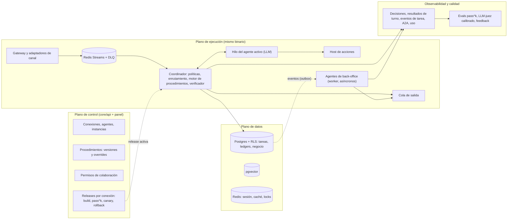

| Plano | Responsabilidad | Nuevo o cambiado | Dónde vive |
|---|---|---|---|
| Control | Configurar y versionar conexiones, agentes (las políticas van en el KernelSpec), procedimientos, permisos y releases | `core/releases/`, endpoints `/api/v1`, consola | proceso `panel` (hoy el mismo que el gateway, ADR-0021) |
| Datos | Fuente de verdad con RLS: tareas *event-sourced*, ledgers, memoria por scope | tablas de §4 | Postgres, Redis, pgvector |
| Ejecución | Turno: políticas, enrutamiento, procedimientos, hilo LLM, verificación, salida; back-office asíncrono | `core/kernel/`, `core/agents/runtime.py`, `core/backoffice/` | `gateway+consumer` (hoy el mismo proceso que el panel, ADR-0021) y `worker` |
| Observabilidad y calidad | Trazar mensaje → decisión → comandos → acciones → estado → verificación → respuesta → costo → feedback; medir pass^k | `core_decisions`, `turn_outcomes`, `task_events`, `a2a_events`, evals | Postgres + OTel |
| Seguridad | Aislamiento, secretos, acciones por etapa, auditoría, cuotas | FKs compuestas, secretos por instalación con scope, niveles T0–T4 | transversal |

### 3.4 Contenedores y topología (C4 nivel 2)

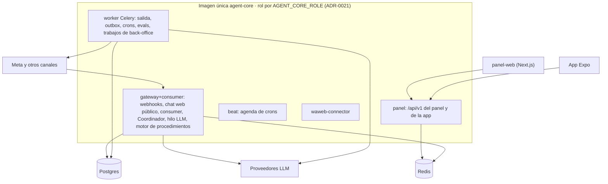

- Hoy el panel y el gateway+consumer son el mismo proceso, y así se queda (ADR-0021). El Coordinador corre donde corre el consumer.
- Se separan con la partición y el disparador de ADR-0021: cuando el panel degrade el p99 del webhook por encima del umbral operativo (**SUPUESTO A VALIDAR**: 1 s durante 15 min, calibrado con el tablero, [HU-AOS-29](hu/HU-AOS-29-tablero-de-fiabilidad.md)) y la separación es [HU-AOS-44](../../05-fase-2-plus/SPEC-27-agent-os-plus/hu/HU-AOS-44-topologia-por-roles.md).

### 3.5 Componentes del turno (C4 nivel 3)

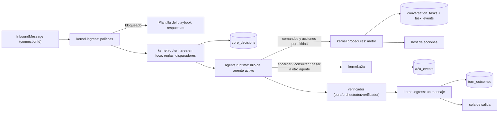

| Módulo | Origen en el código actual | Responsabilidad |
|---|---|---|
| `core/kernel/ingress.py` | `consumer.py` (pausa, escalada, palabras, horario) + `loop.py:181-204` (cuota, presupuesto) | Políticas deterministas antes de gastar LLM |
| `core/kernel/router.py` | `enrutamiento.md` (pasa a dato), `skill_router.py` (respaldo) | Tarea en foco, reglas, disparadores, candidatos (§7.1) |
| `core/kernel/procedures.py` | `core/agents/flow.py` (secciones → etapas) | Motor: datos validados, acciones por etapa, precondiciones, confirmación, transiciones, cierre |
| `core/kernel/state.py` | `conversations.state` (parcial) | Tareas *event-sourced* y tarjeta de estado |
| `core/orchestrator/verificador/` (sigue ahí, ADR-0119) | Verificador de [HU-ARCH-29](../../03-fase-0-go-live/SPEC-02-agente-confiable/hu/HU-ARCH-29-verificador-de-afirmaciones.md) | Afirmaciones contra evidencia y, desde [HU-AOS-06](hu/HU-AOS-06-comandos-y-verificador-sobre-estado.md), contra el estado de las tareas (§7.3). No hay un segundo verificador en `core/kernel/` |
| `core/kernel/a2a.py` | nuevo | Handoff, delegación, consulta, colaboración; límites y ledger (§7.2) |
| `core/agents/runtime.py` | `loop.py:206-585` | Hilo del agente activo: LLM + acciones + comandos |
| `core/agents/compiler.py` | `prompt_builder.py`, `flow.py`, `mcp/translator.py` | Agente + procedimientos → bloques de prompt, schemas y comandos (caché por hash) |
| `core/backoffice/` | `core/tasks/` | Solo el runner del back-office: disparo, presupuesto, ledger y salida como propuesta; la lógica de dominio vive en cada pack (§7.2) |
| `core/releases/` | `spec.py:252-361` | Build, pass^k, promoción, canary, rollback |

### 3.6 Procedimientos y estado de la conversación

Un **procedimiento** (superpoder) es un artefacto declarativo y versionado que trae una habilidad. Es la evolución de las secciones de `flow.json` (ADR-0054/0109): pasan de sugerencia del prompt a contrato que el kernel hace cumplir.

| Parte | Qué define | Quién la hace cumplir |
|---|---|---|
| Disparadores | Descripción, ejemplos de frases, prefijos de botones interactivos | Router (reglas + embeddings) y elección restringida del hilo |
| Datos (*slots*) | Tipo, *resolver* del servidor (catálogo, disponibilidad, plan), obligatoriedad, confirmación, clase de dato | Motor: valida; un valor inválido es un error de negocio que el modelo corrige |
| Etapas | Objetivo, **acciones permitidas**, condición de salida, riesgo | Motor: solo esas acciones se ofrecen y ejecutan |
| Precondiciones | Comprobaciones con acciones `read` (stock, estado del cliente) | Motor, antes de avanzar |
| Confirmación | Paso que exige "sí" explícito; con botón interactivo para lo irreversible | Motor (payload determinista) |
| Efectos | Acciones con clave de idempotencia; montos y links siempre del servidor | Host de acciones |
| Cierre | Evento de dominio que completa la tarea (`pedido_creado`, `pago_confirmado`) | Motor, vía outbox |
| Recuperación | Qué hacer ante error de acción o timeout | Motor |
| Afirmaciones | Qué debe coincidir con qué (monto ↔ cotización, link ↔ acción, "quedó creado" ↔ `pedido_id`) | Verificador |
| Pruebas | Escenarios de usuario simulado de la habilidad | Gate de pass^k |

**Tarjeta de estado.** Se inyecta en el bloque dinámico del prompt, justo antes de la fecha y hora, que sigue siendo lo último (ADR-0091), para no romper la caché (`PROMPT-CACHING-GUIDE.md`). Los rótulos e instrucciones de la tarjeta viven en un playbook del core (invariante 3) y el código solo serializa; los valores son dato del cliente (invariante 7): van delimitados y escapados, nunca como texto libre del prompt (ADR-0114). Ejemplo en el negocio `solvershub`:

```text
## Estado de la conversación (lo define el sistema: no lo inventes ni lo contradigas)
En foco: "Contratar un plan" v1.0 · etapa 2/4 "Datos" · agente: Ventas
  Plan: Premium · $600.000/mes            (informar_plan, turno 3)
  Correo de facturación: FALTA · pedirlo y confirmarlo
  Pago: no iniciado (el link se genera al confirmar el total)
En pausa: "Agendar demo" v1.1 · etapa "Elegir horario" · ofrecidos: jueves 10:00 y 15:00
Acciones ahora: actualizar_tarea, pausar_tarea, retomar_tarea, consultar(suscripciones.estado)
```

### 3.7 A2A en un hilo y agentes de back-office

| Modo exigido | Mecanismo (Plan B) | Inicia | Efectos | Ledger |
|---|---|---|---|---|
| **Delegación** | **Agente como acción**: `encargar(agente, procedimiento, entradas)` crea una sub-tarea del procedimiento del otro agente sobre el mismo estado. Si las entradas bastan, el motor la completa sin LLM; si no, corre un paso del otro agente con el estado completo (no un resumen) y devuelve un resultado tipado | Agente activo | Los del procedimiento destino | `a2a_events` (`delegate`) + `task_events` |
| **Handoff** | `pasar_a_agente(agente, motivo)` o iniciar un procedimiento de otro agente: el kernel cambia el agente dueño **al cerrar el turno** (dos fases); las tareas y la tarjeta viajan intactas | Agente activo o Coordinador | — | `a2a_events` (`handoff`) + `owner_changed` |
| **Consulta** | `consultar(agente, consulta, args)`: lectura tipada que declara el otro agente (`exposes.consultas`), implementada con acciones `read` o registros del core; casi siempre sin LLM | Agente activo o Coordinador | Solo lectura | `a2a_events` (`query`) |
| **Broadcast** | El Coordinador puntúa en paralelo los disparadores de todos los agentes de la conexión; el LLM solo desempata entre candidatos. En back-office sí hay fan-out real a varios agentes asíncronos | Coordinador | Ninguno | `core_decisions.candidates` (+ `a2a_events` en back-office) |
| **Colaboración** | **Pila de tareas**: dos procedimientos activos (uno en foco, otro en pausa) en el mismo hilo; el LLM escribe un solo mensaje viendo ambos en la tarjeta, con una pregunta como máximo | Coordinador (basta con que las instancias estén habilitadas en la conexión) | Los de cada procedimiento, sin cruzar | `a2a_events` (`collaborate`) + `task_events` |

**Reglas duras:**
- Nadie llama al Coordinador.
- Broadcast y colaboración son mecanismos internos del Coordinador, no llamadas entre agentes: no van en `agent_links.modes` (ADR-0116).
- Delegaciones y consultas solo hacia lo que el otro agente **expone** y el grafo **permite**.
- Profundidad máxima 3 y sin ciclos.
- Presupuesto por turno y por enlace.
- Todo lo que vuelve de otro agente es **dato validado contra schema**, nunca instrucción (invariante 7).

**Agentes de back-office** (A2A con contexto propio): corren en el `worker` y se disparan por el outbox (ADR-0107) o por crons (ADR-0044). `core/backoffice/` solo da el runner (disparo, presupuesto, ledger y salida como propuesta); los trabajos con lógica de dominio viven en su pack. Nunca escriben al cliente directamente: una propuesta es un evento del outbox que el Coordinador de la conexión procesa como un turno sin mensaje entrante, con la release de la conversación (ADR-0116). Fuera de 24 h solo sale plantilla por evento (ADR-0108); con la conexión pausada (ADR-0122) la propuesta queda `failed`, sin reintento ni escalamiento, y el trabajo no corre ni gasta LLM sobre conexiones pausadas. Los seguimientos de `pack_commerce.jobs` (`follow_up_leads` y `follow_up_quotes`), que hoy escriben directo al cliente, pasan a proponer por este camino en [HU-AOS-30](hu/HU-AOS-30-agentes-de-back-office.md).

| Agente | Disparo | Qué hace | Salida |
|---|---|---|---|
| Seguimiento | `pedido_creado` sin pago a las N h; leads y cotizaciones sin respuesta (hoy `pack_commerce.jobs`) | Prepara un recordatorio con plantilla aprobada (trabajo de pack-commerce) | Propuesta por el outbox, que el Coordinador procesa |
| Conciliación | Cron diario | Cruza pagos, pedidos y suscripciones; detecta diferencias | Alerta + tarea para humano |
| Resumen para humano | `escalation.triggered` | Arma el resumen del caso desde tareas, hechos y turnos | Nota en la bandeja |
| Auditor de calidad | Cron nocturno | Revisa una muestra de conversaciones con rúbrica (LLM-juez calibrado) | `turn_feedback` + escenarios candidatos para evals |

Hoy los cuatro casos se resuelven con un trabajo del `worker` y, donde aporta, una llamada al LLM (resumen, juez). Ninguno exige todavía un agente de varios pasos con contexto propio: ese nivel se suma cuando aparezca un caso real que lo pida.

### 3.8 Flujos de punta a punta

**Turno con procedimiento y verificador** (negocio `solvershub`):

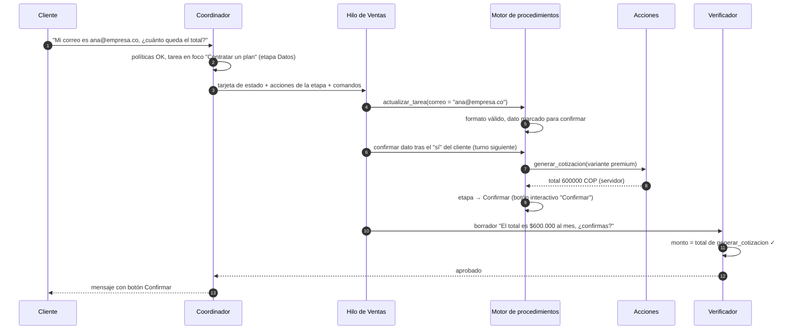

**Cambio de agente (handoff) con estado intacto:**

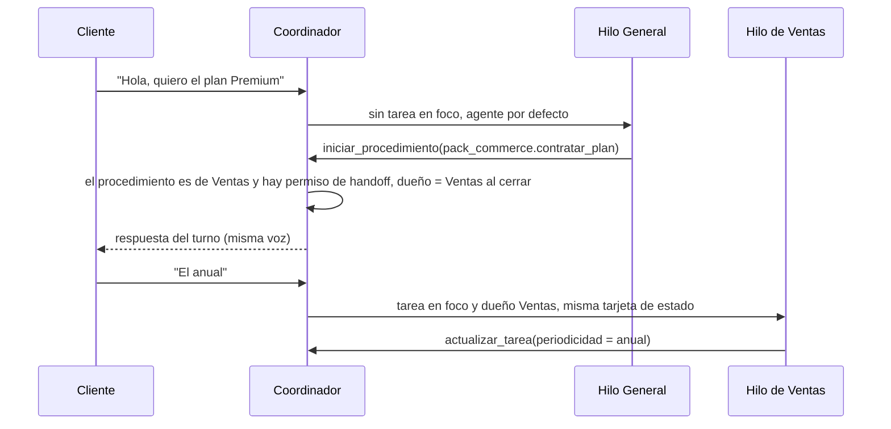

**Delegación y consulta como acciones** (sin segundo contexto):

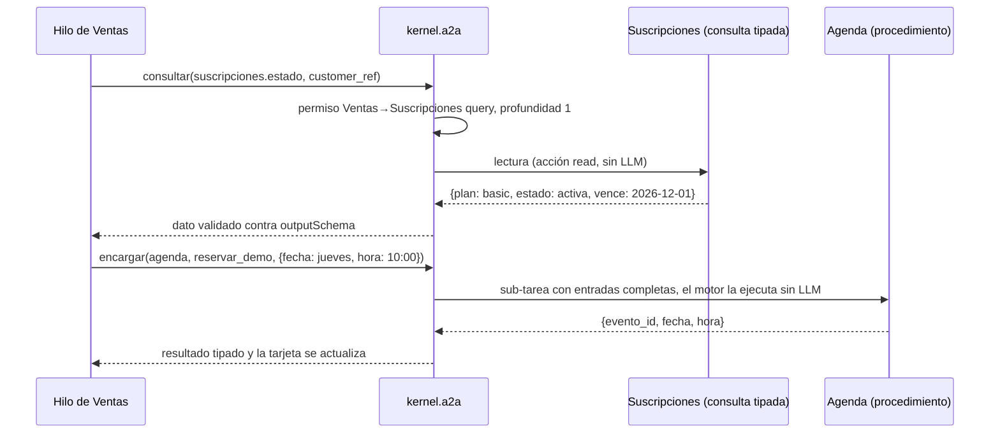

**Colaboración con pila de tareas:**

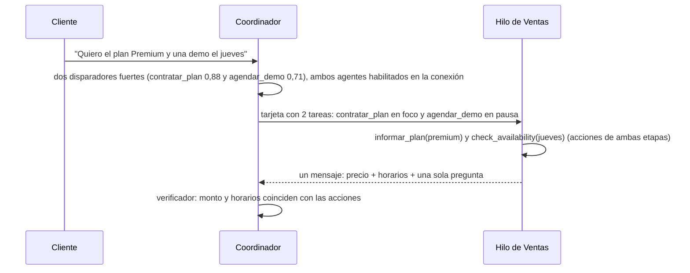

**Back-office: seguimiento de un pedido sin pagar:**

```mermaid
sequenceDiagram
  participant O as Outbox
  participant B as Agente de seguimiento (worker)
  participant K as Coordinador
  participant Q as Cola de salida
  O->>B: pedido_creado sin pago confirmado a las 24 h
  B->>B: conexión no pausada; lee tarea, pedido y ventana de 24 h, elige plantilla aprobada
  B->>O: propuesta (evento del outbox: plantilla por evento + variables del servidor)
  O->>K: turno sin mensaje entrante, con la release de la conversación
  K->>K: políticas: pausa (si está pausada: failed, sin reintento), cuota, ventana, horario
  K->>Q: plantilla
```

**Publicación con canary y rollback automático:**

```mermaid
sequenceDiagram
  actor D as Dueño
  participant P as Panel
  participant R as Releases
  participant E as Evals
  participant K as Coordinador
  D->>P: Publicar cambios de Ventas
  P->>R: build: congela agentes (con el KernelSpec y sus políticas), procedimientos, permisos y habilidades
  R->>E: pass^4 por procedimiento + ruta + journeys (worker, base agentcore_eval)
  E-->>R: pass^4 0,91 (umbral 0,85) → evaluated(passed)
  D->>P: Publicar a una parte (10 %)
  K->>K: episodios nuevos: hash(canary_release_id ‖ conversación) % 100 < 10 → candidata (sticky por episodio)
  Note over K,R: con la muestra mínima (72 h o 200 conversaciones), no-inferioridad; sin muestra en 7 días, el dueño promueve a mano
  R->>R: completitud −4 pp → auto-rollback
  R-->>P: aviso "Volvimos a la versión 12"
```

### 3.9 Cómo se cumple cada principio

| Principio | Mecanismo | Dónde |
|---|---|---|
| Kernel-first | Coordinador y motor de procedimientos en código; el LLM interpreta, propone comandos y redacta | §3.6, §7.1 |
| Determinismo donde importa | Políticas, permisos, transiciones, montos, links, confirmaciones y costos en código y datos versionados | §3.6, §7.1, §7.2 |
| Versionado inmutable | `agent_versions` (incluido el KernelSpec con sus políticas), procedimientos en `pack_versions`, `a2a_graph_versions`, `connection_releases` | §4 |
| Multi-tenant real | RLS forzada + FKs compuestas + secretos por instalación con scope + cuotas | §4, §7.7 |
| Scope explícito | Columna `scope` con CHECK en cada recurso configurable que lo necesita hoy (instalaciones, memoria, propuestas); los permisos A2A y las integraciones son del negocio hasta que un caso pida el de conexión | §4.2 |
| Aislamiento de acciones | Acciones permitidas por etapa (fail-closed), niveles T0–T4 | §7.7 |
| Memoria por scope | Tareas (estado), sesión, privada, cliente, episódica, conexión, negocio | §7.5 |
| Caché por versión | Lo compilado de una release se cachea en proceso con la clave `(tenant_id, release_hash, agent_version_hash)` y nunca se invalida | §7.6 |
| A2A acotado | Permisos, profundidad, presupuesto, sin ciclos, ledger | §7.2 |
| Observabilidad de punta a punta | `core_decisions` → `task_events` → `a2a_events` → `turn_outcomes` → `usage_ledger` → `turn_feedback` | §4, §6 |
| Evals continuas | pass^k por procedimiento, agente y ruta; LLM-juez calibrado; nocturnas | §7.4 |
| Rollback siempre | Puntero de release por conexión; auto-rollback en canary | §3.8 |
| Costos de primera | Ledger por unidad de consumo y cuotas por conexión y agente | §4, [HU-AOS-37](hu/HU-AOS-37-cuotas-y-planes.md) |
| Extensibilidad por habilidades | Procedimientos, consultas y plantillas de agente en el manifiesto | §4, [HU-AOS-16](hu/HU-AOS-16-habilidades-con-procedimientos-y-scope.md) |
| API-first + eventos | `/api/v1` + eventos con sobre CloudEvents y outbox | §5 |

---

## 4. Modelo de datos rediseñado

### 4.1 Mapa de entidades

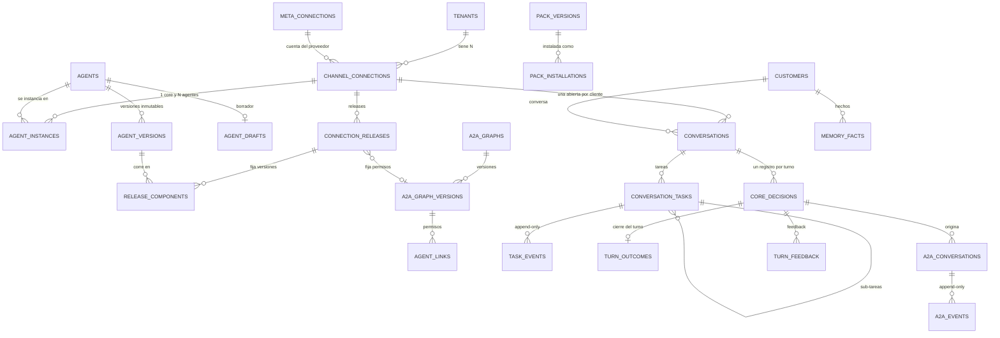

### 4.2 Scope declarado por recurso

| Recurso | Tabla | Scope | Regla |
|---|---|---|---|
| Conexión (canal conversacional) | `channel_connections` (categoría `comunicacion`) | recurso del negocio que **abre** un scope de conexión | Una por número vivo de `phone_numbers`, por página o por widget; tiene exactamente 1 Coordinador cuando está activa; su pausa, si tiene cuenta de Meta, es la de ADR-0122 |
| Integración (calendario, correo saliente) | `channel_connections` (otras categorías) | `tenant` | No tiene agentes (trigger) ni release; el gating de ADR-0072 no cambia. Ligarla a una conexión se decide cuando un negocio con varios números lo pida (ADR-0115) |
| Agente (core, especialista o back-office) | `agents`, `agent_drafts`, `agent_versions` | `tenant` | Reutilizable en varias conexiones (regla 3); declara procedimientos y consultas |
| Instancia de agente | `agent_instances` | `connection` | 1 core (índice único parcial) + N especialistas + 1 por defecto |
| Grafo A2A | `a2a_graphs`, `a2a_graph_versions`, `agent_links` | `tenant` | Un grafo por negocio, fijado en cada release. El scope de conexión (con un `deny` de conexión que gana) se agrega cuando un negocio con dos conexiones pida permisos distintos (ADR-0116) |
| Políticas (presupuestos y límites) | `policies` del KernelSpec en `agent_versions` (`budgetUsdPerConversation`, `backofficeBudgetUsdMonthly`, límites A2A del turno) | `connection` (vía la release) | No hay tablas de políticas aparte: el KernelSpec ya se versiona como agente `core` (ADR-0117) |
| Habilidad instalada | `pack_installations` | `tenant` o `connection` | La de conexión reemplaza entera a la del negocio, sin merge (ADR-0118); no lleva versión: la fija la release; los superpoderes salen de lo instalado |
| Versión de habilidad | `pack_versions` | **sistema** (catálogo global) | Excepción documentada, igual que `plans` (ADR-0045) y `connection_types` (ADR-0069); solo habilidades de la plataforma: los plugins del negocio (ADR-0089) quedan fuera |
| Procedimiento (superpoder) | `pack_versions.manifest.provides.procedures` | **sistema** (contenido versionado de la habilidad); overrides de textos y ejemplos en la versión del agente (`tenant`) | El negocio edita la estructura solo en Fase 2 ([HU-AOS-45](../../05-fase-2-plus/SPEC-27-agent-os-plus/hu/HU-AOS-45-editor-de-estructura-de-superpoderes.md)) |
| Secretos de una habilidad y de las `declarativeTools` | `pack_installations.config_encrypted`; los de `declarativeTools`, en una instalación `core` por scope que solo guarda secretos (credenciales de Meta y de Google: en su conexión, ADR-0094/0126 y ADR-0070) | `tenant` o `connection` | Gana la instalación más específica; cifrado de ADR-0027, con AAD `(tenant_id, installation_id)` en las escrituras nuevas |
| Release | `connection_releases` + componentes | `connection` | Inmutable; puntero activo y canary en la conexión |
| Hechos del cliente | `memory_facts` | `tenant` (el cliente es del negocio) | Escritura por *namespace* concedido al agente |
| Memoria semántica y episódica | `memory_vectors` | `customer`, `connection` o `tenant` (+ `agent_id` = privada) | Recall en cadena cliente → conexión → negocio |
| Tarea (instancia de procedimiento) | `conversation_tasks` + `task_events` | conversación (dentro de una conexión) | Append-only + proyección reconstruible |
| Resultado del turno | `turn_outcomes` | conversación | Append-only |
| Memoria de sesión | Redis | conversación | TTL |
| Decisiones, A2A, uso, auditoría | `core_decisions`, `a2a_*`, `usage_ledger`, `audit_log` | `connection` (con `tenant_id`) | Append-only |
| Federación (Fase 2) | `a2a_federation_grants` | entre dos negocios | Doble consentimiento, expira |

### 4.3 DDL (PostgreSQL 16)

Convenciones del repo, todas obligatorias:
- `tenant_id uuid NOT NULL`.
- RLS **habilitada y forzada** con la política `nullif(current_setting('app.tenant_id', true), '')::uuid`.
- Índices que empiezan por `tenant_id`.
- Borrado lógico (`deleted_at`) e índices únicos parciales.
- Append-only con trigger.

**Qué entra al expand ([HU-AOS-02](hu/HU-AOS-02-esquema-aditivo.md), migraciones `0067`–`0071` de agent-core) y qué no.** El bloque de abajo es el esquema completo de [SPEC-26](spec.md); el expand crea lo marcado como tal en cada sección y deja fuera, cada uno en su HU:

| Fuera del expand | Dónde va |
|---|---|
| Contract de la conversación por conexión (`uq_conversations_open_per_connection`, `ck_conv_connection_nn`, `connection_id` NOT NULL, `VALIDATE` de FKs y CHECKs) | C1, [HU-AOS-11](hu/HU-AOS-11-conexion-canonica.md) y [HU-AOS-15](hu/HU-AOS-15-migracion-sin-regresion.md) |
| Tipo `webchat` en el catálogo de código y resolvedor `SECURITY DEFINER` que reemplaza `web_chat_resolve` | [HU-AOS-11](hu/HU-AOS-11-conexion-canonica.md) (el índice `uq_cc_webchat_key` sí entra) |
| Función `SECURITY DEFINER` del sync de `pack_versions` | [HU-AOS-14](hu/HU-AOS-14-releases-por-conexion.md) |
| Memoria por scope en `memory_vectors` (columnas y CHECKs, §11) | [HU-AOS-36](hu/HU-AOS-36-memoria-por-scope.md) |
| Columnas del gate en `eval_runs`/`eval_results` (§12) | [HU-AOS-21](hu/HU-AOS-21-gate-de-release-pass-k.md) |
| `a2a_federation_grants` (§14) | Fase 2, [HU-AOS-39](../../05-fase-2-plus/SPEC-27-agent-os-plus/hu/HU-AOS-39-federacion-entre-negocios.md) |

Reglas transversales del expand, además de las del bloque 0:
- **Toda** referencia a otra entidad del negocio es FK compuesta, también en columnas nuevas de tablas existentes (`messages`, `usage_ledger`, `audit_log`: turno, conexión, instancia, versión y release, `NOT VALID`) y en referencias que el DDL de abajo dejaba sueltas (`agent_versions.legacy_agent_spec_id` → `agent_specs`, `improvement_proposals.eval_run_id` → `eval_runs`, ambas con `UNIQUE (tenant_id, id)` nuevo). Las que apuntan al **turno** (`core_decisions`) son `DEFERRABLE INITIALLY DEFERRED`: el registro del turno puede escribirse después de la fila.
- Las funciones de trigger fijan `SET search_path = pg_catalog, public, pg_temp`.
- Las tablas append-only también rechazan `TRUNCATE` (trigger `BEFORE TRUNCATE … FOR EACH STATEMENT` con `prevent_mutation()`).
- La idempotencia de índices y triggers compara por tabla (`tgrelid`, definición del índice), no solo por nombre.

Sin modelos SQLAlchemy en el expand: cada modelo llega con la HU que primero lee o escribe su tabla. Cada `ALTER` sobre una tabla grande corre en su propia transacción (`autocommit_block`, `lock_timeout` de 5 s, re-ejecutable) y Alembic confirma cada revisión por separado (`transaction_per_migration`): nunca hay dos tablas grandes bloqueadas a la vez.

**Novedad:** `UNIQUE (tenant_id, id)` en cada tabla padre y **FKs compuestas** `(tenant_id, x_id)`. Con eso, una referencia entre negocios es imposible a nivel de esquema; es la garantía dura del A2A. Donde importa, la FK compuesta también ata la **conexión** o el **agente**: el rol de una instancia es el `kind` de su agente, un componente de release es de la conexión de la release y su versión es de su agente, y el dueño de una conversación o de una decisión y el iniciador de un A2A son instancias de esa conexión. En las migraciones reales cada tabla lleva sus sentencias de RLS explícitas, porque `.claude/hooks/guards.py` las busca. El bloque de abajo las agrupa solo para leerlo.

```sql
-- ======================================================================
-- 0. Utilidades (HU-AOS-02)
-- ======================================================================
-- Función genérica nueva (ADR-0114): rechaza DELETE y todo UPDATE salvo las columnas que recibe como
-- argumento del trigger (TG_ARGV). Sin argumentos, la tabla es append-only estricta. purge_tenant la
-- salta al desactivar triggers (migración 0011), como con usage_ledger y audit_log.
CREATE OR REPLACE FUNCTION prevent_mutation() RETURNS trigger LANGUAGE plpgsql
SET search_path = pg_catalog, public, pg_temp AS $$
DECLARE v_old jsonb; v_new jsonb; v_col text;
BEGIN
  IF TG_OP IN ('DELETE','TRUNCATE') THEN                -- TRUNCATE: trigger por sentencia
    RAISE EXCEPTION '% es append-only (%)', TG_TABLE_NAME, TG_OP;
  END IF;
  v_old := to_jsonb(OLD); v_new := to_jsonb(NEW);
  IF TG_NARGS > 0 THEN
    FOREACH v_col IN ARRAY TG_ARGV LOOP                 -- columnas exentas, p. ej. 'yanked'
      v_old := v_old - v_col; v_new := v_new - v_col;
    END LOOP;
  END IF;
  IF v_old IS DISTINCT FROM v_new THEN
    RAISE EXCEPTION '% es append-only (UPDATE fuera de las columnas exentas)', TG_TABLE_NAME;
  END IF;
  RETURN NEW;
END $$;
-- Uso: sin argumentos en task_events, release_events, a2a_events, agent_versions, a2a_graph_versions,
-- agent_links, connection_releases, release_components, core_decisions, turn_outcomes y turn_feedback;
-- pack_versions la usa con 'yanked' como única columna mutable (ADR-0117 §1, ADR-0118 §1).

-- Patrón RLS (se repite para cada tabla de negocio nueva; ver lista en 0.b):
--   ALTER TABLE <t> ENABLE ROW LEVEL SECURITY;
--   ALTER TABLE <t> FORCE ROW LEVEL SECURITY;
--   CREATE POLICY <t>_tenant_isolation ON <t>
--     USING      (tenant_id = nullif(current_setting('app.tenant_id', true), '')::uuid)
--     WITH CHECK (tenant_id = nullif(current_setting('app.tenant_id', true), '')::uuid);
-- 0.b Tablas que lo llevan: agents, agent_drafts, agent_versions, agent_instances, a2a_graphs,
--     a2a_graph_versions, agent_links, pack_installations,
--     connection_releases, release_components, release_events, core_decisions,
--     conversation_tasks, task_events, turn_outcomes, a2a_conversations, a2a_events, memory_facts,
--     trigger_embeddings, turn_feedback, improvement_proposals.
-- Ninguna VISTA en public lleva columna tenant_id: purge_tenant (0011_purge_tenant.py) recorre
-- information_schema.columns y trataría la vista como tabla (DISABLE TRIGGER y DELETE fallan).

-- 0.c Banderas del Agent OS (ADR-0112). AOS_RUNTIME y AOS_PROCEDURES son configuración de plataforma
-- POR NEGOCIO, en base de datos y editable solo por el master: se encienden negocio por negocio sin
-- redeploy. tenants es tabla de sistema (sin RLS; app_runtime no la escribe). AOS_CONNECTION_ROUTING es
-- global por entorno (variable de entorno), porque su contract (ADR-0115) es global.
ALTER TABLE tenants
  ADD COLUMN aos_runtime    text    NOT NULL DEFAULT 'legacy',   -- legacy | v3
  ADD COLUMN aos_procedures boolean NOT NULL DEFAULT false;
ALTER TABLE tenants                                          -- tabla chica: entran validados
  ADD CONSTRAINT ck_tenants_aos_runtime CHECK (aos_runtime IN ('legacy','v3')),
  ADD CONSTRAINT ck_tenants_aos_order   CHECK (NOT aos_procedures OR aos_runtime = 'v3');
-- Orden de encendido: AOS_CONNECTION_ROUTING (global) → aos_runtime = 'v3' (exige la anterior encendida)
-- → aos_procedures (exige v3). Se apagan en orden inverso: apagar AOS_CONNECTION_ROUTING exige
-- aos_runtime = 'legacy' en todos los negocios. El panel del master rechaza las combinaciones inválidas
-- (la que cruza con la variable global se valida en código, no con un CHECK).

-- Claves compuestas en tablas existentes (índice concurrente y luego constraint, sin lock largo)
CREATE UNIQUE INDEX CONCURRENTLY uq_cc_tenant_id    ON channel_connections (tenant_id, id);
CREATE UNIQUE INDEX CONCURRENTLY uq_conv_tenant_id  ON conversations (tenant_id, id);
CREATE UNIQUE INDEX CONCURRENTLY uq_cust_tenant_id  ON customers (tenant_id, id);
CREATE UNIQUE INDEX CONCURRENTLY uq_meta_tenant_id  ON meta_connections (tenant_id, id);
ALTER TABLE channel_connections ADD CONSTRAINT uq_channel_connections_tenant_id UNIQUE USING INDEX uq_cc_tenant_id;
ALTER TABLE conversations       ADD CONSTRAINT uq_conversations_tenant_id       UNIQUE USING INDEX uq_conv_tenant_id;
ALTER TABLE customers           ADD CONSTRAINT uq_customers_tenant_id           UNIQUE USING INDEX uq_cust_tenant_id;
ALTER TABLE meta_connections    ADD CONSTRAINT uq_meta_connections_tenant_id    UNIQUE USING INDEX uq_meta_tenant_id;

-- ======================================================================
-- 1. Conexión canónica (expand: HU-AOS-02 · backfill/switch: HU-AOS-11)
-- ======================================================================
-- Una conexión por número (fila viva de phone_numbers), estable aunque el número cambie de cuenta:
-- revivirlo o pasarlo a otra cuenta actualiza meta_connection_id. Sin estado propio para Meta: la pausa
-- sigue siendo la de ADR-0122 (motivo_pausa de la cuenta); active/deleted_at (columnas que ya existen)
-- solo aplican a conexiones sin cuenta (manual, waweb, webchat). Las integraciones siguen siendo del
-- negocio (sin scope ni bound_connection_id, ADR-0115 §3).
ALTER TABLE channel_connections
  ADD COLUMN meta_connection_id  uuid,                                  -- cuenta del proveedor (FK compuesta abajo)
  ADD COLUMN settings            jsonb   NOT NULL DEFAULT '{}'::jsonb,  -- operativo: horario, debounce, presentación
  ADD COLUMN active_release_id   uuid,
  ADD COLUMN canary_release_id   uuid,
  ADD COLUMN canary_percent      smallint NOT NULL DEFAULT 0,
  ADD COLUMN updated_at          timestamptz NOT NULL DEFAULT now();  -- la escribe la HU que use estas columnas
ALTER TABLE channel_connections
  ADD CONSTRAINT ck_cc_canary CHECK (canary_percent BETWEEN 0 AND 50
                                  AND (canary_percent = 0 OR canary_release_id IS NOT NULL)) NOT VALID,
  -- Las filas con cuenta de Meta no guardan credenciales: siguen la regla de origen de ADR-0094.
  -- Nacen con is_primary = false y la API de conexiones manuales no las edita.
  ADD CONSTRAINT ck_cc_meta_sin_credenciales CHECK (meta_connection_id IS NULL OR credentials_encrypted IS NULL) NOT VALID,
  ADD CONSTRAINT fk_cc_meta   FOREIGN KEY (tenant_id, meta_connection_id)
                              REFERENCES meta_connections (tenant_id, id) NOT VALID;
-- Chat web: la clave pública del widget es external_id, generada ALEATORIA (≥ 128 bits; nunca derivada del
-- negocio): el índice es global y un choque de clave delataría a otro negocio. Índice único parcial GLOBAL (el endpoint público
-- resuelve sin negocio; hoy web_chat_resolve hace limit 1 sin unicidad); el aislamiento lo cubre aparte
-- el índice que empieza por tenant_id (uq_connection_tenant_provider_external). El resolvedor
-- SECURITY DEFINER sobre channel_connections reemplaza a web_chat_resolve (migración 0048); el secreto de
-- Turnstile pasa a credentials_encrypted.
CREATE UNIQUE INDEX CONCURRENTLY uq_cc_webchat_key ON channel_connections (external_id)
  WHERE type_id = 'webchat';          -- incluye las borradas: una clave pública nunca se reutiliza, tampoco en otro negocio
-- Catálogo (fuente: core/gateway/connection_types.py → sync_connection_types()):
--   nuevo tipo 'webchat' (comunicacion, produces_conversations = true); en Fase 2 'api', 'slack', 'email_imap'.

-- ======================================================================
-- 2. Agentes, borradores, versiones e instancias (expand: HU-AOS-02 · lógica: HU-AOS-12/13)
-- ======================================================================
CREATE TABLE agents (
  id              uuid PRIMARY KEY DEFAULT gen_random_uuid(),
  tenant_id       uuid NOT NULL,
  key             text NOT NULL CHECK (key ~ '^[a-z0-9_]{2,40}$'),
  kind            text NOT NULL CHECK (kind IN ('core','specialist','backoffice')),
  name            text NOT NULL,
  description     text NOT NULL DEFAULT '',      -- dato del negocio que leen el router y la consola
  source_template text,                          -- 'pack_commerce/ventas@1.4.0' o NULL si es propio
  status          text NOT NULL DEFAULT 'active' CHECK (status IN ('active','archived')),
  created_by      uuid,
  created_at      timestamptz NOT NULL DEFAULT now(),
  updated_at      timestamptz NOT NULL DEFAULT now(),
  deleted_at      timestamptz,                   -- status = archivado (visible); deleted_at = borrado lógico
  CONSTRAINT uq_agents_tenant_id      UNIQUE (tenant_id, id),
  CONSTRAINT uq_agents_tenant_id_kind UNIQUE (tenant_id, id, kind)   -- la instancia fija su rol por FK
);
CREATE UNIQUE INDEX uq_agents_tenant_key ON agents (tenant_id, key) WHERE deleted_at IS NULL;

CREATE TABLE agent_drafts (
  tenant_id       uuid NOT NULL,
  agent_id        uuid NOT NULL,
  content         jsonb NOT NULL,                -- AgentSpec v3 o KernelSpec v1 en edición
  base_version_id uuid,                          -- versión desde la que se editó (diff y conflictos)
  lock_version    integer NOT NULL DEFAULT 0 CHECK (lock_version >= 0),  -- concurrencia optimista: 409 si cambió
  updated_by      uuid,
  created_at      timestamptz NOT NULL DEFAULT now(),
  updated_at      timestamptz NOT NULL DEFAULT now(),
  deleted_at      timestamptz,
  PRIMARY KEY (tenant_id, agent_id),
  FOREIGN KEY (tenant_id, agent_id) REFERENCES agents (tenant_id, id),
  FOREIGN KEY (tenant_id, agent_id, base_version_id) REFERENCES agent_versions (tenant_id, agent_id, id)
);

CREATE TABLE agent_versions (
  id                   uuid PRIMARY KEY DEFAULT gen_random_uuid(),
  tenant_id            uuid NOT NULL,
  agent_id             uuid NOT NULL,
  version              integer NOT NULL CHECK (version > 0),
  label                text NOT NULL,            -- '1.0.3' visible
  contract             text NOT NULL CHECK (contract IN ('agentspec/3','kernelspec/1')),
  content              jsonb NOT NULL,
  content_hash         text NOT NULL CHECK (content_hash ~ '^[0-9a-f]{64}$'),  -- sha256 del JSON canónico
  legacy_agent_spec_id uuid,                     -- trazabilidad con agent_specs (backfill)
  notes                text NOT NULL DEFAULT '',
  created_by           uuid,
  created_at           timestamptz NOT NULL DEFAULT now(),
  CONSTRAINT uq_agent_versions_tenant_id UNIQUE (tenant_id, id),
  CONSTRAINT uq_agent_versions_number    UNIQUE (tenant_id, agent_id, version),
  CONSTRAINT uq_agent_versions_hash      UNIQUE (tenant_id, agent_id, content_hash),
  CONSTRAINT uq_agent_versions_agent_id  UNIQUE (tenant_id, agent_id, id),
  FOREIGN KEY (tenant_id, agent_id) REFERENCES agents (tenant_id, id),
  FOREIGN KEY (tenant_id, legacy_agent_spec_id) REFERENCES agent_specs (tenant_id, id)
);
CREATE UNIQUE INDEX uq_agent_versions_legacy ON agent_versions (tenant_id, agent_id, legacy_agent_spec_id)
  WHERE legacy_agent_spec_id IS NOT NULL;      -- backfill B2 idempotente
CREATE TRIGGER agent_versions_immutable BEFORE UPDATE OR DELETE ON agent_versions
  FOR EACH ROW EXECUTE FUNCTION prevent_mutation();

CREATE TABLE agent_instances (
  id            uuid PRIMARY KEY DEFAULT gen_random_uuid(),
  tenant_id     uuid NOT NULL,
  connection_id uuid NOT NULL,
  agent_id      uuid NOT NULL,
  role          text NOT NULL CHECK (role IN ('core','specialist','backoffice')),
  is_default    boolean NOT NULL DEFAULT false,  -- agente General: atiende lo que nadie reconoce
  priority      smallint NOT NULL DEFAULT 100,   -- desempate en broadcast y colaboración
  enabled       boolean NOT NULL DEFAULT true,
  overrides     jsonb NOT NULL DEFAULT '{}'::jsonb,  -- nombre visible, presentación al recibir handoff
  created_at    timestamptz NOT NULL DEFAULT now(),
  updated_at    timestamptz NOT NULL DEFAULT now(),
  deleted_at    timestamptz,
  CONSTRAINT uq_agent_instances_tenant_id  UNIQUE (tenant_id, id),
  CONSTRAINT uq_agent_instances_conn_id    UNIQUE (tenant_id, connection_id, id),            -- "instancia de ESTA conexión"
  CONSTRAINT uq_agent_instances_conn_agent UNIQUE (tenant_id, connection_id, agent_id, id),  -- y de este agente
  CONSTRAINT ck_agent_instances_default CHECK (NOT is_default OR role = 'specialist'),
  FOREIGN KEY (tenant_id, connection_id)  REFERENCES channel_connections (tenant_id, id),
  FOREIGN KEY (tenant_id, agent_id, role) REFERENCES agents (tenant_id, id, kind)   -- rol = kind, también si cambia el kind
);
CREATE UNIQUE INDEX uq_agent_instances_agent    ON agent_instances (tenant_id, connection_id, agent_id) WHERE deleted_at IS NULL;
CREATE UNIQUE INDEX uq_agent_instances_one_core ON agent_instances (tenant_id, connection_id) WHERE role = 'core' AND deleted_at IS NULL;
CREATE UNIQUE INDEX uq_agent_instances_default  ON agent_instances (tenant_id, connection_id) WHERE is_default AND deleted_at IS NULL;
CREATE INDEX ix_agent_instances_agent ON agent_instances (tenant_id, agent_id);

-- Solo las conexiones conversacionales tienen agentes, y una instancia no cambia de negocio, conexión, agente
-- ni rol: release_components fija instancia → versión y mover una instancia corrompería releases viejas.
-- Si la conexión no existe en ESE negocio no lanza: la FK compuesta lo rechaza (ForeignKeyViolation).
-- Una conexión vieja con type_id NULL se rechaza: el backfill de HU-AOS-11 pone type_id antes del de HU-AOS-13.
CREATE OR REPLACE FUNCTION agent_instance_checks() RETURNS trigger LANGUAGE plpgsql AS $$
DECLARE v_conv boolean;
BEGIN
  IF TG_OP = 'UPDATE' THEN
    IF (NEW.tenant_id, NEW.connection_id, NEW.agent_id, NEW.role)
       IS DISTINCT FROM (OLD.tenant_id, OLD.connection_id, OLD.agent_id, OLD.role) THEN
      RAISE EXCEPTION 'agent_instances: negocio, conexión, agente y rol no cambian (crear otra instancia)';
    END IF;
    RETURN NEW;
  END IF;
  SELECT ct.produces_conversations INTO v_conv
    FROM channel_connections cc LEFT JOIN connection_types ct ON ct.id = cc.type_id
   WHERE cc.tenant_id = NEW.tenant_id AND cc.id = NEW.connection_id;
  IF FOUND AND NOT coalesce(v_conv, false) THEN
    RAISE EXCEPTION 'la conexión % no es conversacional', NEW.connection_id;
  END IF;
  RETURN NEW;
END $$;
CREATE TRIGGER agent_instances_checks BEFORE INSERT OR UPDATE ON agent_instances
  FOR EACH ROW EXECUTE FUNCTION agent_instance_checks();

-- "Una conexión con release activa siempre tiene Coordinador" (diferido: se evalúa al COMMIT), en los dos
-- sentidos: la conexión no activa una release sin core, y el core de una conexión con release activa no se
-- deshabilita ni se borra si no queda otro. No mira la pausa: una conexión pausada (ADR-0122) conserva su
-- Coordinador, solo que no lo ejecuta. Los WHEN hacen que con el runtime de hoy (sin releases) no se encole
-- ningún evento. Ambas funciones releen la conexión con FOR SHARE (contra el write skew de dos transacciones
-- concurrentes) y fallan cerradas si no la ven (RLS de otro negocio en contexto).
CREATE OR REPLACE FUNCTION connection_requires_core() RETURNS trigger LANGUAGE plpgsql AS $$
DECLARE v_release uuid; v_deleted timestamptz;
BEGIN
  SELECT active_release_id, deleted_at INTO v_release, v_deleted
    FROM channel_connections WHERE tenant_id = NEW.tenant_id AND id = NEW.id FOR SHARE;
  IF NOT FOUND THEN
    RAISE EXCEPTION 'conexión % no visible al validar su Coordinador', NEW.id;
  END IF;
  IF v_release IS NOT NULL AND v_deleted IS NULL AND NOT EXISTS (
       SELECT 1 FROM agent_instances ai
        WHERE ai.tenant_id = NEW.tenant_id AND ai.connection_id = NEW.id
          AND ai.role = 'core' AND ai.enabled AND ai.deleted_at IS NULL) THEN
    RAISE EXCEPTION 'la conexión % tiene release activa sin Coordinador', NEW.id;
  END IF;
  RETURN NULL;
END $$;
CREATE CONSTRAINT TRIGGER channel_connections_requires_core
  AFTER INSERT OR UPDATE OF deleted_at, active_release_id ON channel_connections
  DEFERRABLE INITIALLY DEFERRED FOR EACH ROW
  WHEN (NEW.active_release_id IS NOT NULL AND NEW.deleted_at IS NULL)
  EXECUTE FUNCTION connection_requires_core();

-- Simétrico en agent_instances (connection_id y role no cambian: basta mirar enabled y deleted_at)
CREATE OR REPLACE FUNCTION core_instance_required() RETURNS trigger LANGUAGE plpgsql AS $$
DECLARE v_release uuid; v_deleted timestamptz;
BEGIN
  SELECT active_release_id, deleted_at INTO v_release, v_deleted
    FROM channel_connections WHERE tenant_id = OLD.tenant_id AND id = OLD.connection_id FOR SHARE;
  IF NOT FOUND THEN
    RAISE EXCEPTION 'conexión % no visible al validar su Coordinador', OLD.connection_id;
  END IF;
  IF v_release IS NOT NULL AND v_deleted IS NULL AND NOT EXISTS (
       SELECT 1 FROM agent_instances ai
        WHERE ai.tenant_id = OLD.tenant_id AND ai.connection_id = OLD.connection_id
          AND ai.role = 'core' AND ai.enabled AND ai.deleted_at IS NULL) THEN
    RAISE EXCEPTION 'la conexión % quedaría con release activa sin Coordinador', OLD.connection_id;
  END IF;
  RETURN NULL;
END $$;
CREATE CONSTRAINT TRIGGER agent_instances_core_required
  AFTER UPDATE OF enabled, deleted_at OR DELETE ON agent_instances
  DEFERRABLE INITIALLY DEFERRED FOR EACH ROW
  WHEN (OLD.role = 'core' AND OLD.enabled AND OLD.deleted_at IS NULL)
  EXECUTE FUNCTION core_instance_required();

-- ======================================================================
-- 3. Permisos de colaboración (grafo A2A) versionados (expand: HU-AOS-02 · lógica: HU-AOS-18)
-- ======================================================================
-- Scope de negocio por ahora (ADR-0116 §2): un grafo por negocio. El scope de conexión (columnas scope y
-- connection_id, con "un deny de conexión gana") se agrega cuando un negocio con dos conexiones pida
-- permisos distintos.
CREATE TABLE a2a_graphs (
  id            uuid PRIMARY KEY DEFAULT gen_random_uuid(),
  tenant_id     uuid NOT NULL,
  name          text NOT NULL,
  created_at    timestamptz NOT NULL DEFAULT now(),
  deleted_at    timestamptz,
  CONSTRAINT uq_a2a_graphs_tenant_id UNIQUE (tenant_id, id)
);
CREATE UNIQUE INDEX uq_a2a_graphs_tenant ON a2a_graphs (tenant_id) WHERE deleted_at IS NULL;

CREATE TABLE a2a_graph_versions (
  id           uuid PRIMARY KEY DEFAULT gen_random_uuid(),
  tenant_id    uuid NOT NULL,
  graph_id     uuid NOT NULL,
  version      integer NOT NULL CHECK (version > 0),
  -- sin límites aquí: los del turno viven en KernelSpec.a2a y los de cada enlace en agent_links
  content_hash text NOT NULL,
  created_by   uuid,
  created_at   timestamptz NOT NULL DEFAULT now(),
  CONSTRAINT uq_a2a_graph_versions_tenant_id UNIQUE (tenant_id, id),
  CONSTRAINT uq_a2a_graph_versions_number    UNIQUE (tenant_id, graph_id, version),
  FOREIGN KEY (tenant_id, graph_id) REFERENCES a2a_graphs (tenant_id, id)
);
CREATE TRIGGER a2a_graph_versions_immutable BEFORE UPDATE OR DELETE ON a2a_graph_versions
  FOR EACH ROW EXECUTE FUNCTION prevent_mutation();

CREATE TABLE agent_links (
  id               uuid PRIMARY KEY DEFAULT gen_random_uuid(),
  tenant_id        uuid NOT NULL,
  graph_version_id uuid NOT NULL,
  from_agent_id    uuid NOT NULL,
  to_agent_id      uuid NOT NULL,                  -- solo permisos (allow); el deny llega con el scope de conexión
  modes            text[] NOT NULL,
  intents          text[] NOT NULL DEFAULT '{}',   -- vacío = las que el destino expone
  max_depth        smallint NOT NULL DEFAULT 3 CHECK (max_depth BETWEEN 1 AND 5),  -- la release exige ≤ KernelSpec
  timeout_ms       integer  NOT NULL DEFAULT 15000 CHECK (timeout_ms BETWEEN 500 AND 60000),
  budget_usd       numeric(10,6) NOT NULL DEFAULT 0.02 CHECK (budget_usd >= 0),
  budget_tokens    integer  NOT NULL DEFAULT 20000 CHECK (budget_tokens >= 0),
  data_classes     text[]   NOT NULL DEFAULT ARRAY['public','internal'],
  created_at       timestamptz NOT NULL DEFAULT now(),
  -- broadcast y colaboración no son llamadas entre agentes: son mecanismos internos del Coordinador y basta
  -- con que la instancia esté habilitada en la conexión (ADR-0116 §1)
  CONSTRAINT ck_agent_links_modes CHECK (cardinality(modes) > 0
             AND modes <@ ARRAY['delegate','handoff','query']),
  CONSTRAINT ck_agent_links_data  CHECK (data_classes <@ ARRAY['public','internal','pii','sensitive']),
  CONSTRAINT ck_agent_links_self  CHECK (from_agent_id <> to_agent_id),
  FOREIGN KEY (tenant_id, graph_version_id) REFERENCES a2a_graph_versions (tenant_id, id),
  FOREIGN KEY (tenant_id, from_agent_id)    REFERENCES agents (tenant_id, id),
  FOREIGN KEY (tenant_id, to_agent_id)      REFERENCES agents (tenant_id, id)
);
CREATE UNIQUE INDEX uq_agent_links_pair ON agent_links (tenant_id, graph_version_id, from_agent_id, to_agent_id);
CREATE TRIGGER agent_links_immutable BEFORE UPDATE OR DELETE ON agent_links
  FOR EACH ROW EXECUTE FUNCTION prevent_mutation();
-- Validaciones de la release (código, con test): nadie apunta al core; agent_links.max_depth ≤ el límite
-- del KernelSpec; el grafo no tiene ciclos con handoff; todo especialista es alcanzable.

-- ======================================================================
-- 4. Políticas: sin tablas propias (ADR-0113, ADR-0117 §1)
-- ======================================================================
-- Los presupuestos y límites viven en el KernelSpec del Coordinador (policies.budgetUsdPerConversation,
-- policies.backofficeBudgetUsdMonthly y los límites A2A del turno), que ya se versiona como agente 'core'
-- en agent_versions y entra a la release. Lo operativo (pausa, horario, debounce) sigue mutable con
-- auditoría (ADR-0051): AppSettings y settings de la conexión.

-- ======================================================================
-- 5. Habilidades versionadas (con procedimientos) e instalaciones con scope
--    (expand: HU-AOS-02 · sync de pack_versions y candidatas de plataforma: HU-AOS-14 · instalaciones: HU-AOS-16)
-- ======================================================================
-- Catálogo de SISTEMA (sin tenant_id ni RLS), como plans/connection_types; la migración la marca como
-- tabla de sistema para el hook y docs/MULTITENANT.md la lista. Fuente: manifiesto del pyproject.
-- Solo habilidades de la plataforma (packages/pack-*): los plugins del negocio (ADR-0089) quedan fuera,
-- porque el catálogo lo ven todos. app_runtime solo tiene SELECT. El sync del arranque inserta con una
-- función SECURITY DEFINER propia (patrón de upsert_plan()/sync_plans(), ADR-0045, pero con
-- ON CONFLICT DO NOTHING). Si la misma (pack_id, version) llega con otro manifest_hash, el arranque alerta
-- y no la registra; el CI falla si cambia el contenido de un pack sin subir su versión.
CREATE TABLE pack_versions (
  pack_id       text NOT NULL REFERENCES plugins(id),
  version       text NOT NULL,                  -- semver del pyproject
  contract      text NOT NULL DEFAULT 'pack/2',
  manifest      jsonb NOT NULL,                 -- provides: procedures (procedure/1), consultas, tools (copia de los
                                                -- metadatos que declara el código del binario: versión, sideEffect,
                                                -- timeoutMs, retry, fallback como código de resultado, dataClasses;
                                                -- el runtime usa los del binario), agent_templates,
                                                -- playbooks (nombre, hash, texto), schemas, evals
                                                -- requires: secrets, scopes, connection_types, packs (por contrato)
  manifest_hash text NOT NULL,
  published_at  timestamptz NOT NULL DEFAULT now(),
  yanked        boolean NOT NULL DEFAULT false, -- retirada por seguridad: no instalable; nunca se borra
  PRIMARY KEY (pack_id, version),
  -- un manifest mal formado haría fallar la vista agent_templates para TODAS las filas
  CONSTRAINT ck_pack_versions_templates CHECK (
    jsonb_typeof(coalesce(manifest->'provides'->'agent_templates', '[]'::jsonb)) = 'array')
);
CREATE TRIGGER pack_versions_immutable BEFORE UPDATE OR DELETE ON pack_versions
  FOR EACH ROW EXECUTE FUNCTION prevent_mutation('yanked');   -- solo yanked puede cambiar
-- y solo de false a true: una versión retirada por seguridad no vuelve (trigger pack_versions_yank_irreversible)

-- La instalación no lleva versión de habilidad: la fija solo la release (una sola fuente, ADR-0113 §4 y
-- ADR-0118 §2). pack_id referencia plugins(id), así que también instala un plugin del negocio (ADR-0089),
-- que no tiene fila en pack_versions: su contenido es el del binario y la release lo fija por nombre de
-- instalación. Una instalación con pack_id = 'core' por scope solo guarda los secretos de las
-- declarativeTools (ADR-0113): no habilita nada, enabled_packs() la ignora y no cuenta para el tope del plan.
CREATE TABLE pack_installations (
  id               uuid PRIMARY KEY DEFAULT gen_random_uuid(),
  tenant_id        uuid NOT NULL,
  pack_id          text NOT NULL REFERENCES plugins(id),
  scope            text NOT NULL CHECK (scope IN ('tenant','connection')),
  connection_id    uuid,
  status           text NOT NULL DEFAULT 'pending_config'
                   CHECK (status IN ('pending_config','active','disabled','error')),
  config_encrypted text,                        -- migra desde plugin_configs tal cual (sin AAD); las escrituras
                                                -- nuevas atan el cifrado con AAD a (tenant_id, id) (ADR-0027)
  installed_by     uuid,
  installed_at     timestamptz NOT NULL DEFAULT now(),
  updated_at       timestamptz NOT NULL DEFAULT now(),
  deleted_at       timestamptz,
  CONSTRAINT uq_pack_installations_tenant_id UNIQUE (tenant_id, id),
  CONSTRAINT ck_pack_installations_scope CHECK ((scope = 'tenant' AND connection_id IS NULL)
                                             OR (scope = 'connection' AND connection_id IS NOT NULL)),
  CONSTRAINT ck_pack_installations_config_cifrada   -- solo texto cifrado (core/shared/crypto.py)
    CHECK (config_encrypted IS NULL OR config_encrypted ~ '^(gcm:v1:|gAAAAA)'),
  FOREIGN KEY (tenant_id, connection_id) REFERENCES channel_connections (tenant_id, id)
);
-- Un negocio no instala el plugin privado de otro: plugins gana owner_tenant_id (NULL = plataforma; sin FK a
-- tenants, que purge_tenant borra) y el trigger pack_installations_owner lo rechaza. app_runtime sigue
-- escribiendo plugins (el plugin manager la sincroniza al arrancar).
CREATE UNIQUE INDEX uq_pack_installations_scope ON pack_installations
  (tenant_id, pack_id, scope, coalesce(connection_id, '00000000-0000-0000-0000-000000000000'::uuid))
  WHERE deleted_at IS NULL;
-- Lectura (ADR-0118 §2): enabled_packs(), enabled_business_packs() y count_tenant_packs() (core/agents/spec.py)
-- son las únicas lecturas de la habilitación. Pasan a async, dejan de recibir el spec y leen de aquí: con la
-- conexión del turno en contexto, las instalaciones que aplican a esa conexión (la de conexión reemplaza
-- entera a la del negocio, sin merge); sin conexión, las de negocio más las de cualquier conexión. Sus
-- call-sites cambian en el mismo PR y el CI falla si queda una lectura de spec.packs fuera del lector
-- tolerante. plugin_manager.load_config resuelve por la conexión del turno y, si no hay, por la del negocio;
-- crons, eventos y panel usan la del negocio. El tope de habilidades del plan cuenta packs distintos.
-- Migración: desde el backfill (una instalación de negocio activa por cada pack de
-- enabled_business_packs(spec activo), con su plugin_configs si existe; las de packs no habilitados, como
-- instalación inactiva), esta tabla es la única fuente, sin importar la bandera.

CREATE VIEW agent_templates WITH (security_invoker = true) AS   -- plantillas de agente que trae cada habilidad
SELECT pv.pack_id, pv.version, t->>'key' AS template_key, t->>'name' AS name,
       t->>'description' AS description, t AS template
  FROM pack_versions pv,
       jsonb_array_elements(coalesce(pv.manifest->'provides'->'agent_templates', '[]'::jsonb)) t
 WHERE NOT pv.yanked;

-- ======================================================================
-- 6. Releases por conexión (expand: HU-AOS-02 · lógica: HU-AOS-14)
-- ======================================================================
CREATE TABLE connection_releases (
  id                          uuid PRIMARY KEY DEFAULT gen_random_uuid(),
  tenant_id                   uuid NOT NULL,
  connection_id               uuid NOT NULL,
  number                      integer NOT NULL CHECK (number > 0),
  origin                      text NOT NULL DEFAULT 'owner' CHECK (origin IN ('owner','platform')),
                                                -- platform: candidata que arma el core al registrarse una versión
                                                -- nueva de una habilidad (ADR-0117 §3)
  graph_version_id            uuid,             -- grafo A2A del negocio (scope de negocio, ADR-0116)
  manifest                    jsonb NOT NULL,   -- instantánea legible: agentes y versiones (el KernelSpec trae las
                                                -- políticas), grafo, habilidades con versión EXACTA (pack_id, version,
                                                -- manifest_hash; los rangos del agente se resuelven en el build;
                                                -- plugins del negocio solo por nombre de instalación), overrides de
                                                -- playbooks y secciones tenant del flujo (texto y hash), campos de
                                                -- AppSettings que entran al prompt (brand_voice, assistant_name,
                                                -- business_description, language), plataforma (git_sha, contratos)
  manifest_hash               text NOT NULL,
  created_by                  uuid,
  created_at                  timestamptz NOT NULL DEFAULT now(),
  CONSTRAINT uq_connection_releases_tenant_id UNIQUE (tenant_id, id),
  CONSTRAINT uq_connection_releases_conn_id   UNIQUE (tenant_id, connection_id, id),
  CONSTRAINT uq_connection_releases_number    UNIQUE (tenant_id, connection_id, number),
  CONSTRAINT uq_connection_releases_hash      UNIQUE (tenant_id, connection_id, manifest_hash),
  FOREIGN KEY (tenant_id, connection_id)    REFERENCES channel_connections (tenant_id, id),
  FOREIGN KEY (tenant_id, graph_version_id) REFERENCES a2a_graph_versions (tenant_id, id)
);
-- Lo operativo de AppSettings (horarios, pausa, debounce, guardrail_fail_action) y la configuración de las
-- instalaciones siguen en caliente y no entran a la release. El contenido del core (core/playbooks/,
-- core/flow.json) va con el binario y lo cubre el CI de la release del motor (ADR-0120), no el canary.
CREATE TRIGGER connection_releases_immutable BEFORE UPDATE OR DELETE ON connection_releases
  FOR EACH ROW EXECUTE FUNCTION prevent_mutation();

CREATE TABLE release_components (              -- qué versión corre cada instancia
  tenant_id         uuid NOT NULL,
  connection_id     uuid NOT NULL,
  release_id        uuid NOT NULL,
  agent_instance_id uuid NOT NULL,
  agent_id          uuid NOT NULL,
  agent_version_id  uuid NOT NULL,
  created_at        timestamptz NOT NULL DEFAULT now(),
  PRIMARY KEY (tenant_id, release_id, agent_instance_id),
  -- la instancia es de la conexión de la release y la versión es de su agente (no solo del mismo negocio)
  FOREIGN KEY (tenant_id, connection_id, release_id) REFERENCES connection_releases (tenant_id, connection_id, id),
  FOREIGN KEY (tenant_id, connection_id, agent_id, agent_instance_id)
                                                     REFERENCES agent_instances (tenant_id, connection_id, agent_id, id),
  FOREIGN KEY (tenant_id, agent_id, agent_version_id) REFERENCES agent_versions (tenant_id, agent_id, id)
);
CREATE TRIGGER release_components_immutable BEFORE UPDATE OR DELETE ON release_components
  FOR EACH ROW EXECUTE FUNCTION prevent_mutation();

CREATE TABLE release_events (                  -- ciclo de vida: la release no cambia, se le agregan eventos
  id            uuid PRIMARY KEY DEFAULT gen_random_uuid(),
  tenant_id     uuid NOT NULL,
  connection_id uuid NOT NULL,
  release_id    uuid NOT NULL,
  type          text NOT NULL CHECK (type IN ('built','evaluated','approved','rejected','promoted',
                                              'canary_started','canary_stopped','rolled_back','retired',
                                              'invalid')),  -- invalid: al arrancar referencia una acción ausente del binario
  data          jsonb NOT NULL DEFAULT '{}'::jsonb,  -- {eval_run_id, passed, percent, reason, from_release_id, metrics}
                                                     -- reason 'yanked': promoción directa sin canary (ADR-0117 §3)
  actor         text NOT NULL,                       -- 'admin:<uuid>' | 'system:auto-rollback' | 'system:platform'
  created_at    timestamptz NOT NULL DEFAULT now(),
  FOREIGN KEY (tenant_id, connection_id, release_id) REFERENCES connection_releases (tenant_id, connection_id, id)
);
CREATE INDEX ix_release_events_conn ON release_events (tenant_id, connection_id, created_at);
CREATE TRIGGER release_events_immutable BEFORE UPDATE OR DELETE ON release_events
  FOR EACH ROW EXECUTE FUNCTION prevent_mutation();

-- El puntero de la conexión solo apunta a SUS releases (FK compuesta con connection_id)
ALTER TABLE channel_connections
  ADD CONSTRAINT fk_cc_active_release FOREIGN KEY (tenant_id, id, active_release_id)
      REFERENCES connection_releases (tenant_id, connection_id, id) NOT VALID,
  ADD CONSTRAINT fk_cc_canary_release FOREIGN KEY (tenant_id, id, canary_release_id)
      REFERENCES connection_releases (tenant_id, connection_id, id) NOT VALID;

-- ======================================================================
-- 7. Conversaciones y mensajes (expand: HU-AOS-02 · switch/contract: HU-AOS-11)
-- ======================================================================
ALTER TABLE conversations
  ADD COLUMN release_id               uuid,          -- release del episodio en curso (sticky por episodio, §7.1)
  ADD COLUMN episode_started_at       timestamptz,   -- inicio del episodio en curso (ADR-0117 §4)
  ADD COLUMN release_lane             text,          -- stable | canary
  ADD COLUMN active_agent_instance_id uuid,          -- dueño tras un handoff; NULL = decide el Coordinador
  ADD COLUMN owner_since              timestamptz;
-- conversations.state conserva solo los contadores operativos (budget_exhausted, turnos_sin_resolver) y las
-- notas; la confirmación pendiente vive en la tarea y pending_confirmation queda solo para acciones fuera de
-- procedimiento (ADR-0114).
ALTER TABLE conversations
  ADD CONSTRAINT ck_conv_lane     CHECK (release_lane IS NULL
                                         OR (release_lane IN ('stable','canary') AND release_id IS NOT NULL)) NOT VALID,
  -- con connection_id NULL las FKs compuestas (MATCH SIMPLE) no se verificarían
  ADD CONSTRAINT ck_conv_aos_requiere_conexion CHECK (connection_id IS NOT NULL
                                  OR (release_id IS NULL AND active_agent_instance_id IS NULL)) NOT VALID,
  ADD CONSTRAINT fk_conv_connection FOREIGN KEY (tenant_id, connection_id)
                                  REFERENCES channel_connections (tenant_id, id) NOT VALID,
  ADD CONSTRAINT fk_conv_release  FOREIGN KEY (tenant_id, connection_id, release_id)
                                  REFERENCES connection_releases (tenant_id, connection_id, id) NOT VALID,
  ADD CONSTRAINT fk_conv_owner    FOREIGN KEY (tenant_id, connection_id, active_agent_instance_id)
                                  REFERENCES agent_instances (tenant_id, connection_id, id) NOT VALID;  -- dueño de ESA conexión
-- fk_conv_connection duplica la FK simple conversations_connection_id_fkey: el contract quita la simple.
-- Switch (código, sin índice): el consumer resuelve la conexión por connection_external_id (el webhook
-- no cambia) y la conversación por (conexión, cliente), y deja de reescribir connection_id. Hasta el
-- contract la búsqueda tolera duplicados y toma la abierta más reciente (apagar y volver a encender la
-- bandera puede dejar dos). Apagar la bandera es seguro mientras no exista el índice: el camino anterior
-- toma la conversación abierta más reciente del cliente (consumer.py::_resolve_conversation). La vuelta
-- atrás va en orden inverso (S2 antes que S1) y el camino anterior se modifica para que, al reescribir
-- connection_id, limpie release_id y active_agent_instance_id: fk_conv_release y fk_conv_owner apuntan a la
-- conexión anterior.
-- Contract (al menos 2 releases después del switch, sin vuelta atrás pendiente): se deduplican SIN
-- CERRAR ninguna. En cada (conexión, cliente) con más de una abierta (status IN ('open','escalated'))
-- queda la más reciente; las demás pasan sus mensajes a esa y se marcan con deleted_at; sus tareas y
-- task_events no se mueven (append-only). Recién entonces se crea el índice, con el mismo predicado.
-- ↓ CONTRACT (C1, HU-AOS-11/15): NO es del expand.
CREATE UNIQUE INDEX CONCURRENTLY uq_conversations_open_per_connection
  ON conversations (tenant_id, connection_id, customer_id)
  WHERE status IN ('open','escalated') AND deleted_at IS NULL;
ALTER TABLE conversations ADD CONSTRAINT ck_conv_connection_nn CHECK (connection_id IS NOT NULL) NOT VALID;
ALTER TABLE conversations VALIDATE CONSTRAINT ck_conv_connection_nn;
ALTER TABLE conversations ALTER COLUMN connection_id SET NOT NULL;   -- PG12+: usa el CHECK validado, sin escaneo
-- ↑ fin del contract. Desde aquí, expand otra vez.

ALTER TABLE messages
  ADD COLUMN turn_id           uuid,
  ADD COLUMN agent_instance_id uuid;              -- autor de una saliente (NULL = humano o legacy)
ALTER TABLE messages
  ADD CONSTRAINT fk_messages_turn FOREIGN KEY (tenant_id, turn_id) REFERENCES core_decisions (tenant_id, id)
      DEFERRABLE INITIALLY DEFERRED NOT VALID,
  ADD CONSTRAINT fk_messages_agent_instance FOREIGN KEY (tenant_id, agent_instance_id)
      REFERENCES agent_instances (tenant_id, id) NOT VALID;
CREATE INDEX CONCURRENTLY ix_messages_turn ON messages (tenant_id, turn_id) WHERE turn_id IS NOT NULL;

-- ======================================================================
-- 7b. Estado de la conversación: tareas event-sourced (expand: HU-AOS-02 · lógica: HU-AOS-04/05)
-- ======================================================================
CREATE TABLE conversation_tasks (               -- proyección de task_events: el estado vigente
  id                uuid PRIMARY KEY DEFAULT gen_random_uuid(),
  tenant_id         uuid NOT NULL,
  conversation_id   uuid NOT NULL,
  procedure_id      text NOT NULL,               -- 'pack_commerce.contratar_plan'
  procedure_version text NOT NULL,               -- contenido congelado por la release
  owner_instance_id uuid,                        -- agente dueño (NULL antes de HU-AOS-13)
  parent_task_id    uuid,                        -- sub-tarea de una delegación
  status            text NOT NULL DEFAULT 'active'
                    CHECK (status IN ('active','suspended','completed','cancelled','failed','escalated')),
  stage             text NOT NULL,
  slots             jsonb NOT NULL DEFAULT '{}'::jsonb,   -- validados contra el schema del procedimiento
  stack_position    smallint NOT NULL DEFAULT 0 CHECK (stack_position >= 0),  -- 0 = en foco; >0 = en pausa
  last_seq          integer NOT NULL DEFAULT 0,  -- último task_events.seq aplicado
  started_turn_id   uuid,
  completed_at      timestamptz,
  created_at        timestamptz NOT NULL DEFAULT now(),
  updated_at        timestamptz NOT NULL DEFAULT now(),
  CONSTRAINT uq_conversation_tasks_tenant_id UNIQUE (tenant_id, id),
  FOREIGN KEY (tenant_id, conversation_id)   REFERENCES conversations (tenant_id, id),
  FOREIGN KEY (tenant_id, owner_instance_id) REFERENCES agent_instances (tenant_id, id),
  FOREIGN KEY (tenant_id, parent_task_id)    REFERENCES conversation_tasks (tenant_id, id)
);
CREATE UNIQUE INDEX uq_conversation_tasks_focus ON conversation_tasks (tenant_id, conversation_id)
  WHERE status = 'active' AND stack_position = 0 AND parent_task_id IS NULL;      -- una sola tarea en foco
CREATE UNIQUE INDEX uq_conversation_tasks_open_procedure ON conversation_tasks (tenant_id, conversation_id, procedure_id)
  WHERE status IN ('active','suspended') AND parent_task_id IS NULL;             -- no dos iguales abiertas
CREATE INDEX ix_conversation_tasks_conv ON conversation_tasks (tenant_id, conversation_id, status);

CREATE TABLE task_events (                      -- append-only: fuente de verdad del estado
  id         uuid PRIMARY KEY DEFAULT gen_random_uuid(),
  tenant_id  uuid NOT NULL,
  task_id    uuid NOT NULL,
  seq        integer NOT NULL CHECK (seq > 0),
  type       text NOT NULL CHECK (type IN ('started','slot_set','slot_cleared','stage_entered','precondition_failed',
                                          'action_requested','action_succeeded','action_failed',
                                          'confirmation_requested','confirmed','suspended','resumed',
                                          'owner_changed','revalidated','episode_expired','completed','cancelled',
                                          'failed','escalated')),
  data       jsonb NOT NULL DEFAULT '{}'::jsonb,  -- {schema_version, slot, value, from_stage, to_stage, from_version,
                                                  --  to_version, action, result_ref, reason}; schema_version (del
                                                  --  procedimiento) permite reconstruir entre versiones
  actor      text NOT NULL CHECK (actor IN ('llm','kernel','tool','human','backoffice')),
  turn_id    uuid,
  created_at timestamptz NOT NULL DEFAULT now(),
  CONSTRAINT uq_task_events_seq UNIQUE (tenant_id, task_id, seq),
  FOREIGN KEY (tenant_id, task_id) REFERENCES conversation_tasks (tenant_id, id)
);
CREATE INDEX ix_task_events_turn ON task_events (tenant_id, turn_id) WHERE turn_id IS NOT NULL;
-- task_events.turn_id, conversation_tasks.started_turn_id y memory_facts.source_turn_id: FK compuesta a
-- core_decisions (tenant_id, id) DEFERRABLE INITIALLY DEFERRED (se agrega después de crear core_decisions).
CREATE TRIGGER task_events_immutable BEFORE UPDATE OR DELETE ON task_events
  FOR EACH ROW EXECUTE FUNCTION prevent_mutation();
-- La proyección (tabla, no vista, por purge_tenant) se actualiza en la MISMA transacción que el evento
-- (last_seq = seq) y se puede reconstruir desde task_events. task_events no lleva deleted_at, como
-- usage_ledger y audit_log. Las tareas siguen la regla de messages (ADR-0053): son registro del negocio,
-- la purga por cliente no las toca y solo purge_tenant las borra.
-- Tareas de un episodio anterior (ADR-0114 §1): una tarea abierta sin actividad durante todo el episodio
-- anterior se cierra al empezar el nuevo con el evento episode_expired y queda 'cancelled' (motivo
-- episode_expired); sus datos válidos pasan a memory_facts con procedencia.

-- ======================================================================
-- 8. Ledger del Coordinador: decisión al empezar, resultado al cerrar (expand: HU-AOS-02 · lógica: HU-AOS-10)
-- ======================================================================
CREATE TABLE core_decisions (                   -- cabecera del turno: id = turn_id
  id                  uuid PRIMARY KEY,
  tenant_id           uuid NOT NULL,
  connection_id       uuid,                        -- NULL solo antes de HU-AOS-11 (conexión canónica)
  conversation_id     uuid NOT NULL,
  release_id          uuid,                        -- NULL solo antes de HU-AOS-14 (releases)
  release_lane        text CHECK (release_lane IS NULL OR release_lane IN ('stable','canary','pinned','legacy')),
  inbound_message_ids uuid[] NOT NULL DEFAULT '{}',
  outcome             text NOT NULL CHECK (outcome IN ('routed','blocked','escalated','ignored')),
  blocked_by          text CHECK (blocked_by IN ('kill_switch','connection_paused','quota','budget','out_of_hours',
                                                 'escalated_conversation','escalation_keyword')),
                                                   -- connection_paused: pausa de ADR-0122, el mensaje se guarda sin IA
  active_instance_id  uuid,                        -- agente que atiende (NULL antes de HU-AOS-13)
  focus_task_id       uuid,
  route_source        text CHECK (route_source IN ('task','rule','trigger','coprocessor','default')),
  rule_id             text,
  candidates          jsonb,                       -- procedimientos ofrecidos al hilo [{procedure_id, owner, score}]
  confidence          numeric(4,3),
  llm_tokens          integer NOT NULL DEFAULT 0,  -- solo el coprocesador
  llm_cost_usd        numeric(10,6) NOT NULL DEFAULT 0,
  latency_ms          integer NOT NULL,
  trace_id            text,
  created_at          timestamptz NOT NULL DEFAULT now(),
  CONSTRAINT uq_core_decisions_tenant_id UNIQUE (tenant_id, id),
  CONSTRAINT ck_core_decisions_routed CHECK (outcome = 'routed' OR route_source IS NULL),
  -- sin conexión, las FKs compuestas de abajo (MATCH SIMPLE) no se verificarían
  CONSTRAINT ck_core_decisions_conn CHECK (connection_id IS NOT NULL OR (release_id IS NULL AND active_instance_id IS NULL)),
  FOREIGN KEY (tenant_id, connection_id)             REFERENCES channel_connections (tenant_id, id),
  FOREIGN KEY (tenant_id, connection_id, release_id) REFERENCES connection_releases (tenant_id, connection_id, id),
  FOREIGN KEY (tenant_id, conversation_id)            REFERENCES conversations (tenant_id, id),
  FOREIGN KEY (tenant_id, connection_id, active_instance_id) REFERENCES agent_instances (tenant_id, connection_id, id),
  FOREIGN KEY (tenant_id, focus_task_id)              REFERENCES conversation_tasks (tenant_id, id)
);
CREATE INDEX ix_core_decisions_conv ON core_decisions (tenant_id, conversation_id, created_at);
CREATE INDEX ix_core_decisions_conn ON core_decisions (tenant_id, connection_id, created_at);
CREATE TRIGGER core_decisions_immutable BEFORE UPDATE OR DELETE ON core_decisions
  FOR EACH ROW EXECUTE FUNCTION prevent_mutation();

CREATE TABLE turn_outcomes (                    -- cierre del turno (append-only)
  turn_id           uuid PRIMARY KEY,
  tenant_id         uuid NOT NULL,
  status            text NOT NULL CHECK (status IN ('replied','neutral','escalated','silent','failed')),
  verifier          jsonb NOT NULL DEFAULT '[]'::jsonb,  -- [{claim, kind, verdict: pass|fail|unverifiable, evidence}]
  verifier_retries  smallint NOT NULL DEFAULT 0,
  tasks_touched     uuid[] NOT NULL DEFAULT '{}',
  final_instance_id uuid,                          -- dueño al cerrar (tras un handoff)
  tokens_in         integer NOT NULL DEFAULT 0,
  tokens_out        integer NOT NULL DEFAULT 0,
  cost_usd          numeric(10,6) NOT NULL DEFAULT 0,
  latency_ms        integer NOT NULL,
  created_at        timestamptz NOT NULL DEFAULT now(),
  CONSTRAINT uq_turn_outcomes_tenant_turn UNIQUE (tenant_id, turn_id),
  FOREIGN KEY (tenant_id, turn_id)           REFERENCES core_decisions (tenant_id, id),
  FOREIGN KEY (tenant_id, final_instance_id) REFERENCES agent_instances (tenant_id, id)
);
CREATE TRIGGER turn_outcomes_immutable BEFORE UPDATE OR DELETE ON turn_outcomes
  FOR EACH ROW EXECUTE FUNCTION prevent_mutation();

-- ======================================================================
-- 9. A2A: conversación A2A (proyección) + eventos (verdad) (expand: HU-AOS-02 · lógica: HU-AOS-18/19; back-office: HU-AOS-30)
-- ======================================================================
-- Toda referencia a otra entidad del negocio (conexión, conversación, turno, instancia, versión) es FK
-- compuesta (tenant_id, …): un enlace o un evento entre negocios es imposible (ADR-0116 §4).
-- a2a_conversations es la proyección (estado, gasto, profundidad), actualizada en la misma transacción
-- que el evento y reconstruible desde a2a_events.
CREATE TABLE a2a_conversations (
  id                    uuid PRIMARY KEY DEFAULT gen_random_uuid(),
  tenant_id             uuid NOT NULL,
  connection_id         uuid NOT NULL,
  conversation_id       uuid,                    -- NULL en trabajos de back-office sin conversación
  turn_id               uuid,                    -- NULL si lo dispara un evento o un cron
  trigger               text NOT NULL DEFAULT 'turn' CHECK (trigger IN ('turn','event','cron')),
  root_mode             text NOT NULL CHECK (root_mode IN ('delegate','handoff','query','broadcast','collaborate')),
  initiator_instance_id uuid NOT NULL,
  max_depth             smallint NOT NULL CHECK (max_depth BETWEEN 1 AND 5),
  budget_usd            numeric(10,6) NOT NULL,
  budget_tokens         integer NOT NULL,
  deadline_at           timestamptz NOT NULL,
  status                text NOT NULL DEFAULT 'open' CHECK (status IN ('open','completed','failed','timed_out',
                                                                        'budget_exhausted','loop_blocked')),
  spent_usd             numeric(10,6) NOT NULL DEFAULT 0,
  spent_tokens          integer NOT NULL DEFAULT 0,
  depth_reached         smallint NOT NULL DEFAULT 0,
  calls                 integer NOT NULL DEFAULT 0,
  trace_id              text,
  started_at            timestamptz NOT NULL DEFAULT now(),
  ended_at              timestamptz,
  CONSTRAINT uq_a2a_conversations_tenant_id UNIQUE (tenant_id, id),
  CONSTRAINT ck_a2a_conversations_trigger CHECK (trigger <> 'turn' OR (turn_id IS NOT NULL AND conversation_id IS NOT NULL)),
  FOREIGN KEY (tenant_id, connection_id)         REFERENCES channel_connections (tenant_id, id),
  FOREIGN KEY (tenant_id, turn_id)               REFERENCES core_decisions (tenant_id, id),
  FOREIGN KEY (tenant_id, conversation_id)       REFERENCES conversations (tenant_id, id),
  FOREIGN KEY (tenant_id, connection_id, initiator_instance_id) REFERENCES agent_instances (tenant_id, connection_id, id)
);
CREATE INDEX ix_a2a_conversations_turn ON a2a_conversations (tenant_id, turn_id);
CREATE INDEX ix_a2a_conversations_conn ON a2a_conversations (tenant_id, connection_id, started_at);

CREATE TABLE a2a_events (                        -- append-only: fuente de verdad del A2A
  id                    uuid PRIMARY KEY DEFAULT gen_random_uuid(),
  tenant_id             uuid NOT NULL,
  a2a_conversation_id   uuid NOT NULL,
  seq                   integer NOT NULL,
  call_id               uuid NOT NULL,
  parent_call_id        uuid,
  type                  text NOT NULL CHECK (type IN ('requested','denied','accepted','completed','failed','timed_out',
                                                     'cancelled','handoff_applied','control_returned','consolidated',
                                                     'loop_detected','budget_exhausted')),
  mode                  text NOT NULL CHECK (mode IN ('delegate','handoff','query','broadcast','collaborate')),
  depth                 smallint NOT NULL CHECK (depth BETWEEN 1 AND 5),
  from_instance_id      uuid NOT NULL,
  to_instance_id        uuid,                     -- NULL en 'consolidated'
  from_agent_version_id uuid,
  to_agent_version_id   uuid,
  intent                text NOT NULL,
  payload_redacted      jsonb,                    -- nunca se guarda el payload completo
  payload_hash          text,                     -- sha256 del payload completo (detección de repetición)
  result_redacted       jsonb,
  reason                text,                     -- no_link|intent|contract|depth|cycle|repeat|fanout|data_class|health|budget|timeout
  tokens_in             integer NOT NULL DEFAULT 0,
  tokens_out            integer NOT NULL DEFAULT 0,
  cost_usd              numeric(10,6) NOT NULL DEFAULT 0,
  latency_ms            integer,
  trace_id              text,
  span_id               text,
  created_at            timestamptz NOT NULL DEFAULT now(),
  CONSTRAINT uq_a2a_events_seq UNIQUE (tenant_id, a2a_conversation_id, seq),
  FOREIGN KEY (tenant_id, a2a_conversation_id)   REFERENCES a2a_conversations (tenant_id, id),
  FOREIGN KEY (tenant_id, from_instance_id)      REFERENCES agent_instances (tenant_id, id),
  FOREIGN KEY (tenant_id, to_instance_id)        REFERENCES agent_instances (tenant_id, id),
  FOREIGN KEY (tenant_id, from_agent_version_id) REFERENCES agent_versions (tenant_id, id),
  FOREIGN KEY (tenant_id, to_agent_version_id)   REFERENCES agent_versions (tenant_id, id)
);
CREATE INDEX ix_a2a_events_call ON a2a_events (tenant_id, call_id);
CREATE INDEX ix_a2a_events_time ON a2a_events (tenant_id, created_at);
CREATE TRIGGER a2a_events_immutable BEFORE UPDATE OR DELETE ON a2a_events
  FOR EACH ROW EXECUTE FUNCTION prevent_mutation();
-- Se conserva hasta purge_tenant: una retención menor requiere un ADR que la declare como excepción a la
-- invariante 8 (ADR-0116 §4). El gasto se factura desde usage_ledger (a2a_call_id), no desde aquí.

-- Una fila por llamada: la API agrupa a2a_events por call_id en una consulta del código. No se crea
-- una vista con tenant_id en public (purge_tenant la recorrería como tabla, ver bloque 0).

-- ======================================================================
-- 10. Uso y auditoría con atribución (expand: HU-AOS-02 · lógica: HU-AOS-10)
-- ======================================================================
ALTER TABLE usage_ledger
  ADD COLUMN kind              text NOT NULL DEFAULT 'turn',   -- filas viejas = 'turn' (un solo agente)
  ADD COLUMN turn_id           uuid,
  ADD COLUMN connection_id     uuid,
  ADD COLUMN agent_instance_id uuid,
  ADD COLUMN agent_version_id  uuid,
  ADD COLUMN release_id        uuid,
  ADD COLUMN a2a_call_id       uuid,
  ADD COLUMN trace_id          text;
ALTER TABLE usage_ledger ADD CONSTRAINT ck_usage_kind
  CHECK (kind IN ('turn','agent_run','classifier','composer','embedding','eval')) NOT VALID;
ALTER TABLE usage_ledger VALIDATE CONSTRAINT ck_usage_kind;
ALTER TABLE usage_ledger                                   -- referencias compuestas, NOT VALID
  ADD CONSTRAINT ck_usage_release_conn CHECK (release_id IS NULL OR connection_id IS NOT NULL) NOT VALID,
  ADD CONSTRAINT fk_usage_turn FOREIGN KEY (tenant_id, turn_id) REFERENCES core_decisions (tenant_id, id)
      DEFERRABLE INITIALLY DEFERRED NOT VALID,
  ADD CONSTRAINT fk_usage_connection FOREIGN KEY (tenant_id, connection_id)
      REFERENCES channel_connections (tenant_id, id) NOT VALID,
  ADD CONSTRAINT fk_usage_agent_instance FOREIGN KEY (tenant_id, agent_instance_id)
      REFERENCES agent_instances (tenant_id, id) NOT VALID,
  ADD CONSTRAINT fk_usage_agent_version FOREIGN KEY (tenant_id, agent_version_id)
      REFERENCES agent_versions (tenant_id, id) NOT VALID,
  ADD CONSTRAINT fk_usage_release FOREIGN KEY (tenant_id, connection_id, release_id)
      REFERENCES connection_releases (tenant_id, connection_id, id) NOT VALID;
-- parciales: las filas viejas no entran y no suman escritura al camino caliente del ledger
CREATE INDEX CONCURRENTLY ix_usage_ledger_conn  ON usage_ledger (tenant_id, connection_id, created_at) WHERE connection_id IS NOT NULL;
CREATE INDEX CONCURRENTLY ix_usage_ledger_agent ON usage_ledger (tenant_id, agent_instance_id, created_at) WHERE agent_instance_id IS NOT NULL;
CREATE INDEX CONCURRENTLY ix_usage_ledger_turn  ON usage_ledger (tenant_id, turn_id) WHERE turn_id IS NOT NULL;
-- Billing: cada fila es una unidad de consumo distinta; en Agent OS NO se escribe una fila 'turn'
-- agregada (sin doble conteo). El gasto A2A lleva a2a_call_id y cuenta para costo_llm_usd (ADR-0045);
-- el del back-office, también, con el tope policies.backofficeBudgetUsdMonthly del KernelSpec. Las filas
-- 'eval' (gate de release, ADR-0117 §5) van a cargo de la plataforma, con tope mensual por negocio, y no se
-- facturan al negocio.

ALTER TABLE audit_log
  ADD COLUMN turn_id           uuid,
  ADD COLUMN connection_id     uuid,
  ADD COLUMN agent_instance_id uuid;
ALTER TABLE audit_log
  ADD CONSTRAINT fk_audit_turn FOREIGN KEY (tenant_id, turn_id) REFERENCES core_decisions (tenant_id, id)
      DEFERRABLE INITIALLY DEFERRED NOT VALID,
  ADD CONSTRAINT fk_audit_connection FOREIGN KEY (tenant_id, connection_id)
      REFERENCES channel_connections (tenant_id, id) NOT VALID,
  ADD CONSTRAINT fk_audit_agent_instance FOREIGN KEY (tenant_id, agent_instance_id)
      REFERENCES agent_instances (tenant_id, id) NOT VALID;
CREATE INDEX CONCURRENTLY ix_audit_log_turn ON audit_log (tenant_id, turn_id) WHERE turn_id IS NOT NULL;

-- ======================================================================
-- 11. Memoria por scope (HU-AOS-36, NO es del expand) y embeddings de disparadores (expand: HU-AOS-02 · lógica: HU-AOS-17)
-- ======================================================================
-- memory_vectors va con HU-AOS-36, no con el expand: hoy el loop guarda cada intercambio en L3 SIN customer_id
-- (core/orchestrator/loop.py → vector_memory.store_memory, que atrapa el error y solo lo registra). Con
-- scope = 'customer' por defecto, ck_mv_keys (aunque sea NOT VALID, se aplica a las filas nuevas) rechazaría
-- en silencio todos esos INSERT, y las filas viejas sin customer_id harían fallar su VALIDATE. HU-AOS-36
-- decide antes el scope de esas filas (p. ej. resolver el cliente desde la conversación al guardar, o un
-- scope propio) y recién entonces agrega las columnas y los CHECK.
ALTER TABLE memory_vectors
  ADD COLUMN scope           text NOT NULL DEFAULT 'customer',
  ADD COLUMN connection_id   uuid,
  ADD COLUMN agent_id        uuid,                -- NULL = compartida; valor = privada de ese agente
  ADD COLUMN kind            text NOT NULL DEFAULT 'exchange',
  ADD COLUMN importance      smallint NOT NULL DEFAULT 1,
  ADD COLUMN expires_at      timestamptz,
  ADD COLUMN embedding_model text,
  ADD COLUMN source_turn_id  uuid;
ALTER TABLE memory_vectors
  ADD CONSTRAINT ck_mv_scope CHECK (scope IN ('customer','connection','tenant')) NOT VALID,
  ADD CONSTRAINT ck_mv_kind  CHECK (kind  IN ('exchange','episode','fact','document')) NOT VALID,
  ADD CONSTRAINT ck_mv_keys  CHECK ((scope = 'customer'   AND customer_id   IS NOT NULL)
                                 OR (scope = 'connection' AND connection_id IS NOT NULL)
                                 OR (scope = 'tenant')) NOT VALID;
CREATE INDEX CONCURRENTLY ix_memory_vectors_scope
  ON memory_vectors (tenant_id, scope, connection_id, customer_id) WHERE deleted_at IS NULL;

CREATE TABLE memory_facts (                      -- L2 con procedencia y fuente; customers.attributes pasa a ser su
                                                  -- proyección (misma transacción) y nadie lo escribe directo (ADR-0114)
  id                     uuid PRIMARY KEY DEFAULT gen_random_uuid(),
  tenant_id              uuid NOT NULL,
  customer_id            uuid NOT NULL,
  namespace              text NOT NULL CHECK (namespace ~ '^[a-z_]{2,30}$'),  -- perfil, ventas, cobranza…
  key                    text NOT NULL CHECK (length(key) BETWEEN 1 AND 80),
  value                  jsonb NOT NULL,
  data_class             text NOT NULL DEFAULT 'internal' CHECK (data_class IN ('public','internal','pii','sensitive')),
  confidence             numeric(3,2) NOT NULL DEFAULT 1.00 CHECK (confidence BETWEEN 0 AND 1),
  source                 text NOT NULL CHECK (source IN ('tool','agent','human','import')),
  written_by_instance_id uuid,
  source_turn_id         uuid,
  valid_from             timestamptz NOT NULL DEFAULT now(),
  superseded_at          timestamptz,             -- el hecho nuevo cierra al anterior (historia)
  expires_at             timestamptz,
  deleted_at             timestamptz,
  created_at             timestamptz NOT NULL DEFAULT now(),
  CONSTRAINT uq_memory_facts_tenant_id UNIQUE (tenant_id, id),
  FOREIGN KEY (tenant_id, customer_id)            REFERENCES customers (tenant_id, id),
  FOREIGN KEY (tenant_id, written_by_instance_id) REFERENCES agent_instances (tenant_id, id)
);
CREATE UNIQUE INDEX uq_memory_facts_current ON memory_facts (tenant_id, customer_id, namespace, key)
  WHERE superseded_at IS NULL AND deleted_at IS NULL;

CREATE TABLE trigger_embeddings (               -- derivada y reconstruible por release (no es fuente de verdad)
  tenant_id       uuid NOT NULL,
  release_id      uuid NOT NULL,
  procedure_id    text NOT NULL,
  exemplar_hash   text NOT NULL,                  -- ejemplo del procedimiento o override del agente
  embedding_model text NOT NULL,
  embedding       vector(384) NOT NULL,           -- la migración usa EMBEDDING_DIMENSIONS (384 por defecto), como 0046
  created_at      timestamptz NOT NULL DEFAULT now(),
  deleted_at      timestamptz,
  PRIMARY KEY (tenant_id, release_id, procedure_id, exemplar_hash, embedding_model),
  FOREIGN KEY (tenant_id, release_id) REFERENCES connection_releases (tenant_id, id)
);

-- ======================================================================
-- 12. Evals de consistencia (HU-ARCH-28, ya en el 0A; HU-AOS-21), feedback y mejora (expand: HU-AOS-02 · lógica: HU-AOS-31/33)
-- ======================================================================
CREATE TABLE turn_feedback (
  id              uuid PRIMARY KEY DEFAULT gen_random_uuid(),
  tenant_id       uuid NOT NULL,
  turn_id         uuid NOT NULL,
  conversation_id uuid NOT NULL,
  source          text NOT NULL CHECK (source IN ('customer','owner','human_agent','outcome','guardrail','eval')),
  signal          text NOT NULL,   -- thumbs_down|csat|takeover_edit|order_paid|appointment_booked|escalated|guardrail_failed
  score           numeric(4,2),
  note            text,
  created_by      text NOT NULL,   -- 'admin:<uuid>' | 'system' | 'customer'
  created_at      timestamptz NOT NULL DEFAULT now(),
  FOREIGN KEY (tenant_id, turn_id)         REFERENCES core_decisions (tenant_id, id),
  FOREIGN KEY (tenant_id, conversation_id) REFERENCES conversations (tenant_id, id)
);
CREATE INDEX ix_turn_feedback_turn ON turn_feedback (tenant_id, turn_id);
CREATE INDEX ix_turn_feedback_time ON turn_feedback (tenant_id, created_at);
CREATE TRIGGER turn_feedback_immutable BEFORE UPDATE OR DELETE ON turn_feedback
  FOR EACH ROW EXECUTE FUNCTION prevent_mutation();

CREATE TABLE improvement_proposals (
  id            uuid PRIMARY KEY DEFAULT gen_random_uuid(),
  tenant_id     uuid NOT NULL,
  scope         text NOT NULL CHECK (scope IN ('tenant','connection')),
  connection_id uuid,
  agent_id      uuid,
  kind          text NOT NULL CHECK (kind IN ('trigger_examples','procedure_texts','playbook','tool_description')),
  evidence      jsonb NOT NULL,                   -- turn_ids, métricas, agrupación
  change        jsonb NOT NULL,                   -- diff propuesto sobre el borrador del agente
  status        text NOT NULL DEFAULT 'proposed' CHECK (status IN ('proposed','evaluating','approved','rejected','applied')),
  eval_run_id   uuid,
  decided_by    uuid,
  decided_at    timestamptz,
  created_at    timestamptz NOT NULL DEFAULT now(),
  updated_at    timestamptz NOT NULL DEFAULT now(),
  deleted_at    timestamptz,
  CONSTRAINT ck_improvement_scope CHECK ((scope = 'tenant' AND connection_id IS NULL)
                                      OR (scope = 'connection' AND connection_id IS NOT NULL)),
  FOREIGN KEY (tenant_id, connection_id) REFERENCES channel_connections (tenant_id, id),
  FOREIGN KEY (tenant_id, agent_id)      REFERENCES agents (tenant_id, id),
  FOREIGN KEY (tenant_id, eval_run_id)   REFERENCES eval_runs (tenant_id, id)
);
CREATE INDEX ix_improvement_status ON improvement_proposals (tenant_id, status, created_at) WHERE deleted_at IS NULL;
-- El CHECK de kind impide que una propuesta toque la estructura de un procedimiento (etapas, datos,
-- acciones), permisos, presupuestos o políticas: eso siempre lo cambia una persona.

-- HU-ARCH-28 (ya, en el 0A, migración 0058 de agent-core): consistencia medida con pass^k. Una fila de
-- eval_results es un ESCENARIO con sus k intentos agregados (no un intento: no hay columna trial).
--   eval_runs:    k integer NOT NULL DEFAULT 1, pass_1 numeric(5,4), pass_k numeric(5,4), simulator jsonb
--   eval_results: k, pass_1, pass_k, simulator, inestable boolean, state_assertions jsonb, verifier jsonb
-- HU-AOS-21 (gate de release, NO es del expand) agrega, nulas y sin CHECK (ADR-0117 §5):
ALTER TABLE eval_runs    ADD COLUMN release_id   uuid;   -- release candidata evaluada
ALTER TABLE eval_results ADD COLUMN procedure_id text;   -- gate por procedimiento
-- Si el gate necesita más (conexión, objetivo de la corrida, ruta esperada y real), las agrega HU-AOS-21 con
-- su propio diseño.

-- ======================================================================
-- 13. Secretos con scope: sin tabla nueva (HU-AOS-16)
-- ======================================================================
-- Los secretos de una habilidad viajan cifrados en pack_installations.config_encrypted (AES-GCM,
-- ADR-0027), con scope de negocio o de conexión. Los de las declarativeTools van en la instalación 'core'
-- del scope: el AgentSpec los declara por referencia ({"Authorization": {"secret": "<nombre>"}}) y nunca
-- como literal (ADR-0113 §2). Los secretos de una integración que es una conexión siguen en la conexión:
-- Google (ADR-0070) y Meta (ADR-0094/0126). No se crea un esquema vault: purge_tenant solo recorre public.

-- ======================================================================
-- 14. Federación entre negocios (Fase 2, HU-AOS-39; apagada por bandera; NO es del expand)
-- ======================================================================
CREATE TABLE a2a_federation_grants (
  id                   uuid PRIMARY KEY DEFAULT gen_random_uuid(),
  tenant_id            uuid NOT NULL,             -- proveedor: dueño del agente expuesto
  consumer_tenant_id   uuid NOT NULL,             -- quien puede llamarlo
  provider_agent_id    uuid NOT NULL,
  intents              text[] NOT NULL CHECK (cardinality(intents) > 0),
  modes                text[] NOT NULL DEFAULT ARRAY['query'] CHECK (modes <@ ARRAY['query','delegate']),
  data_classes         text[] NOT NULL DEFAULT ARRAY['public'] CHECK (data_classes <@ ARRAY['public','internal']),
  budget_usd_month     numeric(10,2) NOT NULL DEFAULT 0,
  status               text NOT NULL DEFAULT 'proposed' CHECK (status IN ('proposed','active','revoked','expired')),
  provider_approved_by uuid, provider_approved_at timestamptz,
  consumer_approved_by uuid, consumer_approved_at timestamptz,
  expires_at           timestamptz NOT NULL,
  created_at           timestamptz NOT NULL DEFAULT now(),
  updated_at           timestamptz NOT NULL DEFAULT now(),
  CONSTRAINT ck_federation_distinct CHECK (tenant_id <> consumer_tenant_id),
  CONSTRAINT ck_federation_active   CHECK (status <> 'active'
                                        OR (provider_approved_at IS NOT NULL AND consumer_approved_at IS NOT NULL)),
  FOREIGN KEY (tenant_id, provider_agent_id) REFERENCES agents (tenant_id, id)
);
ALTER TABLE a2a_federation_grants ENABLE ROW LEVEL SECURITY;
ALTER TABLE a2a_federation_grants FORCE ROW LEVEL SECURITY;
CREATE POLICY a2a_federation_grants_parties ON a2a_federation_grants FOR SELECT
  USING (nullif(current_setting('app.tenant_id', true), '')::uuid IN (tenant_id, consumer_tenant_id));
-- Sin políticas de INSERT/UPDATE para app_runtime: solo funciones SECURITY DEFINER
-- federation_propose/approve/revoke (cada parte firma su lado). purge_tenant también borra
-- donde consumer_tenant_id = tid.
```

**Migraciones posteriores al expand (2026-10-10, en `develop`).** Lo que agregaron las HU de código sobre el
esquema de arriba; el código manda sobre este resumen:

| Migración | HU | Qué agrega |
|---|---|---|
| `0072` | arreglo de `purge_tenant` (#408) | `purge_tenant` con `SET session_replication_role = replica` y solo con el negocio suspendido; en producción requiere `GRANT SET ON PARAMETER session_replication_role` al dueño antes de desplegar |
| `0073` | [HU-AOS-11](hu/HU-AOS-11-conexion-canonica.md) (#427) | las funciones de ruteo y reclamo de números ignoran las filas de `channel_connections` cuya cuenta de Meta se dio de baja |
| `0074` | [HU-AOS-04](hu/HU-AOS-04-estado-de-la-conversacion.md) (#426) | `conversation_tasks.pending_confirmation` y `status_reason`, con CHECKs de coherencia |
| `0076` | [HU-AOS-12](hu/HU-AOS-12-agentes-versionados.md) (#429) | fila `core` en `plugins` para la instalación que guarda los secretos de las tools declarativas (AES-GCM con AAD por negocio e instalación) |

### 4.4 Migraciones y rollback (expand → backfill → switch → contract)

| Paso | HU | Qué hace | Seguridad operativa | Reversa |
|---|---|---|---|---|
| E0 · Evals (ya, en el 0A) | ARCH-28 | Columnas aditivas en `eval_runs` y `eval_results` (k, pass_1, pass_k, aserciones, veredictos) | Sin efecto en el runtime | `downgrade` quita las columnas |
| E1 · Expand | AOS-02 | Migraciones `0067`–`0071`: tablas vacías, columnas nullables o con default constante, índices `CONCURRENTLY` (en `autocommit_block` de Alembic), constraints `NOT VALID`, RLS, `prevent_mutation()` genérica, triggers del Coordinador y las banderas por negocio en `tenants`. Sin modelos SQLAlchemy | Sin reescritura de tablas; cada tabla grande se altera en su propia transacción con `lock_timeout` (nunca dos bloqueadas a la vez) y Alembic confirma cada revisión por separado (`transaction_per_migration`); `downgrade` probado en el stack efímero | `downgrade` borra lo nuevo (no tiene datos) |
| G0 · Guardas de pausa | AOS-11 | **Antes del backfill**: las guardas que usan `connection_id IS NULL` y leen `conversations.meta_connection_id` (`motivo_pausa_de_conversacion`, `_registrar_si_pausada`, `outbound_send`, `event_notices`, `conversations._rechazar_si_conexion_pausada`) y `sender.resolve_credentials` pasan a resolver la cuenta por `channel_connections.meta_connection_id`; el sender envía por el número de la conexión de la conversación | Tests de pausa con conversaciones con y sin `connection_id`; si no, la pausa se saltaría en silencio y los envíos escalarían | Revertir el PR (todavía no hay datos nuevos) |
| B1 · Backfill de conexiones | AOS-11 | Una fila de `channel_connections` por cada número vivo de WhatsApp (BYOK, Embedded Signup o manual) que no la tiene; chat web → conexión `webchat`; `conversations.connection_id`. Messenger e Instagram quedan fuera hasta que haya un cliente. Desde el despliegue, toda alta o reconexión crea o revive su conexión en la transacción de `claim_assets` (los cinco caminos de ADR-0122 §6) y la promoción de ADR-0127 §3 crea la del número real con sus instancias y su release clonadas | Lotes de 1.000 por negocio en `tenant_scope`; idempotente; *dry-run* con conteos que reporta los choques con una conexión manual del mismo `external_id` sin crear una segunda fila | Script inverso por lote |
| S1 · Ruteo por conexión | AOS-11 | El consumer resuelve la conexión por `connection_external_id` (el webhook no cambia); conversación por (conexión, cliente); se deja de reescribir `connection_id` | Bandera global `AOS_CONNECTION_ROUTING`, todavía sin índice único | Bandera apagada: segura hasta el *contract* y en orden inverso (primero S2); el camino anterior toma la conversación abierta más reciente y, al cambiar de conexión, limpia `release_id` |
| B2 · Backfill de agentes | AOS-13/14 | Por negocio: `coordinador` (KernelSpec derivado de la `persona` v2 y los valores por defecto) + `general` (AgentSpec v2 activo → v3) en **cada** conexión conversacional; release 1 por conexión, desde el AgentSpec v2 activo y los artefactos del disco; puntero activo | Idempotente por `legacy_agent_spec_id`; los secretos literales de `declarativeTools` pasan a la configuración cifrada (instalación `core`) antes de crear la primera `agent_version`, que es inmutable | `aos_runtime = 'legacy'` |
| S2 · Runtime por releases | AOS-14/15 | El kernel resuelve agente, procedimientos y permisos desde la release del episodio | `aos_runtime = 'v3'` por negocio (exige S1) + pass^k sin regresión | `aos_runtime = 'legacy'`: ignora `release_id`, lee de `agent_specs` y del disco y sigue el rollback de ADR-0051 §1 |
| S3 · Motor de procedimientos | AOS-04/05/07/08 (encendido en AOS-15) | Las conversaciones **nuevas** de un negocio con `aos_procedures` nacen con tareas; las abiertas pasan al motor al empezar su siguiente episodio (tras `episode.idleMinutes` sin mensajes). Antes de encenderlo, el motor se construye y se mide en evals y en modo sombra | `aos_procedures` por negocio (exige `aos_runtime = 'v3'`) + pass^4 de [HU-ARCH-28](../../03-fase-0-go-live/SPEC-02-agente-confiable/hu/HU-ARCH-28-evals-de-consistencia-pass-k.md) igual o mejor (valor y fecha en la bitácora, ADR-0112) | `aos_procedures = false`: vuelve el flujo por prompt |
| B3 · Backfill de instalaciones | AOS-16 | Una instalación de negocio activa por cada pack de `enabled_business_packs(spec activo)`, con su `plugin_configs` si existe (cifrado tal cual); las filas de packs no habilitados, como instalación inactiva. Desde aquí `pack_installations` es la única fuente de habilitación, sin importar la bandera; `spec.packs` queda de solo lectura y un rollback del AgentSpec (ADR-0051) ya no cambia los packs | Idempotente; las lecturas pasan por `enabled_packs()` y sus pares, ya `async` | Script inverso por lote (las filas de `plugin_configs` no se tocan) |
| C1 · Contract | AOS-11/15 (≥ 2 releases estables) | Deduplicar sin cerrar las conversaciones abiertas por (conexión, cliente) y crear el índice único; `connection_id` NOT NULL; `VALIDATE` de FKs y CHECKs; en `core_decisions`, `release_id` y `connection_id` pasan a obligatorios con CHECK validado; `agent_specs` solo lectura. En el mismo cambio en que el sender y las guardas dejan de leer `conversations.meta_connection_id`, se elimina `meta_asset_claims.mover_conversaciones` (no antes: tras una reconexión la conversación apuntaría a una cuenta sin números vivos) | `VALIDATE` sin lock exclusivo | Solo con 2 releases estables sin rollback |

**Banderas y orden de encendido** (ADR-0112). `AOS_CONNECTION_ROUTING` es global por entorno, porque su *contract* es global. `AOS_RUNTIME` (`legacy` | `v3`) y `AOS_PROCEDURES` son configuración de plataforma **por negocio**, guardada en base de datos (`tenants.aos_runtime`, `tenants.aos_procedures`) y editable solo por el master: se encienden negocio por negocio sin redeploy. Se encienden en el orden `AOS_CONNECTION_ROUTING` → `AOS_RUNTIME = v3` → `AOS_PROCEDURES` y se apagan en orden inverso; apagar `AOS_CONNECTION_ROUTING` exige `AOS_RUNTIME = legacy` en todos los negocios. El panel del master rechaza las combinaciones inválidas. Una conexión pausada (ADR-0122) no ejecuta el Coordinador con ninguna combinación: el mensaje se guarda sin IA, como hoy.

### 4.5 Volumen, índices y retención

| Tabla | Volumen (SUPUESTO A VALIDAR) | Índices clave | Retención |
|---|---|---|---|
| `core_decisions` | 1 fila por turno | `(tenant, conversation, time)`, `(tenant, connection, time)` | Hasta `purge_tenant` (append-only; una retención menor requiere un ADR, invariante 8) |
| `task_events` | 3–15 filas por tarea | `(tenant, task, seq)`, `(tenant, turn)` | Mientras exista el negocio, como `messages` (ADR-0053) |
| `turn_outcomes` | 1 fila por turno | PK + `(tenant, turn)` | Hasta `purge_tenant` (como `core_decisions`) |
| `a2a_events` | 2–6 filas por llamada A2A | `(tenant, call)`, `(tenant, time)` | Hasta `purge_tenant`: una retención menor requiere un ADR que la declare como excepción a la invariante 8 (ADR-0116 §4). Solo payload redactado + hash, **nunca** el completo |
| `usage_ledger` | 1–4 filas por turno | `(tenant, connection, time)`, `(tenant, agent, time)`, `(tenant, turn)` | Plazo contable (SUPUESTO: 5 años) |
| `memory_facts` / `memory_vectors` | por cliente | únicos parciales, `(tenant, scope, …)` | Por scope (§7.5); el cron de retención (`MEMORY_RETENTION_DAYS`) cubre `memory_facts`; purga por cliente (ADR-0053) |

Las tablas append-only de alto volumen se **particionan por mes** cuando pasen de unos 10 M de filas (SUPUESTO A VALIDAR), para mantenimiento e índices. Borrar particiones antes de `purge_tenant` es una retención menor y requiere su propio ADR (invariante 8, ADR-0116 §4).

---

## 5. Contratos de API y eventos

### 5.1 API `/api/v1` (OpenAPI resumido)

Realm `admin` (ADR-0077). Los permisos son secciones de RBAC (ADR-0047/0063): se suman `agentes`, `colaboracion`, `versiones` y `observabilidad` a `conexiones`, `habilidades` y `conversaciones`. Reglas:
- Si el usuario no tiene permiso, la acción **no se muestra** (constitución §1.3).
- Un recurso de otro negocio devuelve **404** (RLS).
- `docs/openapi.json` se regenera con `scripts/export_openapi.py`.

```yaml
openapi: 3.1.0
info: {title: "agent-core /api/v1 · Agent OS", version: "1.x"}
paths:
  # ---------- Conexiones (scope raíz) ----------
  /connections:
    get:  {summary: "Lista con Coordinador, agentes, release activa o canary, salud y consumo de 7 días", x-perm: "conexiones:ver"}
    post: {summary: "Alta desde el catálogo de tipos (whatsapp_meta, webchat, …)", x-perm: "conexiones:editar"}
  /connections/{id}:
    get:   {summary: "Hub de la conexión"}
    patch: {summary: "Etiqueta y ajustes operativos (horario, debounce, presentación); queda en audit_log. Las credenciales de una fila con cuenta de Meta no se editan aquí (ADR-0094)"}
  /connections/{id}/pause:  {post: {summary: "Pausar: con cuenta de Meta es la pausa de ADR-0122 (desactivar la cuenta); sin cuenta, active = false"}}
  /connections/{id}/resume: {post: {summary: "Reanudar (ADR-0122 en las de Meta)"}}
  /connections/{id}/agents:
    get:  {summary: "Instancias: rol, por defecto, prioridad, versión en la release activa"}
    post: {summary: "Agregar agente {agent_id, is_default?, priority?, overrides?}", x-perm: "agentes:editar"}
  /connections/{id}/agents/{instanceId}:
    patch:  {summary: "Prioridad, habilitado, overrides"}
    delete: {summary: "Quitar (borrado lógico); 409 si es el Coordinador o el único por defecto"}
  /connections/{id}/routing/test:
    post: {summary: "{text, release_id?} → {procedure, owner, source, confidence, candidates, rule_id}", x-perm: "agentes:ver"}
  # ---------- Agentes (scope negocio) ----------
  /agent-templates: {get: {summary: "Plantillas de agente de las habilidades instaladas"}}
  /agents:
    get:  {summary: "Agentes del negocio con 'usado en' (conexiones)"}
    post: {summary: "{key, kind, name, description, template?} → crea el agente y su borrador", x-perm: "agentes:editar"}
  /agents/{id}:
    get:    {summary: "Agente + borrador + versiones"}
    patch:  {summary: "Nombre, descripción, estado"}
    delete: {summary: "Archivar; 409 si está instanciado en una conexión activa"}
  /agents/{id}/draft:
    get: {summary: "Borrador vigente (AgentSpec v3: procedimientos, overrides, consultas expuestas)"}
    put: {summary: "{content, lock_version}; 409 si otro lo cambió; 422 con errores del contrato"}
  /agents/{id}/versions:
    get:  {summary: "Historial"}
    post: {summary: "Publicar el borrador → versión inmutable {version, content_hash}; no la activa"}
  /agents/{id}/versions/{vid}: {get: {summary: "Contenido congelado"}}
  # ---------- Procedimientos (superpoderes) ----------
  /procedures:               {get: {summary: "Superpoderes instalados: versión, disparadores, datos, etapas, confirmaciones y pruebas"}}
  /procedures/{procedureId}: {get: {summary: "Detalle por versión, con diferencias entre versiones"}}
  /procedures/validate:      {post: {summary: "{procedure} → errores del contrato procedure/1 (linter de autores y del master)", x-perm: "habilidades:editar"}}
  # ---------- Estado de la conversación ----------
  /conversations/{id}/tasks:                   {get: {summary: "Tareas en foco, en pausa y cerradas, con la tarjeta de estado vigente", x-perm: "conversaciones:ver"}}
  /conversations/{id}/tasks/{taskId}/events:   {get: {summary: "Historia de la tarea (task_events)"}}
  /conversations/{id}/tasks/{taskId}/cancel:   {post: {summary: "{motivo}: cancelar desde la bandeja (acción humana)", x-perm: "conversaciones:atender"}}
  # ---------- Colaboración (permisos A2A) ----------
  /a2a/graphs:
    get:  {summary: "Permisos del negocio (scope de negocio; el de conexión llega cuando un negocio lo pida, ADR-0116)"}
    post: {summary: "Crea el grafo del negocio si no existe", x-perm: "colaboracion:editar"}
  /a2a/graphs/{id}/draft:
    get: {summary: "Borrador de permisos"}
    put: {summary: "{links[], lock_version}"}
  /a2a/graphs/{id}/versions:
    get:  {summary: "Versiones"}
    post: {summary: "Congelar el borrador"}
  /a2a/graphs/validate:
    post: {summary: "{draft, connection_id} → {errors[], warnings[]}: ciclos de handoff, procedimientos o consultas no expuestos, agentes inalcanzables, max_depth por encima del KernelSpec, clases de datos"}
  # ---------- Releases ----------
  /connections/{id}/releases:
    get:  {summary: "Historial con eventos"}
    post: {summary: "Build de candidata → {release_id, number, origin, manifest_hash, diff}; valida contratos al guardar (ADR-0113)", x-perm: "versiones:publicar"}
  /connections/{id}/releases/{rid}:          {get: {summary: "Manifiesto + release_events"}}
  /connections/{id}/releases/{rid}/diff:     {get: {summary: "?against=active → cambios legibles"}}
  /connections/{id}/releases/{rid}/evaluate: {post: {summary: "Encola el gate en el worker contra agentcore_eval (pass^k por procedimiento, ruta y journeys) → eval_run_id"}}
  /connections/{id}/releases/{rid}/promote:  {post: {summary: "{mode: full|canary, percent?}; 409 sin gate aprobado. A los 7 días de canary sin muestra mínima, el dueño promueve a mano"}}
  /connections/{id}/releases/{rid}/stop:     {post: {summary: "Detener una candidata (también las de origin = platform)"}}
  /connections/{id}/rollback:                {post: {summary: "{to_release_id?}: un clic; por defecto vuelve a la anterior promovida"}}
  # ---------- Habilidades ----------
  /packs:                   {get: {summary: "Catálogo con versiones, procedimientos, consultas y plantillas"}}
  /packs/{packId}/versions: {get: {summary: "Versiones publicadas (retiradas marcadas)"}}
  /pack-installations:
    get:  {summary: "Instalaciones por scope"}
    post: {summary: "{pack_id, scope, connection_id?, config}: sin versión, la fija la release", x-perm: "habilidades:editar"}
  /pack-installations/{id}:
    patch:  {summary: "Configuración o estado"}
    delete: {summary: "Desinstalar (borrado lógico)"}
  # Presupuestos y límites: se editan en el KernelSpec del Coordinador (/agents/{id}/draft); no hay /policies
  # ---------- Observabilidad y calidad ----------
  /turns:                   {get: {summary: "?connection_id&conversation_id&from&to&outcome", x-perm: "observabilidad:ver"}}
  /turns/{turnId}:          {get: {summary: "Línea de tiempo: decisión, comandos, acciones, cambios de estado, verificador, envío, costo, feedback"}}
  /turns/{turnId}/feedback: {post: {summary: "{signal, score?, note?}"}}
  /turns/{turnId}/to-eval:  {post: {summary: "Convierte el turno en escenario de usuario simulado"}}
  /a2a/calls:               {get: {summary: "?connection_id&agent_id&mode&status&from&to"}}
  /usage:                   {get: {summary: "?group_by=connection|agent|procedure|a2a|tool|day&from&to"}}
  /evals/runs:
    get:  {summary: "Corridas con pass@1 y pass^k"}
    post: {summary: "{target_kind, target_id, k, release_id?}"}
  /evals/runs/{id}:         {get: {summary: "Por escenario e intento: aserciones de estado, veredictos del verificador, ruta esperada y real"}}
  /playground/turns:        {post: {summary: "{connection_id, release_id?, messages[]}: sin efectos reales (HU-ARCH-14), con traza y estado"}}
  /improvements:            {get: {summary: "Propuestas de mejora"}}
  /improvements/{id}/approve: {post: {summary: "Aprobar: crea borrador y release candidata", x-perm: "versiones:publicar"}}
  /improvements/{id}/reject:  {post: {summary: "Rechazar con motivo"}}
```

### 5.2 Contratos: procedimiento, agente, Coordinador y comandos

**`procedure/1`** (lo publica la habilidad; nuevo, con ADR). Ejemplo del negocio `solvershub`:

```json
{
  "contract": "procedure/1",
  "id": "pack_commerce.contratar_plan",
  "version": "1.0.0",
  "title": "Contratar un plan",
  "triggers": {
    "description": "El cliente quiere comprar, contratar o pagar un plan",
    "examples": [ "quiero el plan premium", "cómo pago el básico", "lo quiero contratar", "mándame el link" ],
    "interactivePayloadPrefix": "plan:"
  },
  "slots": {
    "variante_id":   { "type": "string", "resolver": "pack_commerce.variante_de_plan", "required": true },
    "periodicidad":  { "enum": [ "mensual", "anual" ], "default": "mensual" },
    "correo":        { "type": "string", "format": "email", "required": true, "dataClass": "pii", "confirm": true },
    "cotizacion_id": { "type": "string", "setBy": "action:generar_cotizacion" },
    "pedido_id":     { "type": "string", "setBy": "action:crear_pedido" },
    "link_pago":     { "type": "string", "format": "uri", "setBy": "action:generar_link_pago" }
  },
  "stages": [
    { "id": "elegir_plan", "goal": "Que el cliente elija plan y periodicidad con precios reales",
      "actions": [ "informar_plan", "consultar_inventario" ], "exitWhen": { "slots": [ "variante_id" ] } },
    { "id": "datos", "goal": "Pedir y confirmar el correo de facturación",
      "actions": [], "exitWhen": { "slots": [ "correo" ], "confirmed": [ "correo" ] } },
    { "id": "confirmar", "goal": "Mostrar el total del servidor y pedir confirmación explícita",
      "actions": [ "generar_cotizacion", "confirmar_cotizacion" ], "confirmation": "interactive_button",
      "exitWhen": { "action": "confirmar_cotizacion", "ok": true } },
    { "id": "pagar", "goal": "Crear el pedido y enviar el link de pago", "risk": "high",
      "actions": [ "crear_pedido", "generar_link_pago" ], "exitWhen": { "slots": [ "pedido_id", "link_pago" ] } }
  ],
  "completion": { "events": [ "pack_payments.pago_confirmado", "pack_commerce.pedido_free_confirmado" ], "returnControl": true },
  "recovery": { "actionError": "explicar_y_reintentar_una_vez", "timeout": "relevo_humano" },
  "claims": [
    { "kind": "amount", "mustMatch": [ "action:informar_plan.precio", "action:generar_cotizacion.total" ] },
    { "kind": "link", "mustMatch": [ "slot:link_pago" ] },
    { "kind": "status", "phrases": [ "pedido creado", "quedó registrado" ], "requires": "slot:pedido_id" }
  ],
  "evals": [ "contratar-premium-feliz", "contratar-cambia-a-anual", "contratar-correo-invalido", "contratar-free-sin-link" ]
}
```

- Las frases de `claims.phrases` y `triggers.examples` son datos de la habilidad, no regex (ADR-0025).
- Los *resolvers* son funciones del servidor de la habilidad: convierten "el premium" en `variante_id` válido o devuelven un error de negocio.
- Un linter exige:
  - acciones que existen en la habilidad;
  - etapas alcanzables;
  - toda acción `irreversible` en una etapa con confirmación;
  - toda afirmación de dinero con su fuente.

  El mismo validador corre en el CLI, en CI y en la API (`/procedures/validate`, al guardar un borrador y al publicar una release): un procedimiento, AgentSpec o KernelSpec inválido no se guarda (ADR-0113).
- Las `claims` se compilan a `Afirmacion` y se registran por `register_afirmaciones` (ADR-0119): un solo verificador y una sola API. Mientras un pack no publique procedimientos, sigue registrándolas como hoy.

**AgentSpec v3** (agente = perfil especialista o de back-office; major de contrato con ADR, lector tolerante de v2). `kind` vive en `agents`, no en el contrato, y la identidad (`id`, `tenantId`, `key`, versión) la da la fila; un agente `core` versiona un KernelSpec v1:

```json
{
  "contract": "agentspec/3",
  "description": "Vende los planes de SolversHub: informa precios, cotiza, crea el pedido y envía el link de pago.",
  "persona": { "inheritConnectionVoice": true, "maxLength": 500, "forbiddenPhrases": [] },
  "model": { "primary": "deepseek-flash", "fallback": "gpt-4o-mini", "router": null, "temperature": 0.3 },
  "playbooks": [ { "name": "ventas", "pack": "pack_commerce" } ],
  "procedures": [
    { "id": "pack_commerce.contratar_plan", "version": "^1.0",
      "overrides": { "examples": [ "quiero pasarme a premium", "me interesa el plan anual" ] } },
    { "id": "pack_commerce.consultar_planes", "version": "^1.0" }
  ],
  "exposes": {
    "procedures": [ "pack_commerce.contratar_plan" ],
    "consultas": [ { "id": "ventas.pedido_abierto",
                     "outputSchema": { "type": "object", "properties": { "pedido_id": { "type": "string" }, "estado": { "type": "string" } } } } ]
  },
  "memory": { "shortTermTurns": 30, "readScopes": [ "customer", "connection", "tenant" ], "writeNamespaces": [ "ventas", "perfil" ] },
  "tools": [ { "tool": "consultar_inventario", "enabled": true, "scopes": [] } ],
  "guardrails": [],
  "declarativeTools": [
    { "name": "consultar_envio", "url": "https://api.transportadora.co/v1/guias/{guia}", "method": "GET",
      "headers": { "Authorization": { "secret": "transportadora_token" } } }
  ],
  "policies": { "maxToolCallsPerTurn": 10 }
}
```

- `declarativeTools` **no contiene secretos**: un header sensible se declara por referencia y su valor vive cifrado en la instalación `core` del scope (`config_encrypted`, ADR-0118 §5). El linter y el validador al guardar rechazan valores literales en `Authorization`, `Cookie` y `X-Api-Key`; el lector tolerante mueve los secretos literales de v2 a la configuración cifrada antes de crear la primera `agent_version`, que es inmutable y entra en cada release (ADR-0113 §2). Los headers sensibles se resuelven en `core/mcp/declarative.py` desde esa configuración.

- El lector tolerante convierte el AgentSpec v2 activo en el agente **General** de **cada** conexión conversacional del negocio: cada sección del flujo compuesto pasa a un procedimiento "abierto" (etapa única con sus acciones) y declara en `tools` las acciones que hoy ofrece el loop (las del flujo v2, las `always_available` y las declarativas que nombren las secciones `tenant`), así nada cambia de conducta aunque la etapa en foco sea otra. Luego se reemplazan por procedimientos tipados. Hasta que se construya su release 1, el KernelSpec se deriva en memoria de la `persona` v2 y de los valores por defecto. Los presets (ADR-0110) y el alta (ADR-0121) siguen escribiendo un AgentSpec v2 que el lector convierte, hasta [HU-AOS-46](hu/HU-AOS-46-presets-v2.md).
- Fuera de las acciones de la etapa en foco, las del core y los comandos, un agente solo usa las que su versión declara en `tools`: sin binding no hay acción (fail-closed, cierra D5). Declarar un procedimiento consiente los scopes de sus acciones. Con `AOS_RUNTIME = legacy`, `_tool_denial` sigue fail-open (ADR-0019); el fail-closed rige para los agentes v3 y para el General del lector tolerante (ADR-0118 §3).

**De v2 a v3, campo por campo** (lo aplica el lector tolerante; ADR-0113):

| Campo v2 | En v3 |
|---|---|
| `id`, `version`, `tenantId` | Identidad y versión del agente: `agents` y `agent_versions` (`key`, número y hash) |
| `persona.role`, `tone`, `warmth`, `emojis` | **Voz de la conexión**: `voice` del KernelSpec, versionada con la release; el agente la hereda (`inheritConnectionVoice`) |
| `persona.maxLength`, `forbiddenPhrases` | `persona` del agente |
| `model` | `model` del agente, con los mismos campos que en v2 (`primary`, `fallback`, `router`, `temperature`); el KernelSpec solo dice qué cambia en etapas de riesgo alto |
| `memory` | `memory`, más `readScopes` y `writeNamespaces` |
| `playbooks` | `playbooks`: la allowlist de ADR-0014 pasa a ser la de cada agente |
| `tools` (bindings) | `tools`: consentimiento, límites y acciones fuera de etapa (fail-closed) |
| `policies` | `maxToolCallsPerTurn` en `policies` del agente; `budgetUsdPerConversation` en el KernelSpec |
| `packs` | La habilitación pasa a `pack_installations` con scope (ADR-0118), leída por `enabled_packs`. Sale del contrato cuando ningún lector lea el campo |
| `extensions.guardrails` (ADR-0051) | `guardrails` de primer nivel |
| `extensions.tools` (ADR-0052) | `declarativeTools` de primer nivel, con los secretos por referencia |
| `extensions` | Sigue reservado y sin semántica ("el contrato no miente", ADR-0050) |

**KernelSpec v1** (Coordinador):

```json
{
  "contract": "kernelspec/1",
  "voice": { "role": "Asistente de SolversHub", "tone": "cercano", "warmth": 3, "emojis": "sparse" },
  "episode": { "idleMinutes": 720 },
  "routing": {
    "defaultAgent": "general",
    "rules": [
      { "id": "boton_plan", "when": { "interactivePayloadPrefix": "plan:" }, "start": "pack_commerce.contratar_plan" },
      { "id": "cliente_en_mora", "when": { "customerFact": { "namespace": "cobranza", "key": "en_mora", "equals": true } }, "agent": "cobranza" }
    ],
    "triggers": { "embeddings": true, "minScore": 0.45, "strongScore": 0.80, "margin": 0.15, "maxCandidates": 6 },
    "coprocessor": { "whenCandidatesAbove": 8, "model": "deepseek-flash", "thinking": false, "maxCostUsd": 0.001, "playbook": "enrutamiento" },
    "owner": { "maxOwnerChangesPer6Turns": 2 },
    "shadowMode": false
  },
  "procedures": { "maxStack": 2, "confirmIrreversibleWith": "interactive_button" },
  "modelPolicy": { "highRiskStage": { "thinking": true } },
  "a2a": { "maxDepth": 3, "maxCallsPerTurn": 6, "turnBudgetUsd": 0.05, "turnBudgetTokens": 40000 },
  "composition": { "style": "single_message", "maxQuestions": 1 },
  "responses": "respuestas",
  "policies": { "budgetUsdPerConversation": 0.5, "backofficeBudgetUsdMonthly": 20 }
}
```

- **Una sola fuente por campo** (ADR-0113 §4).
  - Los límites A2A del turno viven en `a2a` del KernelSpec y los de cada enlace en `agent_links`; un enlace solo puede bajarlos.
  - El modelo base y el de respaldo son los del agente.
  - Los reintentos y la acción ante un fallo del verificador son la configuración del negocio de ADR-0092 (`guardrail_max_retries`, `guardrail_fail_action`).
  - El presupuesto por conversación es uno solo, del KernelSpec (la conversación es de la conexión y tiene N agentes); `backofficeBudgetUsdMonthly` es el tope mensual del back-office de la conexión y solo baja `costo_llm_usd` del plan.
  - La confirmación de una acción la da la etapa del procedimiento; el `requiresConfirmation` del binding solo aplica fuera de etapa. El KernelSpec solo puede exigir confirmación además de esas, nunca quitarla; lo `irreversible` siempre se confirma.
  - Voz: la `voice` del KernelSpec manda para rol, tono, calidez y emojis. `AppSettings.brand_voice` sigue siendo dato del negocio, pero la release congela su valor; `behavior_config.tono` deja de escribirse y se lee solo como respaldo de v2.
  - Packs habilitados: `pack_installations`, leídas solo por `enabled_packs()`, `enabled_business_packs()` y `count_tenant_packs()`.
  - Textos de un procedimiento: solo en `procedures[].overrides`; los playbooks, solo en `TENANTS_ROOT` (ADR-0026). La release congela ambos.
- `episode.idleMinutes` cierra un episodio: libera al dueño y vuelve a asignar la release con el siguiente mensaje (§7.1).

**Comandos** (acciones del core que ve el hilo; schemas estrictos; el kernel decide):

| Comando | Argumentos | Se ofrece cuando | Qué hace el kernel |
|---|---|---|---|
| `iniciar_procedimiento` | `procedure_id` (enum de candidatos) | Hay candidatos (§7.1) | Crea la tarea; si es de otro agente y hay permiso, handoff en dos fases |
| `actualizar_tarea` | `task_id`, `slots` (schema del procedimiento) | Hay tarea en foco | Valida con *resolvers*; `slot_set` o error de negocio en lenguaje claro |
| `confirmar_tarea` | `task_id` | La etapa espera confirmación | Exige el "sí" explícito: payload del botón o clasificador sí/no de alta precisión |
| `pausar_tarea` / `retomar_tarea` | `task_id` | Hay dos tareas o una digresión | Mueve la pila |
| `cancelar_tarea` | `task_id`, `motivo` | Hay tarea abierta | `cancelled` + compensaciones si el procedimiento las declara |
| `pasar_a_agente` | `agente`, `motivo` | El grafo permite handoff | Cambio de dueño al cerrar el turno |
| `encargar` | `agente`, `procedimiento`, `entradas` | El grafo permite delegate y el destino lo expone | Sub-tarea; resultado tipado |
| `consultar` | `agente`, `consulta`, `args` | El grafo permite query y el destino la expone | Lectura tipada |
| `relevo_humano` | `motivo` | Siempre | Escalamiento nativo (`escalate`) |

**Tipos internos del runtime** (pydantic, `core/kernel/types.py`):

```python
class Command(BaseModel):
    name: Literal["iniciar_procedimiento", "actualizar_tarea", "confirmar_tarea", "pausar_tarea",
                  "retomar_tarea", "cancelar_tarea", "pasar_a_agente", "encargar", "consultar", "relevo_humano"]
    args: dict[str, Any]                   # validados contra el schema del comando y del procedimiento

class CommandResult(BaseModel):
    ok: bool
    state_card: str                        # tarjeta actualizada: lo que el modelo ve después
    errors: list[str] = []                 # errores de negocio en lenguaje claro: el modelo corrige, no adivina
    allowed_actions: list[str]             # acciones de la etapa vigente

class ThreadTurnRequest(BaseModel):
    turn_id: UUID; tenant_id: UUID; connection_id: UUID | None; conversation_id: UUID
    instance_id: UUID | None; agent_version_id: UUID | None
    state_card: str; candidates: list[str]  # procedimientos que puede iniciar
    allowed_actions: list[str]; commands: list[str]
    budget: Budget; deadline_ms: int; depth: int; path: list[UUID]

class TurnEvidence(BaseModel):             # lo que usa el verificador
    action_results: list[dict[str, Any]]    # del turno, con _tool_name y _ok (como hoy)
    task_snapshots: list[dict[str, Any]]    # estado de las tareas al cerrar
```

`ToolContext` del runtime gana `agent_id`, `agent_instance_id`, `turn_id`, `task_id`, `connection_id` y `trace_id`, alineándose con `contracts.py:283-296`. Se adelanta esa parte de [HU-ARCH-25](../../05-fase-2-plus/SPEC-22-extensibilidad-avanzada/hu/HU-ARCH-25-toolcontext-y-embeddings.md).

### 5.3 Eventos del bus

**Sobre común** (CloudEvents 1.0 con extensiones propias):

```json
{
  "specversion": "1.0",
  "id": "0e7b3c1e-6a9f-4c1e-9a43-2f8f0f6b1d55",
  "type": "a2a.call.completed",
  "source": "agent-core/runtime",
  "subject": "conversation/6f1c2d0a-...",
  "time": "2026-11-20T14:32:05.412Z",
  "datacontenttype": "application/json",
  "dataschema": "agent-core/events/a2a.call.completed/1",
  "tenantid": "e46e57e7-b3c5-4f5a-9112-0382b2365518",
  "connectionid": "c0a8f1d2-...",
  "traceparent": "00-4bf92f3577b34da6a3ce929d0e0e4736-00f067aa0ba902b7-01",
  "dedupekey": "a2a:9b2e...:completed",
  "data": { }
}
```

**Datos de un evento A2A** (`a2a.call.*`; aquí una consulta tipada, sin LLM):

```json
{
  "a2a_conversation_id": "5d1e...", "call_id": "9b2e...", "parent_call_id": null, "turn_id": "77aa...",
  "mode": "query", "depth": 1,
  "from": { "instance_id": "1f0c...", "agent_key": "ventas", "agent_version": 5 },
  "to":   { "instance_id": "8c3d...", "agent_key": "suscripciones", "agent_version": 3 },
  "intent": "suscripciones.estado",
  "payload_redacted": { "customer_ref": "cus_..." }, "payload_hash": "sha256:4e1f...",
  "result_redacted": { "plan": "basic", "estado": "activa", "vence": "2026-12-01" },
  "status": "completed", "reason": null,
  "tokens_in": 0, "tokens_out": 0, "cost_usd": 0, "latency_ms": 35
}
```

**Catálogo:**

| Tipo | Productor | Durabilidad | Consumidores | Semántica |
|---|---|---|---|---|
| `message.received` | gateway | Stream (existe) | kernel | Entrada idempotente por `external_message_id` |
| `core.decision.made` / `core.policy.blocked` | kernel | `core_decisions` (+ outbox si bloquea) | tablero, evals de ruta, alertas | Agente, tarea en foco, origen de la ruta, candidatos |
| `task.started` / `task.stage_entered` / `task.slot_set` / `task.confirmed` | motor | `task_events` | depurador, evals (aserciones) | Cambios de estado de una tarea |
| `task.completed` / `task.cancelled` / `task.escalated` | motor | `task_events` + outbox | métricas de completitud, back-office, mejora | Cierre de una tarea |
| `verifier.failed` | kernel | `turn_outcomes` + EventBus | tablero, mejora | Afirmación sin evidencia (con el tipo) |
| `turn.completed` | kernel | `turn_outcomes` + outbox | memoria episódica, feedback, analítica | Totales del turno |
| `a2a.call.*` (`delegate`, `query`, `handoff`, `collaborate`) | kernel.a2a | `a2a_events` | depurador, billing, alertas | Operaciones entre agentes del mismo hilo |
| `a2a.loop.detected` / `a2a.budget.exhausted` | kernel.a2a | `a2a_events` + outbox | alertas | Ciclo, repetición, ping-pong o presupuesto |
| `backoffice.run.started` / `completed` / `failed` | worker | `a2a_events` (trigger `event`/`cron`) + outbox | panel, alertas | Trabajo asíncrono de un agente de back-office |
| `backoffice.proposal` | worker (trabajo del pack) | outbox (ADR-0107) | Coordinador de la conexión (turno sin mensaje entrante, con la release de la conversación) | Propuesta de mensaje o tarea; con la conexión pausada queda `failed`, sin reintento ni escalamiento (ADR-0122 §2) |
| `tool.executed` / `tool.failed` / `tool.circuit.opened` | runtime | `audit_log` (+ outbox para `circuit`) | salud de habilidad, alertas | Por acción y versión |
| `agent.version.published` / `pack.version.published` | control / sync del arranque | outbox | builder de releases | Contenido nuevo; `pack.version.published` arma una candidata `origin = platform` por cada conexión con release activa que use la habilidad (ADR-0117 §3) |
| `release.built` / `evaluated` / `promoted` / `canary.started` / `rolled_back` / `invalid` | releases | `release_events` + outbox | panel, alertas | Ciclo de vida de la release |
| `feedback.recorded` / `improvement.proposed` | panel y worker | outbox | mejora | §7.9 |

**Semántica de entrega:**
- `task_events`, `core_decisions`, `turn_outcomes`, `a2a_events` y `release_events` se escriben en la transacción del cambio y son la verdad (append-only). Si la escritura falla, el comando o la llamada A2A se deniega (fail-closed).
- Lo que sale del proceso pasa por el outbox `domain_events`: *at-least-once*, `dedupe_key` y handlers idempotentes (ADR-0107).
- El EventBus en proceso es solo para ganchos síncronos. Nada que deba sobrevivir a un crash.
- Orden garantizado por conversación (`turn_gate` + lock de conversación); dentro de un A2A, por `seq`.
- Versiones de esquema en `dataschema`. Un cambio compatible suma campos. Uno rompedor publica `/n+1` y ambos conviven 2 releases.
- La traza se propaga con `traceparent` a Celery (salida, outbox).

---

## 6. Diseño de interfaces

### 6.1 Principios y glosario

- Se respetan `solvershub-panel/apps/panel-web/DESIGN.md`, la constitución §1.3 y el menú por tareas del negocio (`arquitectura-informacion-panel.md`, opción A).
- Para no técnicos: **plantillas y valores por defecto primero**; lo avanzado, plegado.
- Lo irreversible pasa por `useConfirm` con su consecuencia. Lista antes que lienzo. Esqueletos, no spinners. Nunca un enum crudo (`lib/labels.ts`).

| Concepto técnico | En el panel | Ayuda contextual (una línea) |
|---|---|---|
| Agente Core | **Coordinador** (P-11) | "Recibe cada mensaje de esta conexión, aplica tus reglas y decide qué agente atiende" |
| Agente especialista | **Agente** (Ventas, Agenda, Cobranza…) | "Atiende con sus superpoderes y la misma voz de tu negocio" |
| Procedimiento | **Superpoder** | "Un recorrido paso a paso que el asistente sigue sin saltarse nada" |
| Tarea / tarjeta de estado | **En curso** | "Lo que el cliente está haciendo ahora y qué falta" |
| Verificador | **Comprobaciones** | "Antes de enviar, revisamos que montos, links y estados coincidan con el sistema" |
| pass^k | **Consistencia** | "Cuántas veces seguidas sale bien la misma conversación de prueba" |
| A2A y sus modos | **Colaboración**: pasar la conversación · encargar · consultar | Icono + texto; el color nunca es el único portador |
| Pack · Tool · Release · Rollback · Scope · Evals | **Habilidad · Acción · Versión publicada · Volver a la versión anterior · Todo el negocio / Solo esta conexión · Pruebas de calidad** | Glosario §9.3 |

**Menú** (extiende [SPEC-12](../SPEC-12-arquitectura-de-informacion/spec.md)):
- **Canales → Conexiones**.
- **Asistente → Agentes · Superpoderes · Calidad**.
- **Atención → Bandeja**, con el panel **En curso** y el dueño de cada conversación.
- **Consumo y plan → Consumo de IA**.
- **Plataforma** (solo master).

### 6.2 Wireframes

**(a) Canales → Conexiones**

```
┌ Conexiones ─────────────────────────────────────────────────────── [+ Nueva conexión] ┐
│ ● WhatsApp · Ventas  +57 300 …       Activa · Salud ✓        Versión 12 ✓            │
│   Coordinador ✓  Agentes: Ventas · Agenda · General (por defecto)                       │
│   Hoy 48 conversaciones · Consistencia 0,93 · 7 días 1.240 créditos  [Pausar] [Abrir ▸] │
├─────────────────────────────────────────────────────────────────────────────────────────┤
│ ● Chat web · solvershub.site          Activa                  Versión 3 ✓             │
│   Coordinador ✓  Agentes: General (por defecto)                                         │
├─────────────────────────────────────────────────────────────────────────────────────────┤
│ Integraciones (todo el negocio)   Google Calendar ✓   Correo saliente ✓                 │
└─────────────────────────────────────────────────────────────────────────────────────────┘
```

**(b) Hub de una conexión → Agentes.** Pestañas: Resumen · Agentes · Colaboración · Versiones · Salud · Consumo (+ Números, Plantillas, Webhook si es Meta).

```
┌ Coordinador ─────────────────────────────────────────────────────────── [Cómo reparte ▸] ┐
│ Reparte con: 2 reglas · frases de 7 superpoderes · por defecto: General                  │
│ Sensibilidad: ( ) Prudente  (●) Equilibrada  ( ) Decidida      [Probar una frase…]       │
└──────────────────────────────────────────────────────────────────────────────────────────┘
┌ Agentes en esta conexión ────────────────────────────────────────────── [+ Agregar agente] ┐
│ Ventas      Contratar un plan · Consultar planes       v5   62 % de turnos   [⋯]          │
│ Agenda      Agendar demo · Reagendar · Cancelar         v2   21 %             [⋯]          │
│ General ★   saludo y dudas generales                    v7   17 %             [⋯]          │
└───────────────────────────────────────────────────────────────────────────────────────────┘
Probar una frase: "quiero agendar una demo" → Agenda · "Agendar demo" (0,91, por frases de ejemplo)
```

**(c) Editor de agente** (pasos, desde plantilla): `[1 Identidad] [2 Superpoderes] [3 Frases que los activan] [4 Reglas] [5 Memoria] [6 Probar y publicar]`.
- Se marcan los superpoderes de las habilidades instaladas.
- Las frases se revisan una por una; "Sugerir frases" propone y tú aceptas.
- "Publicar" crea la versión pero **no** la activa: la activación es una release (Versiones).

**(d) Superpoder** (vista y ajustes; la estructura es de solo lectura en v1)

```
Superpoder · Contratar un plan (Comercio v1.0)                              Lo usa: Ventas
Recorrido
 1. Elegir plan ........... precios reales del sistema (informar_plan)
 2. Datos ................. pide el correo y lo confirma con el cliente
 3. Confirmar total ....... muestra el total del sistema · botón "Confirmar"    🔒 obligatorio
 4. Pagar ................. crea el pedido y envía el link                      ⚠ riesgo alto
Frases que lo activan (12) [+ Agregar]          Textos de cada paso [Editar]
Comprobaciones: monto = cotización · link = el generado · "pedido creado" solo con número
Consistencia (7 días): 0,93 en 4 intentos seguidos ✓        Pruebas: 4/4 ✓
```

**(e) Colaboración** (permisos; lista por defecto, mapa opcional)

```
Colaboración · Todo el negocio (cada conexión usa la versión fijada en su release)
Ventas puede…
  → pasar la conversación a Agenda
  → encargar a Agenda "Reservar demo" · hasta 15 s
  → consultar a Suscripciones "Estado de suscripción" · solo lectura · datos internos
General puede…
  → pasar la conversación a Ventas o a Agenda
✓ Sin ciclos   ✓ Todo agente es alcanzable desde el Coordinador          [Guardar borrador] [Publicar…]
```

**(f) Versiones**

```
● v12  publicada a todos · 2026-11-20 · consistencia 0,91 (4 intentos)          [Volver a v11]
○ v13  candidata · Ventas v5→v6, 3 frases nuevas en "Contratar un plan"
       Pruebas: pass^4 0,93 ✓ · ruta 96 % ✓ · journeys 8/8 ✓
       [Ver diferencias] [Probar] [Publicar a una parte (10 %)] [Publicar a todos]
○ v14  candidata de la plataforma · Comercio 1.4.1 → 1.4.2 · en canary 10 % · muestra 41/200
       [Ver diferencias] [Detener]
```

"Ver diferencias" es un diff semántico ("Contratar un plan: +3 frases; paso 3 ahora con botón"). "Volver" explica: "desde su siguiente mensaje, todas las conversaciones usan v11; una tarea a medias conserva los datos que sigan siendo válidos". Una candidata de la plataforma (versión nueva de una habilidad, ADR-0117 §3) pasa por el mismo gate y canary: el dueño ve el aviso y puede detenerla. Si el canary no junta la muestra mínima en 7 días, aparece "Publicar a todos" con el gate aprobado.

**(g) Bandeja con "En curso"** (lo ve la persona que toma la conversación)

```
Conversación · Ana (WhatsApp Ventas) · atendida por: Ventas            [Tomar conversación]
┌ En curso ───────────────────────────────────────────────┐
│ Contratar un plan · paso 3/4 "Confirmar total"          │
│   Plan Premium · $600.000/mes · correo ✓ confirmado      │
│   Falta: que el cliente confirme el total               │
│ En pausa: Agendar demo · ofrecidos jueves 10:00 y 15:00 │
└─────────────────────────────────────────────────────────┘
```

**(h) Tablero de fiabilidad** (Asistente → Calidad):
- Indicadores: consistencia por superpoder (pass^4 nocturno); comprobaciones fallidas con falsos positivos marcados; completitud por superpoder (pedidos, citas, pagos); escalamientos; p95 y costo.
- Listas accionables: "superpoderes bajo el umbral", "frases que nadie reconoce" (candidatas a ejemplo) y "datos que el cliente tuvo que repetir".

**(i) Depurador conversacional** (Bandeja → turno → "Ver cómo respondió")

```
Turno 14:32 · "Mi correo es ana@empresa.co"                       v12 · Ventas · 2,1 s · 0,0004 USD
 ① Coordinador: tarea en foco "Contratar un plan" (paso Datos) · sin regla · 3 ms
 ② Comando actualizar_tarea(correo) ✓ válido · queda por confirmar
 ③ En curso: Datos → espera confirmación del correo
 ④ Borrador: "¿Confirmas que tu correo es ana@empresa.co?"
 ⑤ Comprobaciones: sin montos ni links ✓
 ⑥ Enviado ✓ Entregado ✓
 [Ver la tarea completa] [Reproducir con v12] [Marcar respuesta mala] [Convertir en prueba]
```

Datos personales redactados. Solo `observabilidad:ver` ve entradas y salidas de acciones (P-17).

**(j) Plataforma (master)**: superpoderes publicados por habilidad y versión; consistencia y falsos positivos de comprobaciones por negocio; ejecuciones de back-office; salud del runtime; federación (Fase 2); auditoría.

### 6.3 Design system: piezas nuevas

| Pieza (`components/domain/`) | Uso | Reglas |
|---|---|---|
| `InProgressCard` ("En curso") | Bandeja, depurador, hub | Pasos con estado; lo que falta en texto, no solo color |
| `ProcedureSteps` | Superpoderes | Lista ordenada; candado para lo obligatorio, aviso para riesgo alto |
| `ChecksBadge` | Depurador, tablero | "Comprobaciones ✓/✗" con el motivo |
| `ConsistencyChart` | Tablero, versiones | pass^k por superpoder; una serie por superpoder con leyenda (reglas de dataviz) |
| `AgentChip` / `ScopeBadge` / `ReleaseBadge` / `ModeBadge` | Tarjetas y listas | Icono + texto; tokens del sistema |
| `DecisionExplainer` | Hub y depurador | "Por qué atendió Ventas": regla, tarea en foco o frases, con confianza |
| `TurnTimeline` · `SemanticDiff` · `GraphList` (+ mapa con `@xyflow/react` bajo demanda) | Depurador, versiones, colaboración | Lista semántica navegable por teclado |

### 6.4 Flujos UX clave

1. **Primer agente en < 15 min:** Agentes → "+ Agregar" → plantilla → revisar frases → marcar superpoderes → Probar → Publicar versión → aceptar el permiso sugerido → Versiones → "Publicar a una parte".
2. **Ajustar un superpoder:** Superpoderes → frases o textos → Probar (playground con la candidata) → la release candidata corre pass^k → publicar.
3. **Volver atrás:** Versiones → "Volver a v11" → confirmar. Un clic y un `release_event`.
4. **De mala respuesta a mejora:** turno → "Marcar respuesta mala" → "Convertir en prueba" → propuesta → aprobar → candidata con pruebas.
5. **Relevo humano coherente:** la persona ve "En curso", toma la conversación y no le pregunta al cliente lo que ya dijo.

---

## 7. Comportamiento autónomo de los agentes

### 7.1 Kernel del Coordinador y motor de procedimientos

| # | Responsabilidad | Determinista | LLM | Hoy vive en |
|---|---|---|---|---|
| 1 | Recibir (stream, DLQ, reclamo) | ✅ | — | `consumer.py` |
| 2 | Normalizar a `InboundMessage` (media → texto si STT/OCR está activo, [SPEC-04](../../03-fase-0-go-live/SPEC-04-notas-de-voz-y-comprobantes/spec.md)) | ✅ | STT/visión fuera del kernel | `consumer.py`, gateway |
| 3 | Identificar conexión, cliente, conversación y release del episodio (sticky o canary) | ✅ | — | `consumer.py:458-608` |
| 4 | Políticas: pausa de la conexión (ADR-0122: se guarda sin IA), conversación escalada, cuota, presupuesto, palabras de escalamiento, horario | ✅ | — | `consumer.py`, `loop.py:181-204`, `meta_connection_state.py` |
| 5 | Enrutar: tarea en foco, reglas, disparadores, candidatos | ✅ | Coprocesador solo con demasiados candidatos | `enrutamiento.md` (hoy es prompt) |
| 6 | **Ejecutar procedimientos**: validar datos, precondiciones, confirmación, transiciones, efectos | ✅ | El hilo propone comandos | `flow.py` (hoy solo guía) |
| 7 | Operaciones entre agentes con límites | ✅ | — | nuevo |
| 8 | **Verificar afirmaciones** contra evidencia y estado | ✅ | — | `core/orchestrator/verificador/` (ADR-0119; ya retiró dos de los 3 guardrails heurísticos) |
| 9 | Un mensaje por turno, safe extras, plantillas fuera de 24 h | ✅ | — | `loop.py:562-578`, ADR-0108 |
| 10 | Responder (cola de salida idempotente) | ✅ | — | `tasks/outbound_send.py` |
| 11 | Medir y auditar (`core_decisions`, `task_events`, `turn_outcomes`, `usage_ledger`, spans) | ✅ | — | `loop.py:123-157` |

El Coordinador **no** redacta texto creativo. Sus respuestas propias son plantillas del playbook `respuestas`, como hoy.

```python
async def handle_inbound(evt: InboundEnvelope) -> None:
    async with tenant_scope(evt.tenant_id):                            # el webhook ya resolvió el negocio (no cambia)
        conn = await connections.by_external_id(evt.connection_external_id)  # phone_number_id único por negocio (0063)
        if await pause.is_paused(conn):                                # ADR-0122: cuenta de Meta o active = false
            return await messages.store_without_ai(conn, evt)          # como hoy; core_decisions 'connection_paused'
        conv, customer = await conversations.get_or_open(conn.id, evt.contact)
        release = await releases.for_conversation(conv, conn)          # sticky por episodio; canary por
                                                                       # hash(canary_release_id ‖ conv) % 100
        turn = Turn.open(conv, release)                                # turn_id + traza
        verdict = await ingress.check(turn)                            # sin LLM, orden fijo
        if verdict.blocked:
            await decisions.record_blocked(turn, verdict)
            return await egress.template_reply(turn, verdict)
        await debounce_or_now(turn)
        ctx = await router.prepare(turn)                               # dueño, tarea en foco, candidatos
        await decisions.record(turn, ctx)                              # core_decisions
        draft = await thread.run(turn, ctx)                            # hilo: LLM + acciones de la etapa + comandos
        checks = verifier.check(draft.text, turn.evidence())           # determinista (§7.3)
        reply = await egress.finalize(turn, draft, checks)             # reintento, neutral (ADR-0092) o relevo
        await outbound.enqueue(turn, reply)
        await decisions.close(turn, draft, checks)                     # turn_outcomes, dueño en dos fases, memoria

async def prepare(turn) -> RouteContext:
    k = turn.release.kernel
    task = state.focus(turn.conversation)                              # 1. la tarea en foco manda
    owner = task.owner if task else turn.conversation.owner
    if rule := k.rules.first_match(features(turn)):                    # 2. botones, hechos del cliente, horario
        return RouteContext.from_rule(rule, task)
    allowed = permissions.startable(turn.release, owner)               # lo que este dueño puede iniciar o pedir
    scored = await triggers.score(turn.text, allowed, turn.release)    # 3. embeddings (si hay); caché por release
    cands = [c for c in scored if c.score >= k.triggers.min_score][: k.triggers.max_candidates]
    if task is None and cands and cands[0].score >= k.triggers.strong and margin(cands) >= k.triggers.margin:
        owner = cands[0].owner                                         # disparador fuerte: ese agente atiende
    if len(cands) > k.coprocessor.when_candidates_above:               # 4. solo con demasiados candidatos
        cands = await coprocessor.narrow(turn, cands)                  # T=0, enum de ids, presupuesto
    return RouteContext(owner=owner or k.default_agent, focus=task, candidates=cands)

async def apply(turn, cmd: Command) -> CommandResult:                  # el LLM propone, el kernel decide
    task = state.get(cmd.args.get("task_id")) or state.focus(turn.conversation)
    proc = turn.release.procedure(task.procedure_id) if task else None
    match cmd.name:
        case "iniciar_procedimiento":
            new_proc = turn.release.procedure(cmd.args["procedure_id"])
            if new_proc.id not in turn.ctx.candidate_ids:
                return CommandResult.error("Ese recorrido no está disponible ahora.")
            return await state.start(turn, new_proc, owner=permissions.owner_for(turn, new_proc))  # puede ser handoff
        case "actualizar_tarea":
            errors = await proc.validate(cmd.args["slots"], resolvers=turn.resolvers)  # tipos, catálogo, disponibilidad
            if errors:
                return CommandResult.error(*errors)                    # el modelo corrige; nunca se adivina
            await state.set_slots(turn, task, cmd.args["slots"])       # task_events
        case "confirmar_tarea":
            if not (task.awaiting_confirmation and turn.explicit_yes()):   # botón o clasificador sí/no
                return CommandResult.error("Falta la confirmación explícita del cliente.")
            await state.confirm(turn, task)
        # pausar, retomar, cancelar, pasar_a_agente, encargar, consultar, relevo_humano: §7.2
    for pre in proc.stage(task.stage).preconditions:                   # acciones read, sin LLM
        if not await pre.holds(turn, task):
            return await state.precondition_failed(turn, task, pre)
    return await state.advance(turn, task)                             # exitWhen → siguiente etapa
```

**Episodios y cambio de release:**
- Un episodio es un tramo de conversación sin pausas mayores que `episode.idleMinutes` (KernelSpec; 720 por defecto, **SUPUESTO A VALIDAR**). En producción ninguna conversación se cierra sola (solo el playground lo hace), así que la release se fija por episodio y no por conversación.
- Al empezar un episodio, el Coordinador libera al dueño, fija `episode_started_at` y asigna la release activa o la candidata (`hash(canary_release_id ‖ conversation_id) % 100`: estable entre episodios de un mismo canary y sin someter siempre a los mismos clientes a cada canary).
- Las tareas abiertas que no tuvieron actividad durante todo el episodio anterior se cierran al empezar el nuevo con el evento `episode_expired` (quedan `cancelled`) y sus datos válidos pasan a `memory_facts` con procedencia (ADR-0114). Sin esto, en producción una tarea abierta viviría para siempre.
- Un rollback, o un canary detenido, reasigna en su siguiente turno las conversaciones de la release retirada, sin esperar al fin del episodio.
- Al cambiar de release, cada tarea abierta se vuelve a validar contra la versión del procedimiento de la release nueva: conserva los datos válidos, su etapa se recalcula con las condiciones de salida y queda un evento `revalidated` con la versión de origen y la de destino (la proyección sigue siendo reconstruible). Si el procedimiento ya no está, la tarea se cancela (`cancelled`, motivo `release_changed`) y el agente lo dice; si ya tuvo un efecto irreversible (por ejemplo, un link de pago emitido), se escala en vez de cancelarse.
- Una release sin episodios en curso, que no está activa ni en canary, se puede retirar (`retired`).

**Política de modelo por riesgo** (modelo del agente + `modelPolicy` del KernelSpec):

| Situación | Modelo | Por qué |
|---|---|---|
| Etapa normal (datos, consulta) | El del agente (`model.primary`; hoy `deepseek-flash` sin *thinking*, D-22) | Rápido y barato; el motor valida |
| Etapa `risk: high` (crear pedido, cobro) | El mismo con *thinking* (`modelPolicy.highRiskStage`; router de dificultad actual) | Más deliberación donde un error cuesta |
| Después de un fallo del verificador | El respaldo del agente (`model.fallback`; hoy `gpt-4o-mini`, D-22) para el reintento | Otra muestra, otro modelo |
| Confirmación de algo irreversible | **Botón interactivo de WhatsApp** (payload determinista) | No depende de interpretar "sí" en texto libre |

**Modo sombra del motor:**
- Antes de encender los procedimientos en un negocio, el motor corre en paralelo al flujo actual.
- Calcula transiciones y comprobaciones, pero no responde.
- Registra las diferencias.
- Se enciende (`AOS_PROCEDURES`, paso S3 de §4.4, que exige `AOS_RUNTIME = v3`) cuando pass^k es igual o mejor y no hay diferencias críticas.

### 7.2 Colaboración entre agentes en un hilo: cuándo cada modo, límites y anti-loop

| Modo | Se usa cuando… | Lo decide |
|---|---|---|
| **Handoff** (pasar la conversación) | El cliente inicia un procedimiento de otro agente, o el agente activo detecta que el caso es de otro y el permiso existe | Coordinador (disparador fuerte) o agente activo (`pasar_a_agente`); se aplica al cerrar el turno |
| **Delegación** (encargar) | El agente activo necesita que **otro haga algo** con datos que ya tiene (reservar la demo con fecha y hora elegidas) | Agente activo (`encargar`); el motor completa la sub-tarea sin LLM si las entradas bastan |
| **Consulta** | El agente activo necesita un **dato** de otro dominio (estado de suscripción, mora) | Agente activo (`consultar`); lectura tipada, casi siempre sin LLM |
| **Colaboración** (pila) | Dos intenciones fuertes servidas por procedimientos distintos en el mismo mensaje | Coordinador (dos disparadores ≥ `strongScore` y `multi`); un procedimiento en foco y otro en pausa. No es un permiso de `agent_links`: basta con que las instancias estén habilitadas |
| **Broadcast** | Varios agentes podrían atender | Coordinador: puntúa los disparadores de todas las instancias habilitadas; el LLM elige entre candidatos restringidos. Tampoco es un permiso de `agent_links` |

**Devolución del control (handback):**
- Cuando el procedimiento llega a su `completion` (`returnControl: true`), cuando el agente pasa la conversación, o al terminar el episodio (`episode.idleMinutes`).
- El historial y las tareas nunca se pierden: son del hilo, no del agente.

**Guarda de cada operación entre agentes** (determinista; cada denegación queda en `a2a_events` con su motivo):

```python
async def guard(ctx: A2AContext, op: A2AOp) -> str | None:              # None = permitido; si no, el motivo
    link = ctx.permissions.link(ctx.current.agent_id, op.to_agent_id)        # grafo del negocio fijado en la release
    if link is None or op.mode not in link.modes:
        return "no_link"
    if not op.target_exposes(ctx.release) or not valid(op.payload, op.input_schema):
        return "contract"                                                  # solo lo que el destino expone
    if ctx.depth + 1 > min(link.max_depth, ctx.kernel.max_depth):
        return "depth"
    if op.to_instance in ctx.path:
        return "cycle"                                                     # + a2a.loop.detected
    if (op.to_instance, op.name, sha256(canonical(op.payload))) in ctx.seen:
        return "repeat"                                                    # + a2a.loop.detected
    if ctx.ops_this_turn >= ctx.kernel.max_calls_per_turn:
        return "fanout"
    if data_class(op.payload) not in link.data_classes:
        return "data_class"
    if op.mode == "handoff" and ctx.owner_changes_last_6_turns >= ctx.kernel.max_owner_changes:
        return "pingpong"                                                  # se congela el dueño actual
    if not ctx.budget.reserve(link.budget_usd, link.budget_tokens):
        return "budget"                                                    # reserva antes, liquida después
    return None
```

| Límite | Valor por defecto (SUPUESTO A VALIDAR) | Dónde | Efecto al superarlo |
|---|---|---|---|
| Profundidad | 3 (Coordinador → A → sub-tarea de B → consulta a C) | KernelSpec y enlace (gana el menor; la release exige `agent_links.max_depth` ≤ el del KernelSpec) | Denegado `depth` |
| Ciclos | 0: no se vuelve a una instancia ya visitada en la misma rama | Código | `cycle` + `loop_detected` |
| Repetición | Misma (destino, operación, hash de entradas) dos veces en un turno | Código | `repeat` + `loop_detected` |
| Operaciones por turno | 6 | KernelSpec | `fanout` |
| Ping-pong de dueño | Más de 2 cambios de dueño en 6 turnos | KernelSpec `owner` | Se congela el dueño; si se repite, relevo humano |
| Tiempo | 15 s encargar, 3 s consultar (acotado por `turn_timeout_s` = 180) | Enlace | `timed_out` → respaldo |
| Presupuesto | Plan (`costo_llm_usd`) → conversación (`policies.budgetUsdPerConversation` del KernelSpec) → turno (0,05 USD) → enlace (0,02 USD) | En ese orden; reserva y liquidación; el gasto queda en `usage_ledger` con `a2a_call_id` | `budget` |
| Datos que viajan | Clases permitidas por enlace (`public`, `internal`; `pii` con opt-in) | Enlace | `data_class` |

**Respaldo al denegar o fallar:**
1. El agente sigue sin el dato y lo dice.
2. Si no puede, relevo humano nativo con la tarjeta "En curso".

**Back-office** (ADR-0116 §5):
- Son trabajos del `worker` disparados por el outbox (ADR-0107) o por crons (ADR-0044). `core/backoffice/` solo da el runner: disparo, presupuesto, ledger y salida como propuesta. Los trabajos con lógica de dominio viven en su pack (el core no conoce pedidos).
- Escriben solo **propuestas**: eventos del outbox que el Coordinador de la conexión procesa como un turno sin mensaje entrante, con la release de la conversación. Fuera de 24 h solo sale plantilla por evento (ADR-0108). Con la conexión pausada la propuesta queda `failed`, sin reintento ni escalamiento, y el trabajo no corre ni gasta LLM.
- Usan el LLM solo donde aporta (resumen, juez). Sus prompts viven en el AgentSpec del agente `kind = backoffice` o en playbooks del pack, nunca en `core/backoffice/` (invariante 3).
- Presupuesto: `policies.backofficeBudgetUsdMonthly` del KernelSpec, versionado con la release, que solo baja el tope `costo_llm_usd` del plan.
- Se registran en `a2a_events` (`trigger = event | cron`) y el gasto en `usage_ledger`.
- `pack_commerce.jobs.follow_up_leads` y `follow_up_quotes` pasan a proponer por este camino en [HU-AOS-30](hu/HU-AOS-30-agentes-de-back-office.md); hasta entonces son la excepción conocida (ADR-0112).
- Un agente de varios pasos con contexto propio se suma cuando un caso real lo exija (§3.7).

### 7.3 Verificador de afirmaciones

| Afirmación | Cómo se extrae (código del core, sin regex del negocio) | Evidencia válida | Si no coincide |
|---|---|---|---|
| Monto | Parser de moneda (COP, USD, separadores) | Montos de acciones del turno o del estado (cotización, pedido, plan) | Reintento con el monto correcto; luego la acción que configuró el negocio (ADR-0092) |
| Link | URL | Exactamente la que devolvió la acción (`generar_link_pago`) | Se reemplaza por el *safe extra* o se quita |
| Estado o cierre ("quedó creado", "agendado", "pago confirmado") | Frases del procedimiento (`claims.phrases`) y `completion_claims_custom` del negocio (frases literales, ADR-0025) | Acción exitosa en este turno o tarea cerrada | Reintento; luego la acción del negocio |
| Fecha y hora | Parser en la zona del negocio (ADR-0091) | Disponibilidad devuelta o dato de la tarea | Reintento |
| Número de pedido o referencia | Formato del negocio | Dato de la tarea o resultado de acción | Reintento |
| Producto y cantidad | Catálogo del turno | Resultado de acciones | Reintento |

**Despliegue por etapas:**
- **0A ([HU-ARCH-29](../../03-fase-0-go-live/SPEC-02-agente-confiable/hu/HU-ARCH-29-verificador-de-afirmaciones.md)):** la evidencia son los resultados de acciones del turno y de turnos anteriores (`audit_log`, como hoy). Reemplaza la lógica de `crm_amount_check`, `crm_completion_check` y `calendar_completion_check` con un solo modelo de evidencia.
- **Fase 1 ([HU-AOS-06](hu/HU-AOS-06-comandos-y-verificador-sobre-estado.md)):** suma el estado de las tareas.

**Configuración del negocio** (una sola fuente):
- Reintentos y acción final: `guardrail_max_retries` y `guardrail_fail_action` (ADR-0092; hoy `escalate` por defecto).
- Se respetan `disabled_guardrails` y las reglas `required_tool` (ADR-0051).
- La mejora frente a hoy viene de menos falsos positivos, no de cambiar esa configuración.

**Medición:**
- Falsos positivos (respuestas correctas marcadas) sobre un set etiquetado: meta ≤ 2 %.
- Falsos negativos (respuestas malas que pasan) sobre escenarios adversariales: meta ≤ 1 %.
- Ambas metas son SUPUESTO A VALIDAR con la primera medición.

### 7.4 Evals de consistencia (pass^k)

- **Escenario:** agente o conexión; usuario simulado (objetivo, datos que conoce, estilo, semilla); datos sembrados; **aserciones sobre la base al terminar** (p. ej. pedido con variante Premium y total 600.000, sin cargos duplicados); aserciones sobre los mensajes (comprobaciones en verde, como máximo una pregunta por mensaje); tope de turnos.
- **Simulador:** LLM con semilla y temperatura fijas, idealmente de otro proveedor que el agente para evitar autocomplacencia (SUPUESTO A VALIDAR).
- **Corrida:** k intentos por escenario (k = 4 nocturno, k = 8 antes de una release); se reportan pass@1 y **pass^k** (fracción de escenarios que pasan los k intentos).
- **Entorno:** stack efímero, pagos simulados y reloj (journeys de HU-SUB-12), acciones sin efectos reales.
- **Inestabilidad atribuida:** un escenario que pasa a veces queda marcado "inestable" con los intentos fallidos guardados. Reemplaza el `gh run rerun --failed` a ciegas.
- **Gates:**
  - En el 0A se mantiene el umbral (≥ 95 % tres noches) y **se reporta** pass^4.
  - Desde la Fase 1, una release exige pass^4 ≥ 0,85 por procedimiento tocado y no-regresión (SUPUESTO A VALIDAR con la primera medición).
- **Producción** ([HU-AOS-31](hu/HU-AOS-31-auditor-de-calidad.md)):
  - Muestreo diario estratificado por superpoder.
  - LLM-juez con rúbrica (corrección, coherencia, tono, reglas), calibrado contra conversaciones etiquetadas por personas (acuerdo mínimo, P-23).
  - Lo corre el agente auditor de calidad.
- **Gate de release** (ADR-0117 §5, [HU-AOS-21](hu/HU-AOS-21-gate-de-release-pass-k.md)): corre en el worker contra una base de evaluación separada (`agentcore_eval`, nunca la del negocio), con los datos sembrados de los escenarios de la habilidad y la release candidata, sin efectos externos (sender y pagos en modo eval). Si la release no toca procedimientos (solo voz o textos), corre solo los procedimientos cuyos textos cambiaron y los journeys del negocio si existen (adenda de ADR-0016). El resultado queda en `eval_runs.release_id` y `eval_results.procedure_id`.
- **Costo:** en el 0A las evals corren contra una base efímera (CI y stack local), así que su consumo no llega al ledger de ningún negocio real. El consumo del gate va a `usage_ledger` con `kind = 'eval'`, a cargo de la plataforma y con tope mensual por negocio; no se factura al negocio.

### 7.5 Memoria por scope

| Scope | Dónde | Escribe | Lee | TTL / olvido | Embeddings |
|---|---|---|---|---|---|
| **Tareas (estado estructurado)** | `conversation_tasks` + `task_events` | Motor (comandos validados), acciones y humanos | Todos los agentes del hilo, vía tarjeta de estado | Mientras dure el episodio: una tarea sin actividad en todo el episodio anterior se cierra con `episode_expired`; historia append-only hasta `purge_tenant` | No |
| Sesión (conversación) | Redis working memory (existe) | runtime | Agentes de la conversación | 24 h (`working.py:24`) | No |
| Privada de un agente | Redis `scratch:{conv}:{agent}` + `memory_vectors.agent_id` | Ese agente | Ese agente | 24 h / 30 días (SUPUESTO) | Opcional |
| Cliente (hechos) | `memory_facts` (fuente) y `customers.attributes` (su proyección, en la misma transacción, para los lectores existentes como la búsqueda de clientes de pack-calendar; nadie la escribe directo) | Agentes con el *namespace* concedido (`writeNamespaces`), acciones y humanos | Agentes del negocio según `readScopes` y `data_class` | Hasta ser reemplazado; cron de retención (`MEMORY_RETENTION_DAYS`); purga por cliente (ADR-0053) | No (estructurado); los hechos `pii` o `sensitive` nunca se embeben en `memory_vectors` |
| Episódica | `memory_vectors` `kind = episode` (resumen al cerrar el episodio) | worker con modelo barato | Agentes de la conexión y del negocio | 180 días (SUPUESTO; `MEMORY_RETENTION_DAYS`) | Sí |
| Semántica de conexión | `memory_vectors` `scope = connection` (FAQ y políticas de ese canal) | Dueño e importaciones | Agentes de esa conexión | Sin TTL | Sí |
| Semántica del negocio | `memory_vectors` `scope = tenant` (catálogo, políticas) | Dueño, importaciones, habilidades | Todos los agentes del negocio | Sin TTL | Sí |

**Prioridad de fuentes**: la tarjeta de estado manda sobre cualquier recuerdo; si un recuerdo contradice el estado, gana el estado, solo para las tareas del episodio en curso (ADR-0114).

**Recall** en cadena: hechos del cliente → episodios del cliente → semántica de conexión → semántica del negocio. Se filtra por `readScopes`, por `agent_id` (la memoria privada no se cruza) y por `data_class` frente a la persona del agente. Top-k por scope, con PII redactada antes de embeber (`vector.py:137`).

**Consolidación** (cron nocturno por negocio):
- Deduplica hechos (gana el de mayor confianza y más reciente; el anterior queda `superseded_at`).
- Agrupa episodios por cliente (máximo N resúmenes) y reduce `importance` con el tiempo.
- Borrado lógico de lo vencido.
- Re-embeber cuando cambia `embedding_model`.
- Al cerrar una tarea, sus datos útiles (p. ej. dirección confirmada) pasan a `memory_facts` con procedencia (`source = 'tool'`, `source_turn_id`).

**Olvido**: la purga por cliente (`purge_memory`, ADR-0053) se extiende a `memory_facts`, a las claves que proyecta en `customers.attributes` y a la memoria de trabajo de Redis de **todas** las conversaciones del cliente (hoy solo la limpia con `conversation_id`); cuando exista caché de resultados de acciones (§7.6), también a sus claves del cliente. Todo es borrado lógico (invariante 8), salvo Redis, que expira. Las tareas siguen la regla de `messages`: son registro del negocio y solo las borra `purge_tenant`. Esa función cubre todo por descubrimiento dinámico de `tenant_id` (por eso no hay vistas con esa columna, §4.3), más el ajuste de federación.

**Embeddings**: hoy son opcionales (`EMBEDDING_PROVIDER=none`; local `all-MiniLM-L6-v2`, 384 dimensiones, `config.py:116-120`). Ese modelo está entrenado sobre todo en inglés. Para enrutar en español se evalúa uno multilingüe de la misma dimensión (p. ej. `paraphrase-multilingual-MiniLM-L12-v2`). **SUPUESTO A VALIDAR** con el golden de ruteo (P-19).

### 7.6 Caché por versión

Las versiones son inmutables, así que la caché se reduce a lo compilado por versión (ADR-0117 §7):

| Caché | Dónde | Clave | Invalidación |
|---|---|---|---|
| Prefijo del proveedor (DeepSeek automático; Anthropic `cache_control`) | Proveedor | Bloques 1–3 estables por release (`PROMPT-CACHING-GUIDE.md`) | Si cambia el texto, cambia el prefijo. En los bloques fijos solo entran valores congelados en la release; lo que cambia por turno, cliente o conversación va al bloque dinámico (ADR-0091) |
| Lo compilado de una release (prompt fijo, procedimientos con sus schemas y acciones por etapa, disparadores) | En proceso (LRU) | `(tenant_id, release_hash, agent_version_hash)` | Nunca: la versión es inmutable; una release nueva es otra clave |
| Resultados de acciones | **No** se cachean hasta medir una que lo justifique | — | Cuando pase: clave con negocio y versión de la acción, TTL corto; los *epochs* de datos llegan con el primer evento de dominio real |
| Respuestas semánticas | **No** para agentes transaccionales (precios y stock cambian) | — | Opt-in futuro solo para agentes FAQ |

- Sin warm-up al promover: la primera conversación de cada proceso compila y llena la caché.
- `trigger_embeddings` (§4.3) no es caché: es una tabla derivada por release que el build calcula y se puede reconstruir.
- **Métrica**: tokens cacheados sobre tokens de entrada, por agente. La línea base es ≈ 60 % (482 de 807, `09-linea-base.md:41-46`) y no debe caer.

### 7.7 Acciones (tools): registro, permisos, aislamiento, reintentos y respaldo

- **Registro**: el código del binario declara cada acción con `name@version`, `sideEffect` (`read`/`write`/`irreversible`), `scopes`, `timeoutMs`, `idempotencyKey`, `retry {max, backoffMs}`, `fallback`, `requiresConnectionTypes` y `dataClasses`; `pack_versions` los copia para el linter y el panel, y el runtime usa los del binario (ADR-0118 §4). El código sigue siendo `MCPTool` en proceso (ADR-0005). Subir el riesgo de una acción es un cambio rompedor: se publica como `nombre_v2` y `nombre_v1` se retira cuando ninguna release activa, en canary o con episodios en curso la usa; al arrancar, una release que referencia una acción ausente del binario queda `invalid` y alerta.
- **Permisos** (todos deben cumplirse; fail-closed):
  1. la acción está permitida en la **etapa en foco** del procedimiento (o es del core o un comando);
  2. el procedimiento está en la versión del agente;
  3. habilidad instalada en el scope;
  4. conexión requerida activa (ADR-0072/0084);
  5. salud por negocio (ADR-0024);
  6. binding no deshabilitado y `maxCallsPerConversation`;
  7. en una consulta, solo `read`;
  8. si la etapa exige confirmación, el "sí" explícito ya está registrado (`confirmed`).

| Nivel | Qué corre | Aislamiento | Estado |
|---|---|---|---|
| T0 | Acciones del core y habilidades de primera parte | En proceso, código revisado, `ToolContext` sin pool ni entorno (invariante 6) | Existe |
| T1 | Acciones declarativas HTTP del negocio | `ScopedHttp`: allowlist por acción, anti-SSRF, GET/POST, timeout | Existe (ADR-0052) |
| T2 | Servidores MCP externos | Cliente MCP con allowlist de herramientas por negocio, scopes, circuit breaker, egress controlado | [HU-ARCH-19](../SPEC-19-extensibilidad-y-operacion/hu/HU-ARCH-19-mcp-por-tenant.md) (Fase 1) |
| T3 | Plugin del negocio | Paquete revisado por el master, mismos checks de invariantes | Existe (ADR-0089) |
| T4 | Código no confiable | Contenedor o microVM efímera, sin red salvo allowlist, CPU, memoria y tiempo acotados | [HU-AOS-40](../../05-fase-2-plus/SPEC-27-agent-os-plus/hu/HU-AOS-40-sandbox-de-acciones.md) (Fase 2) |

- **Reintentos**: solo si `retryable` y además `read` o con `idempotencyKey`. Máximo 2, con backoff exponencial y jitter, dentro del deadline del turno. Las acciones `irreversible` nunca se reintentan solas.
- **Circuit breaker** por (negocio, acción): se abre con 5 fallos seguidos o con ≥ 50 % de error en 20 llamadas en 60 s; pasa a semiabierto a los 60 s. Abierto, la acción no se ofrece y se usa el respaldo; se emite `tool.circuit.opened`.
- **Respaldo** (`fallback`): otra acción, `escalate` o un código de resultado cuyo texto sale de las respuestas configurables (ADR-0017, invariante 3; `BusinessError`, ADR-0088), nunca texto literal en el manifiesto. Nunca se apaga la habilidad por un error de negocio.
- **Auditoría**: `audit_log` con `turn_id`, agente y conexión. Las entradas y salidas, redactadas en el depurador.

### 7.8 Estrategia de planificación

| Técnica | Dónde | Por qué | Límite |
|---|---|---|---|
| Plan-and-execute **determinista** | El procedimiento **es** el plan: etapas, datos y salidas los define la habilidad y los hace cumplir el motor | Consistencia: mismo estado, mismas acciones posibles | Etapas del procedimiento |
| ReAct acotado | Dentro de una etapa, el hilo usa solo las acciones permitidas | Flexibilidad del lenguaje sin perder el control | `maxToolCallsPerTurn` (hoy 10) |
| Reflexión | Verificador + 1 reintento correctivo + modelo de respaldo tras un fallo | Atrapa montos, links y afirmaciones sin respaldo | 1 reintento (configurable, ADR-0092) |
| Tree-of-Thought | **No** en línea | Costo y latencia incompatibles con WhatsApp | Solo offline, para proponer frases y textos |
| Humano en el ciclo | Botón de confirmación para lo irreversible; relevo con "En curso" | El negocio en control (constitución §1.2) | — |

### 7.9 Auto-mejora: feedback, evals, canary, promoción y rollback

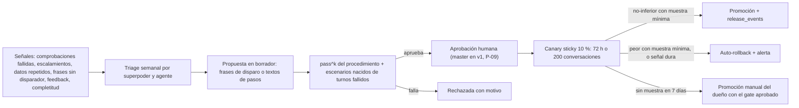

- **Lo automatizable** son frases de disparo y textos.
- **Nunca se automatiza** la estructura de un procedimiento (etapas, datos, acciones), ni permisos, presupuestos o políticas. Lo garantiza el CHECK de `improvement_proposals.kind`.
- **No-inferioridad** (SUPUESTO A VALIDAR), solo con la muestra mínima (ADR-0117 §5):
  - pass^4 ≥ estable;
  - completitud ≥ −2 pp;
  - escalamiento ≤ +2 pp;
  - costo por conversación ≤ +15 %;
  - p95 ≤ +20 %.
- Sin la muestra mínima no hay veredicto por métricas: ni promoción ni rollback automáticos. El auto-rollback inmediato queda para señales duras (errores de acción y fallos del verificador por encima del umbral). Si la conexión no junta la muestra en 7 días, el dueño promueve a mano con el gate aprobado.

---

## 8. Roadmap por fases

### 8.1 Fases, entregables y criterios de aceptación

Tamaños: S = 1,5 · M = 4 · L = 8 días-persona sin IA (constitución). Duración con el método de `calendario-estimado.md`: días con IA = esfuerzo ÷ factor; 4 días efectivos por semana.

| Fase | Objetivo | HU | Esfuerzo (días sin IA) | 1 persona (10× / 4×) | Criterios de aceptación medibles |
|---|---|---|---:|---|---|
| **R0a · Fiabilidad medida** (ya, dentro del 0A, Ola 4) | Medir la consistencia y verificar afirmaciones del agente actual | [HU-ARCH-28](../../03-fase-0-go-live/SPEC-02-agente-confiable/hu/HU-ARCH-28-evals-de-consistencia-pass-k.md), [HU-ARCH-29](../../03-fase-0-go-live/SPEC-02-agente-confiable/hu/HU-ARCH-29-verificador-de-afirmaciones.md) | 12 | 0,3 / 0,75 sem | pass@1 y pass^4 reportados cada noche para framework y `solvershub`; aserciones sobre el estado final de la base; inestabilidad atribuida por escenario; el verificador reemplaza los 3 guardrails heurísticos con falsos positivos ≤ 2 % en el set etiquetado y 0 escalamientos a mitad de compra en los journeys; el umbral del 0A (≥ 95 % tres noches) sigue vigente |
| **R1 · Motor de procedimientos y estado** | Que un agente siga recorridos tipados sobre un estado único | AOS-01…10 | 64 | 1,6 / 4 sem | 4 procedimientos críticos (contratar plan, pedido, agendar, cobro de suscripción) con **pass^4 ≥ 0,85** en evals y no-regresión frente a R0a (se encienden en producción con `AOS_PROCEDURES`, que exige `AOS_RUNTIME = v3`, al cerrar R2: ADR-0112); 0 montos o links fuera del servidor (auditoría de `task_events` y del verificador); 0 acciones irreversibles sin `confirmed`; sobrecarga p95 del kernel ≤ 50 ms; modo sombra sin diferencias críticas una semana |
| **R2 · Conexiones, agentes y releases** | Cada conexión con Coordinador + General, sin cambio visible | AOS-11…15 | 32 | 0,8 / 2 sem | 100 % de conexiones conversacionales con 1 Coordinador, 1 General y release activa; guardas de pausa por la conexión antes del backfill (0 envíos por una cuenta pausada); toda alta o reconexión de un número crea su conexión; `connection_id` NOT NULL validado; pass^4 sin regresión tras migrar; rollback ≤ 5 s probado |
| **R3 · Especialistas en un hilo** | Varios agentes por conexión, coherentes | AOS-16…22 | 40 | 1 / 2,5 sem + ventanas | Ruta correcta ≥ 0,90 de precisión y ≥ 0,85 de recall por procedimiento (golden de ruteo ≥ 60 casos y modo sombra ≥ 7 días); **0 datos perdidos al cambiar de agente** (aserción en evals); 0 bucles ejecutados en 1.000 conversaciones simuladas; costo por conversación ≤ +10 % frente a R2; `solvershub` con pass^4 ≥ 0,85 y 14 días sin incidentes P1 |
| **R4 · Consola** | El dueño opera sin ayuda | AOS-23…29 | 36 | 0,9 / 2,25 sem + usabilidad | 3 de 3 dueños crean un agente desde plantilla, ajustan frases de un superpoder y publican en < 15 min sin ayuda; WCAG AA (axe sin errores serios); "En curso" visible en la bandeja; depurador ≤ 2 s |
| **R5 · Plataforma confiable y mejora** | Back-office, auditoría, canary, caché, memoria | AOS-30…36 | 33,5 | 0,8 / 2,1 sem + canary | Back-office sin mensajes fuera de políticas (test) y los seguimientos de `pack_commerce.jobs` como propuestas; LLM-juez con acuerdo frente a humanos ≥ umbral (P-23); auto-rollback probado con una regresión inducida y promoción manual sin muestra mínima; caché de prefijo ≥ 50 % de tokens de entrada; la purga de cliente borra (lógico) sus hechos y su proyección en `customers.attributes`, y limpia su memoria de trabajo |
| **R6 · Lanzamiento** | Vender Agent OS con honestidad | AOS-37, 38 | 8 | 0,2 / 0,5 sem | Límites de plan aplicados; claims honestos (HU-GTM-05); producción fuera de la máquina de desarrollo ([HU-ARCH-01](../../03-fase-0-go-live/SPEC-01-produccion-segura/hu/HU-ARCH-01-produccion-fuera-de-dev.md)); nombre validado por el abogado; un piloto externo activo (P-14) |
| **Plus** (Fase 2) | Federación, sandbox, auto-mejora asistida, canales, editor de estructura | AOS-39…45 | 48 | 1,2 / 3 sem | Doble consentimiento y revocación inmediata; sandbox con egress por allowlist; propuestas automáticas con aprobación humana; canal API con HMAC |

### 8.2 Historias de usuario

**[SPEC-02](../../03-fase-0-go-live/SPEC-02-agente-confiable/spec.md) · Agente confiable (enmienda, Hito 0A, Ola 4)**

| HU | Título | Tam. | Depende de |
|---|---|---|---|
| [HU-ARCH-28](../../03-fase-0-go-live/SPEC-02-agente-confiable/hu/HU-ARCH-28-evals-de-consistencia-pass-k.md) | Evals de consistencia: usuario simulado, aserciones de estado y pass^k | L | HU-SUB-12 |
| [HU-ARCH-29](../../03-fase-0-go-live/SPEC-02-agente-confiable/hu/HU-ARCH-29-verificador-de-afirmaciones.md) | Verificador de afirmaciones con modelo de evidencia | M | [HU-COM-02](../../03-fase-0-go-live/SPEC-09-comercio-confiable/hu/HU-COM-02-guardrails-correctos.md) |

[HU-SH-08](../../03-fase-0-go-live/SPEC-07-asistente-solvershub/hu/HU-SH-08-golden-set-asistente.md) (golden E2E de SolversHub, 0A, Ola 4) pasa a depender también de [HU-ARCH-28](../../03-fase-0-go-live/SPEC-02-agente-confiable/hu/HU-ARCH-28-evals-de-consistencia-pass-k.md). El esfuerzo de [SPEC-02](../../03-fase-0-go-live/SPEC-02-agente-confiable/spec.md) pasa de 36,5 a 48,5 días.

**[SPEC-26](spec.md) · Agent OS de procedimientos** (`solvershub-docs/04-fase-1-competir/SPEC-26-agent-os/`, fase 1, workstream nuevo "Agent OS")

| # | HU | Título | Tam. | Depende de | Fase |
|---|---|---|---|---|---|
| 1 | [HU-AOS-01](hu/HU-AOS-01-adrs-del-agent-os.md) | ADRs del Agent OS (0112–0119) | M | — | R1 |
| 2 | [HU-AOS-02](hu/HU-AOS-02-esquema-aditivo.md) | Esquema aditivo del Agent OS (expand) | L | AOS-01 | R1 |
| 3 | [HU-AOS-03](hu/HU-AOS-03-contrato-de-procedimientos.md) | Contrato `procedure/1`, linter y conversión de flujos | M | AOS-01 | R1 |
| 4 | [HU-AOS-04](hu/HU-AOS-04-estado-de-la-conversacion.md) | Estado de la conversación: tareas *event-sourced* y tarjeta de estado | L | AOS-02 | R1 |
| 5 | [HU-AOS-05](hu/HU-AOS-05-motor-de-procedimientos.md) | Motor de procedimientos: etapas, datos validados, precondiciones, confirmación y cierre | L | AOS-03, AOS-04 | R1 |
| 6 | [HU-AOS-06](hu/HU-AOS-06-comandos-y-verificador-sobre-estado.md) | Comandos del hilo y verificador sobre el estado | M | AOS-05, [HU-ARCH-29](../../03-fase-0-go-live/SPEC-02-agente-confiable/hu/HU-ARCH-29-verificador-de-afirmaciones.md) | R1 |
| 7 | [HU-AOS-07](hu/HU-AOS-07-procedimientos-de-comercio.md) | Procedimientos de comercio (planes, contratar plan, pedido con entrega) | L | AOS-06 | R1 |
| 8 | [HU-AOS-08](hu/HU-AOS-08-procedimientos-de-agenda-suscripciones-y-cobranza.md) | Procedimientos de agenda, suscripciones (incluye cambio de plan) y cobranza | L | AOS-06 | R1 |
| 9 | [HU-AOS-09](hu/HU-AOS-09-modelo-por-riesgo-y-confirmacion-con-boton.md) | Política de modelo por riesgo y confirmación con botón interactivo | M | AOS-05 | R1 |
| 10 | [HU-AOS-10](hu/HU-AOS-10-kernel-del-coordinador.md) | Kernel del Coordinador: políticas, `core_decisions`, `turn_outcomes` y trazas | L | AOS-02 | R1 |
| 11 | [HU-AOS-11](hu/HU-AOS-11-conexion-canonica.md) | Conexión canónica y conversación por conexión (chat web como conexión) | L | AOS-02, [HU-CONN-01](../../03-fase-0-go-live/SPEC-08-conexion-whatsapp-meta/hu/HU-CONN-01-credenciales-por-conexion.md), [HU-CONN-05](../../03-fase-0-go-live/SPEC-08-conexion-whatsapp-meta/hu/HU-CONN-05-webhook-por-conexion.md) | R2 |
| 12 | [HU-AOS-12](hu/HU-AOS-12-agentes-versionados.md) | Agentes con versiones inmutables: AgentSpec v3 y KernelSpec | L | AOS-03 | R2 |
| 13 | [HU-AOS-13](hu/HU-AOS-13-instancias-por-conexion.md) | Instancias por conexión: Coordinador + General | M | AOS-11, AOS-12 | R2 |
| 14 | [HU-AOS-14](hu/HU-AOS-14-releases-por-conexion.md) | Releases por conexión con rollback en un clic | L | AOS-13 | R2 |
| 15 | [HU-AOS-15](hu/HU-AOS-15-migracion-sin-regresion.md) | Migración de todos los negocios sin regresión de pass^k | M | AOS-07, AOS-08, AOS-10, AOS-14, [HU-ARCH-28](../../03-fase-0-go-live/SPEC-02-agente-confiable/hu/HU-ARCH-28-evals-de-consistencia-pass-k.md) | R2 |
| 16 | [HU-AOS-16](hu/HU-AOS-16-habilidades-con-procedimientos-y-scope.md) | Habilidades versionadas con procedimientos, consultas y plantillas (instalación por scope) | L | AOS-12, [HU-FWK-04](../SPEC-16-habilidades-como-plataforma/hu/HU-FWK-04-catalogo-de-habilidades.md) | R3 |
| 17 | [HU-AOS-17](hu/HU-AOS-17-enrutamiento-y-modo-sombra.md) | Enrutamiento: tarea en foco, reglas, disparadores y modo sombra | M | AOS-15 | R3 |
| 18 | [HU-AOS-18](hu/HU-AOS-18-permisos-limites-y-ledger-a2a.md) | Permisos de colaboración, límites y ledger A2A | L | AOS-15 | R3 |
| 19 | [HU-AOS-19](hu/HU-AOS-19-handoff-delegacion-y-consulta.md) | Handoff, delegación y consulta en el mismo hilo | L | AOS-17, AOS-18 | R3 |
| 20 | [HU-AOS-20](hu/HU-AOS-20-colaboracion-con-pila-de-tareas.md) | Colaboración con pila de tareas | M | AOS-19 | R3 |
| 21 | [HU-AOS-21](hu/HU-AOS-21-gate-de-release-pass-k.md) | Gate de release por pass^k (procedimiento, agente y ruta) | M | AOS-15, [HU-ARCH-28](../../03-fase-0-go-live/SPEC-02-agente-confiable/hu/HU-ARCH-28-evals-de-consistencia-pass-k.md) | R3 |
| 22 | [HU-AOS-22](hu/HU-AOS-22-dogfooding-solvershub.md) | Dogfooding: SolversHub con Ventas, Agenda y Suscripciones | M | AOS-16, AOS-19, AOS-21, [HU-SH-08](../../03-fase-0-go-live/SPEC-07-asistente-solvershub/hu/HU-SH-08-golden-set-asistente.md) | R3 |
| 23 | [HU-AOS-23](hu/HU-AOS-23-consola-de-conexiones.md) | Consola de conexiones y hub | M | AOS-15 | R4 |
| 24 | [HU-AOS-24](hu/HU-AOS-24-editor-de-agentes.md) | Editor de agentes desde plantillas | L | AOS-16, [HU-FWK-08](../SPEC-16-habilidades-como-plataforma/hu/HU-FWK-08-formulario-de-schema-v2.md) | R4 |
| 25 | [HU-AOS-25](hu/HU-AOS-25-superpoderes-en-el-panel.md) | Superpoderes en el panel: recorrido, frases, textos y confirmaciones | M | AOS-24 | R4 |
| 26 | [HU-AOS-26](hu/HU-AOS-26-colaboracion-en-el-panel.md) | Colaboración y enrutamiento en el panel | M | AOS-18, AOS-24 | R4 |
| 27 | [HU-AOS-27](hu/HU-AOS-27-versiones-en-el-panel.md) | Versiones: diferencias, probar, publicar y revertir | M | AOS-14, AOS-21, AOS-23 | R4 |
| 28 | [HU-AOS-28](hu/HU-AOS-28-depurador-y-en-curso.md) | Depurador conversacional y panel "En curso" | L | AOS-04, AOS-18, [HU-ARCH-14](../../03-fase-0-go-live/SPEC-02-agente-confiable/hu/HU-ARCH-14-playground-sandbox.md) | R4 |
| 29 | [HU-AOS-29](hu/HU-AOS-29-tablero-de-fiabilidad.md) | Tablero de fiabilidad | M | AOS-18, AOS-21 | R4 |
| 30 | [HU-AOS-30](hu/HU-AOS-30-agentes-de-back-office.md) | Agentes de back-office asíncronos | L | AOS-18 | R5 |
| 31 | [HU-AOS-31](hu/HU-AOS-31-auditor-de-calidad.md) | Auditor de calidad y LLM-juez calibrado | M | AOS-21, AOS-28 | R5 |
| 32 | [HU-AOS-32](hu/HU-AOS-32-canary-y-auto-rollback.md) | Canary sticky con no-inferioridad y auto-rollback | M | AOS-27, AOS-29 | R5 |
| 33 | [HU-AOS-33](hu/HU-AOS-33-feedback-y-propuestas.md) | Feedback y propuestas de mejora con aprobación humana | M | AOS-31 | R5 |
| 34 | [HU-AOS-34](hu/HU-AOS-34-acciones-v2.md) | Acciones v2: timeouts, reintentos, circuit breaker y respaldo | M | AOS-16 | R5 |
| 35 | [HU-AOS-35](hu/HU-AOS-35-cache-por-version.md) | Caché por versión de lo compilado | S | AOS-14 | R5 |
| 36 | [HU-AOS-36](hu/HU-AOS-36-memoria-por-scope.md) | Memoria por scope con procedencia y olvido | L | AOS-12 | R5 |
| 37 | [HU-AOS-37](hu/HU-AOS-37-cuotas-y-planes.md) | Cuotas y planes Agent OS | M | AOS-18, HU-BILL-05, HU-BILL-06 | R6 |
| 38 | [HU-AOS-38](hu/HU-AOS-38-lanzamiento-comercial.md) | Lanzamiento comercial (incluye validar el nombre) | M | AOS-22, AOS-26, AOS-27, AOS-37, HU-GTM-05, [HU-ARCH-01](../../03-fase-0-go-live/SPEC-01-produccion-segura/hu/HU-ARCH-01-produccion-fuera-de-dev.md) | R6 |

Esfuerzo [SPEC-26](spec.md): 16 L + 22 M + 1 S = **217,5 días-persona sin IA** (39 HU; [HU-AOS-46](hu/HU-AOS-46-presets-v2.md) se sumó el 2026-10-09 desde la revisión de [SPEC-28](../SPEC-28-inmoagent/spec.md); [HU-AOS-35](hu/HU-AOS-35-cache-por-version.md) bajó de M a S el mismo día, al recortarse la caché en ADR-0117).

**[SPEC-27](../../05-fase-2-plus/SPEC-27-agent-os-plus/spec.md) · Agent OS Plus** (`solvershub-docs/05-fase-2-plus/SPEC-27-agent-os-plus/`, fase 2)

| # | HU | Título | Tam. | Depende de |
|---|---|---|---|---|
| 1 | [HU-AOS-39](../../05-fase-2-plus/SPEC-27-agent-os-plus/hu/HU-AOS-39-federacion-entre-negocios.md) | Federación entre negocios con consentimiento | L | AOS-18, AOS-37 |
| 2 | [HU-AOS-40](../../05-fase-2-plus/SPEC-27-agent-os-plus/hu/HU-AOS-40-sandbox-de-acciones.md) | Sandbox aislado para acciones no confiables | L | AOS-34, [HU-ARCH-19](../SPEC-19-extensibilidad-y-operacion/hu/HU-ARCH-19-mcp-por-tenant.md) |
| 3 | [HU-AOS-41](../../05-fase-2-plus/SPEC-27-agent-os-plus/hu/HU-AOS-41-auto-mejora-asistida.md) | Auto-mejora asistida: de fallas a versión candidata | L | AOS-32, AOS-33 |
| 4 | [HU-AOS-42](../../05-fase-2-plus/SPEC-27-agent-os-plus/hu/HU-AOS-42-canal-api-y-webhooks.md) | Canal API y webhooks salientes como conexión | M | AOS-11 |
| 5 | [HU-AOS-43](../../05-fase-2-plus/SPEC-27-agent-os-plus/hu/HU-AOS-43-slack-y-correo-entrante.md) | Slack y correo entrante como conexiones | L | AOS-42 |
| 6 | [HU-AOS-44](../../05-fase-2-plus/SPEC-27-agent-os-plus/hu/HU-AOS-44-topologia-por-roles.md) | Topología por roles y escalado | M | AOS-29 |
| 7 | [HU-AOS-45](../../05-fase-2-plus/SPEC-27-agent-os-plus/hu/HU-AOS-45-editor-de-estructura-de-superpoderes.md) | Editor de estructura de superpoderes para el negocio | L | AOS-25 |

Esfuerzo [SPEC-27](../../05-fase-2-plus/SPEC-27-agent-os-plus/spec.md): 5 L + 2 M = **48 días-persona sin IA** (7 HU).

**Total:** 12 (0A) + 217,5 + 48 = **277,5 días-persona sin IA, 48 HU.** Si se aprueba P-21, se retiran [SPEC-15](../SPEC-15-editor-visual-de-flujo/spec.md) (≈ 23 días), [HU-ARCH-26](../../05-fase-2-plus/SPEC-22-extensibilidad-avanzada/hu/HU-ARCH-26-tool-siguiente-forzada.md) (8) y [HU-FLOW-07](../../05-fase-2-plus/SPEC-22-extensibilidad-avanzada/hu/HU-FLOW-07-purpose-y-reglas-por-etapa.md) (4), porque el motor y el editor de superpoderes los absorben. Neto ≈ 242,5.

### 8.3 Calendario (dos escenarios)

| Escenario | R0a | R1 + R2 + R3 | 0B | R4 + R5 + R6 | **Agent OS v1 vendible** |
|---|---|---|---|---|---|
| 1 persona + IA (D-17) · 10× | Dentro del 0A (+1,2 días; fin del 0A ≈ 2026-11-04) | → 2026-11-28 (3,4 sem) | → 2027-01-15 (4,9 sem; cruza la pausa de fin de año) | → 2027-01-29 (2 sem) | **fin de ene-2027** |
| 1 persona + IA (D-17) · 4× | Dentro del 0A (+3 días; fin del 0A ≈ 2026-12-17) | → 2027-03-01 (8,5 sem + pausa) | → 2027-05-25 (12,2 sem) | → 2027-06-29 (5 sem) | **fin de jun-2027** |
| 3 personas + IA · 10× | Igual | 2 personas en AOS y 1 en el 0B: código ≈ 2,2 sem + ventanas ≈ 3 sem | En paralelo → 2026-12-09 | Incluido | **dic-2026** |
| 3 personas + IA · 4× | Igual | Código ≈ 5,4 sem + ventanas, con la pausa → ≈ 2027-03-01 | 1 persona → ≈ 2027-03-26 (BILL-05/06 primero) | Incluido | **mar–abr 2027** |

- **Ventanas que la IA no comprime:** modo sombra del motor (1 semana por negocio piloto, R1) · modo sombra del enrutamiento (≥ 7 días, R3) · dogfooding (≥ 14 días + pass^4 tres noches, R3) · usabilidad con 3 dueños (≈ 1 semana, R4) · canary (≥ 72 h o 200 conversaciones, R5).
- **Camino crítico** (≈ 68 días-persona sin IA): AOS-01 → 02 → 04 → 05 → 06 → 07 → 15 → 18 → 19 → 22 → 38. Con más de 3 personas no se acorta en proporción.
- **Reparto con 3 personas:**
  - A: motor y datos (R1, R2, AOS-17…20).
  - B: panel (R4, arrancando con mocks del OpenAPI desde AOS-04/12).
  - C: calidad y 0B (R0a, AOS-21, 22, 29, 31, 32 y las HU de BILL).
  - Hasta 8 personas se suman autoría de procedimientos por vertical (cobranza, restaurantes), SRE/seguridad (AOS-40, 44) y canales (AOS-42, 43).
- **Supuestos:**
  - SUPUESTO A VALIDAR: la segunda y tercera persona entran al cierre del 0A, con una semana de onboarding.
  - En D-17, la Fase 1 restante y la Fase 2 se corren lo que dure Agent OS (5,4 a 13,5 semanas).
  - Se recalibra al cerrar R1.

### 8.4 Dependencias entre fases

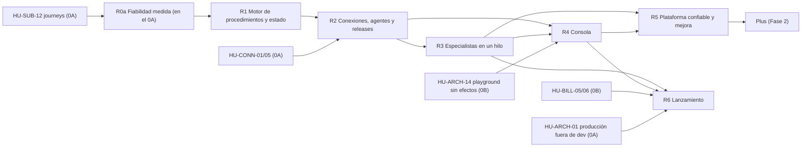

### 8.5 Riesgos y mitigaciones

| # | Riesgo | Prob. | Impacto | Mitigación |
|---|---|---|---|---|
| R-AOS-1 | Procedimientos demasiado rígidos frustran conversaciones naturales | M | A | Objetivo por etapa con ReAct acotado dentro de ella; digresiones con la pila; procedimiento "abierto" del General como respaldo; métricas de "frases sin disparador" y "datos repetidos" |
| R-AOS-2 | Costo de autoría (cada habilidad define procedimientos) | A | M | Conversión automática de `flow.json` v2 a procedimientos abiertos; linter; empezar por los 4 críticos; plantillas |
| R-AOS-3 | Latencia por comandos, verificador y reintentos | M | M | Una llamada típica; verificador determinista (milisegundos); reintento solo ante fallo; p95 por etapa con alerta |
| R-AOS-4 | El verificador repite los falsos positivos de hoy (escalar a mitad de compra) | M | A | Set etiquetado y meta de FP ≤ 2 % **antes** de reemplazar los guardrails; la acción final sigue siendo la que configura cada negocio (ADR-0092) |
| R-AOS-5 | Simulador de usuario poco realista: pass^k alto pero producción mala | M | A | Escenarios nacidos de conversaciones reales (`to-eval`), varios estilos de persona, LLM-juez de producción calibrado con humanos |
| R-AOS-6 | La migración a conexión canónica rompe el ruteo (ADR-0095) | M | A | Expand → backfill → switch con bandera; verificación con Meta real en test |
| R-AOS-7 | El contrato v3 o `procedure/1` rompen habilidades o plugins del negocio | M | M | Lector tolerante v2→v3; tests de contrato; habilidades migradas en el mismo PR |
| R-AOS-8 | Capacidad de 1 persona; el 0A se corre por R0a | A | M | R0a pequeño (12 días) y necesario para SH-08; fases con criterio de salida; Plus aparte |
| R-AOS-9 | Fuga entre negocios | B | A | FKs compuestas, RLS forzada, `auditor-multitenant` por HU, federación apagada |
| R-AOS-10 | Inyección desde datos u otros agentes | M | A | Comandos y resultados tipados; consulta solo lectura; payloads como datos (invariante 7) |
| R-AOS-11 | Sin embeddings en producción | M | B | La elección restringida en el propio hilo funciona sin embeddings; el coprocesador queda para listas largas |
| R-AOS-12 | Producción sigue en la máquina de desarrollo | M | A | AOS-38 depende de [HU-ARCH-01](../../03-fase-0-go-live/SPEC-01-produccion-segura/hu/HU-ARCH-01-produccion-fuera-de-dev.md) |
| R-AOS-13 | Nombre "Agent OS" en uso por un competidor | M | M | Validación legal en HU-GTM-02 antes de AOS-38 (P-25) |

### 8.6 Impacto en decisiones, ADRs y specs existentes

| Artefacto | Cambio | Dónde se registra |
|---|---|---|
| P-10 | Resuelta: **Agent OS de procedimientos; varios agentes por conexión en un hilo; por fases** | D-27 |
| Dirección y R0a | Plan B elegido; evals de consistencia y verificador entran al 0A | D-28 |
| D-17 | Se mantiene; el calendario suma el escenario de 3 personas | `calendario-estimado.md` |
| Hito 0A | +[HU-ARCH-28](../../03-fase-0-go-live/SPEC-02-agente-confiable/hu/HU-ARCH-28-evals-de-consistencia-pass-k.md)/29 en Ola 4 (+12 días sin IA); [HU-SH-08](../../03-fase-0-go-live/SPEC-07-asistente-solvershub/hu/HU-SH-08-golden-set-asistente.md) depende de [HU-ARCH-28](../../03-fase-0-go-live/SPEC-02-agente-confiable/hu/HU-ARCH-28-evals-de-consistencia-pass-k.md) | [SPEC-02](../../03-fase-0-go-live/SPEC-02-agente-confiable/spec.md), [SPEC-07](../../03-fase-0-go-live/SPEC-07-asistente-solvershub/spec.md) |
| ADR-0009 / ADR-0016 / ADR-0026 / ADR-0051 §1 y §4 / ADR-0075 / ADR-0109 | Releases por conexión que también congelan los overrides de playbooks, las secciones del negocio y los campos de `AppSettings` que entran al prompt; candidatas de plataforma al publicarse una versión de habilidad; canary sticky por episodio; gate en `agentcore_eval`; el playground prueba la candidata y reemplaza al tenant de staging | ADR-0117 |
| ADR-0014 / ADR-0019 / ADR-0050 / ADR-0051 §3 / ADR-0052 / ADR-0089 §3 / ADR-0110 §3 | Allowlist de playbooks por agente, guardrails y tools declarativas (sin secretos literales) como campos propios, instalación con scope como única fuente de habilitación (también del plugin del negocio y de los presets) y consentimiento fail-closed, contrato v3 | ADR-0113, 0118 |
| ADR-0021 | Se mantiene tal cual (partición y disparador) | ADR-0112 |
| ADR-0025 / ADR-0051 / ADR-0092 | Evals persistidas, frases de cierre y configuración de fallo del negocio se reutilizan; se suman pass^k y verificador | ADR-0119 |
| ADR-0053 | Memoria por scope; las tareas siguen la regla de `messages` | ADR-0114 |
| ADR-0054 / ADR-0109 | Las secciones del flujo pasan a procedimientos | ADR-0113 |
| ADR-0045 / ADR-0069 / ADR-0095 / ADR-0122 §6 / ADR-0127 §3 | Conexión canónica, una por número; `webchat` como tipo; conversaciones contadas por conexión; toda alta o reconexión de un número y la promoción crean su conexión; la pausa sigue siendo la de ADR-0122 y el gating de ADR-0072 no cambia | ADR-0115 |
| [SPEC-15](../SPEC-15-editor-visual-de-flujo/spec.md) | Se reencuadra como editor de superpoderes ([HU-AOS-25](hu/HU-AOS-25-superpoderes-en-el-panel.md) en v1, [HU-AOS-45](../../05-fase-2-plus/SPEC-27-agent-os-plus/hu/HU-AOS-45-editor-de-estructura-de-superpoderes.md) en Fase 2); sus HU quedan reemplazadas si se aprueba P-21 | [SPEC-15](../SPEC-15-editor-visual-de-flujo/spec.md) + D-27 |
| [SPEC-19](../SPEC-19-extensibilidad-y-operacion/spec.md) / [SPEC-22](../../05-fase-2-plus/SPEC-22-extensibilidad-avanzada/spec.md) | [HU-ARCH-19](../SPEC-19-extensibilidad-y-operacion/hu/HU-ARCH-19-mcp-por-tenant.md) = nivel T2; [HU-ARCH-20](../SPEC-19-extensibilidad-y-operacion/hu/HU-ARCH-20-guardrails-runtime.md) absorbida en parte; [HU-ARCH-26](../../05-fase-2-plus/SPEC-22-extensibilidad-avanzada/hu/HU-ARCH-26-tool-siguiente-forzada.md) y [HU-FLOW-07](../../05-fase-2-plus/SPEC-22-extensibilidad-avanzada/hu/HU-FLOW-07-purpose-y-reglas-por-etapa.md) absorbidas por el motor; [HU-ARCH-25](../../05-fase-2-plus/SPEC-22-extensibilidad-avanzada/hu/HU-ARCH-25-toolcontext-y-embeddings.md) pierde `ToolContext` | Notas en esas HU |
| HU-SUB-07 (mergeada en agent-core #314, ADR-0111) | Su catálogo de planes con precio del servidor se reutiliza; [HU-AOS-08](hu/HU-AOS-08-procedimientos-de-agenda-suscripciones-y-cobranza.md) convierte el cambio de plan en procedimiento | [HU-AOS-08](hu/HU-AOS-08-procedimientos-de-agenda-suscripciones-y-cobranza.md) |
| HU-BILL-05 | Límites `conexiones`, `agentes` y operaciones A2A | [HU-AOS-37](hu/HU-AOS-37-cuotas-y-planes.md) |

---

## 9. Métricas de éxito

La línea base de `09-linea-base.md` está dominada por datos de prueba. Las metas relativas se miden contra la **línea base de R0a** (pass@1 y pass^4 del agente actual) y la de R2 (un agente por conexión). Las metas absolutas son **SUPUESTO A VALIDAR** hasta la primera medición.

**Fiabilidad, precisión y coherencia** (el foco pedido)

| Métrica | Definición | Fuente | Meta |
|---|---|---|---|
| **Consistencia (pass^k)** | Fracción de escenarios que pasan los k intentos (k = 4 nocturno, 8 antes de release), por procedimiento, agente y ruta | `eval_runs.pass_k` | ≥ 0,85 para publicar; objetivo 0,90 |
| pass@1 | Escenarios que pasan en un intento | `eval_runs.pass_1` | ≥ 0,95 (umbral del 0A) |
| Estado final correcto | Escenarios cuyas aserciones sobre la base pasan | `eval_results.state_assertions` | ≥ 0,95 |
| Afirmaciones sin evidencia (producción) | Fallos del verificador ÷ turnos | `turn_outcomes.verifier` | ≤ 1 %, con tendencia a la baja |
| Falsos positivos del verificador | Respuestas correctas marcadas, en un set etiquetado | evals | ≤ 2 % |
| Dinero fuera del servidor | Montos o links enviados sin evidencia de acción o estado | verificador + auditoría | **0** |
| Irreversibles sin confirmación | `action_succeeded` en etapa `risk: high` sin `confirmed` previo | `task_events` | **0** |
| Datos repetidos | Veces que el agente pide un dato que ya está en `slots` o `memory_facts` | `task_events` + LLM-juez | ≤ 2 % de las tareas |
| Estado perdido al cambiar de agente | Datos ausentes después de `owner_changed` | Aserción en evals + `task_events` | **0** |
| Contradicciones entre turnos | Muestra con LLM-juez calibrado | Auditor de calidad | ≤ 1 % |
| Inestabilidad | Escenarios marcados inestables | evals | Tendencia a 0 |

**Técnicas**

| Métrica | Definición | Fuente | Meta |
|---|---|---|---|
| Latencia de turno p50 / p95 / p99 | Entrada recibida → salida encolada, por etapa y modo | spans + `core_decisions`/`turn_outcomes` | p95 ≤ 6 s; p99 ≤ 15 s |
| Sobrecarga del Coordinador | Kernel sin LLM | span `kernel.*` | p95 ≤ 50 ms (≤ 1,2 s con coprocesador) |
| Tasa de error | Turnos a DLQ o con respaldo por excepción ÷ turnos | DLQ + `turn_outcomes.status` | ≤ 0,5 % |
| Costo por sesión | USD por conversación | `usage_ledger` | ≤ +10 % frente a la línea base de R2 |
| Tasa de caché | Tokens cacheados ÷ tokens de entrada, por agente | `usage_ledger` | Prefijo ≥ 50 % (hoy ≈ 60 %: 482/807) |
| Éxito de acciones | Ejecuciones OK ÷ ejecuciones | `audit_log`, `task_events` | ≥ 98 % |
| Profundidad A2A / bucles | Media y p99; denegadas por ciclo o repetición; bucles ejecutados | `a2a_events` | Media ≤ 1,3; **0 bucles ejecutados** |
| Rollback | Clic → siguiente turno de cualquier conversación en la versión anterior | `release_events` | ≤ 5 s |

**De negocio**

| Métrica | Definición | Fuente | Meta (SUPUESTO A VALIDAR) |
|---|---|---|---|
| Activación | Negocios nuevos con ≥ 1 conexión, ≥ 1 agente y ≥ 10 conversaciones en 7 días | conexiones, instancias, conversaciones | ≥ 60 % |
| Tiempo al primer agente | Del alta al primer agente publicado | `release_events` | Mediana < 15 min de trabajo |
| Retención | Negocios activos a 90 días | `tenant_subscriptions` | ≥ 85 % |
| NPS | Encuesta trimestral a dueños | Encuesta | ≥ 40 |
| Expansión | Upgrade de plan o más conexiones en 90 días | billing | ≥ 20 % |
| Conexiones por negocio · agentes por conexión | Medias | conexiones, instancias | ≥ 1,5 · ≥ 2 a 6 meses del lanzamiento |

**De IA**

| Métrica | Definición | Fuente | Meta |
|---|---|---|---|
| Precisión y recall de ruta | Procedimiento y agente correctos, por procedimiento | Golden de ruteo + modo sombra | ≥ 0,90 / ≥ 0,85 |
| Completitud de tarea | Tareas que llegan a `completed` ÷ tareas iniciadas, por procedimiento | `task_events` | +10 pp frente a la línea base de R0a |
| Éxito de handoff | Cambios de agente que terminan en tarea completada sin relevo humano ni rebote en ≤ 5 turnos | `task_events` + `a2a_events` | ≥ 85 % |
| Alucinación | Afirmaciones sin evidencia + muestra semanal con LLM-juez | verificador + auditor | ≤ 1 % |
| Escalamiento por agente | Escalamientos ÷ conversaciones del agente | `escalations` | Seguimiento; no-inferioridad en canary |

---

## 10. Preguntas abiertas

Ninguna bloquea R0a ni R1. Cada una trae una recomendación; las HU se escriben sobre ella (D-10).

| # | Pregunta | Recomendación | Bloquea |
|---|---|---|---|
| P-11 | ¿Cómo se llama el Agente Core en el panel? | **"Coordinador"** | [HU-AOS-23](hu/HU-AOS-23-consola-de-conexiones.md) |
| P-12 | ¿Una voz por conexión o un nombre por agente? | **Una voz**; presentación opcional al cambiar de agente | [HU-AOS-19](hu/HU-AOS-19-handoff-delegacion-y-consulta.md) |
| P-13 | ¿Cómo se empaqueta en los planes? | Escalera como la de habilidades (1/3/8/∞): **agentes** 1+General / 3 / 8 / ∞, **conexiones** 1 / 2 / 5 / ∞; operaciones A2A dentro de los créditos. Cifras = SUPUESTO A VALIDAR con `documento de precios (privado)` | [HU-AOS-37](hu/HU-AOS-37-cuotas-y-planes.md), HU-BILL-05 |
| P-14 | ¿Primer piloto externo? | Un negocio de **cobranza** (diferencial casi único, D-02) | [HU-AOS-38](hu/HU-AOS-38-lanzamiento-comercial.md) |
| P-15 | ¿Hay demanda de federación entre negocios? | Diferir hasta 2 interesados reales; el esquema ya lo impide por defecto | [HU-AOS-39](../../05-fase-2-plus/SPEC-27-agent-os-plus/hu/HU-AOS-39-federacion-entre-negocios.md) |
| P-16 | ¿Qué modelo usa el coprocesador? | `deepseek-flash` sin *thinking*, salida restringida, respaldo `gpt-4o-mini` (D-22) | [HU-AOS-17](hu/HU-AOS-17-enrutamiento-y-modo-sombra.md) |
| P-17 | ¿Quién ve entradas y salidas de acciones en el depurador? | Solo `observabilidad:ver`, siempre redactadas | [HU-AOS-28](hu/HU-AOS-28-depurador-y-en-curso.md) |
| P-18 | ¿Qué canal sigue como conexión? | Canal API, luego correo entrante; Slack según demanda; voz sigue en [SPEC-23](../../05-fase-2-plus/SPEC-23-voz-reportes-y-confianza/spec.md) (D-03) | [HU-AOS-42](../../05-fase-2-plus/SPEC-27-agent-os-plus/hu/HU-AOS-42-canal-api-y-webhooks.md)/43 |
| P-19 | ¿Embeddings en producción? | Local multilingüe de 384 dimensiones, evaluado contra `text-embedding-3-small` con el golden de ruteo | [HU-AOS-17](hu/HU-AOS-17-enrutamiento-y-modo-sombra.md) |
| P-20 | ¿Un agente escribe hechos en el *namespace* de otro? | **No**; se pide por consulta o encargo | [HU-AOS-36](hu/HU-AOS-36-memoria-por-scope.md) |
| P-21 | ¿Se reencuadra [SPEC-15](../SPEC-15-editor-visual-de-flujo/spec.md) como editor de superpoderes? | **Sí**: se retiran [HU-FLOW-01](../SPEC-15-editor-visual-de-flujo/hu/HU-FLOW-01-adr-editor-de-flujo.md)..06, [HU-ARCH-26](../../05-fase-2-plus/SPEC-22-extensibilidad-avanzada/hu/HU-ARCH-26-tool-siguiente-forzada.md) y [HU-FLOW-07](../../05-fase-2-plus/SPEC-22-extensibilidad-avanzada/hu/HU-FLOW-07-purpose-y-reglas-por-etapa.md) (≈ 35 días) y los absorben [HU-AOS-05](hu/HU-AOS-05-motor-de-procedimientos.md)/25/45 | [SPEC-15](../SPEC-15-editor-visual-de-flujo/spec.md), [HU-AOS-25](hu/HU-AOS-25-superpoderes-en-el-panel.md) |
| P-22 | ¿Botón interactivo obligatorio para confirmar lo irreversible? | **Sí** en etapas `risk: high`; en otros canales, clasificador sí/no de alta precisión | [HU-AOS-09](hu/HU-AOS-09-modelo-por-riesgo-y-confirmacion-con-boton.md) |
| P-23 | ¿Qué umbrales de calidad se exigen? | pass^4 ≥ 0,85 por procedimiento para publicar; LLM-juez con acuerdo (kappa) ≥ 0,7 frente a 100 conversaciones etiquetadas; se ajustan con la primera medición | [HU-ARCH-28](../../03-fase-0-go-live/SPEC-02-agente-confiable/hu/HU-ARCH-28-evals-de-consistencia-pass-k.md), [HU-AOS-21](hu/HU-AOS-21-gate-de-release-pass-k.md)/31 |
| P-24 | ¿Quién etiqueta para calibrar el LLM-juez? | El master: 50 conversaciones por semana durante 2 semanas (SUPUESTO) | [HU-AOS-31](hu/HU-AOS-31-auditor-de-calidad.md) |
| P-25 | ¿Se usa "Agent OS" como nombre comercial? | Validar con el abogado (HU-GTM-02); tener lista una alternativa propia | [HU-AOS-38](hu/HU-AOS-38-lanzamiento-comercial.md) |

---

## Validación de los criterios de calidad del encargo

| Criterio | ✓ | Dónde |
|---|---|---|
| Tenant con N conexiones; cada conexión con 1 core + N especialistas | ✅ | §4.3 bloques 1–2 (índice único de core, trigger "conexión activa requiere Coordinador", agente por defecto) |
| Cada recurso declara scope tenant o connection | ✅ | §4.2: columnas `scope` con CHECK donde ya hace falta (instalaciones, memoria, propuestas); permisos A2A e integraciones con scope de negocio hasta que un caso pida el de conexión (ADR-0115, ADR-0116) |
| Los agentes se hablan con los 5 modos | ✅ | §3.7 y §7.2: mecanismos deterministas en un hilo; contexto propio en back-office |
| Permisos, profundidad, timeouts y presupuesto en A2A | ✅ | `agent_links` (§4.3-3) y tabla de límites (§7.2) |
| Trazabilidad total del A2A (from, to, intent, payload, result, costo, latencia) | ✅ | `a2a_events` (§4.3-9), eventos (§5.3), depurador (§6.2i) |
| Aislamiento entre negocios garantizado | ✅ | RLS forzada + FKs compuestas + federación aparte (§4.3-14, D-AOS-13) |
| Agente Core como kernel con responsabilidades claras | ✅ | §7.1 (11 responsabilidades, pseudocódigo, motor) |
| Todo versionado e inmutable | ✅ | `agent_versions` (con el KernelSpec y sus políticas), procedimientos en `pack_versions`, `a2a_graph_versions`, `connection_releases`, `task_events`; `prevent_mutation()` genérica |
| Multi-tenant real (RLS, secretos, cuotas) | ✅ | §4.3, secretos por instalación con scope, [HU-AOS-37](hu/HU-AOS-37-cuotas-y-planes.md) |
| Memoria separada por scope | ✅ | §7.5 (tareas, sesión, privada, cliente, episódica, conexión, negocio) |
| Caché invalidada por versión | ✅ | §7.6 |
| Acciones en sandbox con permisos | ✅ | §7.7 (por etapa, fail-closed, T0–T4) |
| Observabilidad de punta a punta, incluido A2A | ✅ | `core_decisions` → `task_events` → `a2a_events` → `turn_outcomes` → `usage_ledger` → `turn_feedback` |
| Evals y rollback | ✅ | §7.4 (pass^k), §7.9, [HU-AOS-14](hu/HU-AOS-14-releases-por-conexion.md)/21/32 |
| Roadmap ejecutable por 3–8 personas | ✅ | §8.3 (1 y 3 personas, camino crítico, reparto hasta 8) |
| Interfaces usables por no técnicos | ✅ | §6 (glosario, plantillas, "En curso", prueba con 3 dueños) |
| **Operabilidad confiable, precisa y coherente** (pedido de la revisión) | ✅ | D-AOS-0, §3.6 (procedimientos + estado), §7.3 (verificador), §7.4 (pass^k), métricas de §9 con metas de 0 en dinero, irreversibles y estado perdido |
| Sin datos inventados; trade-offs en tabla; sin microservicios ni reescritura | ✅ | Evidencia `ruta:línea` y fuentes fechadas (§2.7); §3.2; D-AOS-1 y D-AOS-15 |
