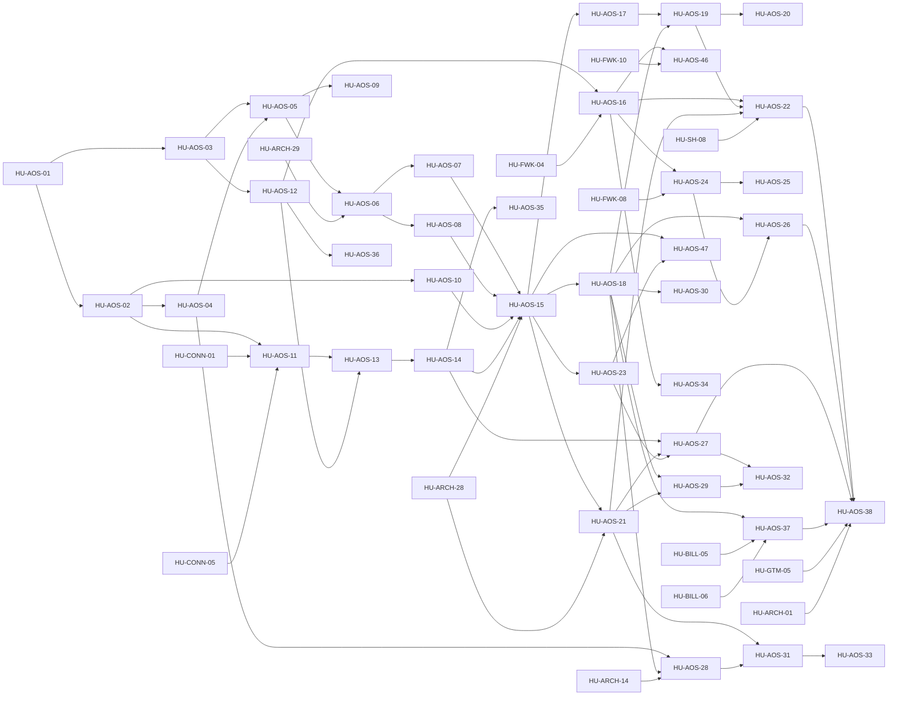

# SPEC-26 · Tareas

Orden de ejecución por fase del Agent OS: R1 motor de procedimientos y estado · R2 conexiones, agentes y releases ·
R3 especialistas en un hilo · R4 consola · R5 plataforma confiable y mejora · R6 lanzamiento. Las evals de
consistencia y el verificador ([HU-ARCH-28](../../03-fase-0-go-live/SPEC-02-agente-confiable/hu/HU-ARCH-28-evals-de-consistencia-pass-k.md) y [HU-ARCH-29](../../03-fase-0-go-live/SPEC-02-agente-confiable/hu/HU-ARCH-29-verificador-de-afirmaciones.md)) van antes, en el Hito 0A ([SPEC-02](../../03-fase-0-go-live/SPEC-02-agente-confiable/spec.md)).

**Estado al 2026-10-17** (D-35): 14 HU terminadas el 2026-10-11 ([HU-AOS-01](hu/HU-AOS-01-adrs-del-agent-os.md) a [HU-AOS-10](hu/HU-AOS-10-kernel-del-coordinador.md), [HU-AOS-12](hu/HU-AOS-12-agentes-versionados.md), [HU-AOS-13](hu/HU-AOS-13-instancias-por-conexion.md), [HU-AOS-14](hu/HU-AOS-14-releases-por-conexion.md) y [HU-AOS-36](hu/HU-AOS-36-memoria-por-scope.md); los PRs están en cada HU), [HU-AOS-11](hu/HU-AOS-11-conexion-canonica.md) y [HU-AOS-15](hu/HU-AOS-15-migracion-sin-regresion.md) en curso, [HU-AOS-47](hu/HU-AOS-47-mi-agente-y-su-data.md) «Mi agente y su data» nueva en R4 y [HU-AOS-37](hu/HU-AOS-37-cuotas-y-planes.md) achicada a operaciones entre agentes y back-office. Tanda 6: [HU-AOS-15](hu/HU-AOS-15-migracion-sin-regresion.md), [HU-AOS-16](hu/HU-AOS-16-habilidades-con-procedimientos-y-scope.md), [HU-AOS-17](hu/HU-AOS-17-enrutamiento-y-modo-sombra.md) y [HU-AOS-46](hu/HU-AOS-46-presets-v2.md); tanda 7 terminada el 2026-10-18: [HU-AOS-24](hu/HU-AOS-24-editor-de-agentes.md), [HU-AOS-23](hu/HU-AOS-23-consola-de-conexiones.md) y [HU-AOS-47](hu/HU-AOS-47-mi-agente-y-su-data.md) (core #472, #473 y #476; panel #80, #81 y #82).

| Orden | HU | Título | Tamaño | Depende de | Fase AOS |
|---|---|---|---|---|---|
| 1 | [HU-AOS-01](hu/HU-AOS-01-adrs-del-agent-os.md) | ADRs del Agent OS (0112–0119) | M | — | R1 |
| 2 | [HU-AOS-02](hu/HU-AOS-02-esquema-aditivo.md) | Esquema aditivo del Agent OS (expand) | L | [HU-AOS-01](hu/HU-AOS-01-adrs-del-agent-os.md) | R1 |
| 3 | [HU-AOS-03](hu/HU-AOS-03-contrato-de-procedimientos.md) | Contrato procedure/1, linter y conversión de flujos | M | [HU-AOS-01](hu/HU-AOS-01-adrs-del-agent-os.md) | R1 |
| 4 | [HU-AOS-04](hu/HU-AOS-04-estado-de-la-conversacion.md) | Estado de la conversación: tareas event-sourced y tarjeta de estado | L | [HU-AOS-02](hu/HU-AOS-02-esquema-aditivo.md) | R1 |
| 5 | [HU-AOS-05](hu/HU-AOS-05-motor-de-procedimientos.md) | Motor de procedimientos: etapas, datos validados, precondiciones, confirmación y cierre | L | [HU-AOS-03](hu/HU-AOS-03-contrato-de-procedimientos.md), [HU-AOS-04](hu/HU-AOS-04-estado-de-la-conversacion.md) | R1 |
| 6 | [HU-AOS-06](hu/HU-AOS-06-comandos-y-verificador-sobre-estado.md) | Comandos del hilo y verificador sobre el estado | M | [HU-AOS-05](hu/HU-AOS-05-motor-de-procedimientos.md), [HU-ARCH-29](../../03-fase-0-go-live/SPEC-02-agente-confiable/hu/HU-ARCH-29-verificador-de-afirmaciones.md) | R1 |
| 7 | [HU-AOS-07](hu/HU-AOS-07-procedimientos-de-comercio.md) | Procedimientos de comercio (planes, contratar plan, pedido con entrega) | L | [HU-AOS-06](hu/HU-AOS-06-comandos-y-verificador-sobre-estado.md) | R1 |
| 8 | [HU-AOS-08](hu/HU-AOS-08-procedimientos-de-agenda-suscripciones-y-cobranza.md) | Procedimientos de agenda, suscripciones (incluye cambio de plan) y cobranza | L | [HU-AOS-06](hu/HU-AOS-06-comandos-y-verificador-sobre-estado.md) | R1 |
| 9 | [HU-AOS-09](hu/HU-AOS-09-modelo-por-riesgo-y-confirmacion-con-boton.md) | Política de modelo por riesgo y confirmación con botón interactivo | M | [HU-AOS-05](hu/HU-AOS-05-motor-de-procedimientos.md) | R1 |
| 10 | [HU-AOS-10](hu/HU-AOS-10-kernel-del-coordinador.md) | Kernel del Coordinador: políticas, core_decisions, turn_outcomes y trazas | L | [HU-AOS-02](hu/HU-AOS-02-esquema-aditivo.md) | R1 |
| 11 | [HU-AOS-11](hu/HU-AOS-11-conexion-canonica.md) | Conexión canónica y conversación por conexión (chat web como conexión) | L | [HU-AOS-02](hu/HU-AOS-02-esquema-aditivo.md), [HU-CONN-01](../../03-fase-0-go-live/SPEC-08-conexion-whatsapp-meta/hu/HU-CONN-01-credenciales-por-conexion.md), [HU-CONN-05](../../03-fase-0-go-live/SPEC-08-conexion-whatsapp-meta/hu/HU-CONN-05-webhook-por-conexion.md) | R2 |
| 12 | [HU-AOS-12](hu/HU-AOS-12-agentes-versionados.md) | Agentes con versiones inmutables: AgentSpec v3 y KernelSpec | L | [HU-AOS-03](hu/HU-AOS-03-contrato-de-procedimientos.md) | R2 |
| 13 | [HU-AOS-13](hu/HU-AOS-13-instancias-por-conexion.md) | Instancias por conexión: Coordinador + General | M | [HU-AOS-11](hu/HU-AOS-11-conexion-canonica.md), [HU-AOS-12](hu/HU-AOS-12-agentes-versionados.md) | R2 |
| 14 | [HU-AOS-14](hu/HU-AOS-14-releases-por-conexion.md) | Releases por conexión con rollback en un clic | L | [HU-AOS-13](hu/HU-AOS-13-instancias-por-conexion.md) | R2 |
| 15 | [HU-AOS-15](hu/HU-AOS-15-migracion-sin-regresion.md) | Migración de todos los negocios sin regresión de pass^k | M | [HU-AOS-07](hu/HU-AOS-07-procedimientos-de-comercio.md), [HU-AOS-08](hu/HU-AOS-08-procedimientos-de-agenda-suscripciones-y-cobranza.md), [HU-AOS-10](hu/HU-AOS-10-kernel-del-coordinador.md), [HU-AOS-14](hu/HU-AOS-14-releases-por-conexion.md), [HU-ARCH-28](../../03-fase-0-go-live/SPEC-02-agente-confiable/hu/HU-ARCH-28-evals-de-consistencia-pass-k.md) | R2 |
| 16 | [HU-AOS-16](hu/HU-AOS-16-habilidades-con-procedimientos-y-scope.md) | Habilidades versionadas con procedimientos, consultas y plantillas (instalación por scope) | L | [HU-AOS-12](hu/HU-AOS-12-agentes-versionados.md), [HU-FWK-04](../SPEC-16-habilidades-como-plataforma/hu/HU-FWK-04-catalogo-de-habilidades.md) | R3 |
| 17 | [HU-AOS-17](hu/HU-AOS-17-enrutamiento-y-modo-sombra.md) | Enrutamiento: tarea en foco, reglas, disparadores y modo sombra | M | [HU-AOS-15](hu/HU-AOS-15-migracion-sin-regresion.md) | R3 |
| 18 | [HU-AOS-18](hu/HU-AOS-18-permisos-limites-y-ledger-a2a.md) | Permisos de colaboración, límites y ledger A2A | L | [HU-AOS-15](hu/HU-AOS-15-migracion-sin-regresion.md) | R3 |
| 19 | [HU-AOS-19](hu/HU-AOS-19-handoff-delegacion-y-consulta.md) | Handoff, delegación y consulta en el mismo hilo | L | [HU-AOS-17](hu/HU-AOS-17-enrutamiento-y-modo-sombra.md), [HU-AOS-18](hu/HU-AOS-18-permisos-limites-y-ledger-a2a.md) | R3 |
| 20 | [HU-AOS-20](hu/HU-AOS-20-colaboracion-con-pila-de-tareas.md) | Colaboración con pila de tareas | M | [HU-AOS-19](hu/HU-AOS-19-handoff-delegacion-y-consulta.md) | R3 |
| 21 | [HU-AOS-21](hu/HU-AOS-21-gate-de-release-pass-k.md) | Gate de release por pass^k (procedimiento, agente y ruta) | M | [HU-AOS-15](hu/HU-AOS-15-migracion-sin-regresion.md), [HU-ARCH-28](../../03-fase-0-go-live/SPEC-02-agente-confiable/hu/HU-ARCH-28-evals-de-consistencia-pass-k.md) | R3 |
| 22 | [HU-AOS-22](hu/HU-AOS-22-dogfooding-solvershub.md) | Dogfooding: SolversHub con Ventas, Agenda y Suscripciones | M | [HU-AOS-16](hu/HU-AOS-16-habilidades-con-procedimientos-y-scope.md), [HU-AOS-19](hu/HU-AOS-19-handoff-delegacion-y-consulta.md), [HU-AOS-21](hu/HU-AOS-21-gate-de-release-pass-k.md), [HU-SH-08](../../03-fase-0-go-live/SPEC-07-asistente-solvershub/hu/HU-SH-08-golden-set-asistente.md) | R3 |
| 23 | [HU-AOS-46](hu/HU-AOS-46-presets-v2.md) | Presets v2: plantillas de agente, reglas del Coordinador y permisos | M | [HU-AOS-16](hu/HU-AOS-16-habilidades-con-procedimientos-y-scope.md), [HU-FWK-10](../SPEC-16-habilidades-como-plataforma/hu/HU-FWK-10-aplicar-preset-desde-panel.md) | R3 |
| 24 | [HU-AOS-23](hu/HU-AOS-23-consola-de-conexiones.md) | Consola de conexiones y hub | M | [HU-AOS-15](hu/HU-AOS-15-migracion-sin-regresion.md) | R4 |
| 25 | [HU-AOS-24](hu/HU-AOS-24-editor-de-agentes.md) | Editor de agentes desde plantillas | L | [HU-AOS-16](hu/HU-AOS-16-habilidades-con-procedimientos-y-scope.md), [HU-FWK-08](../SPEC-16-habilidades-como-plataforma/hu/HU-FWK-08-formulario-de-schema-v2.md) | R4 |
| 26 | [HU-AOS-25](hu/HU-AOS-25-superpoderes-en-el-panel.md) | Superpoderes en el panel: recorrido, frases, textos y confirmaciones | M | [HU-AOS-24](hu/HU-AOS-24-editor-de-agentes.md) | R4 |
| 27 | [HU-AOS-26](hu/HU-AOS-26-colaboracion-en-el-panel.md) | Colaboración y enrutamiento en el panel | M | [HU-AOS-18](hu/HU-AOS-18-permisos-limites-y-ledger-a2a.md), [HU-AOS-24](hu/HU-AOS-24-editor-de-agentes.md) | R4 |
| 28 | [HU-AOS-27](hu/HU-AOS-27-versiones-en-el-panel.md) | Versiones: diferencias, probar, publicar y revertir | M | [HU-AOS-14](hu/HU-AOS-14-releases-por-conexion.md), [HU-AOS-21](hu/HU-AOS-21-gate-de-release-pass-k.md), [HU-AOS-23](hu/HU-AOS-23-consola-de-conexiones.md) | R4 |
| 29 | [HU-AOS-28](hu/HU-AOS-28-depurador-y-en-curso.md) | Depurador conversacional y panel En curso | L | [HU-AOS-04](hu/HU-AOS-04-estado-de-la-conversacion.md), [HU-AOS-18](hu/HU-AOS-18-permisos-limites-y-ledger-a2a.md), [HU-ARCH-14](../../03-fase-0-go-live/SPEC-02-agente-confiable/hu/HU-ARCH-14-playground-sandbox.md) | R4 |
| 30 | [HU-AOS-29](hu/HU-AOS-29-tablero-de-fiabilidad.md) | Tablero de fiabilidad | M | [HU-AOS-18](hu/HU-AOS-18-permisos-limites-y-ledger-a2a.md), [HU-AOS-21](hu/HU-AOS-21-gate-de-release-pass-k.md) | R4 |
| 31 | [HU-AOS-47](hu/HU-AOS-47-mi-agente-y-su-data.md) | Mi agente y su data | L | [HU-AOS-15](hu/HU-AOS-15-migracion-sin-regresion.md), [HU-AOS-23](hu/HU-AOS-23-consola-de-conexiones.md) | R4 |
| 32 | [HU-AOS-30](hu/HU-AOS-30-agentes-de-back-office.md) | Agentes de back-office asíncronos | L | [HU-AOS-18](hu/HU-AOS-18-permisos-limites-y-ledger-a2a.md) | R5 |
| 33 | [HU-AOS-31](hu/HU-AOS-31-auditor-de-calidad.md) | Auditor de calidad y LLM-juez calibrado | M | [HU-AOS-21](hu/HU-AOS-21-gate-de-release-pass-k.md), [HU-AOS-28](hu/HU-AOS-28-depurador-y-en-curso.md) | R5 |
| 34 | [HU-AOS-32](hu/HU-AOS-32-canary-y-auto-rollback.md) | Canary sticky con no-inferioridad y auto-rollback | M | [HU-AOS-27](hu/HU-AOS-27-versiones-en-el-panel.md), [HU-AOS-29](hu/HU-AOS-29-tablero-de-fiabilidad.md) | R5 |
| 35 | [HU-AOS-33](hu/HU-AOS-33-feedback-y-propuestas.md) | Feedback y propuestas de mejora con aprobación humana | M | [HU-AOS-31](hu/HU-AOS-31-auditor-de-calidad.md) | R5 |
| 36 | [HU-AOS-34](hu/HU-AOS-34-acciones-v2.md) | Acciones v2: timeouts, reintentos, circuit breaker y respaldo | M | [HU-AOS-16](hu/HU-AOS-16-habilidades-con-procedimientos-y-scope.md) | R5 |
| 37 | [HU-AOS-35](hu/HU-AOS-35-cache-por-version.md) | Caché por versión de lo compilado | S | [HU-AOS-14](hu/HU-AOS-14-releases-por-conexion.md) | R5 |
| 38 | [HU-AOS-36](hu/HU-AOS-36-memoria-por-scope.md) | Memoria por scope con procedencia y olvido | L | [HU-AOS-12](hu/HU-AOS-12-agentes-versionados.md) | R5 |
| 39 | [HU-AOS-37](hu/HU-AOS-37-cuotas-y-planes.md) | Cuotas Agent OS: operaciones entre agentes y back-office | M | [HU-AOS-18](hu/HU-AOS-18-permisos-limites-y-ledger-a2a.md), HU-BILL-05, HU-BILL-06 | R6 |
| 40 | [HU-AOS-38](hu/HU-AOS-38-lanzamiento-comercial.md) | Lanzamiento comercial (incluye validar el nombre) | M | [HU-AOS-22](hu/HU-AOS-22-dogfooding-solvershub.md), [HU-AOS-26](hu/HU-AOS-26-colaboracion-en-el-panel.md), [HU-AOS-27](hu/HU-AOS-27-versiones-en-el-panel.md), [HU-AOS-37](hu/HU-AOS-37-cuotas-y-planes.md), HU-GTM-05, [HU-ARCH-01](../../03-fase-0-go-live/SPEC-01-produccion-segura/hu/HU-ARCH-01-produccion-fuera-de-dev.md) | R6 |

**Esfuerzo**: 1 S + 22 M + 17 L ≈ 225,5 días-persona sin IA.

Camino crítico (≈ 68 días-persona sin IA): [HU-AOS-01](hu/HU-AOS-01-adrs-del-agent-os.md) → 02 → 04 → 05 → 06 → 07 → 15 → 18 → 19 → 22 → 38. El código empieza al
cerrar el Hito 0A (D-28); el calendario en dos escenarios está en
[calendario-estimado.md](../../02-vision-y-decisiones/calendario-estimado.md#agent-os-d-27-a-d-29).
