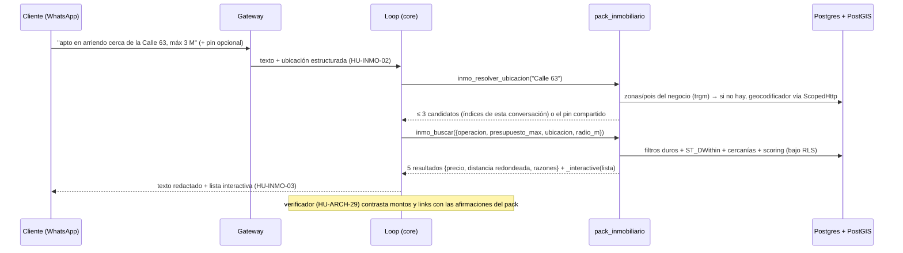
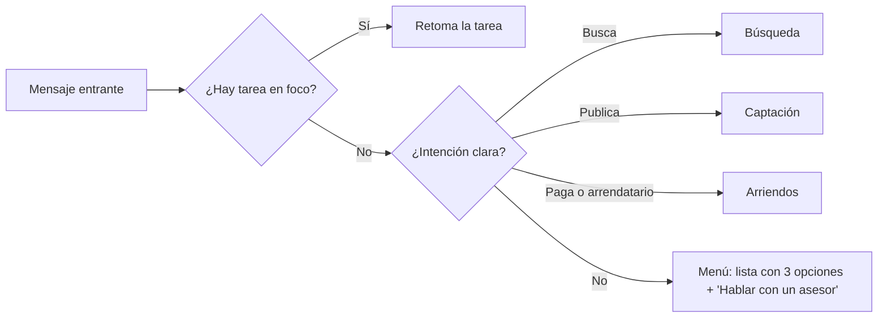
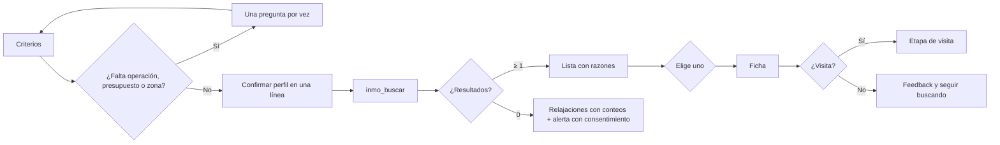
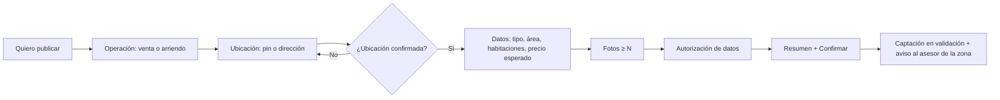
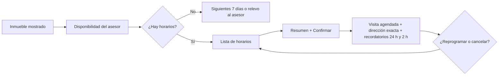
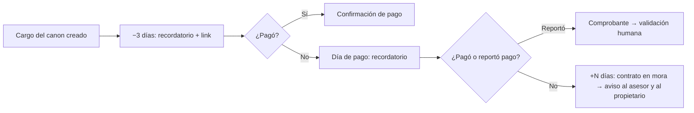
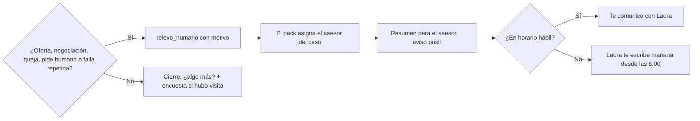

# SPEC-28 · Diseño

Las rutas `ruta:línea` del backend son relativas a `solvershub-backend/` (`develop` @ `cf73dc4`, 2026-10-09). Las del Agent OS remiten a [SPEC-26 design.md](../SPEC-26-agent-os/design.md).

Este diseño ya incorpora la revisión del agente `arquitecto` y del `auditor-multitenant` del 2026-10-09:

- Las piezas genéricas con consumidor real salieron a otras specs: [HU-AOS-03](../SPEC-26-agent-os/hu/HU-AOS-03-contrato-de-procedimientos.md), [HU-AOS-09](../SPEC-26-agent-os/hu/HU-AOS-09-modelo-por-riesgo-y-confirmacion-con-boton.md), [HU-AOS-46](../SPEC-26-agent-os/hu/HU-AOS-46-presets-v2.md) y HU-SUB-18.
- Las extensiones del core y de los packs base que solo usa la vertical esperan al piloto y se hicieron más chicas.
- Se agregaron las reglas de aislamiento entre negocios y de pertenencia al cliente.

## Trazabilidad con el encargo original

El encargo "prompt maestro InmoAgent" pedía 12 secciones. Esta tabla dice dónde quedó cada una.

| # | Sección del encargo | Dónde está |
|---|---|---|
| 1 | Objetivo del agente | [spec.md](spec.md#problema): Problema, Usuarios y Por qué importa |
| 2 | Requerimientos funcionales | [spec.md](spec.md#alcance): Alcance y Gherkin; cada HU en [tasks.md](tasks.md) |
| 3 | Arquitectura de subagentes | [Componentes y flujo](#componentes-y-flujo) |
| 4 | Modelo de datos mínimo | [Datos](#datos) |
| 5 | Herramientas y APIs | [API](#api) |
| 6 | Geolocalización y búsquedas por rango | [Geo](#geo) |
| 7 | Flujos conversacionales y plantillas | [UI](#ui) |
| 8 | Memoria y estado | [Memoria y estado](#memoria-y-estado) |
| 9 | Métricas de éxito | [KPIs y cómo se miden](#kpis-y-cómo-se-miden) |
| 10 | Plan por fases | [tasks.md](tasks.md) |
| 11 | Riesgos | [Riesgos](#riesgos) |
| 12 | Formato y placeholders | Toda la spec: Colombia, COP y `[NOMBRE DE LA INMOBILIARIA]` = variable del preset |

## Componentes y flujo

### Principio

Se aplica el mismo principio del Agent OS: **el LLM entiende y redacta; el servidor decide, calcula y actúa; un verificador comprueba lo que se dice**. En la vertical eso significa:

- El LLM extrae las preferencias, explícitas e implícitas, y llena los parámetros de las acciones.
- El servidor filtra, calcula distancias, puntúa, explica, propone relajaciones, ofrece horarios y genera montos y links.
- Precios, distancias, direcciones, horarios y links **nunca** salen del modelo (constitución §1.2.1).
- La verificación la hace el verificador del core ([HU-ARCH-29](../../03-fase-0-go-live/SPEC-02-agente-confiable/hu/HU-ARCH-29-verificador-de-afirmaciones.md), ADR-0119) con las afirmaciones que declara el pack. **No hay guardrail heurístico propio**: ADR-0119 señala ese patrón como causa de escalamientos falsos.

### Los 7 subagentes del encargo, traducidos al Agent OS

D-27 y ADR-0112 no permiten agentes LLM independientes que conversen con el cliente. Por eso cada "subagente" se convierte en la pieza del Agent OS que le corresponde. Decisión en D-SPEC-28-6.

| Subagente del encargo | Pieza del Agent OS | Antes del AOS (AgentSpec v2) | Responsabilidad | Entradas → salidas | Acciones | Criterio de éxito | Cómo comparte el estado |
|---|---|---|---|---|---|---|---|
| **InmoAgent** (orquestador) | **Coordinador** de la conexión (KernelSpec): voz única, reglas por payload (`menu:`, `inm:`, `vis:`, `rel:`) y disparadores por ejemplos | Asistente único con `flow.json` compuesto: saludo → secciones del pack → escalamiento | Saludar, enrutar, aplicar políticas (horario, pausa, cuota), un mensaje por turno | Mensaje → especialista o procedimiento en foco | Comandos del core | Precisión de ruta ≥ 0,90 (`core_decisions`); ≤ 1 pregunta por mensaje | `conversation_tasks` + tarjeta de estado |
| **SearchAgent** | Especialista **`asesor_comercial`** (plantilla de agente de la habilidad), procedimiento `buscar_inmuebles` | Sección `busqueda` | Recoger criterios, buscar, presentar y llevar a la visita | Texto, ubicación y listas → inmuebles con razones | `inmo_buscar`, `inmo_ver_ficha`, `inmo_perfil_actual` | Un resultado pertinente en ≤ 3 turnos; 0 inmuebles inventados | Slots de la tarea; `perfiles_busqueda` (fuente) |
| **MatchAgent** | **No es agente.** Scoring determinista dentro de `inmo_buscar` + agente back-office "Coincidencias" (R5) que **propone** alertas | Función del servidor + cron que emite eventos | Puntuar, explicar, relajar, detectar coincidencias nuevas | Perfil + inventario → ranking con explicación | `scoring.calcular()` (servidor) | Interés por recomendación ≥ 25 % | `recomendaciones`, `perfiles_busqueda` |
| **GeoAgent** | **No es agente.** Resolvers `ubicacion` y `zona` + acciones de lectura sobre PostGIS | Tools dentro de `busqueda` y `captacion` | Geocodificar, desambiguar, medir distancias y cercanías | Texto o pin → punto confirmado o zona | `inmo_resolver_ubicacion`, `inmo_poi_cercanos` | ≥ 95 % de ubicaciones confirmadas sin corrección del asesor | `zonas`, `pois`, `cercanias`, `geocache` |
| **VisitAgent** | Etapa final de `buscar_inmuebles`, o procedimiento `agendar_visita` si se llega directo; acciones sobre la `SchedulingCapability` del core (D-SPEC-28-4) | Sección `visitas` | Ofrecer horarios reales del asesor, confirmar, recordar y reprogramar | Inmueble mostrado + horario ofrecido → visita confirmada | `inmo_disponibilidad_visita`, `inmo_agendar_visita`, `inmo_reprogramar_visita`, `inmo_cancelar_visita` | 0 dobles reservas; 0 visitas en horarios no ofrecidos | `visitas`, `reserva_ref` |
| **PautaAgent** | Especialista **`captacion`**, procedimiento `captar_inmueble` | Sección `captacion` + formulario público | Captar al propietario, validar ubicación y fotos, avisar al asesor | Datos, pin y fotos → captación en validación | `inmo_iniciar_captacion`, `inmo_actualizar_captacion`, `inmo_enviar_captacion` | ≥ 70 % completas en una conversación; aviso en ≤ 1 min | `captaciones` |
| **PayAgent** | Especialista **`arriendos`**, procedimientos `estado_de_cuenta`, `pagar_canon` y `reportar_pago`. Recordatorios y mora: crons de pack-subscriptions + handlers del pack | Sección `arriendo` | Estado de cuenta, link del canon, "ya pagué" | Contrato del arrendatario → saldo y link del servidor | `inmo_estado_cuenta`, `inmo_link_canon`, `inmo_reportar_pago`. Las suscripciones del contrato rechazan pausar, cancelar y cambiar plan | Links siempre del servidor; % de pago a tiempo | `contratos` (con espejo de cargos) |
| **HandoffAgent** | **No es agente.** Comando `relevo_humano` + el pack asigna el asesor al escuchar `escalation.triggered` + back-office "resumen para humano" ([HU-AOS-30](../SPEC-26-agent-os/hu/HU-AOS-30-agentes-de-back-office.md)) | `escalate_to_human` + el mismo handler del pack | Pasar al asesor correcto con contexto | Motivo → escalamiento asignado y resumen | — | 100 % de escalamientos con responsable; nadie vuelve a pedir datos | `escalations.assigned_admin_id`, `oportunidades` |

Quedan 3 especialistas más el General. Siete especialistas multiplicarían los errores de ruta y los cambios de dueño ([SPEC-26](../SPEC-26-agent-os/spec.md) §2.7). Además, geo, match y relevo no conversan: son cálculos.

**Pila de tareas.** La visita es una etapa de `buscar_inmuebles`, no otra tarea. Así, con `maxStack 2`, una búsqueda en curso deja lugar a una pregunta de arriendo ([HU-INMO-30](hu/HU-INMO-30-especialistas-inmobiliarios.md)).

### Antes y después del Agent OS

| Pieza | Antes del AOS (fases INMO 1 a 4) | Con el AOS (fase INMO 5) |
|---|---|---|
| Enrutamiento | Secciones de `flow.json` del pack: `busqueda`, `visitas`, `captacion`, `arriendo`, `postventa` (ADR-0054/0109) | KernelSpec: reglas por payload y disparadores por ejemplos ([HU-AOS-17](../SPEC-26-agent-os/hu/HU-AOS-17-enrutamiento-y-modo-sombra.md)) |
| Secuencia | Gates deterministas dentro de las acciones: `inmo_agendar_visita` exige un inmueble mostrado y un horario ofrecido en esta conversación | Etapas con acciones permitidas fail-closed ([HU-AOS-05](../SPEC-26-agent-os/hu/HU-AOS-05-motor-de-procedimientos.md)) |
| Confirmación | `requiresConfirmation` en los `ToolBinding` que escriben, que ya existe (`core/orchestrator/loop.py:674-716`). Lo marca el preset y sale como botón cuando exista [HU-AOS-09](../SPEC-26-agent-os/hu/HU-AOS-09-modelo-por-riesgo-y-confirmacion-con-boton.md) | `confirmation: interactive_button` ([HU-AOS-09](../SPEC-26-agent-os/hu/HU-AOS-09-modelo-por-riesgo-y-confirmacion-con-boton.md)) |
| Verificación | Afirmaciones de monto y link declaradas por el pack para el verificador de [HU-ARCH-29](../../03-fase-0-go-live/SPEC-02-agente-confiable/hu/HU-ARCH-29-verificador-de-afirmaciones.md) | Afirmaciones del procedimiento ([HU-AOS-06](../SPEC-26-agent-os/hu/HU-AOS-06-comandos-y-verificador-sobre-estado.md)) + atributo, distancia y prohibidas ([HU-INMO-27](hu/HU-INMO-27-procedimientos-1-1.md)) |
| Datos desde la conversación | Acciones que leen la ubicación y el índice de la fila elegida | `setBy` desde payload, condición por tipo de contenido y dato con candidatos, en `procedure/1` ([HU-AOS-03](../SPEC-26-agent-os/hu/HU-AOS-03-contrato-de-procedimientos.md)) |
| Memoria | Tablas del pack + resumen corto en `customers.attributes` | Igual + `memory_facts` con namespaces `inmo_*` ([HU-AOS-36](../SPEC-26-agent-os/hu/HU-AOS-36-memoria-por-scope.md), R5) |
| Evals | Golden + journeys `inmobiliaria` con pass^k ([HU-ARCH-28](../../03-fase-0-go-live/SPEC-02-agente-confiable/hu/HU-ARCH-28-evals-de-consistencia-pass-k.md)) | Escenarios por procedimiento como gate de release ([HU-AOS-21](../SPEC-26-agent-os/hu/HU-AOS-21-gate-de-release-pass-k.md)) |

Ejemplo de procedimiento nativo. La afirmación `forbidden` llega con [HU-INMO-27](hu/HU-INMO-27-procedimientos-1-1.md); lo demás es `procedure/1` con las extensiones que suma [HU-AOS-03](../SPEC-26-agent-os/hu/HU-AOS-03-contrato-de-procedimientos.md):

```json
{"contract":"procedure/1","id":"pack_inmobiliario.agendar_visita","version":"1.0.0",
 "title":"Agendar la visita a un inmueble",
 "triggers":{"description":"El cliente quiere ver un inmueble","examples":["lo puedo ver el sábado","quiero visitarlo","¿cuándo lo puedo conocer?"],"interactivePayloadPrefix":"vis:"},
 "slots":{"inmueble_id":{"type":"string","resolver":"pack_inmobiliario.inmueble_mostrado","required":true,"setBy":"interactive:inm:"},
          "inicio":{"type":"string","format":"date-time","resolver":"pack_inmobiliario.horario_ofrecido","required":true,"confirm":true,"setBy":"interactive:vis:"},
          "visita_id":{"type":"string","setBy":"action:inmo_agendar_visita"}},
 "stages":[{"id":"elegir","goal":"Ofrecer horarios reales del asesor del inmueble","actions":["inmo_disponibilidad_visita","inmo_ver_ficha"],"exitWhen":{"slots":["inmueble_id","inicio"]}},
           {"id":"confirmar","goal":"Confirmar inmueble, fecha y hora","actions":["inmo_agendar_visita"],"confirmation":"interactive_button","exitWhen":{"slots":["visita_id"]}}],
 "completion":{"events":["inmobiliario.visita_agendada"],"returnControl":true},
 "recovery":{"actionError":"explicar_y_reintentar_una_vez","timeout":"relevo_humano"},
 "claims":[{"kind":"status","phrases":["quedó agendada","te espero"],"requires":"slot:visita_id"},
           {"kind":"forbidden","what":"direccion_exacta","unless":"slot:visita_id"}],
 "evals":["visita-feliz","visita-horario-no-ofrecido","visita-reprograma","visita-sin-asesor"]}
```

`inmo_agendar_visita` es una acción del propio pack que llega a la agenda por un registro del core. Así se cumple la regla de ADR-0113: un procedimiento solo usa acciones de su habilidad y del core.

Procedimientos de la vertical ([HU-INMO-29](hu/HU-INMO-29-procedimientos-inmobiliarios.md)):

| Procedimiento | Especialista | Etapas | Confirmación |
|---|---|---|---|
| `buscar_inmuebles` | `asesor_comercial` | criterios → confirmar perfil → resultados → ajustar o elegir → visita | Visita: botón. Guardar alertas: consentimiento de [HU-CHAN-03](../SPEC-17-canales-y-campanas/hu/HU-CHAN-03-pack-marketing.md) |
| `agendar_visita` (entrada directa) / `reprogramar_visita` / `cancelar_visita` | `asesor_comercial` | elegir visita del cliente → horario → confirmar | Botón |
| `captar_inmueble` | `captacion` | operación → ubicación → datos → fotos → autorización → resumen | Botón (autorización y envío) |
| `estado_de_cuenta` | `arriendos` | contrato del arrendatario → mostrar | Ninguna |
| `pagar_canon` | `arriendos` | cargo pendiente → link | Ninguna; el monto sale del cargo |
| `reportar_pago` | `arriendos` | comprobante → registro pendiente de validar | Botón; lo valida un humano o [HU-MEDIA-04](../../03-fase-0-go-live/SPEC-04-notas-de-voz-y-comprobantes/hu/HU-MEDIA-04-dispatcher-de-vision.md) |

**Consultas entre especialistas.** Se nombran `<agente>.<consulta>` ([SPEC-26](../SPEC-26-agent-os/spec.md) design.md:1553). Por ejemplo, `arriendos.estado_contrato`.

### Integración con los packs existentes

Ningún pack importa a otro (invariante 5) ni guarda ids de tablas de otro pack (ADR-0004). La coordinación va por registros del core (`payment_registry`, `subscription_registry` y `scheduling_registry`) y por eventos del outbox (ADR-0107).

| Pack | Se reutiliza tal cual | Se extiende (espera al piloto) | Cómo se coordina | HU |
|---|---|---|---|---|
| **pack-calendar** | Tipos de cita, bloqueos, recordatorios (`appointment.reminder`), `no_show`, push al responsable (`send_push_batch`), guardrail `calendar_completion_check` | Columna nullable `agenda_admin_id` en citas y `admin_id` en bloqueos (nulo = conducta actual); exclusión `(tenant_id, coalesce(agenda_admin_id, nil), tstzrange)`; `referencia`; correo opcional por tipo de cita; `appointment.*` con `origen=asistente`, sin segundo aviso con la ventana abierta. Sin tabla de recursos hasta un segundo caso real | Implementa la `SchedulingCapability` por `admin_id` | [HU-INMO-05](hu/HU-INMO-05-agenda-por-responsable.md), [HU-INMO-06](hu/HU-INMO-06-agenda-como-capacidad-del-core.md) |
| **pack-subscriptions** | Cargos por período, link Wompi (`sub-<id>`), conciliación por monto, recordatorios (en horario legal con HU-SUB-18), `subscription.past_due` y `charge_paid`, `dias_gracia`, `registrar_pago_externo`, `cambio_programado` | Operaciones opcionales con el molde de `permite_varias`: identidad por `reference`, inicio, día ancla, fin, `cobrar_periodo_inicial`; `autogestion=false` como atributo de la suscripción, validado por el proveedor en `pause`, `cancel` y `change_plan` (fail-closed). Solo kwargs con valores por defecto en `activate` | `subscription_registry` + eventos | [HU-INMO-08](hu/HU-INMO-08-suscripciones-de-plazo-fijo.md) |
| **pack-payments** | `generar_link_pago`, webhook con validación de monto, mínimo por ambiente | Nada | Indirecto, a través de subscriptions | — |
| **core** | `escalate`, `escalations`, `send_push_batch` (`core/tasks/push_tasks.py:34-47`), `lead_registry` (ADR-0056), `public_routes` (ADR-0057), `resolve_tenant_by_slug`, `ScopedHttp` (ADR-0052), `collaborator_roles` (rol `asesor`), `requiresConfirmation`, plantillas por evento (ADR-0108), presets (ADR-0110) | Avisos declarados por habilidades ([HU-INMO-04](hu/HU-INMO-04-avisos-abiertos-a-habilidades.md)); `SchedulingCapability` ([HU-INMO-06](hu/HU-INMO-06-agenda-como-capacidad-del-core.md)). Fuera de esta spec: botón ([HU-AOS-09](../SPEC-26-agent-os/hu/HU-AOS-09-modelo-por-riesgo-y-confirmacion-con-boton.md)), extensiones de procedimientos ([HU-AOS-03](../SPEC-26-agent-os/hu/HU-AOS-03-contrato-de-procedimientos.md)), presets v2 ([HU-AOS-46](../SPEC-26-agent-os/hu/HU-AOS-46-presets-v2.md)), cobro en horario legal (HU-SUB-18) | — | — |
| **pack-commerce** | No se usa (D-SPEC-28-7). El inmueble no es un producto | Se extrae `_verify_turnstile` (`pack_commerce/api.py:112`) a un helper del core sin cambiar su conducta | — | [HU-INMO-18](hu/HU-INMO-18-captacion-de-propietarios.md) |
| **pack-cobranza** | No se usa en v1. Del patrón PostGIS (`alembic/versions/0002_postgis.py:22-46`) se copia el trigger, **no** su índice `GIST (geom)` sin `tenant_id` | Nada: las operaciones nuevas de suscripciones son opcionales | — | — |

**El preset `inmobiliaria`** ([HU-INMO-25](hu/HU-INMO-25-preset-golden-y-journeys.md)) combina `pack_inmobiliario`, `pack_calendar`, `pack_payments` y `pack_subscriptions` con `proveedor_suscripciones: pack_subscriptions`. Fragmentos:

- **calendar:** tipo de cita "Visita a inmueble" de 45 min, `email_obligatorio: false`, recordatorios a 24 h y 2 h;
- **subscriptions:** `varias_por_cliente: true`, `pausar_tras_dias_mora: 0`, `dias_gracia: 5`;
- **inmobiliario:** su configuración base;
- **`requiresConfirmation`** en los bindings de visitas, captación y reporte de pago.

Con el Agent OS, el preset se reescribe como preset v2 ([HU-AOS-46](../SPEC-26-agent-os/hu/HU-AOS-46-presets-v2.md)).

### Flujo de un turno de búsqueda (antes del AOS)



### Habilitadores

| Habilitador | Qué cambia | HU | ADR | ¿Piloto? |
|---|---|---|---|---|
| Botón interactivo | Salida, `button_reply.id` y botones de plantilla | [HU-AOS-09](../SPEC-26-agent-os/hu/HU-AOS-09-modelo-por-riesgo-y-confirmacion-con-boton.md) ([SPEC-26](../SPEC-26-agent-os/spec.md)) | ADR-0112/0113 | No |
| Extensiones de `procedure/1` | Dato desde payload, condición por tipo de contenido, dato con candidatos | [HU-AOS-03](../SPEC-26-agent-os/hu/HU-AOS-03-contrato-de-procedimientos.md) ([SPEC-26](../SPEC-26-agent-os/spec.md)) | ADR-0113 (propuesto) | No |
| Presets v2 | Plantillas de agente, reglas del Coordinador y permisos | [HU-AOS-46](../SPEC-26-agent-os/hu/HU-AOS-46-presets-v2.md) ([SPEC-26](../SPEC-26-agent-os/spec.md)) | Nuevo, enmienda 0110 | No |
| Cobro en horario legal | Ventana, festivos y un aviso por día en pack-subscriptions | HU-SUB-18 (SPEC-06) | Ninguno (configuración del pack) | No |
| Entrada de ubicación y lista | `inbound.py` deja de descartar `location` y `list_reply.id`; `ultima_ubicacion()` acotada al episodio | [HU-INMO-02](hu/HU-INMO-02-entrada-estructurada-whatsapp.md) | ADR de la vertical | Sí |
| Salida de listas, ubicación e imágenes | Extras deterministas `_interactive`, `_location`, `_media`; índices opacos | [HU-INMO-03](hu/HU-INMO-03-salida-interactiva.md) | ADR de la vertical | Sí |
| Avisos declarados por habilidades | Tópico, rutas y clave de deduplicación; variables en el payload; un handler genérico | [HU-INMO-04](hu/HU-INMO-04-avisos-abiertos-a-habilidades.md) | Nuevo, enmienda 0108 | Sí |
| Agenda por asesor | `agenda_admin_id` + referencia + correo opcional + `origen` | [HU-INMO-05](hu/HU-INMO-05-agenda-por-responsable.md) | Nuevo, enmienda 0084 | Sí |
| `SchedulingCapability` | `disponibilidad`, `reservar`, `reagendar`, `cancelar` por `admin_id` | [HU-INMO-06](hu/HU-INMO-06-agenda-como-capacidad-del-core.md) | Nuevo | Sí |
| Relevo al asesor | El pack escucha `escalation.triggered`, llena `assigned_admin_id` y avisa al asesor | [HU-INMO-07](hu/HU-INMO-07-escalamiento-al-responsable.md) | Ninguno (evento existente) | Sí |
| Suscripciones de plazo fijo | Operaciones opcionales y `autogestion` | [HU-INMO-08](hu/HU-INMO-08-suscripciones-de-plazo-fijo.md) | Nuevo, enmienda 0106 | Sí |
| Supresión por titular | Hook `suprimir_titular(customer_id)` por pack | [HU-INMO-09](hu/HU-INMO-09-supresion-de-datos-del-titular.md) | ADR de la vertical | Sí |

El contrato `agentcore_contracts` no cambia: `LocationContent` e `InteractiveContent` ya existen y `OutboundMessage` los admite (`packages/contracts/agentcore_contracts/contracts.py:51-70, 304-307`). `TurnResult` es interno (`core/orchestrator/loop.py:94`).

## Datos

### Reglas comunes de las tablas del pack

- **Columnas base.** `id uuid pk`, `tenant_id uuid not null`, `deleted_at`, `created_at`, `updated_at` y `custom jsonb` donde aplique.
- **Aislamiento.** Toda **PK, UNIQUE y EXCLUDE empieza por `tenant_id`** y los únicos son parciales `WHERE deleted_at IS NULL`. Postgres evalúa FK, UNIQUE y EXCLUDE sobre todas las filas e ignora RLS: un único global revela datos de otro negocio.
- **FK.**
  - Dentro del pack, FK compuestas `(tenant_id, x_id) → (tenant_id, id)`.
  - Hacia el core (clientes, administradores), FK lógicas validadas al escribir leyendo bajo RLS (`get_owned`, `core/db/session.py:70-86`); los administradores se validan además contra `tenant_user` del negocio.
  - **Ninguna columna guarda ids de tablas de otro pack** (ADR-0004).
- **Migraciones.** Cada migración que crea una tabla incluye en el mismo archivo:
  - RLS habilitada y forzada;
  - la policy `tenant_isolation` con `nullif(current_setting('app.tenant_id', true), '')::uuid` en USING y WITH CHECK;
  - grants: `select, insert, update` (sin DELETE, por la invariante 8); las append-only, solo `select, insert`;
  - el índice `(tenant_id, …)`.

  Es lo que exige `.claude/hooks/guards.py:71-85`.
- **Extensiones.** `postgis`, `btree_gist`, `btree_gin`, `pg_trgm` y `unaccent` se crean con `IF NOT EXISTS` en la primera migración del pack, sin depender de la de calendar. Con `btree_gist` y `btree_gin` los índices GIST y GIN quedan compuestos con `tenant_id`.
- **Append-only.** Usan un trigger BEFORE UPDATE/DELETE con una función propia que solo deja pasar la anonimización de [HU-INMO-09](hu/HU-INMO-09-supresion-de-datos-del-titular.md). Nunca una RULE: `purge_tenant` solo desactiva triggers (`alembic/versions/0011_purge_tenant.py:48`). Hoy existen `prevent_audit_mutation` y `prevent_usage_mutation`; no hay una función genérica.
- **Sin vistas.** Ni vistas ni vistas materializadas en `public` con `tenant_id`: rompen `purge_tenant`, y las materializadas no admiten RLS.
- **Rendimiento.** Con RLS forzada, los operadores que no son LEAKPROOF (PostGIS `&&`/`ST_DWithin`, trgm `%`, `@@`, `@>`) no se usan como condición de índice antes de la policy.
  - Se verifica con `EXPLAIN` como `app_runtime` y `app.tenant_id` fijado.
  - **Prohibido evadir RLS por rendimiento** (SECURITY DEFINER, BYPASSRLS o la URL de migraciones).
  - Si no alcanza, se acepta el recorrido por negocio (≤ 10⁴ inmuebles) o se decide con un ADR.

### Tablas `pack_inmobiliario_*`

| Tabla | Columnas clave | Índices y checks |
|---|---|---|
| `inmuebles` | **Identidad:** `codigo`, `operacion` (venta / arriendo / venta_arriendo), `tipo` (validado contra `tipos_inmueble` de la configuración, no por CHECK), `estado_comercial` (borrador → en_validacion → publicado → reservado → arrendado / vendido → retirado), `estado_fisico`.<br>**Precio:** `precio_venta`, `canon_mensual`, `valor_administracion`, `moneda`.<br>**Características:** `habitaciones`, `banos numeric(3,1)`, `area_construida_m2`, `area_privada_m2`, `area_lote_m2`, `estrato` (nullable, Colombia), `parqueaderos`, `piso`, `antiguedad_anios`, `caracteristicas text[]` (vocabulario de la configuración).<br>**Texto:** `titulo`, `descripcion`, `tsv tsvector` generada (español + `unaccent` inmutable).<br>**Ubicación:** `direccion` (reservada, D-SPEC-28-8), `barrio_texto`, `zona_id`, `ciudad`, `lat`, `lng`, `geom geography(Point,4326)` por trigger, `ubicacion_fuente` (pin / panel / geocodificador:<proveedor> / import), `ubicacion_precision`, `ubicacion_confirmada_at`.<br>**Relaciones:** `propietario_customer_id`, `asesor_admin_id`, `captacion_id`, `publicado_at` | uq `(tenant_id, codigo)` parcial; `(tenant_id, estado_comercial, operacion, tipo)`; parciales sobre publicados `(tenant_id, canon_mensual)` y `(tenant_id, precio_venta)`; GIST `(tenant_id, geom)`; GIN `(tenant_id, tsv)` y `(tenant_id, caracteristicas)`; CHECK: precio coherente con la operación, áreas > 0 |
| `medios` | `inmueble_id`, `tipo` (foto / plano / video_url), `storage_key` (bajo `tenants/<tenant_id>/…`, servido con URL firmada), `orden`, `es_portada`, `origen` | `(tenant_id, inmueble_id, orden)`; uq parcial `(tenant_id, inmueble_id) WHERE es_portada` |
| `partes` | `customer_id`, `tipo_persona`, `documento_tipo`, `documento_numero_cifrado` (ADR-0027, solo panel), `roles text[]` (propietario, arrendatario, comprador, codeudor) | uq `(tenant_id, customer_id)` parcial; GIN `(tenant_id, roles)`. La autorización de datos y el consentimiento de marketing **no** viven aquí (P-29, [HU-CHAN-03](../SPEC-17-canales-y-campanas/hu/HU-CHAN-03-pack-marketing.md)) |
| `asesores` | `admin_id`, `zonas uuid[]`, `operaciones text[]`, `activo`, `orden_rotacion`, `ultimo_asignado_at` | uq `(tenant_id, admin_id)` parcial. La agenda del asesor es su `admin_id` en pack-calendar: no se guarda ningún id de calendar |
| `zonas` | `nombre`, `nombre_norm`, `alias text[]`, `tipo` (barrio / localidad / municipio / sector), `contexto` (urbano / suburbano / rural), `ciudad`, `padre_id`, `geom geometry(MultiPolygon,4326)`, `centroide`, `fuente` (osm / negocio), `fuente_id` | GIST `(tenant_id, geom)`; GIN trgm `(tenant_id, nombre_norm)`; uq `(tenant_id, fuente, fuente_id)` |
| `pois` | `categoria` (colegio, universidad, transporte_masivo, supermercado, parque, hospital, centro_comercial), `nombre`, `nombre_norm`, `geom`, `fuente`, `fuente_id`, `refrescado_at` | GIST `(tenant_id, geom)`; `(tenant_id, categoria)`; GIN trgm `(tenant_id, nombre_norm)` |
| `cercanias` | PK `(tenant_id, inmueble_id, categoria)`, `poi_id`, `distancia_m`, `conteo_radio`, `calculado_at` | `(tenant_id, categoria, distancia_m)` |
| `geocache` | `consulta_hmac` (HMAC por negocio de la consulta normalizada: la dirección no se guarda en claro), `sesgo_ciudad`, `proveedor`, `candidatos jsonb`, `expira_at` | uq `(tenant_id, proveedor, consulta_hmac, sesgo_ciudad) WHERE deleted_at IS NULL`; al expirar se anulan las coordenadas y se marca `deleted_at`. **Nunca se comparte entre negocios** |
| `perfiles_busqueda` | `customer_id`, `operacion`, `tipos text[]`, `precio_min`, `precio_max`, `habitaciones_min`, `banos_min`, `area_min`, `area_max`, `caracteristicas_req text[]` (indispensables), `caracteristicas_des text[]` (deseables), `zonas uuid[]`, `centro geography`, `radio_m`, `radio_min_m`, `cercanias jsonb` (categoría → distancia máx.), `implicitas jsonb` (pesos sobre atributos del inmueble), `alertas_activas`, `estado` (activo / pausado / cerrado) | uq `(tenant_id, customer_id, operacion) WHERE estado = 'activo' AND deleted_at IS NULL`; GIN `(tenant_id, tipos)` |
| `busquedas` (append) | `customer_id`, `conversation_id`, `perfil_id`, `parametros jsonb` (**sin coordenada cruda**: zona o celda gruesa), `relajaciones jsonb`, `total_resultados`, `latencia_ms` | `(tenant_id, created_at)`; parcial `total_resultados = 0` |
| `recomendaciones` | `busqueda_id`, `inmueble_id`, `posicion`, `score numeric(5,4)`, `explicacion jsonb`, `feedback` (me_interesa / no_me_interesa / visita), `motivo`, `feedback_at` | uq `(tenant_id, busqueda_id, inmueble_id)` |
| `captaciones` | `propietario_customer_id`, `canal` (whatsapp / formulario / panel), `estado` (borrador → enviada → en_validacion → aprobada / rechazada), `datos jsonb` (validados por esquema), `inmueble_id`, `validaciones jsonb` (ubicación, fotos, `duplicado_de`), `asesor_admin_id`, `motivo_rechazo`, `idempotency_key` | uq `(tenant_id, idempotency_key)`; uq parcial `(tenant_id, propietario_customer_id) WHERE estado = 'borrador'`; `(tenant_id, estado)` |
| `visitas` | `inmueble_id`, `customer_id`, `asesor_admin_id`, `reserva_ref` (cita de pack-calendar, opaca), `inicio`, `fin` (copia), `estado` (agendada / reprogramada / cancelada / realizada / no_asistio), `direccion_revelada_at`, `calificacion 1-5`, `interes_post`, `oportunidad_id` | uq `(tenant_id, reserva_ref)`; `(tenant_id, asesor_admin_id, inicio)`; `(tenant_id, customer_id, estado)` |
| `oportunidades` + `oportunidad_eventos` (append) | `customer_id`, `tipo` (compra / arriendo / captacion), `etapa` (nuevo → contactado → visita → oferta → separado → cerrado_ganado / cerrado_perdido), `inmueble_id`, `asesor_admin_id`, `origen`, `valor_estimado`, `motivo_perdida`, `proxima_accion_at` | `(tenant_id, etapa, asesor_admin_id)`; `(tenant_id, oportunidad_id, created_at)` en eventos |
| `contratos` | **Partes:** `codigo`, `inmueble_id`, `arrendador_customer_id`, `arrendatario_customer_id`, `codeudores uuid[]`.<br>**Condiciones:** `uso` (vivienda / comercial), `canon`, `moneda`, `dia_pago 1-28`, `fecha_inicio`, `fecha_fin`, `prorroga_automatica`.<br>**Incremento:** `regla_incremento` (ipc / ipc_mas_puntos / fijo_pct / ninguno), `puntos_adicionales`, `proximo_ajuste_at`.<br>**Cobro:** `suscripcion_ref` (opaca), `estado` (borrador / vigente / en_mora / terminado / anulado), `en_mora_desde`, espejo de cargos alimentado por eventos (`ultimo_cargo_periodo`, `ultimo_cargo_estado`, `cargos_pagados_a_tiempo`, `cargos_vencidos`) | uq `(tenant_id, suscripcion_ref)` parcial; uq `(tenant_id, inmueble_id) WHERE estado = 'vigente'`; `(tenant_id, arrendatario_customer_id)`; CHECK `fecha_fin > fecha_inicio`, `canon > 0` |
| `ajustes_canon` | `contrato_id`, `canon_anterior`, `canon_nuevo`, `ipc_aplicado`, `tope_calculado`, `fecha_efectiva`, `estado` (propuesto / aprobado / notificado / aplicado / descartado), `aprobado_por`, `notificado_at` | `(tenant_id, contrato_id, fecha_efectiva)` |

### Geo

**Geocodificación ("pin primero", D-SPEC-28-5):**

1. **Inmuebles.** La ubicación sale de un pin de WhatsApp ([HU-INMO-02](hu/HU-INMO-02-entrada-estructurada-whatsapp.md)) o del mapa del panel. Es dato propio y se puede guardar sin restricciones de licencia.
2. **Solo hay dirección en texto.** Se usa un proveedor cuya licencia permita guardar el resultado (Mapbox *permanent* u OSM/Nominatim propio). La cobertura de la nomenclatura colombiana ("Cl 72 # 10-34") está por verificar (P-27).
3. **Lugares que nombra quien busca** ("cerca de Unicentro"). Primero se busca en `pois` y `zonas` del negocio por trigramas. Si no aparece, se usa un geocodificador temporal y no se guarda más de lo que permita su licencia (Google ≤ 30 días; Mapbox *temporary* sin caché).
4. **Confirmación.** Siempre se confirma con una lista de ≤ 3 candidatos o pidiendo el pin. El modelo nunca elige el candidato.
5. **Seguridad.**
   - La lista de proveedores está cerrada en el código: nunca una URL tomada de la configuración, porque `network_allowlist` es estático por módulo (`core/plugin_manager.py:499-507`).
   - Todo pasa por `ScopedHttp`.
   - La clave va en headers o params, nunca en el texto de la URL: `ScopedHttp` incluye la URL en el error (`core/mcp/types.py:228`).
   - El cliente HTTP se construye en cada llamada con la configuración del negocio.

**Zonas y puntos de interés por negocio.**

- Se importan de OpenStreetMap por ciudad (ODbL permite guardar) y se escriben **en las tablas de cada negocio**. El cron baja los datos una vez por ciudad y los escribe dentro del scope de cada negocio.
- Al escribir un inmueble se precalculan su `zona_id` (con `ST_Contains`) y sus `cercanias`: el POI más cercano por categoría dentro de 2 km.

**Catálogo compartido** (solo con ADR y si la duplicación lo justifica). Condiciones:

- solo `fuente = 'osm'`;
- **ninguna columna `tenant_id`**, porque `purge_tenant` la descubriría y borraría filas que usan todos (`alembic/versions/0011_purge_tenant.py:40-49`);
- docstring "tabla de SISTEMA (sin RLS)", con `GRANT SELECT` a `app_runtime` y nada más;
- escritura solo desde el cron, con un rol dedicado;
- las correcciones y las zonas propias del negocio van en tablas por negocio con RLS, que ganan sobre el catálogo;
- cada referencia lleva `origen (sistema | negocio)`.

**Radios por defecto** (configuración): urbano 500 m, suburbano 1000 m (según el `contexto` de la zona) y máximo 10 km. "Cerca" sin cifra usa el radio del contexto.

**Lenguaje natural → parámetros → SQL.** Todas las consultas corren bajo RLS y filtran además por `tenant_id`, `deleted_at IS NULL` y `estado_comercial = 'publicado'`.

1. **"Apartamento en arriendo en Chapinero, máximo 3 millones, 2 habitaciones"**
   - Parámetros: `{operacion:"arriendo", tipos:["apartamento"], presupuesto_max:3000000, habitaciones_min:2, ubicacion:{zona:"Chapinero"}}`.
   - El resolver de zona encuentra "Chapinero Alto" y "Chapinero Central" y ofrece una lista.
   - SQL: `… AND i.zona_id = ANY($zonas_y_sus_hijas) AND i.canon_mensual <= $max * 1.10 AND i.habitaciones >= 2`.
2. **"Casa a menos de 2 km del Colegio Los Nogales"**
   - Parámetros: `{tipos:["casa"], ubicacion:{lugar:"Colegio Los Nogales"}, radio_m:2000}`. El lugar se resuelve en `pois` o con el geocodificador temporal.
   - SQL: `… AND ST_DWithin(i.geom, ST_MakePoint($lng, $lat)::geography, 2000)`, y se devuelve `round(ST_Distance(i.geom, $punto) / 100) * 100 AS distancia_m`.
3. **"Entre 1 y 3 km de mi oficina"** (con un pin compartido)
   - Parámetros: `{ubicacion:{usar_ubicacion_compartida:true}, radio_min_m:1000, radio_m:3000}`.
   - SQL: `… AND ST_DWithin(i.geom, $c, 3000) AND NOT ST_DWithin(i.geom, $c, 1000)`.
4. **"Cerca de TransMilenio y de un parque, que acepten mascotas, hasta 2,5 millones"**
   - Parámetros: `{cercanias:{transporte_masivo:500, parque:500}, caracteristicas_req:["mascotas"], presupuesto_max:2500000}`.
   - SQL: `… AND 'mascotas' = ANY(i.caracteristicas) AND EXISTS (SELECT 1 FROM pack_inmobiliario_cercanias c WHERE c.tenant_id = i.tenant_id AND c.inmueble_id = i.id AND c.categoria = 'transporte_masivo' AND c.distancia_m <= 500)`, más la misma condición para `parque`.

### Recomendación: scoring, explicación y relajación

**Filtros duros:**

- operación y tipo;
- publicado;
- precio ≤ máximo × (1 + `tolerancia_presupuesto_pct`, 10 % por defecto);
- lo que el cliente marcó como indispensable;
- zona o radio, cuando se pidieron.

**Puntaje** sobre ≤ 200 candidatos: `score = Σ wₖ · sₖ`. Los pesos son configurables por negocio.

| Factor | Peso por defecto | sₖ |
|---|---:|---|
| Precio | 0,30 | 1 dentro del rango; baja lineal hasta 0,5 en el tope de tolerancia |
| Ubicación | 0,25 | 1 dentro de la zona o del radio; decae hasta 0 en 1,5 × radio |
| Tamaño y habitaciones | 0,15 | 1 si cumple; 0,5 con una habitación menos (solo al relajar) |
| Características deseables | 0,10 | Fracción que cumple |
| Cercanías pedidas | 0,10 | 1 a ≤ la distancia pedida; 0 al doble |
| Calidad del aviso | 0,05 | ≥ 5 fotos, descripción y publicado hace poco |
| Preferencias implícitas | 0,05 | Aprendidas del feedback, **solo sobre atributos del inmueble** |

**Preferencias implícitas.** El LLM las extrae del texto según reglas del playbook: "tengo dos niños" → cercanía a colegios y parques; "trabajo desde casa" → una habitación más. Nunca se infieren rasgos sensibles de la persona ni se filtra por ellos.

**Explicación.** Cada resultado trae `explicacion` con los 2 o 3 factores que más aportaron, con valores del servidor: "a unos 400 m de la estación Calle 63", "$2.800.000, dentro de tu presupuesto", "acepta mascotas". Las distancias van redondeadas a 100 m mientras el cliente no tenga una visita a ese inmueble, para que no se pueda triangular la dirección.

**Relajación cuando hay 0 resultados.** Escalera determinista y configurable:

1. presupuesto +10 %;
2. radio × 1,5 o zonas vecinas (`ST_Touches`);
3. una habitación menos;
4. quitar lo deseable;
5. tipo alternativo de la configuración (apartaestudio ↔ apartamento).

Se detiene en el primer paso que dé ≥ 3 resultados. Devuelve `sugerencias` con el conteo de cada paso, que se muestran como lista (`rel:<paso>`), y ofrece una alerta con el consentimiento de [HU-CHAN-03](../SPEC-17-canales-y-campanas/hu/HU-CHAN-03-pack-marketing.md). Nunca relaja la operación ni lo indispensable.

**Lo que no se repite.** No se vuelve a mostrar lo marcado como "no me interesa". El feedback ajusta `implicitas` del perfil, con un tope por factor.

### Memoria y estado

| Capa | Antes del AOS | Con el AOS | Contenido |
|---|---|---|---|
| **Sesión** | L1 Redis (`shortTermTurns`), `conversations.state` (notas, confirmación pendiente) y estado efímero del pack en Redis | Slots de la tarea en foco (`conversation_tasks`) + pila | Criterios en curso, candidatos de ubicación, inmuebles mostrados (índices), horarios ofrecidos |
| **Operativa del pack** (fuente de verdad) | `busquedas`, `recomendaciones`, `visitas`, `captaciones` | Igual | Lo mostrado, lo agendado, lo captado |
| **Largo plazo** | `perfiles_busqueda`, `partes`, `contratos`, `oportunidades` + resumen corto en `customers.attributes` (L2) | Igual + `memory_facts` en `inmo_busqueda`, `inmo_captacion` e `inmo_arriendo`, limitado a las claves que usan las reglas `customerFact` | Perfil, roles, contratos, historial |
| **Semántica** | No se usa: `memory_vectors` tiene defectos conocidos y está apagado por defecto | `memory_vectors` por scope ([HU-AOS-36](../SPEC-26-agent-os/hu/HU-AOS-36-memoria-por-scope.md)), solo para episodios | Resúmenes de episodio |

**Estado efímero en Redis.**

- Las claves son `inmo:{tenant_id}:{conversation_id}:…` con TTL, igual que `wm` (`core/memory/working.py:37-47`), y se registran para la limpieza de `purge_tenant`.
- El candidato de ubicación y el inmueble de una lista se identifican por su índice dentro de la lista guardada para esa conversación, nunca por un token global.
- Prohibido `lru_cache` o diccionarios de módulo sobre zonas, POI, pesos, sinónimos o claves.

**Cómo se comparte el estado:**

- Las tablas del pack son la verdad. Los especialistas las leen con acciones `read`.
- El Coordinador ve la tarjeta de estado ([SPEC-26](../SPEC-26-agent-os/spec.md) §7.3).
- Entre especialistas se usa `consultar(arriendos.estado_contrato)`. Un agente nunca escribe en el namespace de otro (P-20).
- `memory_facts` lo escribe un agente con el namespace concedido (ADR-0114). Que lo escriba el servidor (un cron o un handler) queda por definir en [HU-AOS-36](../SPEC-26-agent-os/hu/HU-AOS-36-memoria-por-scope.md).

**Retención y supresión (Ley 1581).**

- Los perfiles sin actividad en 12 meses (configurable) pasan a `cerrado`.
- La supresión del titular usa el hook `suprimir_titular(customer_id)` del pack ([HU-INMO-09](hu/HU-INMO-09-supresion-de-datos-del-titular.md)), que anonimiza ubicación, implícitas, datos de captación y documento. `purge_memory` solo toca vectores y Redis (`core/memory/vector.py:147-188`).
- El pin guardado en `messages` lo cubre el mismo hook.

## API

### Reglas de las acciones

- **Pertenencia al cliente, no solo al negocio.** RLS impide el cruce entre negocios, no entre clientes del mismo negocio. Cada acción valida al cliente del `ToolContext`:
  - visitas con `customer_id` de ese cliente y estado agendada o reprogramada;
  - contratos con `arrendatario_customer_id` de ese cliente, y la suscripción con el mismo cliente;
  - la dirección y `_location`, solo si existe una visita **de ese cliente** a ese inmueble.
- **Payloads como dato no confiable.** En el chat web se pueden teclear. `inm:`, `vis:`, `rel:` y la fila de una lista se validan contra lo que el servidor guardó de la conversación (inmuebles mostrados, horarios ofrecidos) y usan índices opacos.
- **Sin ids del contexto como argumento.** `conversation_id` y `customer_id` salen del `ToolContext`, nunca de argumentos del LLM. `ultima_ubicacion()` usa solo mensajes entrantes del episodio (≤ 24 h).
- **Escrituras idempotentes.** Montos, links, distancias y horarios salen del servidor.
- **Logs.** Sin dirección, coordenadas, consulta de geocodificación ni documento: solo ids, estado y latencia.

### Acciones del pack

Antes del AOS son tools; con el AOS son las acciones de las etapas.

| Acción | sideEffect | Qué hace | Idempotencia y reglas |
|---|---|---|---|
| `inmo_resolver_ubicacion(texto \| usar_ubicacion_compartida)` | read (HTTP) | ≤ 3 candidatos (zona, POI o geocodificado) con su índice | Caché según la licencia del proveedor |
| `inmo_buscar(filtros)` | read (registra `busquedas` y `recomendaciones`) | Filtros duros, geo, scoring, explicación y relajación; ≤ 5 resultados + lista | `(conversation_id, hash(parametros))` en Redis |
| `inmo_ver_ficha(indice)` | read | Ficha con portada, precio, área, cercanías y dirección según D-SPEC-28-8 | Solo inmuebles publicados y mostrados |
| `inmo_poi_cercanos(indice, categorias)` | read | Distancias precalculadas y redondeadas | Solo inmuebles publicados |
| `inmo_perfil_actual()` / `inmo_guardar_perfil(perfil, alertas)` | read / write | Lee o guarda el perfil; las alertas exigen el consentimiento de [HU-CHAN-03](../SPEC-17-canales-y-campanas/hu/HU-CHAN-03-pack-marketing.md) | upsert por `(tenant_id, customer_id, operacion)` |
| `inmo_registrar_feedback(indice, feedback, motivo)` | write | "Me interesa" o "no me interesa" | upsert |
| `inmo_disponibilidad_visita(indice, desde, hasta)` | read | Horarios de la agenda del asesor del inmueble | Solo inmuebles mostrados |
| `inmo_agendar_visita(indice, horario)` / `inmo_reprogramar_visita` / `inmo_cancelar_visita` | write (`requiresConfirmation`) | Reserva y crea o actualiza la visita | `idempotency_key` + `reserva_ref`; inmueble mostrado y horario ofrecido; solo visitas del cliente |
| `inmo_iniciar_captacion` / `inmo_actualizar_captacion(datos)` / `inmo_enviar_captacion()` | write | Borrador, validación por esquema, envío y aviso al asesor | Un borrador por propietario; enviar es una transición idempotente |
| `inmo_estado_cuenta()` | read | Contratos del arrendatario con su espejo de cargos | Solo contratos del cliente |
| `inmo_link_canon(contrato?)` | write | Reutiliza o genera el link del cargo pendiente | El monto sale del cargo; solo contratos del cliente |
| `inmo_reportar_pago(contrato, comprobante)` | write (`requiresConfirmation`) | Pago por otro canal, pendiente de validar | `registrar_pago_externo` lo confirma un humano o [HU-MEDIA-04](../../03-fase-0-go-live/SPEC-04-notas-de-voz-y-comprobantes/hu/HU-MEDIA-04-dispatcher-de-vision.md) |
| **Solo en el panel** (humano): crear o editar contrato, aprobar ajuste del canon, aprobar o rechazar captación, publicar o retirar inmueble | irreversible | — | El LLM no las ve |

**Resolvers** (AOS): `monto` (entiende "3 millones", "3M", "$3.000.000"), `tipo_inmueble`, `zona`, `ubicacion` (candidatos + elección), `inmueble_mostrado`, `horario_ofrecido` y `contrato_del_cliente`.

**Configuración** (`InmobiliarioConfig`, Pydantic → formulario automático):

- **General:** país, moneda, ciudad por defecto, `tipos_inmueble` con alternativos, vocabulario de `caracteristicas` con sinónimos.
- **Scoring:** pesos, `tolerancia_presupuesto_pct`, `max_resultados`, `min_sin_relajar`, `orden_relajacion`.
- **Geo:** `radio_urbano_m`, `radio_suburbano_m`, `radio_max_m`, `geocodificador` (uno de la lista cerrada + `api_key: SecretStr`).
- **Privacidad:** `revelar_direccion` (nunca / tras_agendar / siempre), `redondeo_distancia_m`.
- **Visitas y captación:** `duracion_visita_min`, `fotos_minimas`, `distancia_duplicado_m`, `formulario_activo`, `formulario_origenes`.
- **Arriendos:** `dias_alerta_mora`, `notificar_propietario_mora`, `ipc_por_anio` (P-28), `incremento_requiere_aprobacion`, `aviso_incremento_dias`.
- **Alertas:** `alertas_max_por_semana`.
- **Textos al cliente** (ADR-0017): botones y filas del menú, opciones de relajación, mensajes de "sin resultados" y de relevo.

### Crons y handlers

Los crons iteran con `_tenant_ids()` (molde de `pack_subscriptions/jobs.py:39-58`). Para cada negocio:

- abren `tenant_scope(tid)` y **una sesión nueva dentro de ese scope**: `get_session()` fija `app.tenant_id` al abrirse (`core/db/session.py:46-53`);
- cargan la configuración dentro del scope;
- aíslan los errores por negocio.

Prohibido el rol dueño o SECURITY DEFINER.

Los handlers de eventos comprueban que el pack esté habilitado en el negocio actual y usan `get_current_tenant_id()`, nunca el `tenant_id` del payload: el despachador entrega cada evento a todos los suscriptores (`core/tasks/domain_events_dispatch.py:69-86`).

| Cron | Frecuencia | Qué hace |
|---|---|---|
| `recalcular_cercanias` | Nocturno | Inmuebles con ubicación nueva o cambiada |
| `refrescar_pois` | Mensual por ciudad | Baja OSM una vez y escribe por negocio |
| `expirar_geocache` | Diario | Anula coordenadas vencidas según la licencia |
| `alertas_de_coincidencias` | Por evento `inmueble_publicado` + resumen diario | Emite eventos de aviso para perfiles con alertas y consentimiento ([HU-INMO-04](hu/HU-INMO-04-avisos-abiertos-a-habilidades.md), [HU-CHAN-03](../SPEC-17-canales-y-campanas/hu/HU-CHAN-03-pack-marketing.md)) |
| `reenganche_leads` | Diario | Oportunidades sin actividad → evento de aviso con consentimiento |
| `seguimiento_post_visita` | Cada 30 min | Visitas realizadas → encuesta y siguiente paso |
| `propuestas_de_incremento` | Diario | Contratos que cumplen 12 meses → `ajustes_canon` propuesto |
| `alertas_de_mora` | Diario | Contratos en mora a los días configurados → asesor y propietario |
| `contratos_por_vencer` | Diario | Aviso a 90, 60 y 30 días |

### Eventos

Prefijo único `inmobiliario.`, igual que los dominios existentes (`appointment.*`, `subscription.*`).

- **Emite** (outbox):
  - inmuebles: `inmueble_publicado`, `inmueble_actualizado`, `inmueble_retirado`;
  - captaciones: `captacion_recibida`, `captacion_aprobada`, `captacion_rechazada`;
  - visitas: `visita_agendada`, `visita_reprogramada`, `visita_cancelada`, `visita_realizada`, `visita_no_asistida`;
  - oportunidades: `oportunidad_etapa_cambiada`;
  - contratos: `contrato_registrado`, `contrato_en_mora`, `contrato_al_dia`, `canon_ajuste_propuesto`, `canon_ajustado`, `contrato_por_vencer`.

  Los de aviso al cliente se declaran con [HU-INMO-04](hu/HU-INMO-04-avisos-abiertos-a-habilidades.md).
- **Consume:**
  - `appointment.*`, cruzando `visitas.reserva_ref = appointment_id` en los dos sentidos;
  - `subscription.past_due` y `subscription.charge_paid`, por `suscripcion_ref`, para actualizar el espejo de cargos de `contratos`;
  - `escalation.triggered`, para el relevo al asesor ([HU-INMO-07](hu/HU-INMO-07-escalamiento-al-responsable.md)).

### Formulario público de captación

- **Ruta y negocio.** `POST /api/pack/pack_inmobiliario/captaciones/{slug}`. El negocio sale **solo** del slug del path con `resolve_tenant_by_slug`, que resuelve únicamente negocios activos (`core/tenants.py:64-77`). Se ignora cualquier `tenant_id` o slug del cuerpo.
- **Habilitación.** Pack habilitado y `formulario_activo` en la configuración del negocio.
- **Turnstile.** Obligatorio y fail-closed, validando `hostname` y `action` contra `formulario_origenes`. Hoy commerce solo mira `success` (`pack_commerce/api.py:112-126`).
- **Respuesta.** Límite por slug e IP; la respuesta nunca devuelve datos existentes.
- **Cliente.** Se crea con `channel=web` y no se fusiona con el cliente de WhatsApp del mismo teléfono hasta verificarlo.
- **Fotos.** Bajo `tenants/<tenant_id>/captaciones/<id>/`, con URL firmada y validación del prefijo al leer.

### `SchedulingCapability`

- **Resolución.** Solo con `capability_for_tenant(get_current_tenant_id())`, que lee el AgentSpec del negocio (molde de `core/subscriptions/__init__.py:167-195`). Nunca con `capability_for(None)`.
- **Interfaz mínima.** `disponibilidad(admin_id, desde, hasta, duracion)`, `reservar(customer_id, admin_id, inicio, duracion, titulo, idempotency_key, correo?)`, `reagendar` y `cancelar`.
  - Las operaciones no reciben `tenant_id`.
  - No hay `obtener`: el estado llega por `appointment.*`.
- **Referencia.** La pone el core con el id del pack que llama. `reagendar` y `cancelar` rechazan reservas de otro pack.
- **Sin estado en la instancia:** nada de cachés de configuración ni de tokens.

### Integraciones externas

| Necesidad del encargo | Solución | Estado |
|---|---|---|
| API de listados o MLS interno | El inventario vive en el pack. Se importa con CSV/Excel del negocio desde el panel ([HU-INMO-11](hu/HU-INMO-11-inventario-y-captaciones-en-el-panel.md)) o con el agente `migrator`. Sin scraping de portales | Nuevo |
| Motor geoespacial | PostGIS 3 sobre Postgres 17 (ADR-0058), `geography` + GIST compuesto | Existe la extensión |
| Geocodificación y mapas | Proveedor de la lista cerrada vía `ScopedHttp` (P-27). Mapas: link en la ficha y ubicación nativa de WhatsApp ([HU-INMO-03](hu/HU-INMO-03-salida-interactiva.md)) | Nuevo |
| Calendario | Agenda interna de pack-calendar (por asesor) y Google Calendar (ya integrado). **Outlook no está soportado**: fuera de v1 | Se extiende |
| Notificaciones | WhatsApp (texto, listas, botones de [HU-AOS-09](../SPEC-26-agent-os/hu/HU-AOS-09-modelo-por-riesgo-y-confirmacion-con-boton.md), plantillas), correo (SMTP del negocio), push al equipo (Expo). **SMS no existe**: fuera de v1 | Se extiende |
| CRM | Pipeline propio (`oportunidades`) + vista global de leads (ADR-0056). Un CRM externo se conecta con tools declarativas (ADR-0052) o MCP ([HU-ARCH-19](../SPEC-19-extensibilidad-y-operacion/hu/HU-ARCH-19-mcp-por-tenant.md)) | Nuevo |
| Pasarela de pagos | Wompi a través de pack-payments y pack-subscriptions; pago externo registrado | Existe |
| Base de datos | Postgres multi-tenant con RLS (ADR-0001) | Existe |

## UI

### Plantillas conversacionales

**Reglas comunes:**

- Tono cálido, profesional y claro. Máximo una pregunta por mensaje.
- Los textos viven en playbooks y en la configuración (ADR-0017); cero prompts en código.
- Listas y botones solo dentro de la ventana de 24 h; fuera de ella, plantillas de Meta aprobadas (ADR-0108).
- Los nodos de decisión de cada plantilla son las etapas del procedimiento con el AOS, y las secciones más los gates de las acciones antes del AOS.

#### 1. Bienvenida y enrutamiento



> ¡Hola! Soy el asistente de [NOMBRE DE LA INMOBILIARIA] 🏡 ¿En qué te ayudo hoy?
> [Buscar inmueble] [Publicar mi inmueble] [Soy arrendatario]

#### 2. Búsqueda de inmuebles



> **Confirmación del perfil:** Perfecto: apartamento en **arriendo** cerca de la **Calle 63**, hasta **$3.000.000**, 2 habitaciones. ¿Busco con eso?
>
> **Resultados:** Encontré 4 opciones. La que mejor te encaja es *Apto 2H en Chapinero Alto*: $2.800.000, a unos 400 m de la estación y acepta mascotas. Te dejo la lista para que veas las otras. [Ver opciones]
>
> **Sin resultados:** No tengo nada exacto con eso 😕. Si subes a $3.300.000 hay 4 opciones; si amplías a 1,5 km hay 6. [Ver opciones]

#### 3. Captación de pauta



> ¡Qué bien que quieras trabajar con nosotros! Para empezar, ¿me compartes la ubicación del inmueble? Toca el clip 📎 → *Ubicación*.
>
> Encontré estas direcciones; ¿cuál es? [Ver opciones]
>
> Listo. Laura, nuestra asesora de Chapinero, revisa tu inmueble y te escribe hoy en horario hábil.

#### 4. Agendamiento de visitas



> Puedo agendarte con Laura. Estos son los horarios disponibles: [Ver horarios]
> Confirmo tu visita al *Apto 2H en Chapinero Alto* el **sábado 12 a las 10:00 a. m.** con Laura. [Confirmar] [Cambiar hora]
> ¡Listo! Te espera en *Cl. 72 #10-34, apto 501*. Te recuerdo un día antes.

#### 5. Recordatorio de pago de renta

Plantilla *utility* enviada en horario legal (HU-SUB-18).



> Hola Ana 👋 Te recordamos que el canon de octubre del inmueble *Cl. 72 #10-34* por **$2.800.000** vence el **5 de octubre**. [Pagar ahora] [Ya pagué]
>
> **Mora:** Ana, el canon de octubre sigue pendiente. Si ya pagaste, envíanos el comprobante; si necesitas ayuda, te comunico con tu asesora. [Enviar comprobante] [Hablar con asesora]

#### 6. Cierre y relevo a un humano



> Gracias por tu oferta. Para negociarla te comunico con Laura, que lleva este inmueble; ya tiene todo el contexto, así que no tendrás que repetir nada.

**Plantillas de Meta que hay que crear** (el negocio las aprueba y las mapea con `message_templates_map`):

- **Utility:** `visita_confirmada`, `visita_recordatorio`, `canon_recordatorio`, `canon_vencido`, `canon_ajuste_aviso`, `contrato_por_vencer`, `captacion_recibida`.
- **Encuesta post-visita:** `visita_encuesta`; su categoría está por verificar con la skill `meta-whatsapp`.
- **Marketing con opt-in** ([HU-CHAN-03](../SPEC-17-canales-y-campanas/hu/HU-CHAN-03-pack-marketing.md)): `nuevo_inmueble_para_ti`, `reenganche`.

### Panel

Vistas por descriptor ([HU-FWK-06](../SPEC-16-habilidades-como-plataforma/hu/HU-FWK-06-descriptores-y-api-de-vistas.md)/07), con el glosario de marca ("habilidad", "negocio"):

- **Inventario:** tabla con filtros, mapa con pins, ficha con fotos y estados, importación CSV.
- **Captaciones por validar:** ubicación en el mapa, fotos, posibles duplicados (≤ 30 m), aprobar o rechazar.
- **Asesores:** zonas, operaciones y rotación.
- **Zonas y POI:** importar de OSM por ciudad y corregir, solo en las tablas del negocio.
- **Oportunidades:** tablero por etapa y asesor.
- **Contratos:** registro, espejo de cargos, mora y ajustes por aprobar.
- **KPIs:** [HU-INMO-26](hu/HU-INMO-26-kpis-de-la-vertical.md).

El rol de colaborador `asesor` ve solo sus oportunidades, visitas y captaciones.

## KPIs y cómo se miden

Todas las cifras salen de tablas del pack o del core; ninguna lee tablas de otro pack.

| KPI | Fórmula | Fuente |
|---|---|---|
| Consulta → visita agendada | Perfiles con `visita_agendada` en 30 días / perfiles activos (por cohorte) | `perfiles_busqueda`, evento `inmobiliario.visita_agendada` |
| Búsquedas sin resultado | Antes y después de relajar | `busquedas.total_resultados`, `relajaciones` |
| Precisión de recomendaciones | "Me interesa" + visitas / recomendaciones mostradas; feedback de la visita ≥ 4/5 | `recomendaciones.feedback`, `visitas.calificacion` |
| Asistencia a visitas | Realizadas / agendadas; no-show | `visitas.estado` |
| Embudo y tiempo por etapa | Conversión entre etapas y mediana de días | `oportunidad_eventos` |
| Tiempo de respuesta | Primera respuesta del asistente p95; primera respuesta del asesor tras el relevo | `usage_ledger.latency_ms`; `escalations` (asignado → tomado, [HU-UI-05](../SPEC-13-vistas-profesionales/hu/HU-UI-05-tickets-reales.md)) |
| Recordatorios de pago efectivos | Cargos pagados a tiempo / cargos del período | Espejo de cargos en `contratos` |
| Cartera en mora | Contratos en mora, días de mora y monto | `contratos.en_mora_desde`, espejo de cargos |
| Contactos de cobro fuera de horario (meta 0) | Avisos de cobro fuera de la ventana legal | Registro de HU-SUB-18 |
| Pautas captadas por mes | Captaciones aprobadas / mes; tiempo de validación; duplicados | `captaciones` |
| Días en el mercado | `publicado_at` → arrendado o vendido | `inmuebles` |
| Satisfacción | CSAT de la encuesta post-visita y de cierre | `visitas.calificacion`; encuesta [HU-INMO-21](hu/HU-INMO-21-seguimiento-post-visita-y-encuesta.md) |
| Calidad de la IA | pass^4 por procedimiento; fallos del verificador por tipo | `eval_results`, `turn_outcomes` |
| Costo | LLM por conversación; mensajes de Meta; aciertos de `geocache` | `usage_ledger`; ADR-0033; `geocache` |

## ADR a crear o enmendar

Se crean en `solvershub-backend/docs/adr/` con el número que toque al crearlos. Las enmiendas a ADR aceptados se escriben como **ADR nuevos** que los superan en parte. [HU-INMO-01](hu/HU-INMO-01-adrs-y-dor-del-piloto.md) los deja propuestos y se aceptan al firmarse el piloto.

| ADR | Alcance | HU |
|---|---|---|
| **Nuevo** · Vertical inmobiliaria | Inventario geoespacial con GIST compuesto; zonas y POI por negocio y condiciones de un catálogo compartido; geocache por negocio con HMAC; scoring en el servidor; privacidad de la dirección y distancias redondeadas; listas y ubicación del canal (sin cambiar el contrato); hook `suprimir_titular` | [HU-INMO-01](hu/HU-INMO-01-adrs-y-dor-del-piloto.md) · [HU-INMO-02](hu/HU-INMO-02-entrada-estructurada-whatsapp.md), 03, 09, 10, 12 |
| **Nuevo** (enmienda ADR-0108) · Avisos declarados por las habilidades | Registro abierto, handler genérico, deduplicación; sin cabecera con imagen ni botones de plantilla | [HU-INMO-04](hu/HU-INMO-04-avisos-abiertos-a-habilidades.md) |
| **Nuevo** (enmienda ADR-0084) · Agenda por asesor | `agenda_admin_id`, exclusión nueva, `referencia`, `origen`, correo opcional | [HU-INMO-05](hu/HU-INMO-05-agenda-por-responsable.md) |
| **Nuevo** · Agenda como capacidad del core | `scheduling_registry` con el molde de ADR-0067 | [HU-INMO-06](hu/HU-INMO-06-agenda-como-capacidad-del-core.md) |
| **Nuevo** (enmienda ADR-0106) · Suscripciones de plazo fijo | Operaciones opcionales, identidad por `reference`, `autogestion` | [HU-INMO-08](hu/HU-INMO-08-suscripciones-de-plazo-fijo.md) |
| **Nuevo** (cambio de forma del contrato de procedimientos, ADR-0011) · Afirmaciones de atributo, distancia y prohibidas | Incremento de versión del contrato | [HU-INMO-27](hu/HU-INMO-27-procedimientos-1-1.md) |

**Contradicciones resueltas en esta revisión:**

- **ADR-0011:** no existe un `procedure/1.1` "aditivo". Lo genérico entra en `procedure/1` antes de publicarlo ([HU-AOS-03](../SPEC-26-agent-os/hu/HU-AOS-03-contrato-de-procedimientos.md)), y lo de la vertical va con su ADR y su versión ([HU-INMO-27](hu/HU-INMO-27-procedimientos-1-1.md)).
- **ADR-0004:** ya no hay ids de tablas de pack-calendar ni lecturas de tablas de pack-subscriptions.
- **ADR-0119:** se retiró el guardrail heurístico propio.
- **ADR-0023:** las extensiones con un solo caso esperan al piloto.

ADR-0112 a ADR-0118 siguen propuestos. [HU-INMO-29](hu/HU-INMO-29-procedimientos-inmobiliarios.md) a [HU-INMO-31](hu/HU-INMO-31-back-office-y-memoria.md) esperan a que se acepten en [HU-AOS-01](../SPEC-26-agent-os/hu/HU-AOS-01-adrs-del-agent-os.md).

## Lo que el Agent OS planificado no alcanza para la vertical

Se cumple la cláusula de revisión de ADR-0113 ("si el contrato no expresa un caso real de las verticales sin recurrir a código"). La revisión separó lo que tiene más de un caso real de lo que es solo de la vertical:

| Hueco | Dónde se resuelve |
|---|---|
| Dato llenado desde el payload de una lista o botón | [HU-AOS-03](../SPEC-26-agent-os/hu/HU-AOS-03-contrato-de-procedimientos.md) (también `plan:` de comercio) |
| Condición "llegó una ubicación o una imagen" (`contentType`) | [HU-AOS-03](../SPEC-26-agent-os/hu/HU-AOS-03-contrato-de-procedimientos.md) (también comprobantes de [HU-MEDIA-04](../../03-fase-0-go-live/SPEC-04-notas-de-voz-y-comprobantes/hu/HU-MEDIA-04-dispatcher-de-vision.md)) |
| Dato "lugar" con candidatos y elección | [HU-AOS-03](../SPEC-26-agent-os/hu/HU-AOS-03-contrato-de-procedimientos.md) |
| Afirmaciones `attribute`, `distance` y `forbidden` (dirección antes de agendar) | [HU-INMO-27](hu/HU-INMO-27-procedimientos-1-1.md), con piloto |
| Adjuntos deterministas (lista, ubicación, imágenes) en `composition: single_message` | [HU-INMO-03](hu/HU-INMO-03-salida-interactiva.md) + nota en [HU-AOS-09](../SPEC-26-agent-os/hu/HU-AOS-09-modelo-por-riesgo-y-confirmacion-con-boton.md) |
| Presets que instancian plantillas de agente y KernelSpec | [HU-AOS-46](../SPEC-26-agent-os/hu/HU-AOS-46-presets-v2.md) |
| Resolvers con HTTP (geocodificación): timeout de unos 3 s y respaldo | [HU-AOS-34](../SPEC-26-agent-os/hu/HU-AOS-34-acciones-v2.md) (R5) |
| `memory_facts` escrito por el servidor (cron o handler) | Por definir en [HU-AOS-36](../SPEC-26-agent-os/hu/HU-AOS-36-memoria-por-scope.md) (R5) |

## Migración, despliegue y reversa

- **Pack nuevo.** Árbol Alembic propio (`alembic_version_pack_inmobiliario`); cada migración que crea una tabla trae RLS, FORCE, policy y grants. Reversa: desactivar el pack por negocio (ADR-0024). Las tablas quedan y no se borran.
- **pack-calendar.** EXCLUDE no admite `NOT VALID`.
  - Se hace en una sola transacción con `lock_timeout`: ADD de la exclusión nueva (con `tenant_id WITH =` como primer elemento) y DROP de la vieja.
  - Va en ventana de mantenimiento, porque el ADD toma ACCESS EXCLUSIVE sobre una tabla que comparten todos los negocios.
  - No hace falta verificar solapes: la clave nueva es más fina que la actual.
  - `agenda_admin_id` nulo conserva la conducta actual.
- **pack-subscriptions.** Solo kwargs con valores por defecto que conservan la conducta actual; `autogestion=true` por defecto. Antes de mergear se corren los journeys de suscripciones, [HU-SH-03](../../03-fase-0-go-live/SPEC-07-asistente-solvershub/hu/HU-SH-03-aprovisionamiento-automatico.md) y [HU-SH-04](../../03-fase-0-go-live/SPEC-07-asistente-solvershub/hu/HU-SH-04-cobro-de-plataforma-dos-canales.md), porque `activate` lo usan commerce y el alta automática.
- **Gateway.** Con la bandera apagada, la conducta es idéntica a la de hoy y solo se guarda la estructura. Se enciende por negocio cuando pasan los golden.
- **Orden.** Test → piloto en producción con el preset aplicado solo al piloto → preset publicado.

## Riesgos

| Riesgo | Detalle | Mitigación |
|---|---|---|
| Vertical especulativa | La skill `new-pack` pide no construir packs especulativos | DoR: piloto firmado (P-26, D-31). Lo genérico con consumidor real salió a [HU-AOS-03](../SPEC-26-agent-os/hu/HU-AOS-03-contrato-de-procedimientos.md), [HU-AOS-09](../SPEC-26-agent-os/hu/HU-AOS-09-modelo-por-riesgo-y-confirmacion-con-boton.md), [HU-AOS-46](../SPEC-26-agent-os/hu/HU-AOS-46-presets-v2.md) y HU-SUB-18 |
| Capacidad (1 persona) frente al AOS | D-30: el código del AOS arranca al mergear el código del 0A | P-31: al firmarse el piloto, intercalar las fases INMO 0 a 4 entre fases del AOS sin tocar su camino crítico; la fase 5 tras AOS R3 y R5 |
| **Ley 2300 de 2023** ("dejen de fregar") | Horarios de cobranza: lunes a viernes de 7:00 a 19:00 y sábados de 8:00 a 15:00; nunca domingos ni festivos; límites de frecuencia ([Función Pública](https://www.funcionpublica.gov.co/eva/gestornormativo/norma.php?i=213990), consultada el 2026-10-09). La frecuencia exacta y si aplica al canon están **por verificar** con el abogado (HU-GTM-02) | HU-SUB-18 (SPEC-06), para todos los negocios |
| **Ley 820 de 2003** (arrendamiento de vivienda urbana) | Art. 20: un incremento cada 12 meses, ≤ 100 % del IPC del año calendario anterior, con aviso escrito ([Portafolio](https://www.portafolio.co/mis-finanzas/vivienda/abc-cuanto-pueden-subir-los-arriendos-de-vivienda-y-que-hacer-si-su-arrendador-quiere-subir-mas-de-lo-permitido-486712), consultada el 2026-10-09). **Por verificar:** tope del canon (art. 18), prohibición de depósitos y matrícula de arrendador | El servidor calcula el tope; el asesor aprueba (P-28); plantilla de aviso registrada. `uso = comercial` no aplica el tope (Código de Comercio, por verificar) |
| **Ley 1581 de 2012** (habeas data) | Autorización previa, expresa e informada; supresión; transferencia de direcciones a un geocodificador extranjero | Autorización y consentimiento en una sola fuente (P-29, [HU-CHAN-03](../SPEC-17-canales-y-campanas/hu/HU-CHAN-03-pack-marketing.md)); hook `suprimir_titular` ([HU-INMO-09](hu/HU-INMO-09-supresion-de-datos-del-titular.md)); sin pin crudo en tablas append-only; el proveedor como encargado en el DPA (HU-GTM-02); documento cifrado y solo en el panel |
| SARLAFT / UIAF en el sector inmobiliario | **Por verificar** si el piloto es sujeto obligado | Fuera de v1 |
| Aislamiento entre negocios | Únicos globales, ids de otro negocio en FK lógicas o payloads, crons con la sesión de otro negocio | Reglas comunes de [Datos](#datos), reglas de las acciones, crons por scope y revisión del `auditor-multitenant` en cada HU |
| Licencias de geocodificación | Google: lat/lng ≤ 30 días en caché; Mapbox *temporary*: no se guarda ([Google Maps Platform Service Specific Terms](https://cloud.google.com/archive/maps-platform/terms/maps-service-terms-20250501), [Mapbox Geocoding API](https://docs.mapbox.com/api/search/geocoding/), consultadas el 2026-10-09) | Pin primero; `geocache.expira_at` por proveedor; coordenadas anuladas al expirar |
| Calidad geo en Colombia | Nomenclatura "Cl 72 # 10-34" y cobertura de POI en OSM | Pin primero + confirmación + corrección en el panel; medir el % corregido |
| Costo de Meta | Cada mensaje (lista, imagen, plantilla) cuesta según su categoría (skill `meta-whatsapp`; tarifas de Colombia por verificar) | Lista interactiva en vez de N tarjetas; fotos solo al elegir; alertas como marketing con opt-in y tope semanal |
| Costo del LLM | Búsquedas largas con varias iteraciones de tools | El servidor hace el trabajo pesado; `maxToolCallsPerTurn`; `deepseek-flash` por defecto (D-22); *thinking* solo en etapas `risk: high` |
| Topes de Wompi según el medio de pago | Un canon alto puede superar el tope de PSE o Nequi (**por verificar**) | Mostrarlo en el estado de cuenta; pago por otro canal con `inmo_reportar_pago` |
| Errores y fallback | Geocodificador caído, choque de horario, link que no se genera | Error de negocio controlado ([HU-ARCH-18](../../03-fase-0-go-live/SPEC-02-agente-confiable/hu/HU-ARCH-18-errores-de-negocio-no-apagan-packs.md)): pedir el pin o el barrio; volver a ofrecer horarios; pago por otro canal + relevo. `guardrail_fail_action` del negocio (ADR-0092) |
| Relevo tardío | El cliente queda esperando a un asesor | Asignación automática ([HU-INMO-07](hu/HU-INMO-07-escalamiento-al-responsable.md)), push al asesor, horario hábil explicado al cliente, KPI de primera respuesta |
| Privacidad del inmueble | Dirección de inmuebles ocupados; datos del propietario | Dirección solo con visita del cliente; distancias redondeadas; afirmación `forbidden` ([HU-INMO-27](hu/HU-INMO-27-procedimientos-1-1.md)); nunca datos del propietario |
| Sesgo en la recomendación | Inferencias sobre la persona | Las implícitas solo sobre atributos del inmueble; la explicación muestra los factores |
| Escalabilidad | ≤ 10⁴ inmuebles y 10⁴–10⁵ POI por negocio | Índices compuestos con `tenant_id`; precalcular `zona_id` y `cercanias`; p95 objetivo < 300 ms medido con `EXPLAIN` bajo RLS. Sin embeddings en v1 (texto libre con `tsvector` + `unaccent` + trgm, como [HU-COM-13](../SPEC-18-pack-commerce-v2/hu/HU-COM-13-busqueda-y-recomendaciones.md)) |
