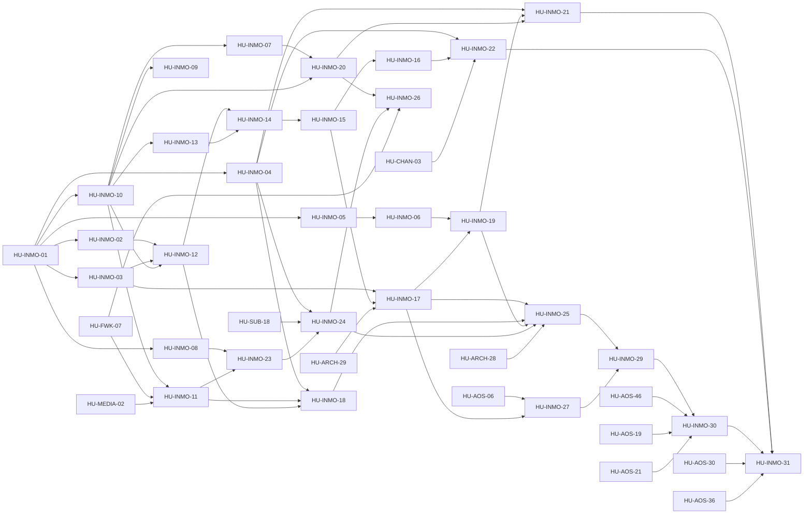

# SPEC-28 · Tareas

Orden de ejecución por fase de la vertical. Todas las HU llevan `fase: 1` en el frontmatter; las fases INMO
son internas de esta spec y siguen la secuencia híbrida (D-SPEC-28-3): las fases 0 a 4 corren sobre el motor
actual (AgentSpec v2), la fase 5 espera al Agent OS ([HU-INMO-27](hu/HU-INMO-27-procedimientos-1-1.md) a [HU-INMO-30](hu/HU-INMO-30-especialistas-inmobiliarios.md) a [SPEC-26](../SPEC-26-agent-os/spec.md) R1 y R3, y [HU-INMO-31](hu/HU-INMO-31-back-office-y-memoria.md) a R5).

**Regla de arranque (D-31):** todas las HU menos [HU-INMO-01](hu/HU-INMO-01-adrs-y-dor-del-piloto.md) exigen un piloto firmado (P-26). Las piezas
genéricas con consumidor real salieron de esta spec en la revisión del 2026-10-09: el botón interactivo a
[HU-AOS-09](../SPEC-26-agent-os/hu/HU-AOS-09-modelo-por-riesgo-y-confirmacion-con-boton.md), las extensiones de procedimientos a [HU-AOS-03](../SPEC-26-agent-os/hu/HU-AOS-03-contrato-de-procedimientos.md), presets v2 a [HU-AOS-46](../SPEC-26-agent-os/hu/HU-AOS-46-presets-v2.md) y el cobro en horario legal
a HU-SUB-18. HU-INMO-28 se retiró (ahora es [HU-AOS-46](../SPEC-26-agent-os/hu/HU-AOS-46-presets-v2.md)) y [HU-INMO-09](hu/HU-INMO-09-supresion-de-datos-del-titular.md) cambió de alcance (supresión de datos).

| Orden | HU | Título | Tamaño | Depende de | Fase INMO | Piloto |
|---|---|---|---|---|---|---|
| 1 | [HU-INMO-01](hu/HU-INMO-01-adrs-y-dor-del-piloto.md) | ADRs de la vertical y DoR del piloto | M | — | 0 · DoR | No |
| 2 | [HU-INMO-02](hu/HU-INMO-02-entrada-estructurada-whatsapp.md) | Ubicación y respuestas de lista entrantes | M | [HU-INMO-01](hu/HU-INMO-01-adrs-y-dor-del-piloto.md) | 1 · Fundaciones | Sí |
| 3 | [HU-INMO-03](hu/HU-INMO-03-salida-interactiva.md) | Listas, ubicación e imágenes salientes | M | [HU-INMO-01](hu/HU-INMO-01-adrs-y-dor-del-piloto.md) | 1 · Fundaciones | Sí |
| 4 | [HU-INMO-04](hu/HU-INMO-04-avisos-abiertos-a-habilidades.md) | Avisos por evento abiertos a las habilidades | M | [HU-INMO-01](hu/HU-INMO-01-adrs-y-dor-del-piloto.md) | 1 · Fundaciones | Sí |
| 5 | [HU-INMO-05](hu/HU-INMO-05-agenda-por-responsable.md) | Agenda por asesor con referencia y correo opcional | M | [HU-INMO-01](hu/HU-INMO-01-adrs-y-dor-del-piloto.md) | 1 · Fundaciones | Sí |
| 6 | [HU-INMO-06](hu/HU-INMO-06-agenda-como-capacidad-del-core.md) | Agenda como capacidad del core | M | [HU-INMO-05](hu/HU-INMO-05-agenda-por-responsable.md) | 1 · Fundaciones | Sí |
| 7 | [HU-INMO-08](hu/HU-INMO-08-suscripciones-de-plazo-fijo.md) | Suscripciones para contratos de plazo fijo | M | [HU-INMO-01](hu/HU-INMO-01-adrs-y-dor-del-piloto.md) | 1 · Fundaciones | Sí |
| 8 | [HU-INMO-10](hu/HU-INMO-10-pack-inmobiliario-inventario-geoespacial.md) | Pack inmobiliario: inventario geoespacial con RLS | L | [HU-INMO-01](hu/HU-INMO-01-adrs-y-dor-del-piloto.md) | 1 · Fundaciones | Sí |
| 9 | [HU-INMO-07](hu/HU-INMO-07-escalamiento-al-responsable.md) | Relevo al asesor del caso | S | [HU-INMO-10](hu/HU-INMO-10-pack-inmobiliario-inventario-geoespacial.md) | 1 · Fundaciones | Sí |
| 10 | [HU-INMO-09](hu/HU-INMO-09-supresion-de-datos-del-titular.md) | Supresión de datos del titular en la vertical | S | [HU-INMO-10](hu/HU-INMO-10-pack-inmobiliario-inventario-geoespacial.md) | 1 · Fundaciones | Sí |
| 11 | [HU-INMO-11](hu/HU-INMO-11-inventario-y-captaciones-en-el-panel.md) | Inventario y captaciones en el panel, con importación | L | [HU-INMO-10](hu/HU-INMO-10-pack-inmobiliario-inventario-geoespacial.md), [HU-FWK-07](../SPEC-16-habilidades-como-plataforma/hu/HU-FWK-07-descriptor-view.md), [HU-MEDIA-02](../../03-fase-0-go-live/SPEC-04-notas-de-voz-y-comprobantes/hu/HU-MEDIA-02-almacenamiento-media.md) | 1 · Fundaciones | Sí |
| 12 | [HU-INMO-12](hu/HU-INMO-12-geocodificacion-y-zonas.md) | Geocodificación con confirmación y zonas | M | [HU-INMO-02](hu/HU-INMO-02-entrada-estructurada-whatsapp.md), [HU-INMO-03](hu/HU-INMO-03-salida-interactiva.md), [HU-INMO-10](hu/HU-INMO-10-pack-inmobiliario-inventario-geoespacial.md) | 2 · Búsqueda y geo | Sí |
| 13 | [HU-INMO-13](hu/HU-INMO-13-puntos-de-interes-y-cercanias.md) | Puntos de interés y cercanías precalculadas | M | [HU-INMO-10](hu/HU-INMO-10-pack-inmobiliario-inventario-geoespacial.md) | 2 · Búsqueda y geo | Sí |
| 14 | [HU-INMO-14](hu/HU-INMO-14-busqueda-con-filtros-y-geo.md) | Búsqueda con filtros y consultas geoespaciales | L | [HU-INMO-12](hu/HU-INMO-12-geocodificacion-y-zonas.md), [HU-INMO-13](hu/HU-INMO-13-puntos-de-interes-y-cercanias.md) | 2 · Búsqueda y geo | Sí |
| 15 | [HU-INMO-15](hu/HU-INMO-15-recomendaciones-y-relajacion.md) | Recomendaciones explicadas y relajación de filtros | M | [HU-INMO-14](hu/HU-INMO-14-busqueda-con-filtros-y-geo.md) | 2 · Búsqueda y geo | Sí |
| 16 | [HU-INMO-16](hu/HU-INMO-16-perfil-de-busqueda-persistente.md) | Perfil de búsqueda persistente y feedback | M | [HU-INMO-15](hu/HU-INMO-15-recomendaciones-y-relajacion.md) | 2 · Búsqueda y geo | Sí |
| 17 | [HU-INMO-17](hu/HU-INMO-17-fichas-y-verificacion-de-hechos.md) | Fichas en el chat y verificación de hechos del inmueble | M | [HU-INMO-03](hu/HU-INMO-03-salida-interactiva.md), [HU-INMO-15](hu/HU-INMO-15-recomendaciones-y-relajacion.md), [HU-ARCH-29](../../03-fase-0-go-live/SPEC-02-agente-confiable/hu/HU-ARCH-29-verificador-de-afirmaciones.md) | 2 · Búsqueda y geo | Sí |
| 18 | [HU-INMO-18](hu/HU-INMO-18-captacion-de-propietarios.md) | Captación de inmuebles de propietarios | L | [HU-INMO-04](hu/HU-INMO-04-avisos-abiertos-a-habilidades.md), [HU-INMO-11](hu/HU-INMO-11-inventario-y-captaciones-en-el-panel.md), [HU-INMO-12](hu/HU-INMO-12-geocodificacion-y-zonas.md) | 3 · Captación y visitas | Sí |
| 19 | [HU-INMO-19](hu/HU-INMO-19-visitas-con-el-asesor.md) | Visitas con el asesor del inmueble | M | [HU-INMO-06](hu/HU-INMO-06-agenda-como-capacidad-del-core.md), [HU-INMO-17](hu/HU-INMO-17-fichas-y-verificacion-de-hechos.md) | 3 · Captación y visitas | Sí |
| 20 | [HU-INMO-20](hu/HU-INMO-20-oportunidades-y-asesores.md) | Oportunidades, asesores y leads | M | [HU-INMO-07](hu/HU-INMO-07-escalamiento-al-responsable.md), [HU-INMO-10](hu/HU-INMO-10-pack-inmobiliario-inventario-geoespacial.md) | 3 · Captación y visitas | Sí |
| 21 | [HU-INMO-21](hu/HU-INMO-21-seguimiento-post-visita-y-encuesta.md) | Seguimiento post-visita y encuesta | M | [HU-INMO-04](hu/HU-INMO-04-avisos-abiertos-a-habilidades.md), [HU-INMO-19](hu/HU-INMO-19-visitas-con-el-asesor.md), [HU-INMO-20](hu/HU-INMO-20-oportunidades-y-asesores.md) | 3 · Captación y visitas | Sí |
| 22 | [HU-INMO-22](hu/HU-INMO-22-alertas-y-reenganche.md) | Alertas de coincidencias y reenganche de leads | M | [HU-INMO-04](hu/HU-INMO-04-avisos-abiertos-a-habilidades.md), [HU-INMO-16](hu/HU-INMO-16-perfil-de-busqueda-persistente.md), [HU-CHAN-03](../SPEC-17-canales-y-campanas/hu/HU-CHAN-03-pack-marketing.md) | 3 · Captación y visitas | Sí |
| 23 | [HU-INMO-23](hu/HU-INMO-23-contrato-de-arriendo-y-canon.md) | Contrato de arriendo como registro y cobro del canon | L | [HU-INMO-08](hu/HU-INMO-08-suscripciones-de-plazo-fijo.md), [HU-INMO-11](hu/HU-INMO-11-inventario-y-captaciones-en-el-panel.md) | 4 · Arriendos y medición | Sí |
| 24 | [HU-INMO-24](hu/HU-INMO-24-mora-e-incremento-del-canon.md) | Mora e incremento anual del canon | M | [HU-INMO-04](hu/HU-INMO-04-avisos-abiertos-a-habilidades.md), HU-SUB-18, [HU-INMO-23](hu/HU-INMO-23-contrato-de-arriendo-y-canon.md) | 4 · Arriendos y medición | Sí |
| 25 | [HU-INMO-25](hu/HU-INMO-25-preset-golden-y-journeys.md) | Preset inmobiliaria, golden y journeys de la vertical | M | [HU-INMO-17](hu/HU-INMO-17-fichas-y-verificacion-de-hechos.md), [HU-INMO-18](hu/HU-INMO-18-captacion-de-propietarios.md), [HU-INMO-19](hu/HU-INMO-19-visitas-con-el-asesor.md), [HU-INMO-24](hu/HU-INMO-24-mora-e-incremento-del-canon.md), [HU-ARCH-28](../../03-fase-0-go-live/SPEC-02-agente-confiable/hu/HU-ARCH-28-evals-de-consistencia-pass-k.md) | 4 · Arriendos y medición | Sí |
| 26 | [HU-INMO-26](hu/HU-INMO-26-kpis-de-la-vertical.md) | KPIs de la vertical | M | [HU-INMO-20](hu/HU-INMO-20-oportunidades-y-asesores.md), [HU-INMO-24](hu/HU-INMO-24-mora-e-incremento-del-canon.md), [HU-FWK-07](../SPEC-16-habilidades-como-plataforma/hu/HU-FWK-07-descriptor-view.md) | 4 · Arriendos y medición | Sí |
| 27 | [HU-INMO-27](hu/HU-INMO-27-procedimientos-1-1.md) | Afirmaciones de atributo, distancia y prohibidas | M | [HU-AOS-06](../SPEC-26-agent-os/hu/HU-AOS-06-comandos-y-verificador-sobre-estado.md), [HU-INMO-17](hu/HU-INMO-17-fichas-y-verificacion-de-hechos.md) | 5 · Agent OS nativo | Sí |
| 28 | [HU-INMO-29](hu/HU-INMO-29-procedimientos-inmobiliarios.md) | Procedimientos tipados inmobiliarios | L | [HU-INMO-25](hu/HU-INMO-25-preset-golden-y-journeys.md), [HU-INMO-27](hu/HU-INMO-27-procedimientos-1-1.md) | 5 · Agent OS nativo | Sí |
| 29 | [HU-INMO-30](hu/HU-INMO-30-especialistas-inmobiliarios.md) | Especialistas inmobiliarios en el Coordinador | M | [HU-INMO-29](hu/HU-INMO-29-procedimientos-inmobiliarios.md), [HU-AOS-46](../SPEC-26-agent-os/hu/HU-AOS-46-presets-v2.md), [HU-AOS-19](../SPEC-26-agent-os/hu/HU-AOS-19-handoff-delegacion-y-consulta.md), [HU-AOS-21](../SPEC-26-agent-os/hu/HU-AOS-21-gate-de-release-pass-k.md) | 5 · Agent OS nativo | Sí |
| 30 | [HU-INMO-31](hu/HU-INMO-31-back-office-y-memoria.md) | Back-office y memoria de la vertical | M | [HU-INMO-21](hu/HU-INMO-21-seguimiento-post-visita-y-encuesta.md), [HU-INMO-22](hu/HU-INMO-22-alertas-y-reenganche.md), [HU-INMO-30](hu/HU-INMO-30-especialistas-inmobiliarios.md), [HU-AOS-30](../SPEC-26-agent-os/hu/HU-AOS-30-agentes-de-back-office.md), [HU-AOS-36](../SPEC-26-agent-os/hu/HU-AOS-36-memoria-por-scope.md) | 5 · Agent OS nativo | Sí |

**Esfuerzo**: 6 L + 22 M + 2 S ≈ 139,0 días-persona sin IA.

| Fase INMO | HU | Días-persona |
|---|---|---:|
| 0 · DoR | [HU-INMO-01](hu/HU-INMO-01-adrs-y-dor-del-piloto.md) | 4 |
| 1 · Fundaciones | [HU-INMO-02](hu/HU-INMO-02-entrada-estructurada-whatsapp.md), [HU-INMO-03](hu/HU-INMO-03-salida-interactiva.md), [HU-INMO-04](hu/HU-INMO-04-avisos-abiertos-a-habilidades.md), [HU-INMO-05](hu/HU-INMO-05-agenda-por-responsable.md), [HU-INMO-06](hu/HU-INMO-06-agenda-como-capacidad-del-core.md), [HU-INMO-07](hu/HU-INMO-07-escalamiento-al-responsable.md), [HU-INMO-08](hu/HU-INMO-08-suscripciones-de-plazo-fijo.md), [HU-INMO-09](hu/HU-INMO-09-supresion-de-datos-del-titular.md), [HU-INMO-10](hu/HU-INMO-10-pack-inmobiliario-inventario-geoespacial.md), [HU-INMO-11](hu/HU-INMO-11-inventario-y-captaciones-en-el-panel.md) | 43 |
| 2 · Búsqueda y geo | [HU-INMO-12](hu/HU-INMO-12-geocodificacion-y-zonas.md), [HU-INMO-13](hu/HU-INMO-13-puntos-de-interes-y-cercanias.md), [HU-INMO-14](hu/HU-INMO-14-busqueda-con-filtros-y-geo.md), [HU-INMO-15](hu/HU-INMO-15-recomendaciones-y-relajacion.md), [HU-INMO-16](hu/HU-INMO-16-perfil-de-busqueda-persistente.md), [HU-INMO-17](hu/HU-INMO-17-fichas-y-verificacion-de-hechos.md) | 28 |
| 3 · Captación y visitas | [HU-INMO-18](hu/HU-INMO-18-captacion-de-propietarios.md), [HU-INMO-19](hu/HU-INMO-19-visitas-con-el-asesor.md), [HU-INMO-20](hu/HU-INMO-20-oportunidades-y-asesores.md), [HU-INMO-21](hu/HU-INMO-21-seguimiento-post-visita-y-encuesta.md), [HU-INMO-22](hu/HU-INMO-22-alertas-y-reenganche.md) | 24 |
| 4 · Arriendos y medición | [HU-INMO-23](hu/HU-INMO-23-contrato-de-arriendo-y-canon.md), [HU-INMO-24](hu/HU-INMO-24-mora-e-incremento-del-canon.md), [HU-INMO-25](hu/HU-INMO-25-preset-golden-y-journeys.md), [HU-INMO-26](hu/HU-INMO-26-kpis-de-la-vertical.md) | 20 |
| 5 · Agent OS nativo | [HU-INMO-27](hu/HU-INMO-27-procedimientos-1-1.md), [HU-INMO-29](hu/HU-INMO-29-procedimientos-inmobiliarios.md), [HU-INMO-30](hu/HU-INMO-30-especialistas-inmobiliarios.md), [HU-INMO-31](hu/HU-INMO-31-back-office-y-memoria.md) | 20 |

- Piloto operando antes del Agent OS (fases 0 a 4): 119 días-persona.
- Camino crítico interno: [HU-INMO-01](hu/HU-INMO-01-adrs-y-dor-del-piloto.md) → [HU-INMO-10](hu/HU-INMO-10-pack-inmobiliario-inventario-geoespacial.md) → [HU-INMO-12](hu/HU-INMO-12-geocodificacion-y-zonas.md) → [HU-INMO-14](hu/HU-INMO-14-busqueda-con-filtros-y-geo.md) → [HU-INMO-15](hu/HU-INMO-15-recomendaciones-y-relajacion.md) → [HU-INMO-17](hu/HU-INMO-17-fichas-y-verificacion-de-hechos.md) →
  [HU-INMO-19](hu/HU-INMO-19-visitas-con-el-asesor.md) → [HU-INMO-25](hu/HU-INMO-25-preset-golden-y-journeys.md) → [HU-INMO-29](hu/HU-INMO-29-procedimientos-inmobiliarios.md) → [HU-INMO-30](hu/HU-INMO-30-especialistas-inmobiliarios.md) → [HU-INMO-31](hu/HU-INMO-31-back-office-y-memoria.md), más la espera de [HU-AOS-19](../SPEC-26-agent-os/hu/HU-AOS-19-handoff-delegacion-y-consulta.md), [HU-AOS-21](../SPEC-26-agent-os/hu/HU-AOS-21-gate-de-release-pass-k.md),
  [HU-AOS-46](../SPEC-26-agent-os/hu/HU-AOS-46-presets-v2.md) (R3) y [HU-AOS-30](../SPEC-26-agent-os/hu/HU-AOS-30-agentes-de-back-office.md), [HU-AOS-36](../SPEC-26-agent-os/hu/HU-AOS-36-memoria-por-scope.md) (R5).

## Fases del encargo frente a las fases de la spec

El encargo original pedía seis fases. Se reordenan para respetar la secuencia híbrida.

| Fase del encargo | Dónde queda |
|---|---|
| 1 · Esquemas de datos y API de búsqueda | Fase INMO 1 ([HU-INMO-09](hu/HU-INMO-09-supresion-de-datos-del-titular.md), [HU-INMO-10](hu/HU-INMO-10-pack-inmobiliario-inventario-geoespacial.md), [HU-INMO-11](hu/HU-INMO-11-inventario-y-captaciones-en-el-panel.md)) y fase 2 ([HU-INMO-14](hu/HU-INMO-14-busqueda-con-filtros-y-geo.md)) |
| 2 · SearchAgent y GeoAgent | Fase INMO 2 ([HU-INMO-12](hu/HU-INMO-12-geocodificacion-y-zonas.md) a [HU-INMO-14](hu/HU-INMO-14-busqueda-con-filtros-y-geo.md)) |
| 3 · PautaAgent y MatchAgent | Fase INMO 2 ([HU-INMO-15](hu/HU-INMO-15-recomendaciones-y-relajacion.md), [HU-INMO-16](hu/HU-INMO-16-perfil-de-busqueda-persistente.md)) y fase 3 ([HU-INMO-18](hu/HU-INMO-18-captacion-de-propietarios.md)) |
| 4 · VisitAgent y PayAgent | Fase INMO 1 ([HU-INMO-05](hu/HU-INMO-05-agenda-por-responsable.md), [HU-INMO-06](hu/HU-INMO-06-agenda-como-capacidad-del-core.md), [HU-INMO-08](hu/HU-INMO-08-suscripciones-de-plazo-fijo.md)), fase 3 ([HU-INMO-19](hu/HU-INMO-19-visitas-con-el-asesor.md)) y fase 4 ([HU-INMO-23](hu/HU-INMO-23-contrato-de-arriendo-y-canon.md), [HU-INMO-24](hu/HU-INMO-24-mora-e-incremento-del-canon.md)); el cobro legal en HU-SUB-18 |
| 5 · Plantillas conversacionales y pruebas de flujo | Fase INMO 1 ([HU-INMO-02](hu/HU-INMO-02-entrada-estructurada-whatsapp.md) a [HU-INMO-04](hu/HU-INMO-04-avisos-abiertos-a-habilidades.md)) y fase 4 ([HU-INMO-25](hu/HU-INMO-25-preset-golden-y-journeys.md)); el botón en [HU-AOS-09](../SPEC-26-agent-os/hu/HU-AOS-09-modelo-por-riesgo-y-confirmacion-con-boton.md) |
| 6 · Integración con Agent OS, monitoreo y handoff | Fase INMO 1 ([HU-INMO-07](hu/HU-INMO-07-escalamiento-al-responsable.md)), fase 4 ([HU-INMO-26](hu/HU-INMO-26-kpis-de-la-vertical.md)) y fase 5 ([HU-INMO-27](hu/HU-INMO-27-procedimientos-1-1.md), [HU-INMO-29](hu/HU-INMO-29-procedimientos-inmobiliarios.md) a [HU-INMO-31](hu/HU-INMO-31-back-office-y-memoria.md)); presets v2 en [HU-AOS-46](../SPEC-26-agent-os/hu/HU-AOS-46-presets-v2.md) |

## Grafo de dependencias

