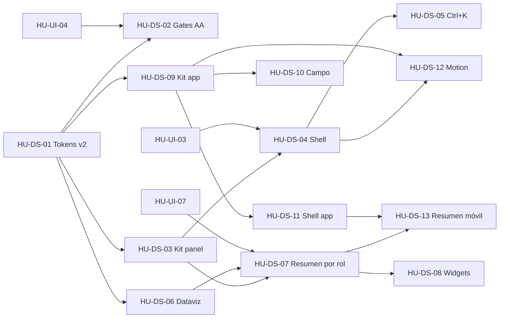

# SPEC-29 · Tareas

| Orden | HU | Título | Tamaño | Depende de |
|---|---|---|---|---|
| 1 | [HU-DS-01](hu/HU-DS-01-tokens-v2.md) | Tokens v2 | M | — |
| 2 | [HU-DS-02](hu/HU-DS-02-contraste-aa-y-gates.md) | Contraste AA y gates del sistema de diseño | M | [HU-DS-01](hu/HU-DS-01-tokens-v2.md), [HU-UI-04](../../03-fase-0-go-live/SPEC-10-panel-confiable/hu/HU-UI-04-calidad-del-panel.md) |
| 3 | [HU-DS-03](hu/HU-DS-03-kit-de-componentes-panel.md) | Kit de componentes v2 del panel y catálogo | L | [HU-DS-01](hu/HU-DS-01-tokens-v2.md) |
| 4 | [HU-DS-09](hu/HU-DS-09-kit-de-componentes-app.md) | Kit de componentes de la app | L | [HU-DS-01](hu/HU-DS-01-tokens-v2.md) |
| 5 | [HU-DS-04](hu/HU-DS-04-shell-adaptativo-del-panel.md) | Shell adaptativo del panel | L | [HU-DS-03](hu/HU-DS-03-kit-de-componentes-panel.md), [HU-UI-03](../../03-fase-0-go-live/SPEC-10-panel-confiable/hu/HU-UI-03-shell.md) |
| 6 | [HU-DS-05](hu/HU-DS-05-paleta-de-comandos-y-atajos.md) | Paleta de comandos y atajos | M | [HU-DS-04](hu/HU-DS-04-shell-adaptativo-del-panel.md) |
| 7 | [HU-DS-10](hu/HU-DS-10-cobranza-de-campo-con-el-kit.md) | Cobranza de campo con el kit nuevo | L | [HU-DS-09](hu/HU-DS-09-kit-de-componentes-app.md) |
| 8 | [HU-DS-06](hu/HU-DS-06-primitivas-de-visualizacion.md) | Primitivas de visualización de datos | M | [HU-DS-01](hu/HU-DS-01-tokens-v2.md) |
| 9 | [HU-DS-07](hu/HU-DS-07-resumen-modular-por-rol.md) | Resumen modular por rol | L | [HU-DS-03](hu/HU-DS-03-kit-de-componentes-panel.md), [HU-DS-06](hu/HU-DS-06-primitivas-de-visualizacion.md), [HU-UI-07](../SPEC-13-vistas-profesionales/hu/HU-UI-07-dashboard-con-tendencias.md) |
| 10 | [HU-DS-08](hu/HU-DS-08-widgets-reorganizables.md) | Widgets reorganizables | M | [HU-DS-07](hu/HU-DS-07-resumen-modular-por-rol.md) |
| 11 | [HU-DS-11](hu/HU-DS-11-shell-del-panel-en-la-app.md) | Shell del panel en la app con cajón lateral y tema oscuro | L | [HU-DS-09](hu/HU-DS-09-kit-de-componentes-app.md) |
| 12 | [HU-DS-12](hu/HU-DS-12-motion-y-microinteracciones.md) | Motion y microinteracciones | M | [HU-DS-04](hu/HU-DS-04-shell-adaptativo-del-panel.md), [HU-DS-09](hu/HU-DS-09-kit-de-componentes-app.md) |
| 13 | [HU-DS-13](hu/HU-DS-13-resumen-movil-por-rol.md) | Resumen móvil por rol | L | [HU-DS-07](hu/HU-DS-07-resumen-modular-por-rol.md), [HU-DS-11](hu/HU-DS-11-shell-del-panel-en-la-app.md) |

**Esfuerzo**: 6 M + 7 L ≈ 80 días-persona sin IA.

## Roadmap por fases (de lo rápido a lo avanzado)

| Fase | HU | Qué se ve al terminar | Por qué va en este orden |
|---|---|---|---|
| **A · Quick wins** (≈ 1 semana con IA) | [HU-DS-01](hu/HU-DS-01-tokens-v2.md), [HU-DS-02](hu/HU-DS-02-contraste-aa-y-gates.md) | Badges y CTA legibles en claro y oscuro. El CI falla si un token rompe AA o si aparece un hex suelto | Arregla lo que hoy incumple la DoD y pone la red antes de tocar pantallas |
| **B · Fundaciones** (2 frentes en paralelo) | [HU-DS-03](hu/HU-DS-03-kit-de-componentes-panel.md) (panel) · [HU-DS-09](hu/HU-DS-09-kit-de-componentes-app.md) (app) | Catálogo vivo en `/catalogo` y en la pantalla de desarrollo de la app | Sin kit, cada pantalla nueva repite estilos. [SPEC-13](../SPEC-13-vistas-profesionales/spec.md) arranca sobre esto |
| **C · Navegación** | [HU-DS-04](hu/HU-DS-04-shell-adaptativo-del-panel.md), [HU-DS-05](hu/HU-DS-05-paleta-de-comandos-y-atajos.md) | Sidebar plegable con migas y pestañas. Ctrl+K para ir a cualquier parte | Es lo que el dueño nota en la primera demo |
| **D · Campo** (en paralelo con C) | [HU-DS-10](hu/HU-DS-10-cobranza-de-campo-con-el-kit.md) | La app de campo con el lenguaje nuevo y las mismas vistas, por OTA gradual | Protege el diferencial: solo visual y con despliegue reversible |
| **E · Resumen** | [HU-DS-06](hu/HU-DS-06-primitivas-de-visualizacion.md), [HU-DS-07](hu/HU-DS-07-resumen-modular-por-rol.md), [HU-DS-08](hu/HU-DS-08-widgets-reorganizables.md) | Resumen por rol con tendencias, alertas y acciones, personalizable | Depende de los datos con período de [HU-UI-07](../SPEC-13-vistas-profesionales/hu/HU-UI-07-dashboard-con-tendencias.md) |
| **F · App panel y pulido** | [HU-DS-11](hu/HU-DS-11-shell-del-panel-en-la-app.md), [HU-DS-12](hu/HU-DS-12-motion-y-microinteracciones.md), [HU-DS-13](hu/HU-DS-13-resumen-movil-por-rol.md) | Header con hamburguesa y cajón lateral como el panel web, tema oscuro por defecto (D-34), motion uniforme y, al final, el Resumen móvil por rol | [HU-DS-11](hu/HU-DS-11-shell-del-panel-en-la-app.md) solo necesita el kit de la app; [HU-DS-13](hu/HU-DS-13-resumen-movil-por-rol.md) reusa perfiles y widgets de la fase E |

## Paralelismo y coordinación con otras specs

- [HU-UI-08](../SPEC-13-vistas-profesionales/hu/HU-UI-08-filtros-y-tablas.md) (`FilterBar`, [SPEC-13](../SPEC-13-vistas-profesionales/spec.md)) espera a [HU-DS-03](hu/HU-DS-03-kit-de-componentes-panel.md) para usar la `DataTable` v2.
- [HU-UI-07](../SPEC-13-vistas-profesionales/hu/HU-UI-07-dashboard-con-tendencias.md) entrega los datos con período. Su UI la hace [HU-DS-07](hu/HU-DS-07-resumen-modular-por-rol.md) (D-SPEC-29-1).
- Si [HU-UX-02](../SPEC-12-arquitectura-de-informacion/hu/HU-UX-02-menu-v2.md) (menú v2) se cruza con [HU-DS-04](hu/HU-DS-04-shell-adaptativo-del-panel.md), se mergea primero [HU-UX-02](../SPEC-12-arquitectura-de-informacion/hu/HU-UX-02-menu-v2.md).
- La fase D es del repo de la app y no bloquea ni la bloquea nada del panel.

