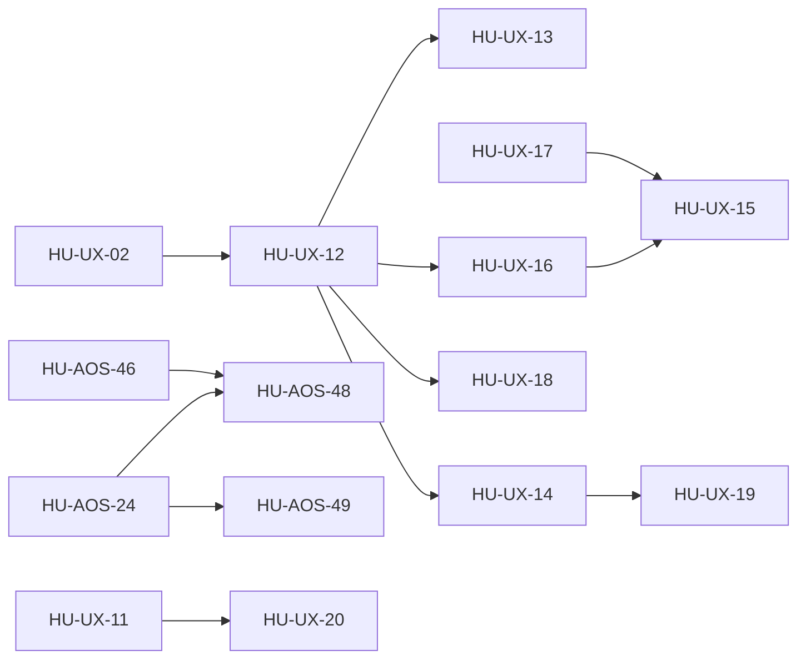

# SPEC-31 · Tareas

| Orden | HU | Título | Tamaño | Depende de |
|---|---|---|---|---|
| 1 | [HU-UX-12](hu/HU-UX-12-arreglos-rapidos-del-ciclo.md) | Arreglos rápidos del ciclo de pruebas | S | [HU-UX-02](../SPEC-12-arquitectura-de-informacion/hu/HU-UX-02-menu-v2.md) |
| 2 | [HU-UX-17](hu/HU-UX-17-motivos-de-escalacion-legibles.md) | Motivos de escalación legibles | M | — |
| 3 | [HU-UX-13](hu/HU-UX-13-avisos-y-formularios-en-espanol.md) | Avisos y formularios en español | M | [HU-UX-12](hu/HU-UX-12-arreglos-rapidos-del-ciclo.md) |
| 4 | [HU-UX-16](hu/HU-UX-16-clientes-estilo-agent-sale.md) | Clientes estilo agent-sale | L | [HU-UX-12](hu/HU-UX-12-arreglos-rapidos-del-ciclo.md) |
| 5 | [HU-UX-15](hu/HU-UX-15-bandeja-de-conversaciones.md) | Bandeja de conversaciones en vivo | L | [HU-UX-16](hu/HU-UX-16-clientes-estilo-agent-sale.md), [HU-UX-17](hu/HU-UX-17-motivos-de-escalacion-legibles.md) |
| 6 | [HU-UX-14](hu/HU-UX-14-shell-v2-y-perfil.md) | Shell v2 y perfil | M | [HU-UX-12](hu/HU-UX-12-arreglos-rapidos-del-ciclo.md) |
| 7 | [HU-UX-18](hu/HU-UX-18-listas-y-formularios-de-seccion.md) | Listas y formularios de las secciones | M | [HU-UX-12](hu/HU-UX-12-arreglos-rapidos-del-ciclo.md) |
| 8 | [HU-UX-19](hu/HU-UX-19-centro-de-notificaciones.md) | Centro de notificaciones | L | [HU-UX-14](hu/HU-UX-14-shell-v2-y-perfil.md) |
| 9 | [HU-AOS-48](hu/HU-AOS-48-onboarding-con-guion-por-agente.md) | Onboarding con guion por agente | L | [HU-AOS-24](../SPEC-26-agent-os/hu/HU-AOS-24-editor-de-agentes.md), [HU-AOS-46](../SPEC-26-agent-os/hu/HU-AOS-46-presets-v2.md) |
| 10 | [HU-AOS-49](hu/HU-AOS-49-pack-de-conocimiento.md) | Pack de conocimiento (RAG) | L | [HU-AOS-24](../SPEC-26-agent-os/hu/HU-AOS-24-editor-de-agentes.md) |
| 11 | [HU-UX-20](hu/HU-UX-20-apk-lo-que-falto-del-ciclo.md) | APK: lo que faltó del ciclo | M | [HU-UX-11](../SPEC-12-arquitectura-de-informacion/hu/HU-UX-11-cajon-de-la-app-con-menu-v2.md) |

## Orden de las olas

- **Primera ola:** UX-12 y UX-17, en paralelo. Tocan archivos distintos: UX-17 es dueña de `lib/labels.ts` (motivos) y de Escalaciones; UX-12, del tooltip, Agentes, Plan y `DataTable`.
- **Segunda ola:** UX-13, que usa el tooltip con portal de UX-12, y UX-16.
- **Tercera ola:** UX-15. Reutiliza la ficha del cliente de UX-16 y los motivos de UX-17.
- **Cuarta ola:** UX-14 y UX-18, en paralelo.
- **Después:**
  - UX-19, que va en la topbar del shell v2;
  - AOS-48 y AOS-49, en paralelo con las de panel porque viven sobre todo en el core;
  - UX-20, que sale por OTA mientras la huella siga en `68a78b…`.

Después de cada ola se despliega en test, con el OK del dueño, y se corren las pruebas del catálogo de esas HU.

