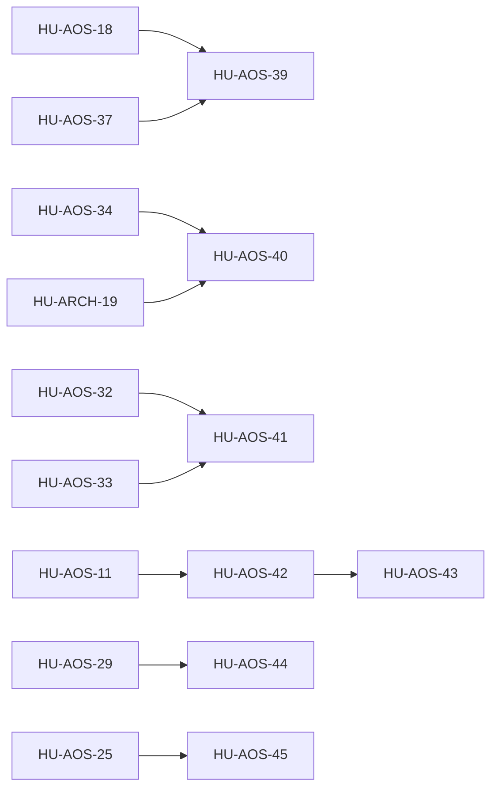

# SPEC-27 · Tareas

| Orden | HU | Título | Tamaño | Depende de |
|---|---|---|---|---|
| 1 | [HU-AOS-39](hu/HU-AOS-39-federacion-entre-negocios.md) | Federación entre negocios con consentimiento | L | [HU-AOS-18](../../04-fase-1-competir/SPEC-26-agent-os/hu/HU-AOS-18-permisos-limites-y-ledger-a2a.md), [HU-AOS-37](../../04-fase-1-competir/SPEC-26-agent-os/hu/HU-AOS-37-cuotas-y-planes.md) |
| 2 | [HU-AOS-40](hu/HU-AOS-40-sandbox-de-acciones.md) | Sandbox aislado para acciones no confiables | L | [HU-AOS-34](../../04-fase-1-competir/SPEC-26-agent-os/hu/HU-AOS-34-acciones-v2.md), [HU-ARCH-19](../../04-fase-1-competir/SPEC-19-extensibilidad-y-operacion/hu/HU-ARCH-19-mcp-por-tenant.md) |
| 3 | [HU-AOS-41](hu/HU-AOS-41-auto-mejora-asistida.md) | Auto-mejora asistida: de fallas a versión candidata | L | [HU-AOS-32](../../04-fase-1-competir/SPEC-26-agent-os/hu/HU-AOS-32-canary-y-auto-rollback.md), [HU-AOS-33](../../04-fase-1-competir/SPEC-26-agent-os/hu/HU-AOS-33-feedback-y-propuestas.md) |
| 4 | [HU-AOS-42](hu/HU-AOS-42-canal-api-y-webhooks.md) | Canal API y webhooks salientes como conexión | M | [HU-AOS-11](../../04-fase-1-competir/SPEC-26-agent-os/hu/HU-AOS-11-conexion-canonica.md) |
| 5 | [HU-AOS-43](hu/HU-AOS-43-slack-y-correo-entrante.md) | Slack y correo entrante como conexiones | L | [HU-AOS-42](hu/HU-AOS-42-canal-api-y-webhooks.md) |
| 6 | [HU-AOS-44](hu/HU-AOS-44-topologia-por-roles.md) | Topología por roles y escalado del runtime | M | [HU-AOS-29](../../04-fase-1-competir/SPEC-26-agent-os/hu/HU-AOS-29-tablero-de-fiabilidad.md) |
| 7 | [HU-AOS-45](hu/HU-AOS-45-editor-de-estructura-de-superpoderes.md) | Editor de estructura de superpoderes para el negocio | L | [HU-AOS-25](../../04-fase-1-competir/SPEC-26-agent-os/hu/HU-AOS-25-superpoderes-en-el-panel.md) |

**Esfuerzo**: 2 M + 5 L ≈ 48,0 días-persona sin IA.

